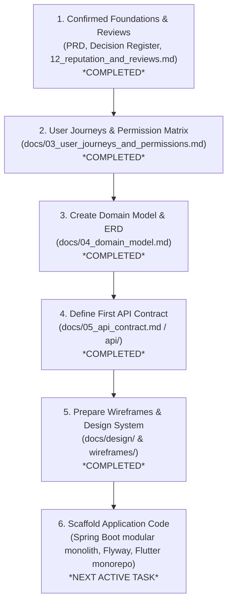

# Hosil Ecosystem — Documentation Index

**Version:** 0.3  
**Date:** 14 October 2026  
**Status:** Active — updated upon Milestone 5 completion  
**Repository:** https://github.com/AsilbekAsqarov17/Hosil_Apps.git  
**Workspace Root:** `c:\Users\Oliya\Desktop\Hosil\`

---

## 1. Canonical Document Map

All active documentation lives strictly under `docs/`. Root-level duplicate files have been inspected, checksum-verified, and safely moved to `docs/archive/` (see [`docs/archive/ARCHIVE_NOTICE.md`](archive/ARCHIVE_NOTICE.md)).

| # | Document | Purpose & Scope | Status |
|---|---|---|---|
| 00 | [`00_documentation_index.md`](00_documentation_index.md) (this file) | Master documentation index, deliverable checklist, roadmap, and blocker register. | **Active** |
| 01 | [`01_prd.md`](01_prd.md) | Canonical Product Requirements Document (PRD): vision, personas (P1–P7), MVP scope per app, core state models, non-functional requirements, and launch blockers. | **Draft** (Review required) |
| 02 | [`02_architecture.md`](02_architecture.md) | Architecture Blueprint (v0.4): Java 21 + Spring Boot modular monolith, PostgreSQL, Flyway, Python/FastAPI AI boundary, module isolation rules, and dev phases. | **Proposed** |
| 03 | [`03_user_journeys_and_permissions.md`](03_user_journeys_and_permissions.md) | Five primary end-to-end user journeys (with sequence/state diagrams, failure paths, data mutations, acceptance criteria) and master 9-role × 50-operation permission matrix with audit rules. | **Draft** (Completed) |
| 04 | [`04_domain_model.md`](04_domain_model.md) | Authoritative relational domain model, Mermaid ER diagrams, PostgreSQL schema tables, check/unique constraints, indexes, allocation ledger, state machines, and concurrency strategy. | **Draft** (Completed v0.1) |
| 05 | [`05_api_contract.md`](05_api_contract.md) | REST API contract: endpoints, DTOs, status codes, pagination, idempotency, versioning for first dev slice. Companion machine-readable spec in [`api/openapi-v1.yaml`](api/openapi-v1.yaml). | **Draft** (Completed v1.0) |
| 06 | `06_security_privacy.md` | Security and privacy review: data classification, access boundaries, uploads, retention, threat model. | **Not started** (Tier 2) |
| 07 | [`07_offline_strategy.md`](07_offline_strategy.md) | Offline-first strategy: which screens work offline, Drift/SQLite schema, sync queue, conflict resolution, image upload queue. | **Proposed** |
| 08 | [`08_observability.md`](08_observability.md) | Observability: structured JSON logging, Actuator health probes, Micrometer/Prometheus metrics, Sentry error tracking, alerting script, pg_dump backup strategy. | **Proposed** |
| 09 | [`09_notifications.md`](09_notifications.md) | Notification architecture: in-app persistent notifications, FCM push, replaceable SMS provider adapter, user preferences, deduplication and retry. | **Proposed** |
| 10 | [`10_admin_and_api_versioning.md`](10_admin_and_api_versioning.md) | Admin panel technology choice (Spring Boot + Thymeleaf recommended) and `/api/v1/` backward compatibility, breaking change rules, and deprecation policy. | **Proposed** |
| 11 | [`11_hosting.md`](11_hosting.md) | Hosting evaluation for Uzbekistan deployment: local UZ VPS vs Hetzner Cloud + Cloudflare, Docker Compose topology, cost estimates (`[UNVERIFIED]`). | **Proposed** |
| 12 | [`12_reputation_and_reviews.md`](12_reputation_and_reviews.md) | Two-sided reputation and transaction review specification: buyer-to-seller, seller-to-buyer, product/listing ratings, double-blind publication window, equal weighting, anti-abuse, and moderation audit rules. | **Implemented & Verified** (Milestone 10) |
| 13 | [`13_payment_integration_blueprint.md`](13_payment_integration_blueprint.md) | Payment integration blueprint and merchant onboarding: provider-neutral settlement options (DEC-007), proposed domain model, webhook HMAC security, dispatch authorization safety gate, KYC onboarding, deterministic test plan, and phased roadmap. | **Implemented & Hardened** (Milestones 6 & 7) |
| 14 | `14_testing_strategy.md` | Comprehensive testing strategy: unit, integration, Testcontainers, failure injection, Definition of Done. | **Not started** (Tier 2) |
| — | [`decision_register.md`](decision_register.md) | Master decision register: records DEC-001 through DEC-018, options, blockers, recommendations, confirmed stakeholder decisions, and ERD dependencies. | **Draft** (Updated) |
| — | [`decisions/ADR-001_modular_monolith.md`](decisions/ADR-001_modular_monolith.md) | Architecture Decision Record: Modular monolith as starting architecture with Python AI exception. | **Accepted** |
| — | [`decisions/ADR-002_admin_panel_thymeleaf.md`](decisions/ADR-002_admin_panel_thymeleaf.md) | Architecture Decision Record: Selection of Spring Boot + Thymeleaf for MVP admin panel. | **Proposed** |
| — | [`archive/ARCHIVE_NOTICE.md`](archive/ARCHIVE_NOTICE.md) | Record of historical root files archived during Phase 0 audit. | **Archived** |
| — | [`api/openapi-v1.yaml`](api/openapi-v1.yaml) | Machine-readable OpenAPI 3.0.3 contract for first implementation slice (Identity, Farm Management, Marketplace Publication Bridge). | **Draft** (Completed v1.0) |
| — | [`docs/design/01_shared_design_system.md`](design/01_shared_design_system.md) | Shared Flutter design tokens, outdoor high-contrast palette, typography, button and error banner components. | **Draft** (Completed v1.0) |
| — | [`docs/design/02_hosil_bozor_ui.md`](design/02_hosil_bozor_ui.md) | Hosil Bozor mobile UI/UX 17-screen inventory, marketplace discovery, single-seller cart, and decoupled review flows. | **Draft** (Completed v1.0) |
| — | [`docs/design/03_hosil_farm_ui.md`](design/03_hosil_farm_ui.md) | Hosil Farm mobile UI/UX 17-screen inventory, offline-first daily activity logging, field mapping, harvest recording, staged AI diagnosis. | **Draft** (Completed v1.0) |
| — | [`docs/design/04_hosil_logistika_ui.md`](design/04_hosil_logistika_ui.md) | Hosil Logistika mobile UI/UX 15-screen inventory, dual-persona mode, origin/destination privacy masking, carrier quotes, POD upload. | **Draft** (Completed v1.0) |
| — | [`docs/design/05_admin_panel_ui.md`](design/05_admin_panel_ui.md) | Hosil Admin panel 8-screen operational inventory, Spring Boot + Thymeleaf/HTMX, seller/listing/review moderation, mandatory audit logging. | **Draft** (Completed v1.0) |

---

## 2. Prioritized Deliverable Checklist

### Tier 1 — Must be ready before major feature implementation

These deliverables define the core business invariants, user flows, and relational schemas. They block the start of coding.

- [x] **PRD** ([`01_prd.md`](01_prd.md)): Product vision, launch region, user personas (P1–P7), MVP scope per app, non-functional targets, launch blockers (§15), and two-sided review requirements (`REV-001`–`REV-010`).
- [x] **User Journeys** ([`03_user_journeys_and_permissions.md`](03_user_journeys_and_permissions.md) Part 1): Six primary end-to-end journeys (Registration, Farm/Field/Cycle, Harvest Publish, Bozor Order/Payment, Logistics Shipment/POD, and Two-Sided Review Exchange) with sequence/state diagrams, failure paths, data mutations, and acceptance criteria (`AC-1.1` to `AC-5.6`, `AC-REV-1` to `AC-REV-8`).
- [x] **Permission Matrix** ([`03_user_journeys_and_permissions.md`](03_user_journeys_and_permissions.md) Part 2): Comprehensive 9-role × 58-operation matrix enforcing dual-layer RBAC+ABAC (role capability + resource ownership/farm membership), review permissions, and exhaustive mandatory audit log operations (`ADM-005`).
- [x] **Two-Sided Reputation & Reviews** ([`12_reputation_and_reviews.md`](12_reputation_and_reviews.md)): Dedicated specification for mutual counterparty evaluation, product reviews, double-blind publishing, equal weighting invariant, anti-abuse controls, and moderation auditability.
- [x] **Decision Register** ([`decision_register.md`](decision_register.md)): Complete catalog of DEC-001 through DEC-018. Formally records stakeholder approval for DEC-003, DEC-004, DEC-005, DEC-006, DEC-008, DEC-009, provider-neutral settlement in DEC-007, and proposed reputation architecture in DEC-018.
- [x] **ADR-001** ([`decisions/ADR-001_modular_monolith.md`](decisions/ADR-001_modular_monolith.md)): Formal acceptance of the modular monolith starting architecture with isolated Python AI boundary.
- [x] **ADR-002** ([`decisions/ADR-002_admin_panel_thymeleaf.md`](decisions/ADR-002_admin_panel_thymeleaf.md)): Proposed adoption of Spring Boot + Thymeleaf for MVP admin back-office.
- [x] **Domain Model / ERD** ([`04_domain_model.md`](04_domain_model.md)): Authoritative relational domain model covering 39 PostgreSQL tables across 7 bounded contexts, explicit allocation ledger (`harvest_allocations`), two-sided reviews (`reviews`), status state machines, mathematical quantity balance invariants, and pessimistic row-locking strategy.
- [x] **API Contract** ([`05_api_contract.md`](05_api_contract.md) & [`api/openapi-v1.yaml`](api/openapi-v1.yaml)): OpenAPI 3.0.3 REST specification for Identity, Farm management, and Marketplace publication bridge (`/api/v1/auth/*`, `/api/v1/users/*`, `/api/v1/farms/*`, `/api/v1/market/harvest-listings`), error envelope, idempotency, and offline batch sync protocol.
- [x] **UI/UX Design Specifications & Wireframes** ([`docs/design/01_shared_design_system.md`](design/01_shared_design_system.md)): Shared design tokens ([`01_shared_design_system.md`](design/01_shared_design_system.md)), dedicated mobile UI specifications for Hosil Bozor ([`02_hosil_bozor_ui.md`](design/02_hosil_bozor_ui.md)), Hosil Farm ([`03_hosil_farm_ui.md`](design/03_hosil_farm_ui.md)), Hosil Logistika ([`04_hosil_logistika_ui.md`](design/04_hosil_logistika_ui.md)), Hosil Admin ([`05_admin_panel_ui.md`](design/05_admin_panel_ui.md)), and 10 standalone SVG wireframes in `docs/design/wireframes/`. *(Completed)*

### Tier 2 — Must be completed incrementally before pilot launch

These deliverables govern operations, security hardening, external integrations, and pilot readiness.

- [x] **Offline Strategy** ([`07_offline_strategy.md`](07_offline_strategy.md)): Specified for Hosil Farm (Drift/SQLite persistence, sync queue, last-write-wins + user notice conflict resolution, image upload queue).
- [x] **Observability & Operations** ([`08_observability.md`](08_observability.md)): Specified for Spring Boot Actuator, structured JSON logging, Prometheus metrics, Sentry, Telegram alerting, daily pg_dump backups.
- [x] **Notification Architecture** ([`09_notifications.md`](09_notifications.md)): Specified for in-app notifications, FCM push, replaceable SMS provider adapter, and user preferences.
- [x] **Admin Panel & API Versioning** ([`10_admin_and_api_versioning.md`](10_admin_and_api_versioning.md)): Specified for Thymeleaf admin screens, `/api/v1/` compatibility rules, deprecation policy, and client version handshake.
- [x] **Hosting Evaluation** ([`11_hosting.md`](11_hosting.md)): Evaluated local UZ VPS vs Hetzner Cloud + Cloudflare, Docker Compose topology, cost estimates marked `[UNVERIFIED]`.
- [x] **Payment Integration Blueprint** ([`13_payment_integration_blueprint.md`](13_payment_integration_blueprint.md)): Authoritative payment blueprint, provider-neutral settlement options (DEC-007), proposed domain model (1:N attempts), webhook HMAC security, dispatch authorization safety gate, KYC onboarding, deterministic test plan, and phased roadmap.
- [ ] **Security & Privacy Review** (`06_security_privacy.md`): Formal data classification, access boundaries, threat model, and retention policy.
- [ ] **Provider Verification** (`integration_checklist.md`): Commercial onboarding status for SMS gateway, payment merchant account (Payme/Click), weather provider (Open-Meteo), and mapping provider.
- [ ] **Comprehensive Testing Strategy** (`14_testing_strategy.md`): Unit, integration, Testcontainers, failure testing, Definition of Done.

---

## 3. Confirmed ERD Foundations and Decision Status

All 18 architectural and product decisions are formally cataloged in [`decision_register.md`](decision_register.md).

### Status of the Foundational Decisions for the Initial ERD

The stakeholder has approved the core direction for the **six foundational decisions**, providing an agreed architectural baseline for `docs/04_domain_model.md`:

| Decision ID | Question | Confirmed Direction | Relational Schema Resolution |
|---|---|---|---|
| **DEC-003** | Authentication method | **Phone OTP primary** (Confirmed) | `users.phone_number` primary identifier; OTP challenge metadata columns; session persistence with inactive re-auth. |
| **DEC-004** | Seller eligibility | **Tiered eligibility** (Confirmed) | `seller_profiles` 1:1 with `users`; `verification_status` enum; open harvest listings with post-moderation; mandatory verification for commercial input sellers. |
| **DEC-005** | Retail vs wholesale in Bozor | **Segmented model** (Confirmed) | Retail inputs; wholesale harvests; mandatory `min_order_quantity` and `increment_step` constraints on listings and orders. |
| **DEC-006** | Purchase request vs binding order | **Segmented order flow** (Confirmed) | Direct order checkout + reservation for inputs; purchase request → seller confirmation → payment for wholesale harvests. Decoupled order and payment state machines. |
| **DEC-007** | Payment settlement | **Provider-neutral core** (Unresolved) | Kept provider-neutral pending legal/tax counsel; settlement-dependent entities marked provisional/deferred. |
| **DEC-008** | Stock & harvest allocation model | **1 batch → multiple listings** (Confirmed) | Each listing links to 1 batch (`listing.harvest_batch_id`); 1 batch can supply multiple listings via an explicit allocation ledger. Overselling prohibited. |
| **DEC-009** | Units of measurement | **Admin-managed catalog** (Confirmed) | Normalized `units_of_measure` table and category mapping join table; `NUMERIC(14, 3)` fixed precision; explicit conversions only. |
| **DEC-018** | Two-sided reputation & reviews | **Two-sided verified reviews** (Proposed) | `reviews`, `review_responses`, `review_reports` tables; double-blind window; unweighted arithmetic mean; decoupled person vs product feedback. |

### Other Key Decisions by Phase Deadline

- **Must resolve before PRD is finalized:** DEC-001 (Pilot geography — Tashkent region recommended), DEC-002 (Languages — Uzbek Latin + Russian recommended), DEC-012 (Delivery responsibility — configurable per listing recommended).
- **Must resolve before Phase 1 (Engineering Foundation):** DEC-015 (Hosting — Hetzner Cloud VPS + Cloudflare recommended), DEC-017 (Data residency — requires legal review of Law ZRU-547 `[DECISION REQUIRED]`).
- **Must resolve before Phase 4 (Bozor Payments):** DEC-007 (Payment recipient & settlement legal structure `[DECISION REQUIRED]`), DEC-010 (Cancellation & refund policy).
- **Must resolve before Phase 5 (Logistika):** DEC-011 (Carrier onboarding vetting — invitation-only during pilot recommended), DEC-013 (Finance partner for leasing `[UNVERIFIED]`).
- **Must resolve before Phase 6 (Advisory):** DEC-014 (Weather provider — Open-Meteo recommended `[UNVERIFIED coverage]`).
- **Must resolve before Phase 8 (Farm AI):** Crop disease dataset provenance, local validation labels, and model thresholding rules.

---

## 4. Phase 0 Roadmap and Immediate Next Milestones

### Detailed Milestone Breakdown

1. **Milestone 1: Review PRD, Decision Register & Reputation Specification** *(Completed)*
   - Recorded stakeholder approval of confirmed directions for DEC-003, DEC-004, DEC-005, DEC-006, DEC-008, DEC-009.
   - Preserved DEC-007 neutrality pending legal review.
   - Authored [`12_reputation_and_reviews.md`](12_reputation_and_reviews.md) establishing two-sided reputation architecture (DEC-018).

2. **Milestone 2: User Journeys & Permission Matrix** *(Completed)*
   - Updated [`03_user_journeys_and_permissions.md`](03_user_journeys_and_permissions.md) with confirmed auth, allocation, and order flows.
   - Added Journey 6: Two-Sided Transaction Review and Rating Exchange.
   - Added Reputation & Review domain to Master Permission Matrix and audit log register (`ADM-005`).

3. **Milestone 3: Create Domain Model and ERD (`docs/04_domain_model.md`)** *(Completed)*
   - Authored [`04_domain_model.md`](04_domain_model.md) defining the complete PostgreSQL schema (39 tables across 7 bounded contexts), mathematical quantity balance invariants, pessimistic row-locking strategy, index plan, and traceability matrix.

4. **Milestone 4: Define First API Contract (`docs/05_api_contract.md` / `api/`)** *(Completed)*
   - Authored [`05_api_contract.md`](05_api_contract.md) and OpenAPI 3.0.3 specification [`docs/api/openapi-v1.yaml`](api/openapi-v1.yaml) covering Identity, Farm management, and the Marketplace harvest publication bridge.

5. **Milestone 5: Prepare Wireframes and Design System (`docs/design/`)** *(Completed)*
   - Authored shared design system ([`docs/design/01_shared_design_system.md`](design/01_shared_design_system.md)), dedicated mobile UI specifications for Hosil Bozor ([`docs/design/02_hosil_bozor_ui.md`](design/02_hosil_bozor_ui.md)), Hosil Farm ([`docs/design/03_hosil_farm_ui.md`](design/03_hosil_farm_ui.md)), Hosil Logistika ([`docs/design/04_hosil_logistika_ui.md`](design/04_hosil_logistika_ui.md)), Hosil Admin panel ([`docs/design/05_admin_panel_ui.md`](design/05_admin_panel_ui.md)), and 10 standalone SVG wireframes in `docs/design/wireframes/`.

6. **Milestone 6A: Repository and Application Foundation** *(Completed)*
   - Scaffolded monorepo: `backend/` (Java 21 + Spring Boot 3.3.4 modular monolith, Flyway migrations V1–V3, Spring Modulith), `infra/docker-compose.yml` (PostgreSQL 16), three Flutter app shells (`apps/hosil_bozor`, `apps/hosil_farm`, `apps/hosil_logistika`), and three shared Flutter packages (`packages/flutter/hosil_design_system`, `packages/flutter/hosil_api_client`, `packages/flutter/hosil_shared_models`).
   - Automated tests and Spring Modulith architectural boundaries verified.

7. **Milestone 6B: Implementation Slices (Identity, Farm Core, & Bozor Marketplace)**
   - **Milestone 6B.1 (Identity & Auth Core):** Phone OTP challenge/verification, HMAC server secret hashing, session rotation, revocation, and user profile management against PostgreSQL and Flyway V1. *(Completed)*
   - **Milestone 6B.2 (Farm, Field, & Crop Cycle Core):** Farm holding creation, membership administration, field and crop cycle management against Flyway V2–V4. *(Completed)*
   - **Milestone 6B.3 (Farm Activities & Offline Synchronization):** Daily activity recording, client mutation idempotency, and batch offline sync (`/api/v1/farms/{farmId}/activities/batch-sync`) against Flyway V5. *(Completed)*
   - **Milestone 6B.4 (Harvest Recording & Bozor Publication Bridge):** Harvest batch recording and atomic Bozor marketplace publication bridge (`/api/v1/market/harvest-listings`) against Flyway V6–V7. *(Completed)*
   - **Milestone 6B.5A (Public Harvest Listing Discovery & Search):** Public read-only marketplace catalog endpoints (`GET /market/harvest-listings/**`) with multi-faceted filtering against Flyway V7. *(Completed)*
   - **Milestone 6B.5B (Buyer Inquiries & RFQ Negotiation):** Two-party negotiation, counteroffer workflows, turn-taking, and formal quotation agreements (`/market/inquiries/**`) against Flyway V8–V9. *(Completed)*
   - **Milestone 6B.6 (Wholesale Order Placement & Lifecycle):** Commercial order creation from agreed RFQ, atomic inventory reservation, seller confirmation, and stage-gated cancellation (`/market/orders/**`) against Flyway V10. *(Completed)*
   - **Milestone 6B.7 (Agricultural-Input Catalog & Seller Offers):** Agricultural input master categories, catalog product discovery, administrative catalog maintenance, and verified commercial supplier offer management (`/market/catalog/**`, `/market/seller/offers/**`) against Flyway V11 (`DEC-004`, `DEC-009`). *(Completed)*
   - **Milestone 6B.8 (Inventory Reservation Expiry & Reliability):** Automated background sweep worker, deterministic locking, timeout release, and order state synchronization (`InventoryReservationExpiryService`). *(Completed)*
   - **Milestone 6B.9 (Agricultural-Input Order Placement & Lifecycle):** Multi-item commercial input ordering, deterministic stock reservation, single-seller order enforcement, MOQ/step validation, and cancellation (`/market/input-orders/**`) against Flyway V12 (`DEC-005`). *(Completed)*
   - **Milestone 6B.10 (Cross-Flow Integrity Hardening):** Global lock hierarchy verification, stock conservation equation auditing, double-release race condition prevention via atomic CAS status transitions, idempotency matrix validation, and cross-flow regression hardening. *(Completed)*
   - **Milestone 6B.11 (Logistics Shipment Requests):** First Hosil Logistika backend slice: shipment request creation optionally linked to wholesale or direct orders or harvest batches (`/api/v1/logistics/shipment-requests`), order/batch eligibility checks, location/contact privacy masking (`LOG-002`, `ACL-006`), carrier profile onboarding and verification (`DEC-011`, `/api/v1/logistics/carrier-profile`), atomic carrier acceptance, strict sequential transit progression (`ACCEPTED` -> `PICKUP_ARRANGED` -> `PICKED_UP` -> `IN_TRANSIT` -> `DELIVERED`), stage-gated cancellation guards, auditable status timeline history (`shipment_status_history`), and Spring Modulith encapsulation against Flyway V13. *(Completed)*
   - **Milestone 6B.12 (Logistics Lifecycle Integrity & Order Integration):** Complete hardening of Hosil Logistika and cross-module linkages: strict cargo unit semantics rejecting implicit conversions of non-mass units or mixed orders without explicit weight (`409 Conflict`), order and harvest batch linkage matrix validation with active shipment duplicate prevention via DB partial unique indexes (`V14__shipment_request_active_linkage_guards.sql`), payment-dispatch boundary blocking cargo pickup (`PICKED_UP`) when order is in `PENDING_PAYMENT` or `CANCELLED`, carrier authorization isolation preventing unverified carriers from accepting shipments, administrative verification endpoint (`PATCH /api/v1/logistics/carrier-profile/{carrierUserId}/verification`), payload-consistent idempotency validation, and terminal state immutability. 161 total backend tests passing. *(Completed)*
   - **Milestone 6B.12.1 (Final Commerce & Logistics Consistency Check):** Audited order-status reachability (`chk_orders_status` has no `PAID` state; input orders reach `PENDING_PAYMENT`, wholesale reach `CONFIRMED`), separated shipment creation from physical dispatch gating, confirmed harvest-batch shipment cardinality across multiple orders and batch-only transport, corrected batch-only active guard in repository to match migration V14 index (`findByHarvestBatchIdAndOrderIdIsNullAndStatusIn`), enabled wholesale order buyers to link backing harvest batches without being farm owner, verified PRD `LOG-001` scope for standalone transport, documented open business decisions for `QUOTED` quoting engine and `EXPIRED` automated sweep. 164 total backend tests passing. *(Completed)*
   - **Milestone 6B.12.2 (Physical Dispatch Authorization Safety Gate):** Comprehensive audit of physical dispatch boundaries: confirmed that seller confirmation (`CONFIRMED`) accepts commercial terms but does not constitute verified financial clearance. Because `DEC-007` remains unresolved and no authoritative payment-verification or dispatch-authorization mechanism exists in the system, implemented a fail-closed technical safety gate blocking physical pickup (`PICKED_UP`) for any order-linked shipment (`409 Conflict`), while preserving standalone transport progression (`PICKUP_ARRANGED` -> `PICKED_UP` -> `IN_TRANSIT` -> `DELIVERED`). 166 total backend tests passing. *(Completed)*

8. **Milestone 6C: Payments, Settlements, & Commerce Reliability**
   - **Milestone 6C.1 (Payment Integration Blueprint & Merchant Onboarding):** Authoritative architecture and documentation milestone for payment integration across Hosil Bozor and Hosil Logistika ([`docs/13_payment_integration_blueprint.md`](13_payment_integration_blueprint.md)). Audited repository reality (no payment tables, no payment endpoints; clarified that single skipped test in surefire is `FlywayPostgresIntegrationTests` due to Testcontainers socket, not a payment test; `orders` status check contains no `PAID` state; physical dispatch fails closed for order-linked shipments). Designed proposed domain model, webhook security architecture, dispatch authorization contract, tiered merchant onboarding specification, deterministic mock payment test plan (10 scenarios), and phased implementation roadmap. Zero database migrations or runtime payment changes applied. *(Completed)*
   - **Milestone 6C.1.1 (Payment Blueprint Legal and Technical Source Validation):** Comprehensive legal and technical validation of [`docs/13_payment_integration_blueprint.md`](13_payment_integration_blueprint.md). Corrected statutory references to Law ZRU-792 "On Electronic Commerce" (including Article 24 on Escrow and Article 9 on Seller Qualifications), Law ZRU-578 "On Payments and Payment Systems", Law ZRU-547 "On Personal Data" (Article 27¹ data residency), and Tax Code Article 378 p.8 (homegrown produce personal income tax exemption). Audited Payme Business and Click developer APIs, proving absence of public turn-key split-settlement or escrow APIs. Reconciled Option A with backend fail-closed dispatch gate (requiring formal `FINANCE_OVERRIDE` or licensed COD transport to operate). Maintained DEC-007 as strictly Unresolved and DEC-010 as Proposed. *(Completed)*
   - **Milestone 6C.1.2 (Legal Effective-Date, Hosting, and Verification Reconciliation):** Focused reconciliation of [`docs/13_payment_integration_blueprint.md`](13_payment_integration_blueprint.md) Version 1.2. Distinguished operative law ZRU-792 from future-effective Law ZRU-1173 (effective 12.12.2026); corrected personal data localization under Law ZRU-547 Article 27¹ as amended by Law ZRU-1125 (effective 27.03.2026, distinguishing mandatory domestic categories from eligible general data); reconciled Law ZRU-792 Article 17 document retention to sectoral equivalence principles (removing blanket 3-year claim); reconciled Central Bank Regulation No. 3336 Account 22650 accounting classification versus commercial banking agreements; reconciled historical test counts (166 vs 164 mathematical Surefire breakdown); preserved DEC-007, DEC-010, and DEC-017 as Unresolved/Proposed. *(Completed)*
   - **Milestone 6C.1.2.1 (Final Payment Blueprint Documentation Corrections):** Narrowly scoped corrections to [`docs/13_payment_integration_blueprint.md`](13_payment_integration_blueprint.md) Version 1.2.1: corrected Law ZRU-792 effective date to 31 December 2022; distinguished current Article 13 platform operator obligations (parts 2 & 3) from future Law ZRU-1173 amendments (effective 12.12.2026); recorded that the 30-day advance notice rule is already in effect under current Art. 13 p.3; clarified that e-commerce registry registration is not an Art. 13 statutory duty (requiring administrative verification with NAPP); reconciled Law ZRU-547 Art. 20 database registration (mandatory only for Art. 27¹ p.2 biometric/genetic/telecom subscriber data, exempting Hosil's customer/farmer database) and clarified that consent under Arts. 13 & 15 is a general legal basis, not an Art. 27¹ cross-border exception; reconciled Art. 17 paper-equivalence retention rules, eliminating CC Art. 150 as a source of mandatory retention, citing Tax Code Art. 88 / Art. 221 (5 years) and Law on Accounting ZRU-404 Art. 29 (5 years), and labeling inquiry/quote/log durations as provisional awaiting legal confirmation; preserved DEC-007 and DEC-017 as Unresolved, DEC-010 as Proposed. *(Completed)*
   - **Milestone 6C.4 (Complete Mobile Navigation and Usable Mobile Applications):** Turned all three Flutter app shells (`hosil_bozor`, `hosil_farm`, `hosil_logistika`) into genuinely navigable mobile applications with responsive category chips, real live catalog discovery, verified active seller offers, honest empty/loading/error states, and physical Android deployment. *(Completed)*
   - **Milestone 6C.5 (Telegram Bot OTP Delivery & Mobile Authentication):** Implemented interchangeable `OtpDeliveryPort` and `TelegramOtpDeliveryAdapter` with Flyway `V16` migration, deep linking (`https://t.me/<bot_username>?start=<token>`), SHA-256 token hashing, sender contact verification, and 190 passing backend tests. Implemented shared `HosilAuthSection` in `hosil_design_system`, wired across all three mobile apps' profile screens, and verified with 0 analyzer issues and all automated Flutter test suites passing. *(Completed)*
   - **Milestone 6 (Marketplace Payment Lifecycle Implementation):** Implemented complete end-to-end payment lifecycle across Hosil Bozor and backend modular monolith against Flyway `V17__marketplace_payment_lifecycle.sql`. Integrated `PaymentGatewayPort`, `MockSandboxPaymentGateway`, `PaymentService`, webhook processing, and Flutter `bozor_payment_sheet.dart` with automated integration tests. *(Completed)*
   - **Milestone 7 (Payment Production Readiness):** Hardened payment subsystem with startup secret validation (`PaymentConfigValidator`), environment-restricted sandbox endpoints (`@Profile("!prod")`), webhook HMAC signature validation, sensitive payload sanitization (`PaymentPayloadSanitizer`), idempotency enforcement, and network failure recovery audit records. *(Completed)*
   - **Milestone 8 (Hosil Farm AI Crop-Disease Scanner):** Implemented AI-assisted crop-disease scanner integrated into Hosil Farm against Flyway `V18__crop_disease_diagnostics.sql`. Enforced isolated AI inference boundary (`CropDiseaseInferencePort`, `MockSandboxCropDiseaseInferenceGateway`), server-side image upload validation (`CropImageValidator`), diagnostic-to-activity conversion, and Flutter camera viewfinder UI with offline capability. *(Completed)*
   - **Milestone 9 & 9.1 (Hosil Logistika Equipment Leasing Lifecycle & Integration):** Implemented complete equipment leasing subsystem across backend modular monolith and Hosil Logistika mobile application against Flyway `V19__equipment_leasing_lifecycle.sql`. Delivered machinery catalog, eligibility checks, financial partner boundary (`LeasingPartnerPort`), stage-gated application state machine, fixed repayment schedules, typed `hosil_api_client` methods, `HttpLogisticsRepository`, and Flutter leasing screens. *(Completed)*
   - **Milestone 10 (Two-Sided Reputation & Reviews):** Implemented two-sided transaction-verified reputation and review subsystem against Flyway `V20__reputation_and_reviews.sql` conforming to `docs/12_reputation_and_reviews.md`. Delivered 14-day double-blind publication window, 7-day single factual rebuttals, mathematical equal weighting ($1.0$), rolling 90-day repeat-pair damping algorithm, content policy & PII filtering, audited administrative moderation (`ADM-005`), Modulith encapsulation via `MarketplaceOrderBridge`, shared Dart models/SDK client, and Hosil Bozor UI widgets. *(Completed)*

---

### Implementation Scope Separation

To prevent premature coupling, decisions are partitioned across project phases:

- **Required before First Implementation Slice (Identity + Farm Core):**
  - Confirmed decisions on DEC-003 (Phone OTP auth), DEC-008 (Farm harvest batch allocation), DEC-009 (Measurement units), and DEC-015/017 (Hosting & data residency baseline).
  - Domain model and Flyway migrations for `users`, `user_profiles`, `user_roles`, `farms`, `fields`, `crop_cycles`, and `farm_activities`.
  - Local Docker Compose environment (PostgreSQL 16).

- **Required only before Marketplace Transactions (Phase 4):**
  - Confirmed decisions on DEC-004 (Seller eligibility verification), DEC-005 (Retail vs wholesale cart rules), DEC-006 (Binding order vs purchase request), DEC-007 (Payment recipient & settlement legal structure), and DEC-010 (Cancellation & refund rules).
  - Payment gateway merchant account onboarding (Payme / Click) [UNVERIFIED].

- **Required only before Logistics & Leasing (Phase 5):**
  - Confirmed decisions on DEC-011 (Carrier onboarding vetting), DEC-012 (Delivery responsibility), and DEC-013 (Finance partner for leasing agreement) [UNVERIFIED].

- **Required only before Farm AI Inference (Phase 8):**
  - Confirmed decisions on DEC-016/017 (AI dataset provenance, local crop disease labels, and validation thresholds). Python + FastAPI service remains completely decoupled until this phase.

---

## 5. Architectural Invariants

Throughout all documentation and subsequent implementation, these constraints remain non-negotiable:
1. **Client Tier:** Three distinct Flutter mobile applications (*Hosil Bozor*, *Hosil Farm*, *Hosil Logistika*) sharing common UI components and API client packages.
2. **Backend Platform:** Java 21 + Spring Boot organized as a modular monolith. No microservice sprawl.
3. **Database & Migrations:** PostgreSQL with Spring Data JPA and Flyway versioned SQL migrations.
4. **AI Boundary:** Python + FastAPI is strictly an isolated inference microservice for crop disease image scanning. Java owns all users, permissions, and business records. Python must never access PostgreSQL directly.
5. **Security:** Authorization checks occur server-side (dual-layer RBAC + ABAC). Hiding a button in Flutter is not security. BOLA is strictly prevented.
