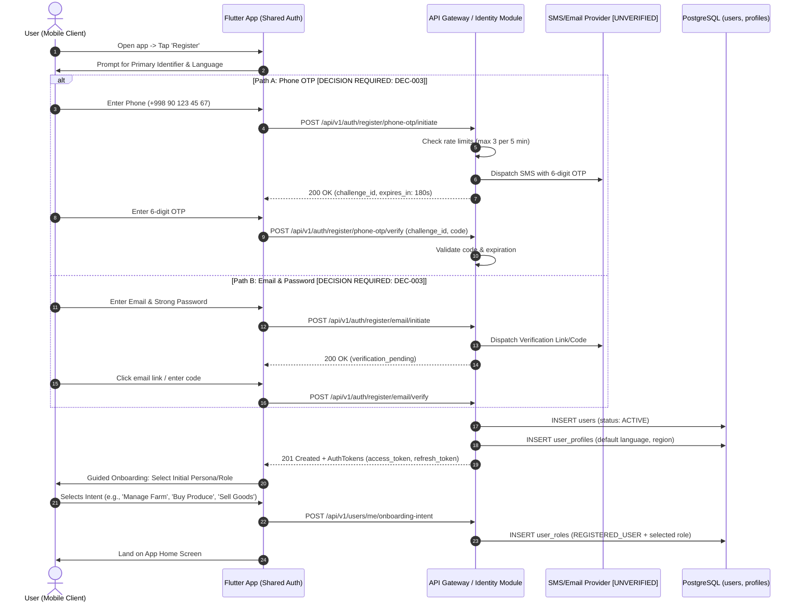
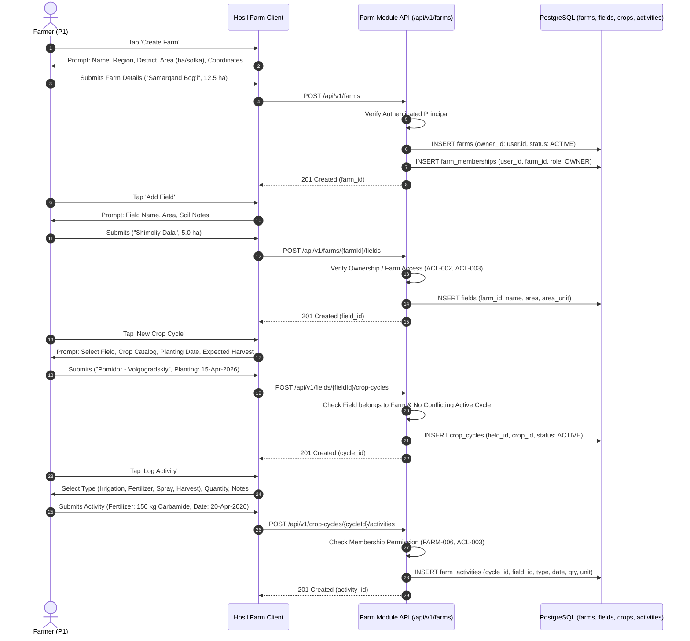
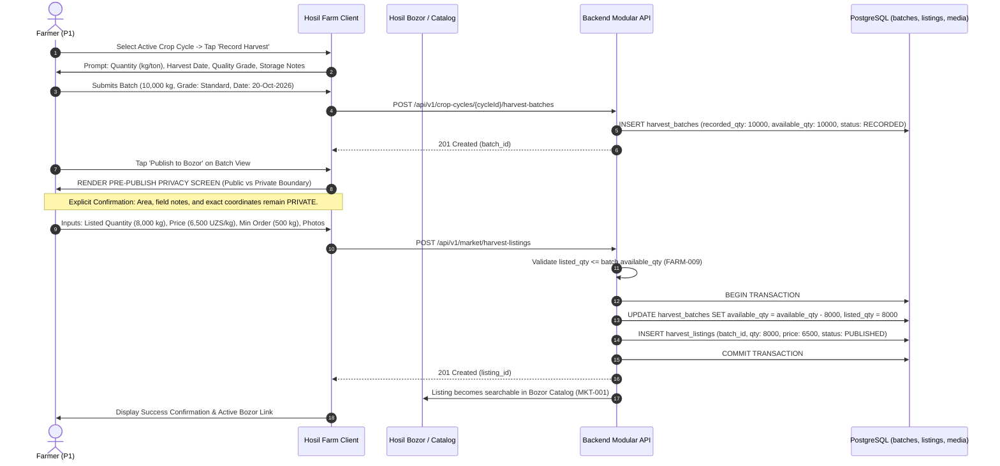
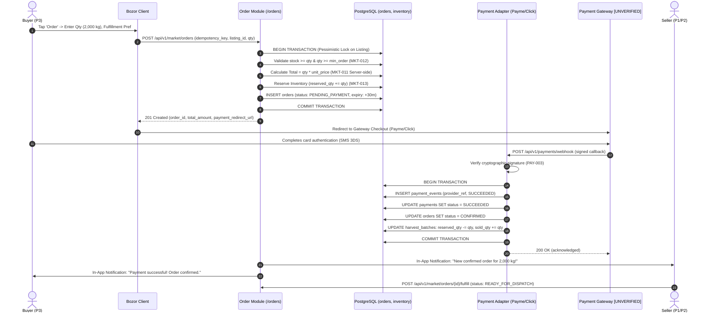
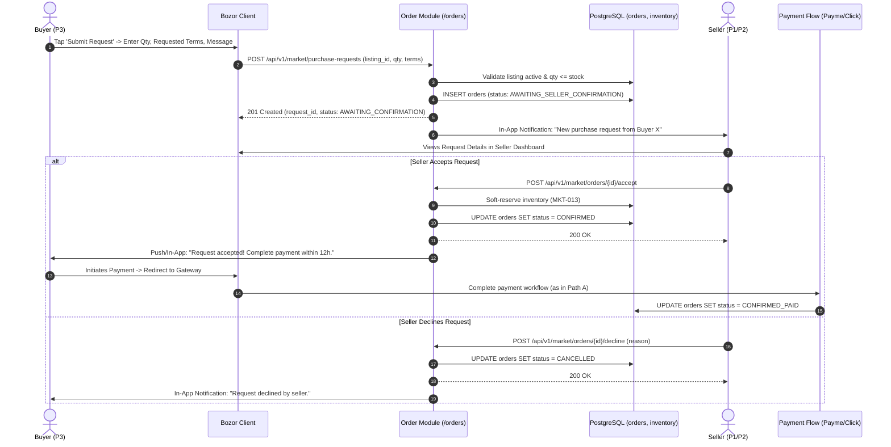
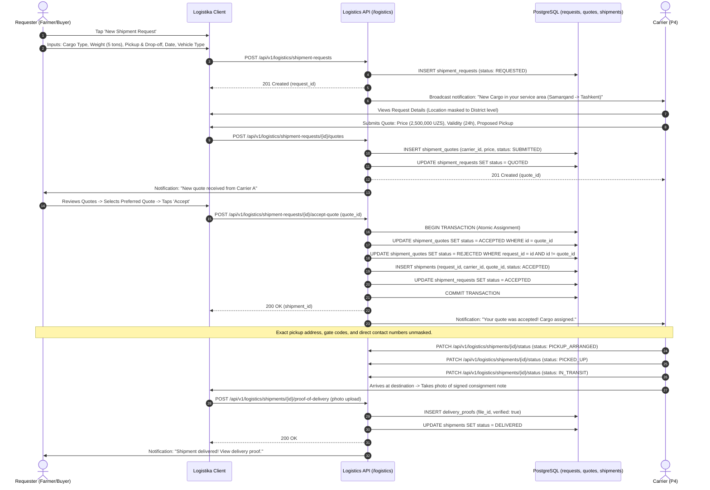
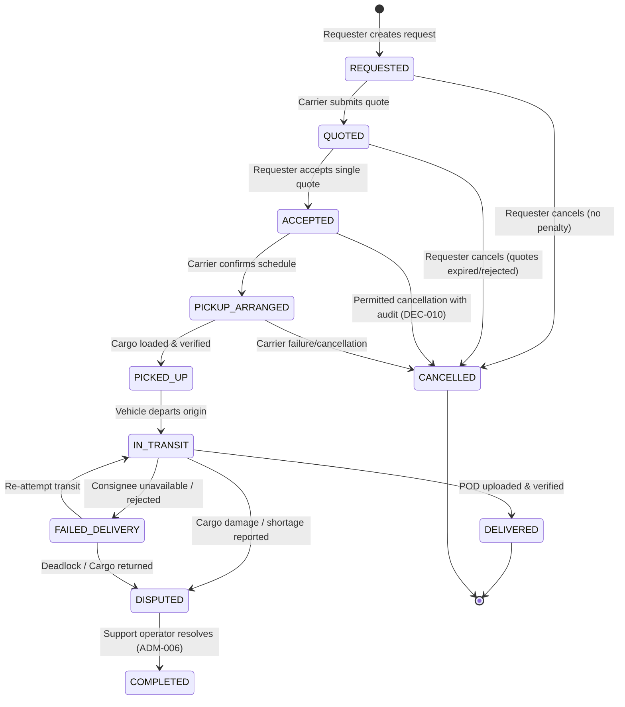
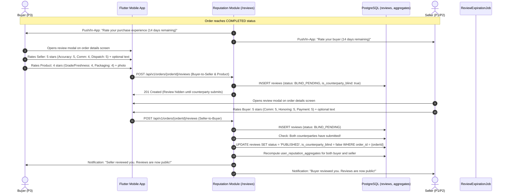
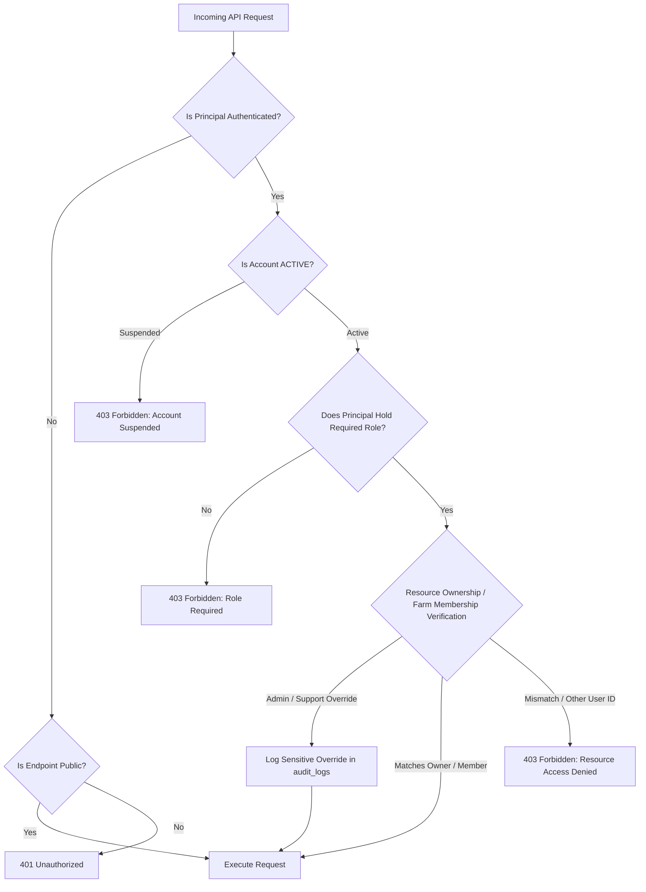

# Hosil Ecosystem — User Journeys and Permission Matrix

**Document ID:** HOSIL-DOC-003  
**Version:** 0.1  
**Status:** Draft — review required before implementation  
**Date:** 13 October 2026  
**Products:** Hosil Bozor, Hosil Farm, Hosil Logistika, Platform Admin  
**Target Market:** Uzbekistan (Initial phase)  
**Authors/Contributors:** Platform Systems & Product Architecture Team  

---

## Document Overview and Standards

This document establishes the end-to-end user journeys and access control policies for the Hosil agricultural ecosystem. It serves as the primary behavioral specification connecting the Product Requirements Document ([01_prd.md](file:///c:/Users/Oliya/Desktop/Hosil/docs/01_prd.md)) with the Technical Architecture Blueprint ([02_architecture.md](file:///c:/Users/Oliya/Desktop/Hosil/docs/02_architecture.md)), Domain Model, and API Contracts.

### Normative Rules and Conventions

1. **Cross-Referencing:** Every workflow step, permission grant, and boundary is cross-referenced with PRD requirement identifiers (e.g., `FARM-008`, `MKT-013`, `PAY-003`, `ACL-001`) and Architecture sections (e.g., `§5`, `§8.1`).
2. **Decision & Assumption Tracking:**
   - Unresolved business or product choices are explicitly tagged with `[DECISION REQUIRED: DEC-xxx]`.
   - Assumptions regarding external infrastructure, legal frameworks, or third-party service provider interfaces are marked with `[UNVERIFIED]`.
   - Implementations must never invent or assume resolutions to marked items; pending decisions branch into documented architectural paths.
3. **Dual-Layer Access Control:** In accordance with PRD `ACL-001` and `ACL-002`, access control is governed by both **Role-Based Access Control (RBAC)** (platform-level capability) and **Resource-Based / Attribute-Based Access Control (ABAC)** (ownership and organizational membership). A valid role grant alone is insufficient to perform operations on individual domain objects.
4. **Idempotency and Resilience:** All write operations that create orders, process payments, or mutate harvest allocations must support client-generated or server-scoped idempotency keys (`MKT-014`, `PAY-004`).

---

# PART 1: USER JOURNEYS

---

## Journey 1: Account Registration, Authentication, Recovery, and Multi-App Access

### 1.1 Overview and Actors
- **Primary Actor:** Any new or returning individual across all ecosystem personas:
  - **P1 Farmer / Farm Manager** ([01_prd.md §2.2](file:///c:/Users/Oliya/Desktop/Hosil/docs/01_prd.md#L56))
  - **P2 Agricultural Supplier** ([01_prd.md §2.2](file:///c:/Users/Oliya/Desktop/Hosil/docs/01_prd.md#L63))
  - **P3 Wholesale / Produce Buyer** ([01_prd.md §2.2](file:///c:/Users/Oliya/Desktop/Hosil/docs/01_prd.md#L68))
  - **P4 Carrier / Logistics Provider** ([01_prd.md §2.2](file:///c:/Users/Oliya/Desktop/Hosil/docs/01_prd.md#L73))
- **Secondary Actor:** Hosil Identity Service (Spring Boot Modular Monolith, [02_architecture.md §5](file:///c:/Users/Oliya/Desktop/Hosil/docs/02_architecture.md#L208)), SMS Gateway / Mail Provider.
- **Goal:** Establish a single verified platform identity (**Hosil ID**) that enables secure, authenticated, and seamless access across Hosil Bozor, Hosil Farm, and Hosil Logistika without redundant credentialing (`ID-001`).

### 1.2 Prerequisites
- The user has installed at least one mobile client (Flutter app: Hosil Farm, Hosil Bozor, or Hosil Logistika).
- Connectivity to the internet is available for initial credential verification and token exchange.

---

### 1.3 Main Flows

#### 1.3.1 Registration Workflow

1. **App Initiation:** The user launches any Hosil mobile application. The shared authentication package (`hosil_auth`, [02_architecture.md §9](02_architecture.md#L437)) renders a localized welcome screen offering **Register** or **Login**.
2. **Identifier Input & Verification (Confirmed: DEC-003):**
   - **Primary Authentication Mode:** Phone-number OTP verification is the confirmed primary authentication standard for the platform across Uzbekistan.
   - **Registration Flow:**
     - User inputs their Uzbekistan MSISDN (format: `+998XXXXXXXXX`).
     - Client invokes `POST /api/v1/auth/register/phone-otp/initiate`.
     - Backend enforces rate limits (max 3 requests per 5 minutes per MSISDN / IP).
     - Backend generates a cryptographically secure 6-digit numeric OTP with an expiration TTL and issues a temporary `challenge_id`.
     - `[UNVERIFIED: SMS delivery provider SLA and cost per message in UZ; specific timeout and rate-limit parameters pending final configuration]`.
     - User inputs the OTP; client posts payload to `POST /api/v1/auth/register/phone-otp/verify`.
     - Backend verifies OTP; challenge is marked consumed (single-use invariant).
   - **Active Session vs Inactivity Re-Authentication:**
     - An active mobile session must **not** require OTP re-authentication on every app opening (`DEC-003`). Tokens are stored in secure device keystore/keychain.
     - If the device session expires after an extended period of inactivity, the user must re-authenticate using phone OTP.
   - **Fallback / Corporate Account Path:** Email and password registration is retained for institutional agricultural corporate entities and desktop back-office administration (`ADR-002`).
3. **Core Profile Creation:** User submits basic profile attributes:
   - Full Name (`full_name`)
   - Preferred Language (`language_code`: `uz_latn` or `ru`, [01_prd.md §2.1](01_prd.md#L45))
   - Geographic Region / Province (`region_id` from canonical administrative list).
4. **Guided Role Onboarding (`ID-002`):** User selects primary starting goal:
   - *"I want to manage my farm"* $\rightarrow$ Assigned role `FARMER`, redirects to Farm Profile Setup (Journey 2).
   - *"I want to buy agricultural products"* $\rightarrow$ Assigned role `BUYER`, lands on Bozor catalog.
   - *"I want to sell agricultural inputs or harvest"* $\rightarrow$ Prompts Seller Setup:
     - Direct farm produce/harvest listings: open to registered farmers under post-moderation ([DEC-004](decision_register.md#dec-004-seller-eligibility)).
     - Commercial agricultural inputs (seeds, fertilizer, machinery): prompts formal business entity and tax verification (`SELLER_VERIFIED`).
   - *"I provide freight / cargo transport"* $\rightarrow$ Prompts Carrier Setup `[DECISION REQUIRED: DEC-011: Logistics vetting flow]`.
5. **Session Establishment:** Backend issues a short-lived JSON Web Token (`access_token`, 15-minute validity) and a long-lived cryptographically random refresh token (`refresh_token`, persisted in PostgreSQL with client fingerprinting, [02_architecture.md §5](02_architecture.md#L218)).

#### 1.3.2 Login Workflow (Returning User)
1. User opens the application and selects **Login**.
2. **Phone OTP (Primary):** User enters registered phone number $\rightarrow$ receives SMS OTP $\rightarrow$ validates code. Active sessions bypass this step until inactivity expiration.
3. **Email/Password (Corporate/Admin):** User enters email and password $\rightarrow$ backend checks bcrypt hash (`$2b$12$`).
4. Backend checks account status in `users.status`:
   - If `ACTIVE`: Issues access and refresh token pair.
   - If `SUSPENDED`: Terminates authentication with `403 Forbidden` (`ACCOUNT_SUSPENDED`), displaying suspension rationale and support contact reference (`ID-003`, `ACL-007`).
5. Client retrieves current permissions and profiles via `GET /api/v1/me`.

#### 1.3.3 Multi-App Single Identity Experience (`ID-001`, `ID-005`)
1. User has previously registered and authenticated in **Hosil Farm** on their mobile device.
2. User subsequently opens **Hosil Bozor** or **Hosil Logistika** on the same mobile device.
3. **Token Sharing Mechanism:**
   - Under Android/iOS shared keystore/keychain access groups (using Flutter secure storage scoped to the `uz.hosil` developer app group), the secondary app detects the existing active refresh token.
   - Secondary app submits `POST /api/v1/auth/token/refresh` with the device identifier.
   - Backend validates the token, applies token rotation (invalidates old refresh token, persists and returns new refresh token), and returns an access token scoped to the user's unified Hosil ID.
4. If token rotation fails or refresh token has expired: User is presented with a fast re-authentication prompt (biometric unlock or single-tap OTP request) without re-registering profile details.

---

### 1.4 Alternative and Failure Paths

| Failure Scenario | Trigger / Root Cause | System Behavior & UX Error Handling | Security & Data Invariant |
|---|---|---|---|
| **OTP Delivery Failure** | SMS gateway timeout or invalid routing `[UNVERIFIED]`. | UI displays countdown timer (60s). After 60s, enables 'Resend Code'. Maximum 3 attempts per 5 minutes. On 3rd failure, display "Contact Support" modal (`PLAT-002`). | Rate-limiting tracker stored in Redis/DB with IP and MSISDN keys. |
| **Brute-Force OTP Attack** | Client submits invalid OTP codes repeatedly. | Return `400 Bad Request` with `remaining_attempts`. On 5th failed attempt within a challenge window, invalidate `challenge_id` and enforce a 15-minute cooldown (`ID-004`). | Failed attempts logged to `audit_logs` (`ADM-005`). |
| **Duplicate Identifier** | User registers with phone/email already associated with `ACTIVE` account. | Backend intercepts unique constraint conflict. System returns `409 Conflict` (`ACCOUNT_ALREADY_EXISTS`) and prompts: *"This number is already registered. Would you like to log in instead?"* | Database unique constraint on `users.phone_number` and `users.email`. |
| **Account Suspended** | Account flagged for fraud or policy violation (`ADM-003`). | Backend rejects token generation or invalidates active session tokens. API returns `403 Forbidden` (`ACCOUNT_SUSPENDED`). Client clears cached tokens and renders read-only screen. | Block all write operations at Spring Security filter layer (`ACL-001`). |
| **Network Loss During Registration** | Intermittent 3G/2G connectivity during onboarding. | Flutter client persists entered registration fields in encrypted local SQLite/Hive cache (`07_offline_strategy.md §4`). Form offers "Retry Connection" when network connectivity returns. | Incomplete users not created until challenge verification succeeds. |
| **Account Recovery** | User lost credentials or changed device. | **Path A:** Submit phone $\rightarrow$ verify OTP $\rightarrow$ session restored. **Path B:** Enter email $\rightarrow$ receive time-limited signed password reset token (1 hour TTL) $\rightarrow$ submit `POST /api/v1/auth/password-reset` $\rightarrow$ invalidate all prior refresh tokens. | Prevents session hijacking; revokes all existing sessions (`ID-005`). |

---

### 1.5 Data Created and Modified
- **`users`:** `id` (UUID), `phone_number`, `email`, `status` (`ACTIVE`, `SUSPENDED`, `PENDING_VERIFICATION`), `created_at`, `updated_at`.
- **`user_profiles`:** `id`, `user_id` (FK), `full_name`, `preferred_language` (`uz_latn`, `ru`), `region_id`, `avatar_media_id`.
- **`user_roles`:** `user_id` (FK), `role` (`REGISTERED_USER`, `FARMER`, `BUYER`, `SELLER`, `CARRIER`).
- **`refresh_tokens`:** `id`, `user_id` (FK), `token_hash`, `device_id`, `client_app` (`FARM`, `BOZOR`, `LOGISTIKA`), `expires_at`, `is_revoked`.
- **`audit_logs`:** Event record for account registration, status change, or failed security challenges.

### 1.6 Permission and Boundary Checks
- **Public Endpoints:** `POST /api/v1/auth/*` open to `GUEST` role; governed by strict IP-based and identifier-based rate limiters.
- **Protected Actions:** `POST /api/v1/users/me/*` requires valid `Bearer` access token (`ACL-001`).
- **Administrative Override:** Only `ADMINISTRATOR` can mutate `users.status` to `SUSPENDED` (`ADM-003`).

### 1.7 Notifications
- **In-App:** Welcome notification (`PLAT-001`): *"Welcome to Hosil! Your account has been created."*
- **External Dispatch:** OTP dispatch via SMS/Email (strictly transactional; does not contain marketing payload).

### 1.8 Acceptance Criteria
- **AC-1.1:** A new user can complete phone registration and land on their role-specific home screen in under 60 seconds (excluding third-party SMS carrier transmission latency).
- **AC-1.2:** A single Hosil ID credentials record provides authenticated access to Hosil Farm, Hosil Bozor, and Hosil Logistika without separate user accounts (`ID-001`).
- **AC-1.3:** A user whose status is `SUSPENDED` is completely blocked from write endpoints, and all active access/refresh tokens are immediately rejected (`ID-003`).
- **AC-1.4:** Brute-force attacks against the OTP endpoint trigger a lockout after 5 consecutive failures for a duration of 15 minutes (`ID-004`).
- **AC-1.5:** Token revocation server-side immediately renders the refresh token unusable across all client applications (`ID-005`).

---

## Journey 2: Farmer Creates Farm, Field, Crop Cycle, and Records Activities

### 2.1 Overview and Actors
- **Primary Actor:** Farmer / Farm Owner (`P1 Persona`, [01_prd.md §2.2](file:///c:/Users/Oliya\Desktop\Hosil\docs\01_prd.md#L56)).
- **Secondary Actor:** Authorized Farm Member (`P7 Persona`, [01_prd.md §2.2](file:///c:/Users/Oliya\Desktop\Hosil\docs\01_prd.md#L89)), Hosil Farm Backend Module ([02_architecture.md §2.2](file:///c:/Users/Oliya\Desktop\Hosil\docs\02_architecture.md#L81)).
- **Goal:** Establish agricultural operational structure by registering farm land, segmenting into physical fields, establishing crop production cycles, and logging routine agronomic operations (`FARM-001` through `FARM-006`).

### 2.2 Prerequisites
- Authenticated user account holding the `FARMER` role.
- Active farm management session in the Hosil Farm application.

---

### 2.3 Main Flow

1. **Farm Profile Creation (`FARM-001`, `FARM-003`):**
   - Farmer navigates to the Farm workspace and taps **Create Farm**.
   - Farmer inputs:
     - Farm Name (`name`: e.g., *"Bo'ston Zamin Baraka"*)
     - Region and District (`region_id`, `district_id`)
     - Total Area and Unit (`total_area`: e.g., `15.5`, `area_unit`: `HECTARE` or `SOTKA`)
     - Optional Coordinates (`latitude`, `longitude` or centroid point; kept private per `ACL-008`).
   - App posts to `POST /api/v1/farms`.
   - Backend establishes the farm record and automatically inserts a record into `farm_memberships` assigning the creator as `OWNER`.
2. **Field Management (`FARM-004`):**
   - Farmer opens the created farm and selects **Add Field**.
   - Inputs: Field Name / Label (e.g., *"1-Dala Bog'"*), Field Area (e.g., `4.5` hectares), optional soil type or irrigation infrastructure notes.
   - App posts to `POST /api/v1/farms/{farmId}/fields`.
   - Backend validates that the total field area does not exceed farm total bounds (warning/soft validation) and binds field to `farm_id`.
3. **Crop Cycle Initialization (`FARM-005`):**
   - Farmer selects the field and taps **New Crop Cycle**.
   - Inputs: Crop selection from system catalog (`crop_id`: e.g., Tomato, Cotton, Apple, Wheat), Planting Date (`planting_date`), Expected Harvest Window (`expected_harvest_start`, `expected_harvest_end`), Planted Area (`planted_area`).
   - App posts to `POST /api/v1/fields/{fieldId}/crop-cycles`.
   - Backend creates record in `crop_cycles` with `status: ACTIVE`.
4. **Daily Agronomic Activity Recording (`FARM-006`):**
   - Farmer taps **Log Activity** within the active crop cycle view.
   - Inputs:
     - Activity Type (`PLANTING`, `IRRIGATION`, `FERTILIZATION`, `CHEMICAL_TREATMENT`, `SCOUTING_INSPECTION`, `SOIL_TILLAGE`, `HARVEST`).
     - Execution Date and Time (`activity_date`).
     - Material / Input Quantity & Unit (e.g., `200` `KG` of Ammonium Nitrate).
     - Agronomic notes and optional operational observations.
   - App posts to `POST /api/v1/crop-cycles/{cycleId}/activities`.
   - Record is persisted; agronomic timeline is updated.
5. **Activity History and Filtering:** Farmer reviews logs filtered by field, crop cycle, activity category, or date range.

---

### 2.4 Alternative and Failure Paths

| Failure Scenario | Trigger / Root Cause | System Behavior & UX Error Handling | Security & Data Invariant |
|---|---|---|---|
| **Unauthorized Farm Mutation** | Malicious client alters `{farmId}` to access another farmer's farm (`ACL-002`). | Backend checks `farm_memberships` for `(user_id, farm_id)`. Non-member access returns `403 Forbidden` (`ACCESS_DENIED`). | Zero resource enumeration; prevents Broken Object Level Authorization (`BOLA`). |
| **Invalid Numeric Input** | Farmer enters negative or zero area / quantity values. | Client and server validation (`API-005`) rejects payload with `422 Unprocessable Entity` (`INVALID_AREA_VALUE`). | Database check constraints (`area > 0`, `quantity >= 0`). |
| **Cross-Farm Association** | Request attempts to attach a crop cycle to a field belonging to a different farm. | Backend transaction verifies `field.farm_id == target_farm_id`. Mismatch triggers `400 Bad Request` (`CROSS_FARM_ASSOCIATION_PROHIBITED`). | Foreign key relational integrity enforced at service layer. |
| **Offline Operation Logging** | Farmer is in a remote field with no GSM connection. | Mobile client commits activity locally to SQLite sync table (`07_offline_strategy.md §3`). UI indicates "Saved locally (Pending Sync)". Background sync pushes when network resumes. | Client assigns client-generated UUID; backend verifies and deduplicates via unique constraint. |
| **Activity Modification Audit** | Farmer corrects fertilizer amount logged 3 days prior. | Allowed for farm `OWNER` or creator. Backend preserves original record in `activity_audit_logs` (`FARM-006`). | Historical audit immutability. |
| **Activity Record Deletion** | Farmer attempts to delete an erroneous activity log. | **[DECISION REQUIRED: DEC-007 / DEC-012]** Recommended policy: **Soft Delete with Audit**. System sets `deleted_at = NOW()`, preserving historical entries for financial/traceability integrity. Hard deletion is prohibited. | Maintains traceable agronomic chain of custody. |

---

### 2.5 Data Created and Modified
- **`farms`:** `id`, `owner_user_id`, `name`, `region_id`, `district_id`, `total_area`, `area_unit`, `latitude`, `longitude`, `status` (`ACTIVE`, `ARCHIVED`).
- **`farm_memberships`:** `id`, `farm_id` (FK), `user_id` (FK), `role` (`OWNER`, `MANAGER`, `WORKER`), `created_at`.
- **`fields`:** `id`, `farm_id` (FK), `name`, `area`, `area_unit`, `soil_notes`, `status` (`ACTIVE`, `INACTIVE`).
- **`crop_cycles`:** `id`, `field_id` (FK), `crop_id` (FK), `planting_date`, `expected_harvest_start`, `expected_harvest_end`, `status` (`PLANNED`, `ACTIVE`, `COMPLETED`, `ABANDONED`).
- **`farm_activities`:** `id`, `crop_cycle_id` (FK), `field_id` (FK), `activity_type`, `activity_date`, `quantity`, `unit`, `notes`, `created_by_user_id`, `created_at`.

### 2.6 Permission and Boundary Checks
- **Farm Creation:** Any authenticated user holding `FARMER` role (`ACL-001`).
- **Field & Cycle Management:** Requires `farm_memberships` record with role `OWNER` or `MANAGER` (`ACL-003`).
- **Activity Logging:** Permitted for `OWNER`, `MANAGER`, or `WORKER` assigned to the farm.
- **Privacy Boundary:** Farm coordinates, field geometries, and activity logs are strictly confidential; never exposed to marketplace buyers or public endpoints (`ACL-008`).

### 2.7 Notifications
- **In-App:** Operational confirmation; in Phase 1 team features, worker activity logs notify farm manager/owner (`PLAT-001`).

### 2.8 Acceptance Criteria
- **AC-2.1:** A farmer can set up a farm, define a field, start a crop cycle, and record an agronomic activity in a continuous offline/online flow within 3 minutes (`FARM-001` - `FARM-006`).
- **AC-2.2:** A crop cycle cannot reference a field ID belonging to another farm; attempts are rejected with `400 Bad Request`.
- **AC-2.3:** A single user can create and independently switch between multiple distinct farm accounts (`FARM-003`).
- **AC-2.4:** Direct API invocation targeting another user's farm ID returns `403 Forbidden` with zero data leakage (`ACL-002`).
- **AC-2.5:** Modifications to saved activities maintain an audit log recording editor ID, prior values, and timestamp.

---

## Journey 3: Farmer Records Harvest and Publishes to Hosil Bozor

### 3.1 Overview and Actors
- **Primary Actor:** Farmer / Produce Producer (`P1 Persona`, [01_prd.md §2.2](file:///c:/Users/Oliya\Desktop\Hosil\docs\01_prd.md#L56)).
- **Secondary Actor:** Hosil Bozor Public Buyers (`P3 Persona`), Marketplace Catalog Module ([02_architecture.md §2.1](file:///c:/Users/Oliya\Desktop\Hosil\docs\02_architecture.md#L64)).
- **Goal:** Transform field production into verified inventory by logging a harvest batch in Hosil Farm, then explicitly publishing an authorized commercial listing on Hosil Bozor while preserving private operational data (`FARM-007`, `FARM-008`, `MKT-004`, `ACL-008`).

### 3.2 Prerequisites
- Active crop cycle exists within Hosil Farm.
- Crop cycle has reached harvest readiness or is currently undergoing harvest.
- User possesses farm ownership or publishing authorization (`ACL-003`, `FARM-008`).

---

### 3.3 Main Flow

1. **Harvest Batch Recording (`FARM-007`):**
   - Farmer opens the active crop cycle in Hosil Farm and taps **Record Harvest**.
   - Input fields:
     - Harvested Crop Type (pre-filled from crop cycle).
     - Total Harvested Quantity and Unit (e.g., `10,000` `KG` or `10` `TON`).
     - Harvest Date (`harvest_date`).
     - Quality Grade / Standard (`grade`: e.g., *Grade 1 / Export*, *Standard / Local Market*, *Processing / Industrial*).
     - Storage Condition & Location Notes (internal reference, e.g., *"Cold store room #2"*).
   - Client invokes `POST /api/v1/crop-cycles/{cycleId}/harvest-batches`.
   - Backend records the batch with:
     - `recorded_quantity = 10000`
     - `available_quantity = 10000`
     - `listed_quantity = 0`, `reserved_quantity = 0`, `sold_quantity = 0`
     - `status = RECORDED`.
2. **Pre-Publish Privacy Boundary Gate (`FARM-008`, `ACL-008`):**
   - Farmer taps **Publish to Hosil Bozor** directly on the harvest batch details screen.
   - The application renders a mandatory **Privacy Confirmation & Field Disclosure Modal**:
     - **PUBLIC TO MARKETPLACE:** Crop type, listed quantity, sale unit, province/district region, quality grade, asking price / RFQ preference, minimum order threshold, uploaded produce photographs, seller business display name.
     - **STRICTLY PRIVATE (NEVER SHARED):** Exact GPS coordinates, cadastral boundaries, historical pesticide/fertilizer spray logs, farm worker names, internal yield calculations, and field storage notes.
   - Farmer must check: *"I understand this harvest will become publicly visible on Hosil Bozor"* (`FARM-008`).
3. **Listing Parameter Configuration (`MKT-004`):**
   - Farmer specifies commercial terms:
     - Quantity to List: e.g., `8,000` kg (enforcing `listed_quantity <= available_quantity`).
     - Pricing Strategy: Fixed Unit Price (e.g., `6,500 UZS / kg`) OR toggle for *"Request for Quote (RFQ) / Negotiable"* (`MKT-004`).
     - Minimum Order Quantity: e.g., `500 kg`.
     - Fulfillment / Delivery Terms: *Pickup from Farm Warehouse* or *Delivery Available via Hosil Logistika*.
     - Media Uploads: Produce photographs meeting size/type validation (`MEDIA-003`).
4. **Publish Execution & Inventory Locking (`FARM-009`, `MKT-005`):**
   - Client executes `POST /api/v1/market/harvest-listings`.
   - Backend opens a database transaction:
     - Evaluates batch status and confirms available balance: `available_quantity >= requested_listing_quantity`.
     - Deducts requested quantity from batch: `available_quantity = available_quantity - 8000`.
     - Increments `listed_quantity = listed_quantity + 8000`.
     - Persists `harvest_listings` record with status `PUBLISHED`.
   - Transaction commits. The listing is instantly indexed into Hosil Bozor search collections (`MKT-001`, `MKT-002`).

---

### 3.4 Alternative and Failure Paths

| Failure Scenario | Trigger / Root Cause | System Behavior & UX Error Handling | Security & Data Invariant |
|---|---|---|---|
| **Quantity Over-Allocation** | Farmer attempts to list `12,000 kg` when batch only has `10,000 kg` available. | Validation halts request before DB write. Backend returns `422 Unprocessable Entity` (`EXCEEDS_AVAILABLE_HARVEST_QUANTITY`). UI highlights error on quantity field (`FARM-009`). | Invariant: `available_qty = recorded_qty - (listed_qty + reserved_qty + sold_qty) >= 0`. |
| **Unauthorized Publishing** | Farm worker with `WORKER` role attempts to publish listing to Bozor. | Backend verifies membership role in `farm_memberships`. Returns `403 Forbidden` (`INSUFFICIENT_FARM_PERMISSIONS`). Publishing restricted to `OWNER` or `MANAGER` (`ACL-003`). | Enforces resource-level permission matrix. |
| **Invalid Pricing** | Farmer submits negative, zero, or unparseable price string. | Backend validation rejects input with `400 Bad Request` (`INVALID_PRICE`). Server enforces `BigDecimal > 0` unless explicitly flagged as `RFQ` (`MKT-011`). | Financial calculations use numeric precision types. |
| **Media Policy Violation** | Farmer uploads unapproved executable or file exceeding 10MB (`MEDIA-003`). | Storage adapter checks MIME magic numbers and file size. Returns `400 Bad Request` (`UNSUPPORTED_MEDIA_TYPE` or `FILE_TOO_LARGE`). | Protects S3 object store and client devices. |
| **Multi-Listing Allocation** | Farmer creates multiple listings from one harvest batch. | **Confirmed Model (DEC-008):** In MVP, each listing links to exactly 1 batch, and 1 harvest batch may supply multiple listings via an explicit allocation ledger. Backend validates that total active allocations do not exceed unallocated batch balance ($\sum \text{allocated\_qty} \le \text{recorded\_qty}$). Over-allocation or overselling is strictly prevented. | Mathematical consistency across listings. |
| **Listing Paused** | Farmer temporarily pauses listing during market price fluctuations. | Farmer taps 'Pause'. Listing status $\rightarrow$ `PAUSED`. Listing hidden from search. `available_quantity` on batch is **NOT** restored, because harvest is still committed to the listing. | Invariant: Pausing preserves allocation. |
| **Listing Archived / Cancelled** | Farmer withdraws listing entirely from marketplace. | Farmer taps 'Archive'. Listing status $\rightarrow$ `ARCHIVED`. Backend atomically returns `listed_quantity` back to batch `available_quantity`: `available_qty = available_qty + listed_qty; listed_qty = 0`. | Restores unencumbered inventory to farm. |

---

### 3.5 Data Created and Modified
- **`harvest_batches`:** `id`, `crop_cycle_id`, `farm_id`, `crop_id`, `recorded_quantity`, `available_quantity`, `listed_quantity`, `reserved_quantity`, `sold_quantity`, `unit`, `harvest_date`, `quality_grade`, `storage_notes`, `status` (`RECORDED`, `PARTIALLY_LISTED`, `FULLY_LISTED`, `DEPLETED`).
- **`harvest_listings`:** `id`, `harvest_batch_id` (FK), `seller_user_id` (FK), `crop_id`, `quantity`, `unit`, `unit_price`, `currency` (`UZS`), `is_rfq`, `minimum_order_quantity`, `region_id`, `fulfillment_type`, `status` (`DRAFT`, `PUBLISHED`, `PAUSED`, `SOLD_OUT`, `ARCHIVED`).
- **`listing_media`:** `id`, `listing_id` (FK), `media_file_id` (FK), `display_order`, `is_primary`.

### 3.6 Permission and Boundary Checks
- **Record Harvest:** Farm `OWNER` or `MANAGER` (`ACL-003`).
- **Publish to Bozor:** Farm `OWNER` or explicit authorized seller delegate (`FARM-008`).
- **Listing Lifecycle Modification:** Exclusively the `seller_user_id` who created the listing or authorized platform `ADMINISTRATOR` (`MKT-006`, `ADM-002`).

### 3.7 Notifications
- **In-App:** Confirmation banner to farmer: *"Your harvest listing for [Crop Name] is now live on Hosil Bozor!"* (`PLAT-001`).

### 3.8 Acceptance Criteria
- **AC-3.1:** Pre-publish screen explicitly itemizes public vs private attributes and requires user confirmation before listing creation (`FARM-008`, `ACL-008`).
- **AC-3.2:** System strictly forbids publishing a quantity greater than the harvest batch's `available_quantity` under all concurrency scenarios (`FARM-009`).
- **AC-3.3:** Farm operational details (field names, coordinates, fertilizer history) do not appear in any public marketplace API response payload (`API-008`).
- **AC-3.4:** The published listing appears in Bozor search queries filtered by crop type and region within 2 seconds of transaction commit (`MKT-001`).
- **AC-3.5:** Archiving a listing restores the remaining unreserved quantity to the underlying farm harvest batch balance (`FARM-009`).
- **AC-3.6:** Duplicate submissions using the same client request idempotency key produce the existing listing without double-decrementing harvest stock (`API-006`).

---

## Journey 4: Buyer Discovers Listing, Places Order/Request, Payment Workflow

### 4.1 Overview and Actors
- **Primary Actor:** Wholesale Produce Buyer / Input Buyer (`P3 Persona`, [01_prd.md §2.2](file:///c:/Users/Oliya\Desktop\Hosil\docs\01_prd.md#L68)).
- **Secondary Actor:** Seller / Produce Producer (`P1/P2 Persona`), Payment Gateway Provider (Payme / Click, `[UNVERIFIED]`, [01_prd.md §6.3](file:///c:/Users/Oliya\Desktop\Hosil\docs\01_prd.md#L330)), Marketplace Order Engine ([02_architecture.md §2.1](file:///c:/Users/Oliya\Desktop\Hosil\docs\02_architecture.md#L64)).
- **Goal:** Enable a buyer to search and evaluate produce/input listings, select goods, execute purchase under the established commercial model, reserve stock safely, and complete authorized payment (`MKT-001`, `MKT-010` - `MKT-017`, `PAY-001` - `PAY-009`).

### 4.2 Prerequisites
- Buyer is registered and authenticated with `BUYER` role (`ACL-005`).
- Active listings exist in Hosil Bozor with positive available inventory (`MKT-001`).
- Payment provider sandbox credentials configured in backend (`PAY-009`).

---

### 4.3 Main Flows — Confirmed Segmented Order Model (DEC-005, DEC-006, DEC-009)

In accordance with confirmed architectural decisions ([DEC-005](decision_register.md#dec-005-retail-vs-wholesale-in-mvp-bozor), [DEC-006](decision_register.md#dec-006-purchase-request-vs-binding-order), [DEC-009](decision_register.md#dec-009-units-of-measurement)), the marketplace operates a segmented transaction model:
- **Flow Path A (Standardized Inputs):** Direct order checkout with automated server-side pricing, inventory reservation, and payment initiation.
- **Flow Path B (Wholesale Harvests):** Two-step purchase request with seller confirmation prior to buyer payment.
- **Payment Settlement Policy:** Remains provider-neutral ([DEC-007](decision_register.md#dec-007-payment-recipient-and-settlement)) pending formal commercial and regulatory counsel.

#### Steps 1–3: Discovery and Evaluation (Common to Both Paths)
1. **Catalog Search & Discovery (`MKT-001`, `MKT-002`):**
   - Buyer opens Hosil Bozor. Navigates categories or searches:
     - Keyword (e.g., *"Pomidor"*), Region (e.g., *"Samarqand"*), Quantity Range, Price Range, Quality Grade.
   - API executes `GET /api/v1/market/search` returning matching active listings.
2. **Listing Inspection (`MKT-008`):**
   - Buyer selects a listing to view detailed specifications:
     - High-resolution verified photos, unit price in UZS, available volume, minimum order quantity, producer region, delivery options, public seller rating.
3. **Checkout Initiation:**
   - Buyer taps **Buy Now / Place Order** (Path A for retail inputs) OR **Submit Purchase Request** (Path B for wholesale harvests).

---

#### Flow Path A: Standardized Agricultural Inputs (Direct Order Model)
*Under this model, purchasing packaged inputs (seeds, fertilizer, machinery) executes an immediate order with inventory reservation.*

4. **Order Submission & Inventory Reservation (`MKT-011`, `MKT-013`, `MKT-014`):**
   - Buyer inputs quantity (e.g., `2,000 kg`) and delivery instructions.
   - Client sends `POST /api/v1/market/orders` with headers `Idempotency-Key: {uuid}`.
   - Backend acquires database lock on `harvest_listings`:
     - Verifies quantity $\le$ current available stock.
     - Calculates order subtotal server-side (`unit_price * quantity`); client calculations are discarded (`MKT-011`).
     - Atomic stock reservation: increments `reserved_quantity`, sets reservation timer (e.g., 30-minute expiration window `[DECISION REQUIRED]`).
     - Inserts record into `orders` with status `PENDING_PAYMENT`.
5. **Payment Provider Hand-off (`PAY-001`, `PAY-007`):**
   - Backend generates payment intent via provider integration adapter (`PaymePaymentAdapter` / `ClickPaymentAdapter`).
   - Order service returns provider redirect URL / deep link.
   - Buyer client transitions to payment screen. No card details ever touch Hosil infrastructure (`PAY-007`).
6. **Provider Callback & Webhook Verification (`PAY-002`, `PAY-003`, `PAY-004`):**
   - External gateway submits HTTP callback to `POST /api/v1/payments/callbacks/{provider}`.
   - Backend validates request HMAC/digital signature using stored secret keys (`PAY-003`).
   - Payment record updated to `SUCCEEDED`.
   - Order state transitions to `CONFIRMED`.
   - Reserved stock converts to `sold_quantity`.
7. **Fulfillment Transition (`MKT-017`):**
   - Seller receives instant notification: *"New confirmed order received — 2,000 kg Tomato"*.
   - Seller prepares packaging $\rightarrow$ marks `PROCESSING` $\rightarrow$ marks `READY_FOR_DISPATCH`.

---

#### Flow Path B: Purchase Request Model (`DEC-006 Option B`)
*Under this model, the buyer submits an inquiry/request requiring manual seller acceptance before any financial obligation or payment takes place.*

4. **Purchase Request Submission (`MKT-009`):**
   - Buyer enters desired volume, delivery expectation, and terms notes.
   - Client sends `POST /api/v1/market/purchase-requests`.
   - Backend creates order in `AWAITING_SELLER_CONFIRMATION`. No immediate payment occurs.
5. **Seller Review & Determination:**
   - Seller receives notification: *"New purchase request for 2,000 kg Tomato"*.
   - Seller evaluates logistic feasibility and inventory availability:
     - **Accept:** Order status transitions to `CONFIRMED`. System reserves inventory with a longer payment window (e.g., 12–24 hours `[DECISION REQUIRED]`). Buyer receives notification to pay.
     - **Decline:** Order status transitions to `CANCELLED` with a documented reason. Buyer is notified.
6. **Subsequent Payment:**
   - Buyer accesses the confirmed request and initiates payment via gateway as documented in Path A.

#### Steps 11–13: Fulfillment, Logistics Handoff, and Completion (Common)
11. **Fulfillment Tracking (`MKT-017`):** Seller marks order `READY_FOR_DISPATCH`.
12. **Logistics Integration Handoff:**
    - If seller/buyer requires third-party transportation, app provides direct link: *"Book Transport on Hosil Logistika"* (initiating Journey 5 with pre-filled cargo parameters).
13. **Completion:** Upon physical receipt and acceptance, order transitions to `COMPLETED`. Both parties receive completion notifications.

---

### 4.4 Alternative and Failure Paths

| Failure Scenario | Trigger / Root Cause | System Behavior & UX Error Handling | Security & Data Invariant |
|---|---|---|---|
| **Stock Depleted Concurrently** | Two buyers order remaining 1,000 kg simultaneously. | First transaction commits. Second transaction fails quantity lock $\rightarrow$ returns `409 Conflict` (`INSUFFICIENT_STOCK_AVAILABLE`). Client displays out-of-stock dialog (`MKT-013`). | Pessimistic/Optimistic locking prevents overselling. |
| **Price Stale at Checkout** | Seller updated price from 5,000 to 6,000 UZS while buyer viewed item. | Server computes total using current stored price. Detects client-provided expected price mismatch $\rightarrow$ returns `409 Conflict` (`PRICE_STALE`). Client displays updated price and asks buyer to re-confirm (`MKT-011`). | Total price is always server-authoritative. |
| **Reservation Timeout Expiration** | Buyer does not complete payment within 30 minutes (Path A). | Scheduled background job (`OrderReservationReaper`, [02_architecture.md §1](file:///c:/Users/Oliya\Desktop\Hosil\docs\02_architecture.md#L42)) queries expired `PENDING_PAYMENT` orders. Releases reserved inventory: `reserved_qty -= qty`, transitions order to `CANCELLED` (`RESERVATION_EXPIRED`). | Prevents phantom inventory lockups. |
| **Payment Provider Timeout** | Provider gateway hangs or fails during bank processing. | Order remains in `PENDING_PAYMENT`. System transitions payment to `UNKNOWN_REQUIRES_RECONCILIATION` (`PAY-005`). Scheduled reconciliation cron polls provider API. | Prevents silent cancellation of potentially paid orders. |
| **Duplicate Provider Webhook** | Network retry sends payment success callback twice (`PAY-004`). | Backend verifies unique `provider_event_id` in `payment_events`. Detects existing entry $\rightarrow$ returns `200 OK` without re-executing inventory state changes. | Webhook processing is strictly idempotent. |
| **Buyer Cancellation Before Payment** | Buyer changes mind on checkout screen. | Buyer taps 'Cancel Order'. Backend releases stock reservation immediately. Order status $\rightarrow$ `CANCELLED` (`DEC-010`). | Instant inventory recovery. |
| **Seller Cancellation After Payment** | Crop damaged by frost before dispatch. | Seller cancels order. Backend triggers automated refund workflow `REFUND_PENDING` $\rightarrow$ payment adapter requests provider refund (`PAY-006`). | Full financial and inventory reversal logged. |

---

### 4.5 Data Created and Modified
- **`orders`:** `id`, `order_number`, `buyer_user_id` (FK), `seller_user_id` (FK), `listing_id` (FK), `quantity`, `unit`, `unit_price`, `total_amount`, `currency` (`UZS`), `status` (`CREATED`, `PENDING_PAYMENT`, `AWAITING_SELLER_CONFIRMATION`, `CONFIRMED`, `PROCESSING`, `READY_FOR_DISPATCH`, `IN_TRANSIT`, `COMPLETED`, `CANCELLED`, `DISPUTED`), `idempotency_key`, `reservation_expires_at`.
- **`order_items`:** `id`, `order_id` (FK), `listing_id` (FK), `snapshot_crop_name`, `snapshot_unit_price`, `quantity`, `unit`, `subtotal`.
- **`order_status_history`:** `id`, `order_id` (FK), `from_status`, `to_status`, `actor_user_id` (FK), `reason`, `created_at`.
- **`payments`:** `id`, `order_id` (FK), `amount`, `currency`, `provider` (`PAYME`, `CLICK`, `SANDBOX`), `provider_reference`, `status` (`CREATED`, `PENDING`, `SUCCEEDED`, `FAILED`, `CANCELLED`, `REFUNDED`, `UNKNOWN_REQUIRES_RECONCILIATION`), `created_at`.
- **`payment_events`:** `id`, `payment_id` (FK), `provider_event_id`, `event_payload_json`, `verification_status`, `created_at`.

### 4.6 Permission and Boundary Checks
- **Place Order:** Any authenticated user holding `BUYER` role (`ACL-005`).
- **View Order:** Strictly restricted to `buyer_user_id` or `seller_user_id` of that specific order record (`MKT-015`, `ACL-002`). Unrelated users receive `403 Forbidden`.
- **Order State Transitions:** State transitions validated against permitted actor matrix (e.g., only seller can mark `READY_FOR_DISPATCH`, only buyer/seller can cancel within allowed policy windows, `MKT-016`, `MKT-017`).
- **Payment Webhook:** Verified via HTTP signature/header tokens against gateway shared secrets; rejected if signature mismatch occurs (`PAY-003`).

### 4.7 Notifications
- **To Buyer:** Order confirmation, payment outcome, seller acceptance/rejection, dispatch notification.
- **To Seller:** New order/request notification, payment received, cancellation alerts (`PLAT-001`).

### 4.8 Acceptance Criteria
- **AC-4.1:** Client attempts to order more than the currently available listing quantity are rejected with `422 Unprocessable Entity` (`MKT-012`).
- **AC-4.2:** Server calculates all totals, fees, and currency values; client-submitted totals in the request payload are discarded (`MKT-011`).
- **AC-4.3:** Concurrency tests simulating 100 simultaneous order requests for the same inventory unit produce zero duplicate sales or oversold balances (`MKT-013`).
- **AC-4.4:** Duplicate submissions with an identical `Idempotency-Key` return the initial order response without generating duplicate database records (`MKT-014`).
- **AC-4.5:** Payment status and order status are governed by separate, decoupled state machines (`PAY-002`).
- **AC-4.6:** A failed or timed-out payment releases reserved inventory back to available stock within 60 seconds of expiration (`MKT-013`, `PAY-005`).
- **AC-4.7:** Direct API queries targeting an order by ID from an unassociated buyer or seller return `403 Forbidden` (`MKT-015`).
- **AC-4.8:** Payment webhook callbacks are cryptographically verified and process idempotently upon multiple delivery attempts (`PAY-003`, `PAY-004`).

---

## Journey 5: Shipment Request, Carrier Quotes, Acceptance, and Delivery

### 5.1 Overview and Actors
- **Primary Actor (Requester):** Farmer or Buyer requiring freight transit (`P1/P3 Persona`, [01_prd.md §2.2](file:///c:/Users/Oliya\Desktop\Hosil\docs\01_prd.md#L56)).
- **Primary Actor (Carrier):** Freight Carrier / Fleet Operator (`P4 Persona`, [01_prd.md §2.2](file:///c:/Users/Oliya\Desktop\Hosil\docs\01_prd.md#L73)).
- **Secondary Actor:** Hosil Logistika Dispatch Module ([02_architecture.md §2.3](file:///c:/Users/Oliya\Desktop\Hosil\docs\02_architecture.md#L98)), Customer Support Operator (`P5 Persona`, `ADM-006`).
- **Goal:** Enable a user with cargo to publish a shipment request, allow verified carriers to bid with quotes, bind an agreement, track transit status, and conclude the freight lifecycle with verified Proof of Delivery (`LOG-001` through `LOG-009`).

### 5.2 Prerequisites
- Requester is authenticated and possesses an existing Bozor order or Farm harvest batch (or manual cargo manifest).
- Carrier has an active, verified carrier profile and designated operational regions (`LOG-003`).

---

### 5.3 Main Flow

1. **Shipment Request Initiation (`LOG-001`):**
   - Requester opens Hosil Logistika and taps **New Shipment Request**.
   - Optional association: selects linked Bozor Order ID or Farm Harvest Batch ID (pre-fills crop type, weight, and general location).
   - Input specifications:
     - Cargo Category & Description (e.g., *"Fresh Apricots, perishable"*).
     - Total Weight and Volume (e.g., `5,000 kg`, `12 m³`).
     - Pickup Location: Province, District, Address, Contact Name/Phone.
     - Drop-off Location: Province, District, Destination Address, Contact Name/Phone.
     - Desired Time Window (`pickup_earliest`, `pickup_latest`, `dropoff_deadline`).
     - Vehicle Requirements (e.g., *Refrigerated / Isothermal Body*, *Flatbed*, *Minimum 5-ton capacity*).
     - Special Handling Notes (e.g., *"Requires delicate stacking"*).
   - Client invokes `POST /api/v1/logistics/shipment-requests`.
   - Backend records request with status `REQUESTED`.
2. **Location Privacy Masking (`LOG-002`, `ACL-006`):**
   - In accordance with location privacy rules, eligible carriers browsing open requests see only general routing (e.g., *"Samarqand, Pastdarg'om $\rightarrow$ Tashkent, Sergeli"*), cargo details, and date windows.
   - Exact street addresses, farm coordinates, and private telephone numbers remain masked until quote acceptance.
3. **Carrier Quote Submission (`LOG-004`):**
   - Carriers operating within the designated corridor receive request dispatch notices.
   - Carrier reviews specifications and submits formal bid via `POST /api/v1/logistics/shipment-requests/{id}/quotes`:
     - Quote Price and Currency (e.g., `2,500,000 UZS`).
     - Validity Window (e.g., valid for 24 hours).
     - Proposed Pickup Time and Vehicle Registration / Driver Details.
     - Specific Carriage Conditions.
   - Backend records `shipment_quotes` and updates request status to `QUOTED`.
4. **Quote Evaluation and Acceptance (`LOG-005`):**
   - Requester views competing carrier quotes side-by-side (comparing price, vehicle specs, carrier rating).
   - Requester selects the winning quote and taps **Accept Quote**.
   - Client invokes `POST /api/v1/logistics/shipment-requests/{id}/accept-quote`.
   - Backend executes atomic transaction:
     - Validates that quote is unexpired and carrier is active.
     - Marks selected quote `ACCEPTED`.
     - Marks all competing quotes for this request as `REJECTED`.
     - Spawns active `shipments` operational record with status `ACCEPTED`.
     - Assigns carrier ID to shipment (`LOG-005`).
   - Unmasks exact contact details and street addresses to the assigned carrier.
5. **Transit Execution & Status Updates (`LOG-006`, `LOG-007`):**
   - Assigned carrier advances shipment through operational stages:
     - `PICKUP_ARRANGED`: Carrier communicates scheduled arrival time.
     - `PICKED_UP`: Carrier arrives at farm/warehouse, loads cargo, verifies weight.
     - `IN_TRANSIT`: Freight is en route.
   - Every transition generates a timestamped record in `shipment_status_history` and dispatches in-app notifications to requester (`PLAT-001`).
6. **Proof of Delivery & Completion (`LOG-008`):**
   - Carrier arrives at destination consignee location.
   - Carrier captures Proof of Delivery (POD): photograph of signed paper CMR/waybill or photo of unloaded produce at consignee warehouse.
   - Carrier uploads POD via `POST /api/v1/logistics/shipments/{id}/proof-of-delivery`.
   - Backend validates image file (`MEDIA-003`), persists `delivery_proofs`, and updates shipment to `DELIVERED`.
   - Requester receives instant notification with delivery proof attachment.

---

### 5.4 Shipment Lifecycle State Diagram

---

### 5.5 Alternative and Failure Paths

| Failure Scenario | Trigger / Root Cause | System Behavior & UX Error Handling | Security & Data Invariant |
|---|---|---|---|
| **No Carrier Quotes Received** | Remote rural origin or peak harvest capacity shortage. | Request remains `REQUESTED`. If no quotes received within 72h, system notifies requester offering: "Extend Window" or "Cancel Request". | Unfilled requests do not block farm operations. |
| **Quote Acceptance Conflict** | Requester attempts to accept quote that expired 5 minutes prior. | Backend checks `quote.valid_until > NOW()`. If expired, returns `409 Conflict` (`QUOTE_EXPIRED`). UI prompts requester to request refreshed quote (`LOG-005`). | Prevents carrier price binding past agreed validity. |
| **Concurrent Quote Acceptance** | Race condition: Requester double-taps accept or accepts two carriers. | Database row-level locking ensures only one quote transitions to `ACCEPTED`. Second invocation fails with `409 Conflict` (`REQUEST_ALREADY_ASSIGNED`). | Invariant: Exactly one assigned carrier per shipment (`LOG-005`). |
| **Unauthorized Status Mutation** | Carrier B attempts to mutate status of Carrier A's shipment (`ACL-006`). | Backend verifies `shipment.carrier_id == authenticated_user.carrier_id`. Non-matching carrier receives `403 Forbidden` (`NOT_ASSIGNED_CARRIER`). | Broken Object Level Authorization strictly prevented (`LOG-007`). |
| **Missing Proof of Delivery** | Carrier attempts to mark `DELIVERED` without attaching POD document. | Backend validation requires `file_id` payload on completion endpoint. Returns `422 Unprocessable Entity` (`PROOF_OF_DELIVERY_REQUIRED`) (`LOG-008`). | Strict transition invariant: `DELIVERED` requires valid POD. |
| **Failed Delivery Attempt** | Consignee warehouse closed upon carrier arrival. | Carrier logs `FAILED_DELIVERY` with explanation and photo. Requester notified immediately to provide resolution instructions. | Recorded in `shipment_status_history`. |
| **Cargo Damage Dispute** | Consignee reports 30% of cargo damaged during transit. | Requester or carrier flags shipment $\rightarrow$ status becomes `DISPUTED`. Case automatically escalated to Hosil Support Admin panel (`ADM-006`). | Freezes payment/settlement until dispute resolution. |

---

### 5.6 Data Created and Modified
- **`shipment_requests`:** `id`, `requester_user_id` (FK), `linked_order_id` (FK, nullable), `linked_harvest_batch_id` (FK, nullable), `cargo_type`, `quantity`, `unit`, `pickup_region_id`, `pickup_address`, `pickup_latitude`, `pickup_longitude`, `dropoff_region_id`, `dropoff_address`, `dropoff_latitude`, `dropoff_longitude`, `pickup_window_start`, `pickup_window_end`, `required_vehicle_type`, `special_instructions`, `status` (`REQUESTED`, `QUOTED`, `ACCEPTED`, `CANCELLED`).
- **`shipment_quotes`:** `id`, `request_id` (FK), `carrier_user_id` (FK), `price`, `currency` (`UZS`), `valid_until`, `proposed_pickup_at`, `vehicle_details`, `terms`, `status` (`SUBMITTED`, `ACCEPTED`, `REJECTED`, `EXPIRED`, `WITHDRAWN`).
- **`shipments`:** `id`, `request_id` (FK), `accepted_quote_id` (FK), `carrier_user_id` (FK), `status` (`ACCEPTED`, `PICKUP_ARRANGED`, `PICKED_UP`, `IN_TRANSIT`, `DELIVERED`, `FAILED_DELIVERY`, `DISPUTED`, `CANCELLED`), `created_at`.
- **`shipment_status_history`:** `id`, `shipment_id` (FK), `from_status`, `to_status`, `actor_user_id` (FK), `notes`, `created_at`.
- **`delivery_proofs`:** `id`, `shipment_id` (FK), `media_file_id` (FK), `proof_type` (`PHOTO_CONSIGNMENT_NOTE`, `RECIPIENT_SIGNATURE`), `uploaded_by_user_id` (FK), `created_at`.

### 5.7 Permission and Boundary Checks
- **Create Request:** Authenticated user holding `FARMER` or `BUYER` role who owns the linked order/harvest (`ACL-002`, `LOG-001`).
- **Browse Requests:** Verified users holding `CARRIER` role (`ACL-006`); location details masked (`LOG-002`).
- **Submit Quote:** Active `CARRIER` profile with verified status (`LOG-003`, `LOG-004`).
- **Accept Quote:** Requester owner exclusively (`LOG-005`).
- **Update Transit Status & Upload POD:** Strictly the assigned carrier (`LOG-007`, `LOG-008`).
- **Dispute Override:** Platform `SUPPORT_OPERATOR` or `ADMINISTRATOR` with documented ticket reference (`ADM-006`).

### 5.8 Notifications
- **To Requester:** New quote received, quote accepted confirmation, carrier pickup schedule, picked up, in-transit, delivered, or dispute raised.
- **To Carrier:** Request broadcast in operating region, quote accepted, quote rejected, cancellation, support inquiry (`PLAT-001`).

### 5.9 Acceptance Criteria
- **AC-5.1:** A shipment request accepts multiple carrier quotes, but accepting a quote atomically assigns exactly one carrier and marks all competing quotes as rejected (`LOG-005`).
- **AC-5.2:** Precise pickup and drop-off contact details and street addresses are strictly hidden from carriers until quote acceptance (`LOG-002`, `ACL-008`).
- **AC-5.3:** A carrier cannot view, edit, or update status for shipments assigned to other carriers (`LOG-007`, `ACL-006`).
- **AC-5.4:** Direct state transitions skipping mandatory intermediate states (e.g., jumping from `REQUESTED` directly to `DELIVERED`) are rejected with `400 Bad Request`.
- **AC-5.5:** Marking a shipment `DELIVERED` strictly requires uploading at least one verified delivery proof image (`LOG-008`).
- **AC-5.6:** Any shipment cancellation records the initiating actor ID, exact timestamp, stage, and explanation text in audit logs (`LOG-009`, `ADM-005`).

---

## Journey 6: Two-Sided Transaction Review and Rating Exchange

### 6.1 Overview and Actors
- **Primary Actors:**
  - **Verified Buyer (`P3 Persona`):** Evaluates seller reliability and physical product quality.
  - **Verified Seller (`P1/P2 Persona`):** Evaluates buyer communication, payment compliance, and pickup reliability.
- **Secondary Actors:**
  - **Reputation Service (`reputation` module, [02_architecture.md §6](02_architecture.md)):** Collects, blinds, aggregates, and publishes reviews.
  - **Support Operator / Admin (`P5 Persona`):** Investigates reported reviews and moderates policy violations.
- **Goal:** Enable mutual, transaction-verified reputation feedback between counterparties following order completion without fear of retaliatory negative scoring, ensuring all reviews are unweighted and transparently calculated (`MKT-018`, `REV-001`–`REV-010`, [12_reputation_and_reviews.md](12_reputation_and_reviews.md)).

### 6.2 Prerequisites
- Order has reached `COMPLETED` status (or formally resolved `CANCELLED_NO_SHOW` with documented fault finding).
- Participating buyer and seller hold active, authenticated accounts.
- Review window of 14 calendar days has not elapsed since order completion (`[PROPOSED: 14 days]`).

---

### 6.3 Main Flow (Double-Blind Rating & Review Submission)

1. **Review Invitation Trigger (`REV-001`):** Upon order transition to `COMPLETED`, backend dispatches in-app and push notification prompts to both buyer and seller.
2. **Buyer Review Submission (`REV-001`, `REV-003`):**
   - Buyer accesses the completed order view and taps **Rate & Review**.
   - **Seller Counterparty Review (`BUYER_TO_SELLER`):** Overall rating (1–5 stars) + structured sub-ratings (Listing Accuracy, Communication, Fulfillment/Dispatch) + optional written review (max 1,000 characters).
   - **Product Review (`LISTING_PRODUCT`):** Product physical quality rating (1–5 stars) + Grade/Freshness + Packaging + up to 3 produce photos (`MEDIA-003`).
   - Client sends `POST /api/v1/orders/{orderId}/reviews`.
   - Backend records reviews with status `BLIND_PENDING`. They are completely hidden from the seller.
3. **Seller Review Submission (`REV-001`):**
   - Seller accesses the completed order view and taps **Rate Buyer**.
   - **Buyer Counterparty Review (`SELLER_TO_BUYER`):** Overall rating (1–5 stars) + structured sub-ratings (Communication, Commitment Honoring, Payment/Handover Punctuality) + optional written review.
   - Client sends `POST /api/v1/orders/{orderId}/reviews`.
   - Backend records review with status `BLIND_PENDING`.
4. **Atomic Double-Blind Publication (`REV-004`):**
   - Because both counterparties have now submitted, backend triggers the atomic unblinding event:
     - Updates review statuses to `PUBLISHED` (`is_counterparty_blind = false`).
     - Recomputes unweighted arithmetic averages in `user_reputation_aggregates` (`REV-002`).
     - Dispatches notification to both parties with public links to their reviews.
5. **Optional Counterparty Response (`REV-010`):**
   - Either party may post **one** single factual rebuttal response (max 500 characters) within 7 days post-publication. Response cannot be further replied to.

---

### 6.4 Alternative and Failure Paths

| Failure Scenario | Trigger / Root Cause | System Behavior & UX Error Handling | Security & Invariant |
|---|---|---|---|
| **Uncompleted Order Review** | Buyer attempts to review order in `PROCESSING` status. | Backend rejects request with `400 Bad Request` (`ORDER_NOT_COMPLETED`). UI renders disabled review button. | Only `COMPLETED` (or permitted `CANCELLED_NO_SHOW`) transactions qualify (`REV-001`). |
| **Duplicate Review Submission** | User submits second review for identical order. | Backend unique constraint rejects request with `409 Conflict` (`REVIEW_ALREADY_EXISTS`). | Max 1 review per type per transaction (`REV-007`). |
| **Self-Review Collusion** | User attempts to review order where `buyer_id == seller_id`. | Backend rejects with `403 Forbidden` (`CANNOT_REVIEW_SELF`). | Prevents self-rating farming. |
| **Window Expiration** | User attempts review 16 days after completion. | Backend rejects with `410 Gone` (`REVIEW_WINDOW_EXPIRED`). Eligibility marked `FORFEITED`. | Enforces temporal bounds (`[PROPOSED: 14 days]`). |
| **Single-Party Submission Expiry** | Buyer submits review; seller never submits within 14 days. | `ReviewExpirationJob` runs upon window expiration; transitions buyer review to `PUBLISHED`; closes seller eligibility without penalty. | Protects single reviewer from indefinite blinding. |
| **Abusive Content / PII** | Free-text commentary contains phone numbers or hate speech. | User reports review (`REV-005`). Review status $\rightarrow$ `FLAGGED`. Admin inspects; if violated, marks `HIDDEN` with mandatory audit reason (`ADM-005`). | Content moderation with auditability. |
| **Failure to Honor Commitment** | Confirmed buyer abandons cargo at farm gate (`CANCELLED_NO_SHOW`). | Seller submits counterparty review under auditable exception policy. Buyer notified and permitted rebuttal. | Documents chronic no-shows under audit control (`REV-006`). |

---

### 6.5 Data Created and Modified
- **`reviews`:** `id`, `order_id` (FK), `order_item_id` (FK, nullable), `author_id` (FK), `target_user_id` (FK, nullable), `target_listing_id` (FK, nullable), `review_type`, `overall_rating` (1–5), `dimension_scores` (JSONB), `commentary`, `status` (`BLIND_PENDING`, `PUBLISHED`, `FLAGGED`, `HIDDEN`, `REMOVED`), `is_counterparty_blind`, `blind_until`, `published_at`.
- **`review_responses`:** `id`, `review_id` (FK, unique 1:1), `author_id` (FK), `response_text`, `created_at`.
- **`review_reports`:** `id`, `review_id` (FK), `reporter_id` (FK), `reason_code`, `details`, `status` (`PENDING`, `DISMISSED`, `ACTIONED`).
- **`user_reputation_aggregates`:** `user_id` (PK), `role_context` (`SELLER`, `BUYER`), `average_rating`, `total_reviews`, `total_completed_orders`, `last_calculated_at`.

### 6.6 Permission and Boundary Checks
- **Submit Review:** Authenticated user who is the confirmed `buyer_id` or `seller_id` of the linked completed order (`ACL-002`, `REV-001`).
- **View Blind Pending Review:** Strictly the submitting author; counterparty cannot access under any API parameters.
- **View Published Reviews:** Public (`GUEST` and all authenticated roles).
- **Moderate / Hide Review:** Platform `SUPPORT_OPERATOR` or `ADMINISTRATOR` with mandatory audit logging (`ADM-005`).

### 6.7 Notifications
- **To Reviewer:** Confirmation of submission; notice when counterparty submits and review becomes public.
- **To Counterparty:** Prompt to review after order completion; notice when review is published with link to post factual response.

### 6.8 Acceptance Criteria
- **AC-REV-1:** Only authenticated buyers and sellers of an order in `COMPLETED` (or permitted `CANCELLED_NO_SHOW`) status can submit reviews.
- **AC-REV-2:** A participant cannot submit more than one review per permitted type for a given transaction (`409 Conflict`).
- **AC-REV-3:** Rating calculations use an unweighted arithmetic mean. Order value, cargo volume, or spending must not amplify review weight.
- **AC-REV-4:** Product physical quality ratings are stored and presented distinctly from seller personal counterparty reputation.
- **AC-REV-5:** Submitted reviews remain completely invisible to the counterparty until either both parties have submitted or the 14-day window expires.
- **AC-REV-6:** Once published, reviews cannot be edited by the author. A counterparty may post at most one factual rebuttal within 7 days.
- **AC-REV-7:** Submitting a negative review (1 star) does not automatically trigger an order refund or dispute status transition.
- **AC-REV-8:** Any administrative action that flags, hides, or restores a review generates an immutable audit record containing operator ID, justification code, and timestamp (`ADM-005`).

---

# PART 2: PERMISSION MATRIX

---

## 1. Principles of Access Control and Authorization Architecture

The Hosil Ecosystem implements a robust **dual-layer access evaluation engine** on the Spring Boot backend (`ACL-001`). Client-side UI element toggling is treated solely as a presentation convenience and is never relied upon for security enforcement.

### Core Authorization Tenets:
1. **Multi-Role User Principal (`ID-002`):** A single user account (`users.id`) can hold multiple roles simultaneously (e.g., a user can be both `FARMER` and `BUYER` and `SELLER`). Capabilities are additive across held roles.
2. **Mandatory Ownership Verification (`ACL-002`):** Holding a platform role grants capability within that functional domain, but never grants universal data access. Every data access operation validates that the requesting principal owns the target resource or possesses authorized membership in the owning entity.
3. **Farm Tenant Isolation (`ACL-003`):** Farm data (fields, crops, activities, private harvest logs) is strictly isolated. Only users with active records in `farm_memberships` for that specific `farm_id` can query or mutate its records.
4. **Least-Privilege Administrative Access (`ACL-007`, `ADM-004`):** Support operators and platform administrators do not have blanket access to private personal information, private farm documents, or unmasked location records. Administrative access requires an active support case or documented investigation rationale and is immutable in audit logs (`ADM-005`).

---

## 2. Platform Role Definitions

| Role Identifier | Description & System Scope | PRD Persona Reference |
|---|---|---|
| **`GUEST`** | Unauthenticated public visitor. Can browse public catalog items and advisory articles. | Anonymous Public |
| **`REGISTERED_USER`** | Verified account baseline. Can view and manage own personal profile and notification settings. | Base Account (`ID-001`) |
| **`FARMER` / `FARM_OWNER`** | Registered agricultural producer. Full ownership of created farms, fields, crop cycles, and harvest records. | **P1 Farmer** |
| **`FARM_MEMBER`** | Delegated farm worker or manager granted scoped access to a specific farm via `farm_memberships`. | **P7 Farm Worker** |
| **`SELLER` / `SUPPLIER`** | Commercial agricultural input vendor or verified producer authorized to list commercial goods. | **P2 Supplier** |
| **`BUYER`** | Commercial wholesaler, institutional purchaser, or retail consumer purchasing produce/inputs. | **P3 Buyer** |
| **`CARRIER`** | Freight transport operator or fleet logistics provider bidding on and executing shipments. | **P4 Carrier** |
| **`SUPPORT_OPERATOR`** | Customer care and operational dispute agent. Narrowly scoped, audited view of transactions. | **P5 Support Staff** |
| **`ADMINISTRATOR`** | Platform system administrator. Category management, listing moderation, account lifecycle governance. | **P5 System Admin** |

---

## 3. Master Permission Matrix

### Legend:
- ✅ **Yes:** Operation permitted unconditionally for this role.
- ❌ **No:** Operation strictly prohibited.
- 🔒 **Own only:** Permitted only if the requesting principal is the resource owner/creator (`ACL-002`).
- 👥 **Farm members:** Permitted only if the user holds an active membership in the target farm (`ACL-003`).
- 📋 **Audited:** Operation generates an immutable security audit entry (`ADM-005`).
- ⚠️ **With case/justification:** Requires an active dispute or support ticket reference and is logged (`ACL-007`).
- ➖ **N/A:** Not applicable to this functional role.

---

### Matrix Table

| Operation / Functional Domain | GUEST | REGISTERED_USER | FARMER / OWNER | FARM_MEMBER | SELLER / SUPPLIER | BUYER | CARRIER | SUPPORT_OPERATOR | ADMINISTRATOR | PRD & Architecture References |
|---|:---:|:---:|:---:|:---:|:---:|:---:|:---:|:---:|:---:|---|
| **ACCOUNT & IDENTITY** | | | | | | | | | | |
| Register account | ✅ | ❌ | ❌ | ❌ | ❌ | ❌ | ❌ | ❌ | ❌ | `ID-001`, `ID-004` |
| Authenticate / Login | ✅ | ✅ | ✅ | ✅ | ✅ | ✅ | ✅ | ✅ | ✅ | `ID-001`, `§5` |
| View own profile & settings | ❌ | 🔒 Own only | 🔒 Own only | 🔒 Own only | 🔒 Own only | 🔒 Own only | 🔒 Own only | 🔒 Own only | 🔒 Own only | `ID-006` |
| Edit own profile & language | ❌ | 🔒 Own only | 🔒 Own only | 🔒 Own only | 🔒 Own only | 🔒 Own only | 🔒 Own only | 🔒 Own only | 🔒 Own only | `ID-006` |
| View another user's public profile | ❌ | ✅ | ✅ | ✅ | ✅ | ✅ | ✅ | ✅ | ✅ | `MKT-008` |
| View another user's private data | ❌ | ❌ | ❌ | ❌ | ❌ | ❌ | ❌ | ⚠️ With case | ⚠️ With case + 📋 | `ACL-007`, `DATA-002` |
| Suspend or reactivate account | ❌ | ❌ | ❌ | ❌ | ❌ | ❌ | ❌ | ❌ | 📋 Audited | `ADM-003`, `ID-003` |
| **FARM MANAGEMENT** | | | | | | | | | | |
| Create new farm profile | ❌ | ✅ | ✅ | ❌ | ❌ | ❌ | ❌ | ❌ | ❌ | `FARM-001`, `FARM-003` |
| View farm details & fields | ❌ | ❌ | 🔒 Own only | 👥 Farm members | ❌ | ❌ | ❌ | ⚠️ With case | ⚠️ With case + 📋 | `FARM-002`, `ACL-003` |
| Edit farm profile / boundaries | ❌ | ❌ | 🔒 Own only | ❌ | ❌ | ❌ | ❌ | ❌ | 📋 Audited | `FARM-002` |
| Add / edit / remove fields | ❌ | ❌ | 🔒 Own only | 👥 Manager only | ❌ | ❌ | ❌ | ❌ | ❌ | `FARM-004` |
| Create / close crop cycle | ❌ | ❌ | 🔒 Own only | 👥 Manager only | ❌ | ❌ | ❌ | ❌ | ❌ | `FARM-005` |
| Log daily farm activity | ❌ | ❌ | 🔒 Own only | 👥 Farm members | ❌ | ❌ | ❌ | ❌ | ❌ | `FARM-006` |
| View farm activity history | ❌ | ❌ | 🔒 Own only | 👥 Farm members | ❌ | ❌ | ❌ | ⚠️ With case | ⚠️ With case + 📋 | `FARM-006`, `ACL-008` |
| Invite farm member [P1] | ❌ | ❌ | 🔒 Own only | ❌ | ❌ | ❌ | ❌ | ❌ | ❌ | `P7 Persona`, `§5` |
| Remove farm member | ❌ | ❌ | 🔒 Own only | ❌ | ❌ | ❌ | ❌ | ❌ | 📋 Audited | `P7 Persona`, `ACL-003` |
| View weather & advisories | ✅ | ✅ | ✅ | ✅ | ✅ | ✅ | ✅ | ✅ | ✅ | `FARM-010`, `FARM-013` |
| **HARVEST OPERATIONS** | | | | | | | | | | |
| Record harvest batch | ❌ | ❌ | 🔒 Own only | 👥 Manager only | ❌ | ❌ | ❌ | ❌ | ❌ | `FARM-007` |
| View own harvest batches | ❌ | ❌ | 🔒 Own only | 👥 Farm members | ❌ | ❌ | ❌ | ⚠️ With case | ⚠️ With case + 📋 | `FARM-007` |
| Publish harvest to Bozor | ❌ | ❌ | 🔒 Own only | ❌ | ❌ | ❌ | ❌ | ❌ | ❌ | `FARM-008`, `ACL-008` |
| Pause / archive harvest listing | ❌ | ❌ | 🔒 Own only | ❌ | ❌ | ❌ | ❌ | ❌ | 📋 Audited | `MKT-005`, `FARM-009` |
| **MARKETPLACE — LISTINGS**| | | | | | | | | | |
| Browse catalog & listings | ✅ | ✅ | ✅ | ✅ | ✅ | ✅ | ✅ | ✅ | ✅ | `MKT-001`, `MKT-002` |
| View public listing details | ✅ | ✅ | ✅ | ✅ | ✅ | ✅ | ✅ | ✅ | ✅ | `MKT-008` |
| Create product offer (Input) | ❌ | ❌ | ❌ | ❌ | ✅ | ❌ | ❌ | ❌ | ❌ | `MKT-003` |
| Create harvest listing | ❌ | ❌ | 🔒 Own only | ❌ | 🔒 Own only | ❌ | ❌ | ❌ | ❌ | `MKT-004` |
| Edit own listing / offer | ❌ | ❌ | 🔒 Own only | ❌ | 🔒 Own only | ❌ | ❌ | ❌ | 📋 Audited | `MKT-006` |
| Suspend / hide listing | ❌ | ❌ | ❌ | ❌ | ❌ | ❌ | ❌ | 📋 Audited | 📋 Audited | `MKT-007`, `ADM-002` |
| Report inappropriate listing | ❌ | ✅ | ✅ | ✅ | ✅ | ✅ | ✅ | ➖ | ➖ | `MKT-007` |
| Manage catalog categories | ❌ | ❌ | ❌ | ❌ | ❌ | ❌ | ❌ | ❌ | 📋 Audited | `ADM-001` |
| **MARKETPLACE — ORDERS** | | | | | | | | | | |
| Place order / request | ❌ | ❌ | ❌ | ❌ | ❌ | ✅ | ❌ | ❌ | ❌ | `MKT-010`, `ACL-005` |
| View order details (as buyer) | ❌ | ❌ | ❌ | ❌ | ❌ | 🔒 Own only | ❌ | ⚠️ With case | ⚠️ With case + 📋 | `MKT-015`, `ACL-002` |
| View order details (as seller)| ❌ | ❌ | 🔒 Own only | ❌ | 🔒 Own only | ❌ | ❌ | ⚠️ With case | ⚠️ With case + 📋 | `MKT-015`, `ACL-004` |
| Accept / decline order | ❌ | ❌ | 🔒 Own only | ❌ | 🔒 Own only | ❌ | ❌ | ❌ | 📋 Audited | `MKT-017` |
| Mark ready for dispatch | ❌ | ❌ | 🔒 Own only | ❌ | 🔒 Own only | ❌ | ❌ | ❌ | ❌ | `MKT-017` |
| Cancel order (permitted stage)| ❌ | ❌ | 🔒 Own only | ❌ | 🔒 Own only | 🔒 Own only | ❌ | 📋 Audited | 📋 Audited | `MKT-016`, `DEC-010` |
| Search all orders globally | ❌ | ❌ | ❌ | ❌ | ❌ | ❌ | ❌ | ⚠️ With case | 📋 Audited | `ADM-004` |
| **PAYMENTS & SETTLEMENT** | | | | | | | | | | |
| Initiate order payment | ❌ | ❌ | ❌ | ❌ | ❌ | 🔒 Own only | ❌ | ❌ | ❌ | `PAY-001`, `PAY-007` |
| View payment status | ❌ | ❌ | 🔒 Own only | ❌ | 🔒 Own only | 🔒 Own only | ❌ | ⚠️ With case | ⚠️ With case + 📋 | `PAY-002`, `PAY-008` |
| Execute payment refund | ❌ | ❌ | ❌ | ❌ | ❌ | ❌ | ❌ | 📋 Audited | 📋 Audited | `PAY-006` |
| Reconcile payment records | ❌ | ❌ | ❌ | ❌ | ❌ | ❌ | ❌ | 📋 Audited | 📋 Audited | `PAY-005` |
| **LOGISTICS & FREIGHT** | | | | | | | | | | |
| Create shipment request | ❌ | ❌ | 🔒 Own only | ❌ | 🔒 Own only | 🔒 Own only | ❌ | ❌ | ❌ | `LOG-001`, `ACL-002` |
| View open requests (masked) | ❌ | ❌ | ❌ | ❌ | ❌ | ❌ | ✅ | ⚠️ With case | ✅ | `LOG-002`, `ACL-006` |
| View own shipment requests | ❌ | ❌ | 🔒 Own only | ❌ | 🔒 Own only | 🔒 Own only | ❌ | ⚠️ With case | ⚠️ With case + 📋 | `LOG-001` |
| Submit quote for request | ❌ | ❌ | ❌ | ❌ | ❌ | ❌ | ✅ | ❌ | ❌ | `LOG-004` |
| Accept carrier quote | ❌ | ❌ | 🔒 Own only | ❌ | 🔒 Own only | 🔒 Own only | ❌ | ❌ | 📋 Audited | `LOG-005` |
| Update shipment transit status| ❌ | ❌ | ❌ | ❌ | ❌ | ❌ | 🔒 Assigned only | ⚠️ With case | 📋 Audited | `LOG-007` |
| Upload Proof of Delivery | ❌ | ❌ | ❌ | ❌ | ❌ | ❌ | 🔒 Assigned only | ❌ | 📋 Audited | `LOG-008` |
| View delivery proof document | ❌ | ❌ | 🔒 Own only | ❌ | 🔒 Own only | 🔒 Own only | 🔒 Assigned only | ⚠️ With case | ⚠️ With case + 📋 | `LOG-008`, `MEDIA-002` |
| **EQUIPMENT LEASING [P1]**| | | | | | | | | | |
| Submit leasing application | ❌ | ❌ | ✅ | ❌ | ❌ | ❌ | ❌ | ❌ | ❌ | `LEASE-001`, `LEASE-002`|
| View own application status | ❌ | ❌ | 🔒 Own only | ❌ | ❌ | ❌ | ❌ | ❌ | ❌ | `LEASE-003` |
| Access finance partner docs | ❌ | ❌ | ❌ | ❌ | ❌ | ❌ | ❌ | ⚠️ With case | ⚠️ With case + 📋 | `LEASE-005`, `DATA-004`|
| **FILES & MEDIA STORAGE** | | | | | | | | | | |
| Upload listing / general photos| ❌ | ✅ | ✅ | ✅ | ✅ | ✅ | ✅ | ❌ | ✅ | `MEDIA-001`, `MEDIA-003`|
| View own private documents | ❌ | 🔒 Own only | 🔒 Own only | 🔒 Own only | 🔒 Own only | 🔒 Own only | 🔒 Own only | ⚠️ With case | ⚠️ With case + 📋 | `MEDIA-002` |
| View another user's documents| ❌ | ❌ | ❌ | ❌ | ❌ | ❌ | ❌ | ⚠️ With case | ⚠️ With case + 📋 | `MEDIA-002`, `ACL-007`|
| Delete own uploaded files | ❌ | 🔒 Own only | 🔒 Own only | 🔒 Own only | 🔒 Own only | 🔒 Own only | 🔒 Own only | ❌ | 📋 Audited | `MEDIA-005` |
| **MARKETPLACE — REPUTATION & REVIEWS** | | | | | | | | | | |
| Submit buyer-to-seller review | ❌ | ❌ | ❌ | ❌ | ❌ | 🔒 Own order | ❌ | ❌ | ❌ | `REV-001`, `REV-003` |
| Submit seller-to-buyer review | ❌ | ❌ | 🔒 Own order | ❌ | 🔒 Own order | ❌ | ❌ | ❌ | ❌ | `REV-001`, `REV-003` |
| Submit listing/product review | ❌ | ❌ | ❌ | ❌ | ❌ | 🔒 Own order | ❌ | ❌ | ❌ | `REV-003`, `REV-007` |
| View published reviews & ratings | ✅ | ✅ | ✅ | ✅ | ✅ | ✅ | ✅ | ✅ | ✅ | `REV-008`, `MKT-008` |
| View blind pending reviews | ❌ | ❌ | 🔒 Author only | ❌ | 🔒 Author only | 🔒 Author only | ❌ | ❌ | ❌ | `REV-004` |
| Submit counterparty response | ❌ | ❌ | 🔒 Target only | ❌ | 🔒 Target only | 🔒 Target only | ❌ | ❌ | ❌ | `REV-010` |
| Report inappropriate review | ❌ | ✅ | ✅ | ✅ | ✅ | ✅ | ✅ | ➖ | ➖ | `REV-005` |
| Moderate / hide review (admin) | ❌ | ❌ | ❌ | ❌ | ❌ | ❌ | ❌ | 📋 Audited | 📋 Audited | `REV-005`, `ADM-005` |
| **SYSTEM & AUDIT GOVERNANCE**| | | | | | | | | | |
| Inspect system audit logs | ❌ | ❌ | ❌ | ❌ | ❌ | ❌ | ❌ | ❌ | 📋 Audited | `ADM-005` |
| Manage support disputes/cases | ❌ | ❌ | ❌ | ❌ | ❌ | ❌ | ❌ | ✅ | ✅ | `ADM-006` |
| Trigger reconciliation job | ❌ | ❌ | ❌ | ❌ | ❌ | ❌ | ❌ | ❌ | 📋 Audited | `PAY-005`, `§8.1` |

---

## 4. Actions Requiring Mandatory Audit Records (`ADM-005`)

In compliance with PRD `ADM-005`, `PAY-008`, and Architecture `§5`, every high-risk, financial, or administrative state modification must generate an immutable record in the PostgreSQL `audit_logs` table.

Audit logs are written within the same database transaction as the business operation where applicable, guaranteeing that the action cannot succeed without the audit event being recorded.

### Audit Log Schema Requirements
Every audit record must include:
- `id`: Unique UUID.
- `timestamp`: UTC ISO-8601 timestamp with microsecond precision.
- `actor_user_id`: UUID of the authenticated principal executing the change.
- `actor_role`: Active role used for authorization.
- `ip_address` & `user_agent`: Network origin identifiers.
- `action_type`: Machine-readable action code (e.g., `ACCOUNT_SUSPENDED`, `ORDER_CANCELLED`).
- `target_entity_type`: Target domain object class (e.g., `Order`, `User`, `Payment`).
- `target_entity_id`: UUID of the target domain object.
- `justification_reason`: Human-readable explanation text or linked Support Ticket ID.
- `state_diff_json`: Sanitized JSON document capturing previous vs updated field states (redacting all passwords, PINs, OTPs, or financial secrets).

### Exhaustive List of Audited Operations

| Action Code | Triggering Event / User Action | Required Audit Context / Metadata | Regulatory / PRD Rationale |
|---|---|---|---|
| **`AUTH_ACCOUNT_SUSPENDED`** | Administrator suspends user account (`ADM-003`). | Reason code, administrative ticket ID, duration, previous status. | Prevents abusive administrative lockouts (`ID-003`). |
| **`AUTH_ACCOUNT_REACTIVATED`** | Administrator restores suspended user account. | Approved ticket reference, restoring administrator ID. | Traceability for fraud restoration. |
| **`MKT_LISTING_MODERATED`** | Admin suspends, hides, or restores a marketplace listing (`ADM-002`). | Flag reason, violation category, previous listing status. | Commercial transparency (`MKT-007`). |
| **`MKT_ORDER_CANCELLED`** | Buyer, seller, or support operator cancels an order (`MKT-016`). | Cancelling actor, stage of cancellation, inventory release delta, refund reference. | Inventory and contractual auditability (`DEC-010`). |
| **`PAY_STATUS_MUTATED`** | Payment moves through state transitions (`PAY-002`). | Provider event ID, transaction reference, amount, currency, status transition. | Financial ledger integrity (`PAY-008`). |
| **`PAY_REFUND_EXECUTED`** | Support or system executes full or partial refund (`PAY-006`). | Amount refunded, original payment ID, operator ID, customer request ID. | Anti-fraud and merchant accounting. |
| **`LOG_CARRIER_ASSIGNED`** | Requester accepts carrier quote, establishing contract (`LOG-005`). | Shipment request ID, quote ID, accepted price, carrier user ID. | Contractual freight liability. |
| **`LOG_POD_UPLOADED`** | Carrier uploads Proof of Delivery to complete shipment (`LOG-008`). | Shipment ID, file storage key, timestamp, carrier user ID. | Delivery verification & cargo release. |
| **`FARM_MEMBERSHIP_ALTERED`** | Farm owner invites, modifies, or evicts a member (`ACL-003`). | Farm ID, affected user ID, granted/revoked role, owner ID. | Agronomic data isolation boundary. |
| **`ADMIN_USER_DATA_ACCESSED`** | Support or Admin inspects private user records (`ACL-007`). | Justification ticket ID, queried user ID, specific fields unmasked. | Minimizes data privacy abuse (`DATA-004`). |
| **`ADMIN_CATEGORY_MUTATED`** | Admin creates, edits, or deletes product catalog category (`ADM-001`). | Category ID, modified hierarchy, previous attributes. | Marketplace taxonomy consistency. |
| **`LEASE_APPLICATION_FORWARD`** | Platform forwards leasing application to finance partner (`LEASE-002`). | Application ID, partner entity ID, customer consent version timestamp. | Regulatory compliance for financing (`LEASE-004`). |
| **`REV_REVIEW_MODERATED`** | Support/Admin flags, hides, or restores a review (`REV-005`). | Review ID, author ID, target ID, moderation action, violation category, previous state. | Content integrity and anti-censorship (`ADM-005`). |
| **`REV_REPORT_ACTIONED`** | Support operator dismisses or upholds review abuse report. | Report ID, review ID, reporter ID, determination rationale code. | Anti-harassment governance. |
| **`REV_UNBLINDED_INSPECTED`** | Admin unblinds pending review during legal or fraud arbitration. | Review ID, order ID, investigative justification ticket ID. | Procedural fairness audit trail. |

---

## 5. Decision and Assumption Index

The following open decisions and assumptions are identified in this specification. Any implementation must consult this index prior to development:

| Tag Reference | Domain | Nature of Item | Impact on Architecture / Workflow |
|---|---|---|---|
| **`DEC-003`** | Identity | `[CONFIRMED DIRECTION]` | Authentication mechanism: **Phone OTP primary**. Shared across all 3 apps. Device sessions persist; inactive sessions re-authenticate via OTP. Parameters (provider, timeout, rate limits) pending ([decision_register.md](decision_register.md#dec-003-authentication-method)). |
| **`DEC-004`** | Bozor | `[CONFIRMED DIRECTION]` | Seller eligibility: Open for harvest produce listings (post-moderated); mandatory business verification for commercial input suppliers ([decision_register.md](decision_register.md#dec-004-seller-eligibility)). |
| **`DEC-005`** | Bozor | `[CONFIRMED DIRECTION]` | Retail vs wholesale: Retail purchasing for agricultural inputs; wholesale-oriented transactions for harvests with MOQ and step increments ([decision_register.md](decision_register.md#dec-005-retail-vs-wholesale-in-mvp-bozor)). |
| **`DEC-006`** | Bozor | `[CONFIRMED DIRECTION]` | Transaction model: Segmented: direct order + reservation for inputs; purchase request $\to$ seller confirmation $\to$ payment for wholesale harvests. Decoupled order and payment states ([decision_register.md](decision_register.md#dec-006-purchase-request-vs-binding-order)). |
| **`DEC-007`** | Payments | `[UNRESOLVED: LEGAL REVIEW]` | Marketplace settlement legal structure: Remains provider-neutral pending legal counsel on local financial/tax laws ([decision_register.md](decision_register.md#dec-007-payment-recipient-and-settlement)). |
| **`DEC-008`** | Farm/Bozor | `[CONFIRMED DIRECTION]` | Harvest allocation mapping: In MVP, each listing links to 1 batch, and 1 batch may supply multiple listings via an explicit allocation ledger. Overselling mathematically prohibited ([decision_register.md](decision_register.md#dec-008-stock-and-harvest-allocation-model)). |
| **`DEC-009`** | Bozor | `[CONFIRMED DIRECTION]` | Units of measurement: Admin-managed category-scoped unit catalog (`units_of_measure`); fixed precision decimal types; explicit conversions only ([decision_register.md](decision_register.md#dec-009-units-of-measurement)). |
| **`DEC-010`** | Platform | `[DECISION REQUIRED]` | Cancellation and refund policy: Defining permissible cancellation stages, cancellation penalty fees, and inventory restoration windows across orders and shipments ([decision_register.md](decision_register.md#dec-010-cancellation-and-refund-policy)). |
| **`DEC-011`** | Logistics | `[DECISION REQUIRED]` | Carrier verification requirement: Manual offline carrier license review vs open driver registration in MVP ([decision_register.md](decision_register.md#dec-011-carrier-onboarding)). |
| **`DEC-018`** | Bozor | `[PROPOSED: DEC-018]` | Two-sided reputation and reviews: Double-blind 14-day window; equal weighting (1 review = 1 vote); decoupled person vs product ratings ([12_reputation_and_reviews.md](12_reputation_and_reviews.md)). |
| **`UNVERIFIED: SMS`** | Identity | `[UNVERIFIED]` | Local SMS gateway delivery SLA, regional routing reliability across mobile networks (Beeline, Ucell, Mobiuz, UZTELECOM), and per-message operational cost. |
| **`UNVERIFIED: Pay`** | Payments | `[UNVERIFIED]` | Commercial merchant onboarding agreements, supported callback protocols (Payme / Click API specifications), and marketplace split payout regulatory approval in Uzbekistan. |
| **`UNVERIFIED: Maps`**| Logistics | `[UNVERIFIED]` | Local Uzbekistan geocoding coverage and address search accuracy for rural agricultural districts. |

---

*End of User Journeys and Permission Matrix Specification (Document ID: HOSIL-DOC-003).*
