# Hosil Ecosystem — Relational Domain Model & ERD Specification

**Document ID:** HOSIL-DOC-004  
**Version:** 0.1  
**Date:** 14 October 2026  
**Status:** Draft — Architectural Baseline for Engineering Review  
**Cross-References:** [01_prd.md](01_prd.md) (Product Requirements), [02_architecture.md](02_architecture.md) (Architecture Blueprint), [03_user_journeys_and_permissions.md](03_user_journeys_and_permissions.md) (User Journeys & Access Control), [decision_register.md](decision_register.md) (Master Decision Register), [12_reputation_and_reviews.md](12_reputation_and_reviews.md) (Reputation Specification), [07_offline_strategy.md](07_offline_strategy.md) (Offline Strategy), [decisions/ADR-001_modular_monolith.md](decisions/ADR-001_modular_monolith.md)

---

## 1. Purpose, Scope, and Design Foundations

### 1.1 Purpose and Scope
This document specifies the authoritative relational domain model and PostgreSQL database schema for the Hosil agricultural platform. It translates product requirements and architectural decisions into normalized relational structures, precise constraints, foreign keys, lifecycle state machines, concurrency strategies, and access-isolation boundaries.

The domain model spans all three applications within the unified ecosystem:
1. **Hosil Farm:** Farmer record-keeping, farm boundaries, crop cycles, daily activities, and harvest batch tracking (offline-first sync peer).
2. **Hosil Bozor:** Agricultural inputs catalog, supplier offers, wholesale harvest listings, inventory allocations, orders, and payment transactions (online-first, strong consistency).
3. **Hosil Logistika:** Shipment requests, carrier quotes, assignments, milestone tracking, and proof-of-delivery (online-first with cached manifests).
4. **Platform Core:** Cross-app identity, phone OTP verification, two-sided reputation, media metadata, and append-only administrative audit logging.

### 1.2 Design Foundations & Conventions
To guarantee mathematical correctness, operational auditability, and data security, all schemas adhere to the following non-negotiable principles:

- **Primary Identifiers:** All business entities use standard UUID Version 4 (`UUID` in PostgreSQL, generated via `gen_random_uuid()`). Phone numbers, sequence numbers, or autoincrementing integers are never exposed as primary keys.
- **Monetary Quantities:** Stored as `NUMERIC(14, 2)` representing whole and fractional currency units (e.g., Uzbek Som, UZS). Floating-point data types (`FLOAT`, `REAL`, `DOUBLE PRECISION`) are strictly prohibited for monetary values. Currency code is explicitly recorded (`VARCHAR(3)`, e.g., `'UZS'`).
- **Physical Quantities:** Stored as `NUMERIC(14, 3)` to permit exact milligram/gram or fractional kilogram/ton representation without rounding drift. Measurement units reference an authoritative reference catalog (`units_of_measure`).
- **Timestamps:** All instants are persisted in UTC using `TIMESTAMPTZ` (`TIMESTAMP WITH TIME ZONE`). Local timezone conversions occur exclusively at presentation boundaries.
- **Cryptographic Security:** Secret credentials (OTP challenges, refresh tokens, session identifiers) are stored exclusively as salted cryptographic hashes (`VARCHAR(64)` for SHA-256 / PBKDF2 / BCrypt). Plaintext tokens are never persisted.
- **Single-Seller Order MVP Constraint:** In MVP, an order contains line items from exactly one seller. Multi-seller marketplace carts are deferred to post-MVP to eliminate cross-seller dispute and partial-fulfillment splits.
- **Provider-Neutral Payments (DEC-007):** In alignment with `DEC-007`, payment transaction entities remain strictly decoupled from specific gateway proprietary formats (Payme, Click, bank APIs), allowing pluggable settlement drivers without schema migration.
- **Decoupled Order and Payment Lifecycles:** Order fulfillment state (`orders.status`) and payment settlement state (`payments.status`) operate as independent, synchronized state machines.

---

## 2. Bounded Contexts & Modular Monolith Mapping

In conformance with [`ADR-001_modular_monolith.md`](decisions/ADR-001_modular_monolith.md), the domain is partitioned into distinct Maven/Gradle modules within a single Spring Boot application. Schema boundaries are maintained through explicit module ownership:

```
+--------------------------------------------------------------------------------------------------+
|                                    HOSIL MODULAR MONOLITH                                        |
+--------------------------+--------------------------+--------------------------------------------+
| Identity & Access        | Farm Management          | Marketplace Catalog & Allocation           |
| (hosil-identity)         | (hosil-farm)             | (hosil-catalog / hosil-marketplace)        |
| - users                  | - farms                  | - product_categories                       |
| - user_profiles          | - fields                 | - units_of_measure / unit_conversions      |
| - phone_identities       | - crop_cycles            | - catalog_products                         |
| - otp_challenges         | - farm_activities        | - seller_offers                            |
| - auth_sessions          | - harvest_batches        | - harvest_allocations                      |
| - seller_profiles        |                          | - harvest_listings                         |
| - farm_memberships       |                          | - inventory_reservations                   |
+--------------------------+--------------------------+--------------------------------------------+
| Orders & Fulfillment     | Payments & Settlement    | Logistics & Transport                      |
| (hosil-order)            | (hosil-payment)          | (hosil-logistics)                          |
| - orders                 | - payments               | - carrier_profiles / carrier_vehicles      |
| - order_items            | - payment_events         | - shipment_requests                        |
| - order_status_history   | - refunds                | - shipment_quotes / shipments              |
|                          |                          | - delivery_proofs                          |
+--------------------------+--------------------------+--------------------------------------------+
| Reputation & Reviews     | Platform & Support       | Farm AI Inference (External Python)        |
| (hosil-reputation)       | (hosil-platform)         | (Separate Service - No Direct DB Access)   |
| - reviews                | - media_files            | [Inference requests handled via REST/Queue]|
| - review_media           | - notifications          | - disease_diagnoses (Java-owned entity)    |
| - review_responses       | - audit_logs             |                                            |
| - reputation_aggregates  |                          |                                            |
+--------------------------+--------------------------+--------------------------------------------+
```

---

## 3. Domain Entity-Relationship Diagrams (Mermaid)

### 3.1 Identity, Access, and Verification ERD
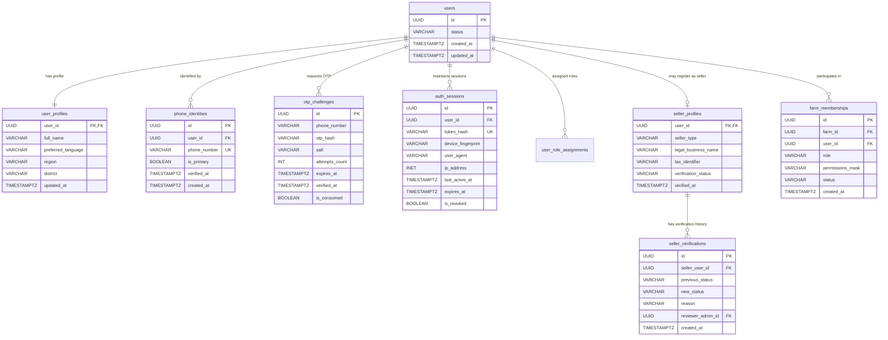

### 3.2 Farm Core and Harvest Batches ERD
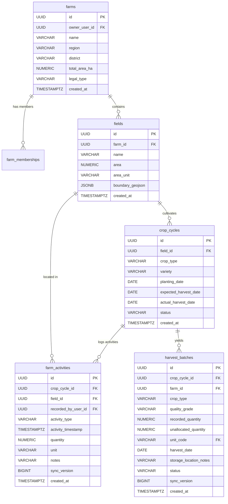

### 3.3 Marketplace Catalog, Harvest Allocation, and Listings ERD
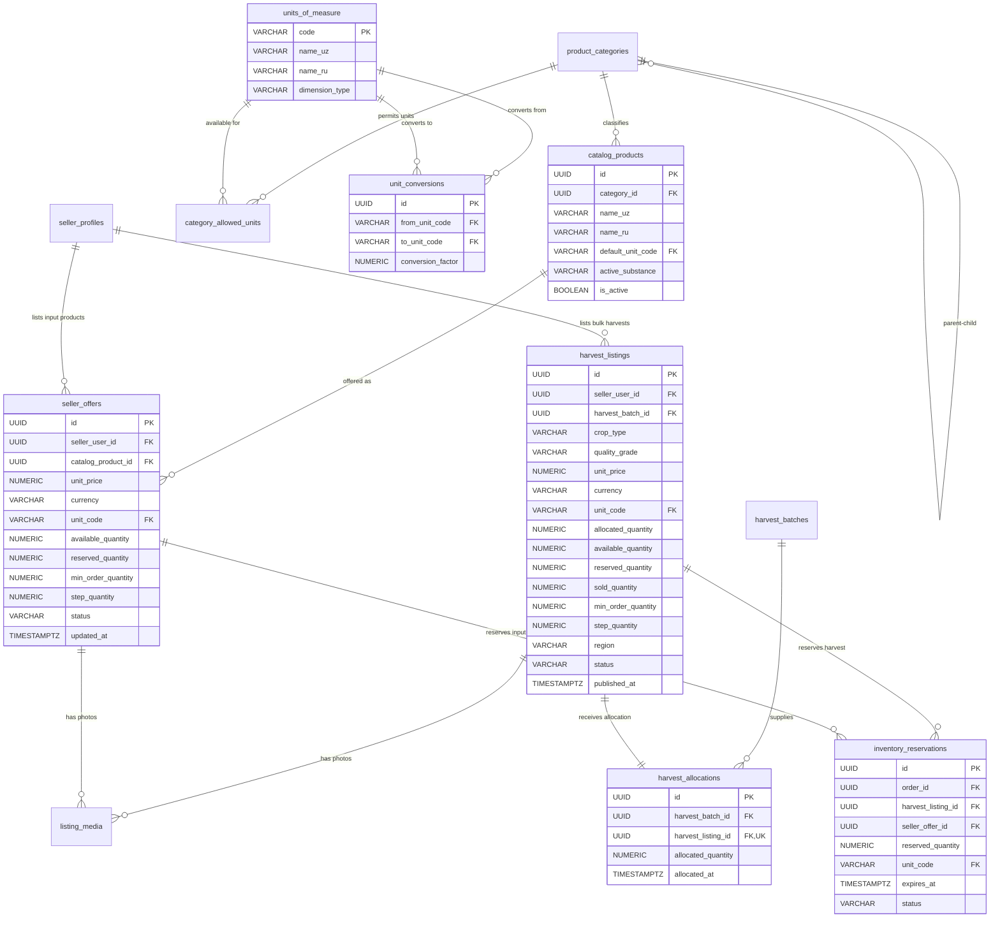

### 3.4 Orders, Payments, and Settlement ERD
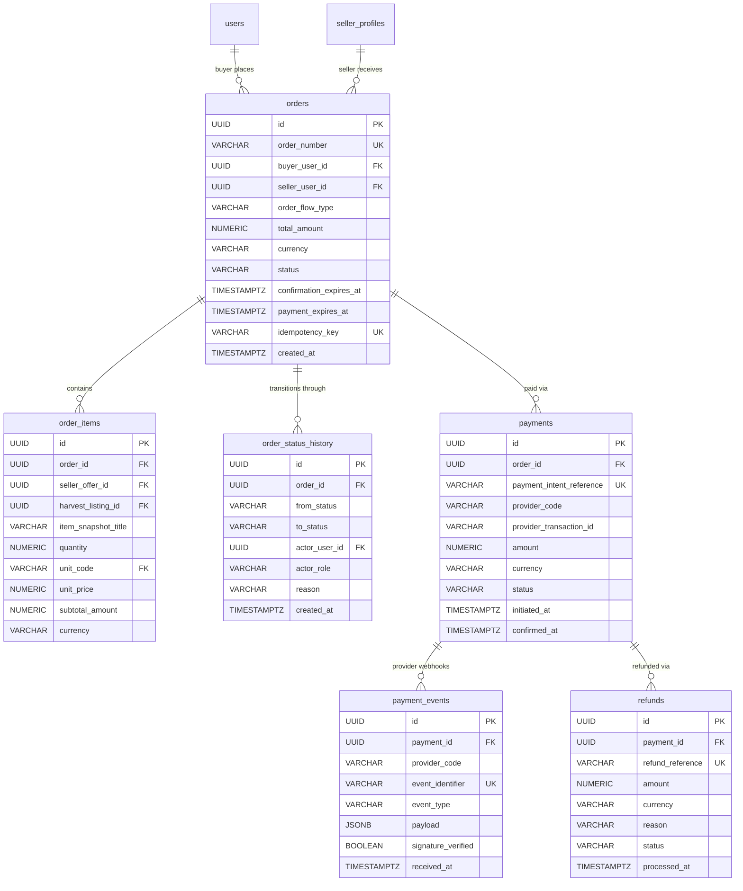

### 3.5 Logistics, Fleet, and Proof of Delivery ERD
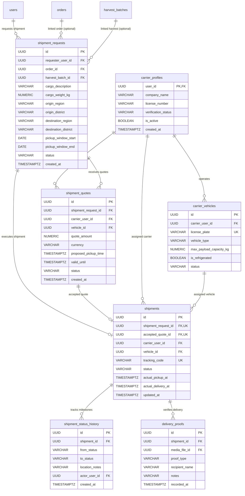

### 3.6 Reputation, Two-Sided Reviews, and Moderation ERD
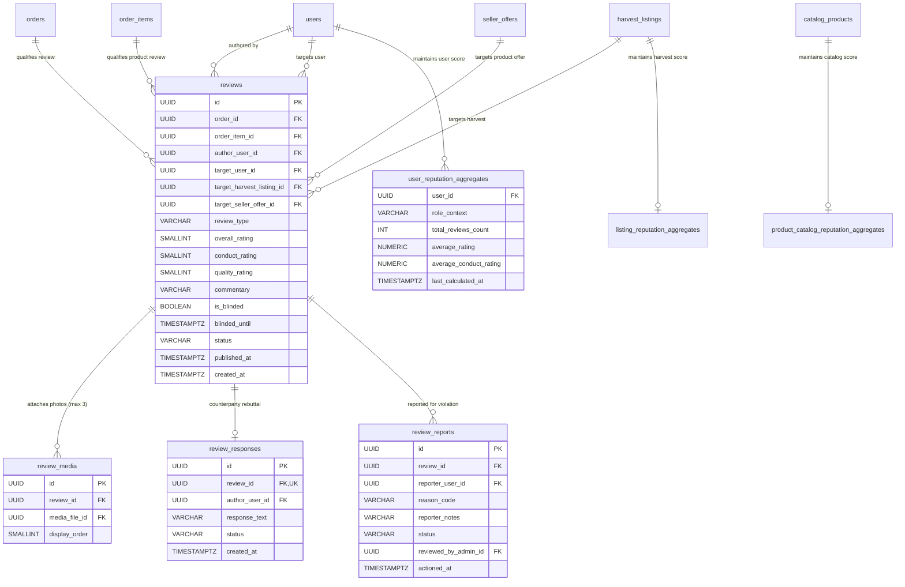

### 3.7 Platform, Media, and Immutable Audit Log ERD
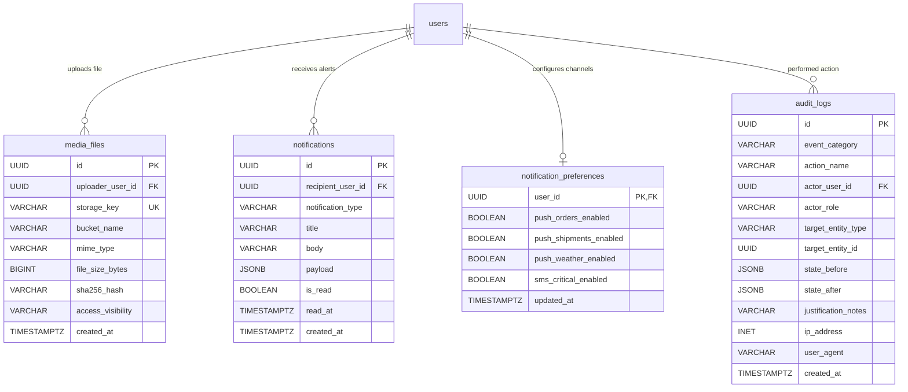

---

## 4. Entity-by-Entity Relational Schema Specifications

### 4.1 Identity and Access Module (`hosil-identity`)

#### 1. `users`
Core user entity. A stable internal UUID identifier uncoupled from the mutable phone MSISDN.

| Column Name | PostgreSQL Type | Nullable | Default | PK/FK/Constraints | Description |
|---|---|---|---|---|---|
| `id` | `UUID` | No | `gen_random_uuid()` | **PK** | Immutable internal user identifier. |
| `status` | `VARCHAR(30)` | No | `'ACTIVE'` | `CHECK (status IN ('PENDING_VERIFICATION', 'ACTIVE', 'SUSPENDED', 'DEACTIVATED'))` | Account lifecycle state (`ID-001`). |
| `deleted_at` | `TIMESTAMPTZ` | Yes | `NULL` | — | Soft deletion timestamp for GDPR/privacy compliance. |
| `created_at` | `TIMESTAMPTZ` | No | `clock_timestamp()` | — | System registration timestamp. |
| `updated_at` | `TIMESTAMPTZ` | No | `clock_timestamp()` | — | Record update timestamp. |

#### 2. `user_profiles`
Personal demographic details, regional location, and localization preferences.

| Column Name | PostgreSQL Type | Nullable | Default | PK/FK/Constraints | Description |
|---|---|---|---|---|---|
| `user_id` | `UUID` | No | — | **PK, FK** $\to$ `users(id)` ON DELETE CASCADE | 1:1 relation to parent user account. |
| `full_name` | `VARCHAR(255)` | No | — | `CHECK (length(trim(full_name)) >= 2)` | Legal full name or farm manager name. |
| `preferred_language`| `VARCHAR(10)` | No | `'uz-Latn'` | `CHECK (preferred_language IN ('uz-Latn', 'ru', 'uz-Cyrl'))` | Preferred UI language (`DEC-002`). |
| `region` | `VARCHAR(100)` | No | — | — | Province/Viloyat (e.g., `'Toshkent viloyati'`). |
| `district` | `VARCHAR(100)` | No | — | — | District/Tuman (e.g., `'Yangiyoʻl tumani'`). |
| `avatar_media_id` | `UUID` | Yes | `NULL` | **FK** $\to$ `media_files(id)` | Profile avatar reference. |
| `updated_at` | `TIMESTAMPTZ` | No | `clock_timestamp()` | — | Last profile update instant. |

#### 3. `phone_identities`
Normalized phone number identities. Guarantees global uniqueness of verified phone numbers.

| Column Name | PostgreSQL Type | Nullable | Default | PK/FK/Constraints | Description |
|---|---|---|---|---|---|
| `id` | `UUID` | No | `gen_random_uuid()` | **PK** | Identity identifier. |
| `user_id` | `UUID` | No | — | **FK** $\to$ `users(id)` ON DELETE RESTRICT | Owning user account. |
| `phone_number` | `VARCHAR(20)` | No | — | **UK**, `CHECK (phone_number ~ '^\+998[0-9]{9}$')` | E.164 Uzbekistan format (`+998XXXXXXXXX`). |
| `is_primary` | `BOOLEAN` | No | `TRUE` | — | Primary credential flag. |
| `verified_at` | `TIMESTAMPTZ` | Yes | `NULL` | — | Instant OTP was successfully verified. |
| `created_at` | `TIMESTAMPTZ` | No | `clock_timestamp()` | — | Binding timestamp. |

#### 4. `otp_challenges`
Phone authentication challenges. **Never stores plaintext OTPs.**

| Column Name | PostgreSQL Type | Nullable | Default | PK/FK/Constraints | Description |
|---|---|---|---|---|---|
| `id` | `UUID` | No | `gen_random_uuid()` | **PK** | Challenge transaction identifier. |
| `phone_number` | `VARCHAR(20)` | No | — | `CHECK (phone_number ~ '^\+998[0-9]{9}$')` | Destination phone number. |
| `otp_hash` | `VARCHAR(64)` | No | — | — | Salted SHA-256 hash of generated OTP. |
| `salt` | `VARCHAR(32)` | No | — | — | Random per-challenge cryptographic salt. |
| `attempts_count` | `INT` | No | `0` | `CHECK (attempts_count <= 5)` | Failed attempt counter for brute-force lock. |
| `expires_at` | `TIMESTAMPTZ` | No | — | — | Challenge validity expiry (typically 3–5 min). |
| `verified_at` | `TIMESTAMPTZ` | Yes | `NULL` | — | Successful verification timestamp. |
| `is_consumed` | `BOOLEAN` | No | `FALSE` | — | Consumed flag preventing replay attacks. |
| `created_at` | `TIMESTAMPTZ` | No | `clock_timestamp()` | — | Challenge creation instant. |

#### 5. `auth_sessions`
Device authentication sessions. Maintains active mobile tokens without requiring OTP on every launch (`DEC-003`).

| Column Name | PostgreSQL Type | Nullable | Default | PK/FK/Constraints | Description |
|---|---|---|---|---|---|
| `id` | `UUID` | No | `gen_random_uuid()` | **PK** | Session ID. |
| `user_id` | `UUID` | No | — | **FK** $\to$ `users(id)` ON DELETE CASCADE | Authenticated user. |
| `token_hash` | `VARCHAR(64)` | No | — | **UK** | Cryptographic hash of issued refresh token. |
| `device_fingerprint`| `VARCHAR(255)`| Yes| `NULL` | — | Hardware/OS identifier for anomaly detection. |
| `user_agent` | `VARCHAR(255)`| Yes| `NULL` | — | Client app version and OS platform. |
| `ip_address` | `INET` | Yes | `NULL` | — | Originating client network address. |
| `last_active_at` | `TIMESTAMPTZ` | No | `clock_timestamp()` | — | Sliding inactivity monitor timestamp. |
| `expires_at` | `TIMESTAMPTZ` | No | — | — | Inactivity session expiration timestamp. |
| `is_revoked` | `BOOLEAN` | No | `FALSE` | — | Explicit session revocation status. |
| `created_at` | `TIMESTAMPTZ` | No | `clock_timestamp()` | — | Session establishment instant. |

#### 6. `user_roles` & `user_role_assignments`
System role assignment supporting multiple concurrent roles per user (`ID-002`).

```sql
-- Role reference enumeration
CREATE TYPE app_role_enum AS ENUM (
    'GUEST', 'REGISTERED_USER', 'FARMER', 'SELLER', 'BUYER', 'CARRIER', 'SUPPORT_OPERATOR', 'ADMINISTRATOR'
);
```

| Column Name | PostgreSQL Type | Nullable | Default | PK/FK/Constraints | Description |
|---|---|---|---|---|---|
| `id` | `UUID` | No | `gen_random_uuid()` | **PK** | Assignment ID. |
| `user_id` | `UUID` | No | — | **FK** $\to$ `users(id)` ON DELETE CASCADE | Target user. |
| `role_name` | `app_role_enum` | No | `'REGISTERED_USER'`| — | Assigned system role. |
| `assigned_by` | `UUID` | Yes | `NULL` | **FK** $\to$ `users(id)` | Administrator ID who assigned role. |
| `created_at` | `TIMESTAMPTZ` | No | `clock_timestamp()` | **UK(`user_id`, `role_name`)** | Unique role per user. |

#### 7. `seller_profiles` & `seller_verifications`
Commercial verification lifecycle for agricultural-input suppliers and marketplace sellers (`DEC-004`).

| Column Name | PostgreSQL Type | Nullable | Default | PK/FK/Constraints | Description |
|---|---|---|---|---|---|
| `user_id` | `UUID` | No | — | **PK, FK** $\to$ `users(id)` | 1:1 seller profile. |
| `seller_type` | `VARCHAR(30)` | No | `'FARMER'` | `CHECK (seller_type IN ('FARMER', 'COMMERCIAL_SUPPLIER', 'COOPERATIVE'))` | Seller business classification. |
| `legal_business_name`|`VARCHAR(255)`| Yes| `NULL` | — | Registered enterprise name (INN/STIR). |
| `tax_identifier` | `VARCHAR(50)` | Yes | `NULL` | **UK** | Tax Identification Number (TIN/INN). |
| `verification_status`|`VARCHAR(30)` | No | `'UNVERIFIED'`| `CHECK (verification_status IN ('UNVERIFIED', 'PENDING_REVIEW', 'VERIFIED', 'REJECTED', 'SUSPENDED'))` | Verification state (`MKT-018`). |
| `verified_at` | `TIMESTAMPTZ` | Yes | `NULL` | — | Timestamp of verification approval. |
| `created_at` | `TIMESTAMPTZ` | No | `clock_timestamp()` | — | Onboarding registration date. |

**`seller_verifications` (Audit Trail Table):**
- `id` (`UUID PK`)
- `seller_user_id` (`UUID FK` $\to$ `seller_profiles.user_id`)
- `previous_status` (`VARCHAR(30)`)
- `new_status` (`VARCHAR(30)`)
- `reason` (`TEXT NOT NULL`)
- `reviewer_admin_id` (`UUID FK` $\to$ `users.id`)
- `created_at` (`TIMESTAMPTZ DEFAULT clock_timestamp()`)

#### 8. `farm_memberships`
Role-Based and Attribute-Based Access Control for farm management (`ACL-003`).

| Column Name | PostgreSQL Type | Nullable | Default | PK/FK/Constraints | Description |
|---|---|---|---|---|---|
| `id` | `UUID` | No | `gen_random_uuid()` | **PK** | Membership ID. |
| `farm_id` | `UUID` | No | — | **FK** $\to$ `farms(id)` ON DELETE CASCADE | Associated farm. |
| `user_id` | `UUID` | No | — | **FK** $\to$ `users(id)` ON DELETE CASCADE | Associated user member. |
| `role` | `VARCHAR(30)` | No | `'WORKER'` | `CHECK (role IN ('OWNER', 'MANAGER', 'AGRONOMIST', 'WORKER'))` | Functional farm role. |
| `permissions_mask`| `VARCHAR(255)` | No | `'READ'` | — | Comma-delimited permissions (e.g., `'READ,WRITE_ACTIVITY,RECORD_HARVEST'`). |
| `status` | `VARCHAR(30)` | No | `'ACTIVE'` | `CHECK (status IN ('INVITED', 'ACTIVE', 'REVOKED'))` | Membership status. |
| `created_at` | `TIMESTAMPTZ` | No | `clock_timestamp()` | **UK(`farm_id`, `user_id`)** | Unique membership per farm. |

---

### 4.2 Farm Core Module (`hosil-farm`)

#### 9. `farms`
Agricultural enterprise or private smallholder farm holding.

| Column Name | PostgreSQL Type | Nullable | Default | PK/FK/Constraints | Description |
|---|---|---|---|---|---|
| `id` | `UUID` | No | `gen_random_uuid()` | **PK** | Farm holding ID. |
| `owner_user_id` | `UUID` | No | — | **FK** $\to$ `users(id)` ON DELETE RESTRICT | Legal farm owner. |
| `name` | `VARCHAR(255)` | No | — | `CHECK (length(trim(name)) >= 2)` | Public farm business/holding name. |
| `region` | `VARCHAR(100)` | No | — | — | Administrative region/viloyat. |
| `district` | `VARCHAR(100)` | No | — | — | Administrative district/tuman. |
| `total_area_ha` | `NUMERIC(10, 2)`| Yes | `NULL` | `CHECK (total_area_ha > 0)` | Total contiguous farm size in hectares. |
| `legal_type` | `VARCHAR(50)` | No | `'DEHQON'` | `CHECK (legal_type IN ('DEHQON', 'FERMER', 'MCHJ', 'TOMORQA'))` | Legal category under Uzbekistan law. |
| `created_at` | `TIMESTAMPTZ` | No | `clock_timestamp()` | — | Farm profile creation timestamp. |
| `updated_at` | `TIMESTAMPTZ` | No | `clock_timestamp()` | — | Last update timestamp. |

#### 10. `fields`
Physical cultivation plots (*dala*) belonging to a farm.

| Column Name | PostgreSQL Type | Nullable | Default | PK/FK/Constraints | Description |
|---|---|---|---|---|---|
| `id` | `UUID` | No | `gen_random_uuid()` | **PK** | Field plot ID. |
| `farm_id` | `UUID` | No | — | **FK** $\to$ `farms(id)` ON DELETE CASCADE | Parent farm. |
| `name` | `VARCHAR(100)` | No | — | `CHECK (length(trim(name)) >= 1)` | Field designation (e.g., "1-Dala Bogʻ"). |
| `area` | `NUMERIC(10, 2)`| No | — | `CHECK (area > 0)` | Field area. |
| `area_unit` | `VARCHAR(20)` | No | `'HECTARE'` | `CHECK (area_unit IN ('HECTARE', 'SOTKA', 'SQM'))` | Area unit of measurement. |
| `boundary_geojson`| `JSONB` | Yes | `NULL` | — | Field perimeter polygon (GeoJSON format). |
| `notes` | `TEXT` | Yes | `NULL` | — | Private agronomic notes (soil type, irrigation access). |
| `created_at` | `TIMESTAMPTZ` | No | `clock_timestamp()` | — | Creation timestamp. |

#### 11. `crop_cycles`
Individual seasonal crop cultivation instances within a field.

| Column Name | PostgreSQL Type | Nullable | Default | PK/FK/Constraints | Description |
|---|---|---|---|---|---|
| `id` | `UUID` | No | `gen_random_uuid()` | **PK** | Crop cycle ID. |
| `field_id` | `UUID` | No | — | **FK** $\to$ `fields(id)` ON DELETE CASCADE | Cultivated field. |
| `crop_type` | `VARCHAR(100)` | No | — | — | Crop species (e.g., "Tomato", "Cotton", "Wheat"). |
| `variety` | `VARCHAR(100)` | Yes | `NULL` | — | Seed variety / cultivar. |
| `planting_date` | `DATE` | No | — | — | Sowing or transplantation date. |
| `expected_harvest_date`|`DATE`| Yes | `NULL` | `CHECK (expected_harvest_date >= planting_date)` | Forecasted harvest commencement. |
| `actual_harvest_date` | `DATE` | Yes | `NULL` | `CHECK (actual_harvest_date >= planting_date)` | Actual harvest conclusion. |
| `status` | `VARCHAR(30)` | No | `'ACTIVE'` | `CHECK (status IN ('PLANNED', 'ACTIVE', 'HARVESTED', 'TERMINATED'))` | Lifecycle state (`FARM-003`). |
| `created_at` | `TIMESTAMPTZ` | No | `clock_timestamp()` | — | Cycle initialization timestamp. |

#### 12. `farm_activities`
Daily agronomic operations logged in the field. Designed for offline creation (`07_offline_strategy.md`).

| Column Name | PostgreSQL Type | Nullable | Default | PK/FK/Constraints | Description |
|---|---|---|---|---|---|
| `id` | `UUID` | No | `gen_random_uuid()` | **PK** | Activity record ID (client-generated UUID). |
| `crop_cycle_id` | `UUID` | No | — | **FK** $\to$ `crop_cycles(id)` ON DELETE CASCADE | Associated crop cycle. |
| `field_id` | `UUID` | No | — | **FK** $\to$ `fields(id)` ON DELETE CASCADE | Associated field. |
| `recorded_by_user_id`|`UUID` | No | — | **FK** $\to$ `users(id)` | Member who logged the activity. |
| `activity_type` | `VARCHAR(50)` | No | — | `CHECK (activity_type IN ('PLANTING', 'IRRIGATION', 'FERTILIZING', 'CHEMICAL_TREATMENT', 'WEEDING', 'PRUNING', 'INSPECTION', 'HARVEST'))` | Agronomic category (`FARM-005`). |
| `activity_timestamp`|`TIMESTAMPTZ`| No | — | — | Instant activity was physically performed. |
| `quantity` | `NUMERIC(14, 3)`| Yes | `NULL` | `CHECK (quantity IS NULL OR quantity >= 0)` | Material quantity applied (fertilizer, water, etc.). |
| `unit` | `VARCHAR(30)` | Yes | `NULL` | — | Unit of applied material (kg, liter, m3). |
| `notes` | `TEXT` | Yes | `NULL` | — | Operational commentary and observations. |
| `sync_version` | `BIGINT` | No | `1` | — | Optimistic locking and sync conflict revision. |
| `created_at` | `TIMESTAMPTZ` | No | `clock_timestamp()` | — | Server ingestion timestamp. |

#### 13. `harvest_batches`
Physical bulk harvest batch recorded at field level. Acts as inventory foundation for marketplace listings (`DEC-008`).

| Column Name | PostgreSQL Type | Nullable | Default | PK/FK/Constraints | Description |
|---|---|---|---|---|---|
| `id` | `UUID` | No | `gen_random_uuid()` | **PK** | Harvest batch ID (client-generated UUID). |
| `crop_cycle_id` | `UUID` | No | — | **FK** $\to$ `crop_cycles(id)` ON DELETE RESTRICT | Source crop cycle. |
| `farm_id` | `UUID` | No | — | **FK** $\to$ `farms(id)` ON DELETE RESTRICT | Parent farm holding. |
| `crop_type` | `VARCHAR(100)` | No | — | — | Produce species name. |
| `quality_grade` | `VARCHAR(30)` | Yes | `NULL` | `CHECK (quality_grade IN ('PREMIUM', 'FIRST_CLASS', 'SECOND_CLASS', 'STANDARD', 'INDUSTRIAL'))` | Produce quality classification. |
| `recorded_quantity`| `NUMERIC(14, 3)`| No | — | `CHECK (recorded_quantity > 0)` | Total physical harvest weight/quantity logged. |
| `unallocated_quantity`|`NUMERIC(14, 3)`| No| — | `CHECK (unallocated_quantity >= 0 AND unallocated_quantity <= recorded_quantity)` | Harvest balance not yet tied to marketplace listings. |
| `unit_code` | `VARCHAR(20)` | No | — | **FK** $\to$ `units_of_measure(code)` | Base unit code (e.g., `'KG'`, `'TON'`). |
| `harvest_date` | `DATE` | No | — | — | Physical harvest completion date. |
| `storage_location_notes`|`VARCHAR(255)`| Yes| `NULL`| — | Private warehouse/bunker identifier. |
| `status` | `VARCHAR(30)` | No | `'RECORDED'`| `CHECK (status IN ('RECORDED', 'PARTIALLY_ALLOCATED', 'FULLY_ALLOCATED', 'ARCHIVED'))` | Batch allocation lifecycle state. |
| `sync_version` | `BIGINT` | No | `1` | — | Sync conflict revision number. |
| `created_at` | `TIMESTAMPTZ` | No | `clock_timestamp()` | — | Ingestion timestamp. |

---

### 4.3 Marketplace Catalog & Harvest Allocation Module (`hosil-catalog` & `hosil-marketplace`)

#### 14. `product_categories`
Hierarchical taxonomy classifying agricultural inputs and harvest commodities (`MKT-001`).

| Column Name | PostgreSQL Type | Nullable | Default | PK/FK/Constraints | Description |
|---|---|---|---|---|---|
| `id` | `UUID` | No | `gen_random_uuid()` | **PK** | Category ID. |
| `parent_id` | `UUID` | Yes | `NULL` | **FK** $\to$ `product_categories(id)` | Self-referencing parent category. |
| `name_uz` | `VARCHAR(150)` | No | — | — | Category title in Uzbek Latin. |
| `name_ru` | `VARCHAR(150)` | No | — | — | Category title in Russian. |
| `slug` | `VARCHAR(150)` | No | — | **UK** | URL and search token identifier. |
| `category_type` | `VARCHAR(30)` | No | — | `CHECK (category_type IN ('AGRICULTURAL_INPUT', 'HARVEST_PRODUCE'))` | Distinguishes inputs from produce. |
| `display_order` | `INT` | No | `0` | — | Sorting priority in UI menus. |
| `is_active` | `BOOLEAN` | No | `TRUE` | — | Category visibility flag. |

#### 15. `units_of_measure` & `unit_conversions`
Authoritative reference catalog of standardized sale and measurement units (`DEC-009`).

| Column Name | PostgreSQL Type | Nullable | Default | PK/FK/Constraints | Description |
|---|---|---|---|---|---|
| `code` | `VARCHAR(20)` | No | — | **PK** | Standard unit code (e.g., `'KG'`, `'TON'`, `'PIECE'`, `'BAG_50KG'`, `'LITER'`). |
| `name_uz` | `VARCHAR(50)` | No | — | — | Unit name in Uzbek Latin. |
| `name_ru` | `VARCHAR(50)` | No | — | — | Unit name in Russian. |
| `dimension_type` | `VARCHAR(30)` | No | — | `CHECK (dimension_type IN ('MASS', 'VOLUME', 'UNIT_COUNT', 'AREA'))` | Physical dimensional category. |

**`category_allowed_units` (Join Table):**
- `category_id` (`UUID FK` $\to$ `product_categories.id`)
- `unit_code` (`VARCHAR(20) FK` $\to$ `units_of_measure.code`)
- **PK(`category_id`, `unit_code`)**

**`unit_conversions` (Explicit Conversion Rules):**
- `id` (`UUID PK`)
- `from_unit_code` (`VARCHAR(20) FK` $\to$ `units_of_measure.code`)
- `to_unit_code` (`VARCHAR(20) FK` $\to$ `units_of_measure.code`)
- `conversion_factor` (`NUMERIC(18, 8) NOT NULL CHECK (conversion_factor > 0)`)
- **UK(`from_unit_code`, `to_unit_code`)**

#### 16. `catalog_products`
Standardized master catalog of agricultural inputs (fertilizers, pesticides, seeds, tools) sold by commercial suppliers (`MKT-003`).

| Column Name | PostgreSQL Type | Nullable | Default | PK/FK/Constraints | Description |
|---|---|---|---|---|---|
| `id` | `UUID` | No | `gen_random_uuid()` | **PK** | Master catalog product ID. |
| `category_id` | `UUID` | No | — | **FK** $\to$ `product_categories(id)` | Classification category. |
| `name_uz` | `VARCHAR(255)` | No | — | — | Product name in Uzbek. |
| `name_ru` | `VARCHAR(255)` | No | — | — | Product name in Russian. |
| `brand_name` | `VARCHAR(100)` | Yes | `NULL` | — | Manufacturer / chemical brand. |
| `active_substance`|`VARCHAR(255)` | Yes | `NULL` | — | Chemical formulation or NPK composition. |
| `default_unit_code`|`VARCHAR(20)` | No | — | **FK** $\to$ `units_of_measure(code)` | Standard packaging unit. |
| `is_active` | `BOOLEAN` | No | `TRUE` | — | Catalog active state. |
| `created_at` | `TIMESTAMPTZ` | No | `clock_timestamp()` | — | Ingestion timestamp. |

#### 17. `seller_offers`
Commercial input supplier offers tied to master catalog products. Supports retail direct-checkout ordering (`DEC-005`).

| Column Name | PostgreSQL Type | Nullable | Default | PK/FK/Constraints | Description |
|---|---|---|---|---|---|
| `id` | `UUID` | No | `gen_random_uuid()` | **PK** | Offer ID. |
| `seller_user_id` | `UUID` | No | — | **FK** $\to$ `seller_profiles(user_id)` | Commercial supplier account. |
| `catalog_product_id`|`UUID` | No | — | **FK** $\to$ `catalog_products(id)` | Linked catalog item. |
| `unit_price` | `NUMERIC(14, 2)`| No | — | `CHECK (unit_price > 0)` | Price per unit in specified currency. |
| `currency` | `VARCHAR(3)` | No | `'UZS'` | — | ISO-4217 currency code. |
| `unit_code` | `VARCHAR(20)` | No | — | **FK** $\to$ `units_of_measure(code)` | Sale measurement unit. |
| `available_quantity`|`NUMERIC(14, 3)`| No| — | `CHECK (available_quantity >= 0)` | Immediate purchasable stock. |
| `reserved_quantity` |`NUMERIC(14, 3)`| No| `0` | `CHECK (reserved_quantity >= 0)` | Stock held in active unexpired checkouts. |
| `min_order_quantity`|`NUMERIC(14, 3)`| No| `1` | `CHECK (min_order_quantity > 0)` | Minimum order threshold. |
| `step_quantity` | `NUMERIC(14, 3)`| No | `1` | `CHECK (step_quantity > 0)` | Permitted purchasing increment. |
| `status` | `VARCHAR(30)` | No | `'ACTIVE'` | `CHECK (status IN ('DRAFT', 'ACTIVE', 'PAUSED', 'OUT_OF_STOCK', 'ARCHIVED'))` | Offer visibility state. |
| `updated_at` | `TIMESTAMPTZ` | No | `clock_timestamp()` | — | Stock/price update timestamp. |

#### 18. `harvest_allocations`
Explicit allocation ledger linking a private harvest batch to a public marketplace listing (`DEC-008`).

| Column Name | PostgreSQL Type | Nullable | Default | PK/FK/Constraints | Description |
|---|---|---|---|---|---|
| `id` | `UUID` | No | `gen_random_uuid()` | **PK** | Allocation record ID. |
| `harvest_batch_id` | `UUID` | No | — | **FK** $\to$ `harvest_batches(id)` ON DELETE RESTRICT | Source harvest batch. |
| `harvest_listing_id`|`UUID` | No | — | **UK, FK** $\to$ `harvest_listings(id)` ON DELETE RESTRICT | Target listing (1:1 with listing). |
| `allocated_quantity`|`NUMERIC(14, 3)`| No| — | `CHECK (allocated_quantity > 0)` | Quantity assigned to this listing. |
| `allocated_at` | `TIMESTAMPTZ` | No | `clock_timestamp()` | — | Timestamp allocation was committed. |

#### 19. `harvest_listings`
Wholesale agricultural harvest listing published by a farmer on Hosil Bozor (`DEC-008`, `MKT-004`).

| Column Name | PostgreSQL Type | Nullable | Default | PK/FK/Constraints | Description |
|---|---|---|---|---|---|
| `id` | `UUID` | No | `gen_random_uuid()` | **PK** | Listing ID. |
| `seller_user_id` | `UUID` | No | — | **FK** $\to$ `users(id)` ON DELETE RESTRICT | Farmer account publishing produce. |
| `harvest_batch_id` | `UUID` | No | — | **FK** $\to$ `harvest_batches(id)` ON DELETE RESTRICT | Backing physical harvest batch. |
| `crop_type` | `VARCHAR(100)` | No | — | — | Public produce title. |
| `quality_grade` | `VARCHAR(30)` | Yes | `NULL` | — | Displayed quality classification. |
| `unit_price` | `NUMERIC(14, 2)`| Yes | `NULL` | `CHECK (unit_price IS NULL OR unit_price > 0)` | Fixed price per unit (`NULL` if RFQ). |
| `currency` | `VARCHAR(3)` | No | `'UZS'` | — | Currency code. |
| `is_rfq_enabled` | `BOOLEAN` | No | `FALSE` | — | Request-For-Quote pricing flag. |
| `unit_code` | `VARCHAR(20)` | No | — | **FK** $\to$ `units_of_measure(code)` | Listing sale unit. |
| `allocated_quantity`|`NUMERIC(14, 3)`| No| — | `CHECK (allocated_quantity > 0)` | Total quantity allocated to listing. |
| `available_quantity`|`NUMERIC(14, 3)`| No| — | `CHECK (available_quantity >= 0)` | Quantity currently unreserved and available. |
| `reserved_quantity` |`NUMERIC(14, 3)`| No| `0` | `CHECK (reserved_quantity >= 0)` | Quantity held in active purchase requests. |
| `sold_quantity` | `NUMERIC(14, 3)`| No | `0` | `CHECK (sold_quantity >= 0)` | Quantity completed and paid. |
| `min_order_quantity`|`NUMERIC(14, 3)`| No| — | `CHECK (min_order_quantity > 0)` | Wholesale Minimum Order Quantity (`DEC-005`). |
| `step_quantity` | `NUMERIC(14, 3)`| No | — | `CHECK (step_quantity > 0)` | Permitted purchase step increment. |
| `region` | `VARCHAR(100)` | No | — | — | Public produce location (province level). |
| `district` | `VARCHAR(100)` | No | — | — | Public produce location (district level). |
| `status` | `VARCHAR(30)` | No | `'DRAFT'` | `CHECK (status IN ('DRAFT', 'PUBLISHED', 'PAUSED', 'SOLD_OUT', 'ARCHIVED'))` | Listing state machine. |
| `published_at` | `TIMESTAMPTZ` | Yes | `NULL` | — | Instant listing became publicly visible. |
| `created_at` | `TIMESTAMPTZ` | No | `clock_timestamp()` | — | Creation timestamp. |

*Row-Level Check Invariant:*
```sql
ALTER TABLE harvest_listings ADD CONSTRAINT chk_listing_quantity_balance
CHECK (allocated_quantity = (available_quantity + reserved_quantity + sold_quantity));
```

#### 20. `inventory_reservations`
Temporary stock reservations created during checkout or seller confirmation (`DEC-006`).

| Column Name | PostgreSQL Type | Nullable | Default | PK/FK/Constraints | Description |
|---|---|---|---|---|---|
| `id` | `UUID` | No | `gen_random_uuid()` | **PK** | Reservation ID. |
| `order_id` | `UUID` | No | — | **FK** $\to$ `orders(id)` ON DELETE CASCADE | Associated order. |
| `harvest_listing_id`|`UUID` | Yes | `NULL` | **FK** $\to$ `harvest_listings(id)` | Reserved harvest listing (if harvest). |
| `seller_offer_id` | `UUID` | Yes | `NULL` | **FK** $\to$ `seller_offers(id)` | Reserved input offer (if input). |
| `reserved_quantity`| `NUMERIC(14, 3)`| No | — | `CHECK (reserved_quantity > 0)` | Quantity placed on hold. |
| `unit_code` | `VARCHAR(20)` | No | — | **FK** $\to$ `units_of_measure(code)` | Measurement unit. |
| `expires_at` | `TIMESTAMPTZ` | No | — | — | Hard expiration timestamp (e.g., 30m / 24h). |
| `status` | `VARCHAR(30)` | No | `'ACTIVE'` | `CHECK (status IN ('ACTIVE', 'CONFIRMED_SOLD', 'RELEASED_EXPIRED', 'RELEASED_CANCELLED'))` | Reservation state. |
| `created_at` | `TIMESTAMPTZ` | No | `clock_timestamp()` | — | Lock creation instant. |

*Target Exclusion Constraint:*
```sql
ALTER TABLE inventory_reservations ADD CONSTRAINT chk_reservation_target
CHECK (
    (harvest_listing_id IS NOT NULL AND seller_offer_id IS NULL) OR
    (harvest_listing_id IS NULL AND seller_offer_id IS NOT NULL)
);
```

---

### 4.4 Orders & Payments Module (`hosil-order` & `hosil-payment`)

#### 21. `orders`
Master purchase order. Supports both instant checkout and wholesale purchase request workflows (`DEC-006`).

| Column Name | PostgreSQL Type | Nullable | Default | PK/FK/Constraints | Description |
|---|---|---|---|---|---|
| `id` | `UUID` | No | `gen_random_uuid()` | **PK** | Master Order ID. |
| `order_number` | `VARCHAR(50)` | No | — | **UK** | Human-readable tracking number (e.g., `'ORD-20261014-9X2A'`). |
| `buyer_user_id` | `UUID` | No | — | **FK** $\to$ `users(id)` ON DELETE RESTRICT | Purchasing buyer. |
| `seller_user_id` | `UUID` | No | — | **FK** $\to$ `users(id)` ON DELETE RESTRICT | Merchant or farmer seller. |
| `order_flow_type`| `VARCHAR(30)` | No | — | `CHECK (order_flow_type IN ('INPUT_DIRECT_CHECKOUT', 'HARVEST_PURCHASE_REQUEST'))` | Processing flow variant. |
| `total_amount` | `NUMERIC(14, 2)`| No | — | `CHECK (total_amount >= 0)` | Server-calculated total order price (`MKT-011`). |
| `currency` | `VARCHAR(3)` | No | `'UZS'` | — | ISO-4217 currency. |
| `status` | `VARCHAR(35)` | No | — | `CHECK (status IN ('DRAFT', 'AWAITING_SELLER_CONFIRMATION', 'PENDING_PAYMENT', 'CONFIRMED', 'PROCESSING', 'READY_FOR_DISPATCH', 'IN_TRANSIT', 'COMPLETED', 'CANCELLED', 'DISPUTED'))` | Order state machine (`MKT-010`). |
| `confirmation_expires_at`|`TIMESTAMPTZ`| Yes | `NULL` | — | Timeout for seller to accept request (`DEC-006`). |
| `payment_expires_at`|`TIMESTAMPTZ`| Yes | `NULL` | — | Timeout for buyer to complete payment. |
| `delivery_type` | `VARCHAR(30)` | No | `'BUYER_ARRANGES'`| `CHECK (delivery_type IN ('BUYER_ARRANGES', 'SELLER_DELIVERS', 'HOSIL_LOGISTIKA'))` | Selected logistics model (`DEC-012`). |
| `idempotency_key` | `VARCHAR(100)` | No | — | **UK** | Client idempotency token (`MKT-014`). |
| `created_at` | `TIMESTAMPTZ` | No | `clock_timestamp()` | — | Order placement timestamp. |
| `updated_at` | `TIMESTAMPTZ` | No | `clock_timestamp()` | — | State transition timestamp. |

#### 22. `order_items`
Immutable purchase snapshot of products/listings at the moment of order placement.

| Column Name | PostgreSQL Type | Nullable | Default | PK/FK/Constraints | Description |
|---|---|---|---|---|---|
| `id` | `UUID` | No | `gen_random_uuid()` | **PK** | Line item ID. |
| `order_id` | `UUID` | No | — | **FK** $\to$ `orders(id)` ON DELETE CASCADE | Parent order. |
| `seller_offer_id` | `UUID` | Yes | `NULL` | **FK** $\to$ `seller_offers(id)` | Originating offer (for inputs). |
| `harvest_listing_id`|`UUID` | Yes | `NULL` | **FK** $\to$ `harvest_listings(id)` | Originating listing (for harvests). |
| `item_snapshot_title`|`VARCHAR(255)`| No | — | — | Immutable product title snapshot. |
| `quantity` | `NUMERIC(14, 3)`| No | — | `CHECK (quantity > 0)` | Ordered quantity. |
| `unit_code` | `VARCHAR(20)` | No | — | **FK** $\to$ `units_of_measure(code)` | Sale unit code snapshot. |
| `unit_price` | `NUMERIC(14, 2)`| No | — | `CHECK (unit_price > 0)` | Price per unit at purchase. |
| `subtotal_amount` | `NUMERIC(14, 2)`| No | — | `CHECK (subtotal_amount = round(quantity * unit_price, 2))` | Item subtotal. |
| `currency` | `VARCHAR(3)` | No | `'UZS'` | — | Currency code snapshot. |

*Target Exclusion Constraint:*
```sql
ALTER TABLE order_items ADD CONSTRAINT chk_order_item_source
CHECK (
    (seller_offer_id IS NOT NULL AND harvest_listing_id IS NULL) OR
    (seller_offer_id IS NULL AND harvest_listing_id IS NOT NULL)
);
```

#### 23. `order_status_history`
Append-only audit trail of every order state transition.

| Column Name | PostgreSQL Type | Nullable | Default | PK/FK/Constraints | Description |
|---|---|---|---|---|---|
| `id` | `UUID` | No | `gen_random_uuid()` | **PK** | History record ID. |
| `order_id` | `UUID` | No | — | **FK** $\to$ `orders(id)` ON DELETE CASCADE | Associated order. |
| `from_status` | `VARCHAR(35)` | No | — | — | Prior order state. |
| `to_status` | `VARCHAR(35)` | No | — | — | New order state. |
| `actor_user_id` | `UUID` | Yes | `NULL` | **FK** $\to$ `users(id)` | User triggering transition (`NULL` if system job). |
| `actor_role` | `VARCHAR(30)` | No | — | — | Role context (e.g., `'BUYER'`, `'SELLER'`, `'SYSTEM'`). |
| `reason` | `TEXT` | Yes | `NULL` | — | Justification or cancellation rationale. |
| `created_at` | `TIMESTAMPTZ` | No | `clock_timestamp()` | — | Transition instant. |

#### 24. `payments`
Provider-neutral payment transactions. Operates independently from `orders.status` (`PAY-001`, `DEC-007`).

| Column Name | PostgreSQL Type | Nullable | Default | PK/FK/Constraints | Description |
|---|---|---|---|---|---|
| `id` | `UUID` | No | `gen_random_uuid()` | **PK** | Payment transaction ID. |
| `order_id` | `UUID` | No | — | **FK** $\to$ `orders(id)` ON DELETE RESTRICT | Target order. |
| `payment_intent_reference`|`VARCHAR(100)`| No | — | **UK** | Idempotent transaction reference. |
| `provider_code` | `VARCHAR(50)` | No | — | — | Gateway driver (e.g., `'PAYME'`, `'CLICK'`, `'BANK_ESCROW'`). |
| `provider_transaction_id`|`VARCHAR(100)`| Yes| `NULL`| — | Remote payment provider unique identifier. |
| `amount` | `NUMERIC(14, 2)`| No | — | `CHECK (amount > 0)` | Payment transaction amount. |
| `currency` | `VARCHAR(3)` | No | `'UZS'` | — | ISO-4217 currency. |
| `status` | `VARCHAR(30)` | No | `'INITIATED'`| `CHECK (status IN ('INITIATED', 'PENDING_PROVIDER', 'AUTHORIZED', 'CAPTURED', 'FAILED', 'CANCELLED', 'REFUNDED'))` | Independent payment lifecycle. |
| `initiated_at` | `TIMESTAMPTZ` | No | `clock_timestamp()` | — | Initialization instant. |
| `confirmed_at` | `TIMESTAMPTZ` | Yes | `NULL` | — | Provider callback confirmation instant. |

#### 25. `payment_events`
Raw audit log of incoming payment gateway webhooks and callbacks. Enforces webhook idempotency (`PAY-004`).

| Column Name | PostgreSQL Type | Nullable | Default | PK/FK/Constraints | Description |
|---|---|---|---|---|---|
| `id` | `UUID` | No | `gen_random_uuid()` | **PK** | Event ID. |
| `payment_id` | `UUID` | No | — | **FK** $\to$ `payments(id)` ON DELETE RESTRICT | Linked internal payment record. |
| `provider_code` | `VARCHAR(50)` | No | — | — | Provider identifier. |
| `event_identifier`| `VARCHAR(100)` | No | — | **UK** | Provider unique webhook transaction ID. |
| `event_type` | `VARCHAR(50)` | No | — | — | Event name (e.g., `'transaction.paid'`, `'cancel'`). |
| `payload` | `JSONB` | No | — | — | Exact raw webhook JSON payload for audit. |
| `signature_verified`|`BOOLEAN` | No | `FALSE` | — | Cryptographic HMAC signature check flag. |
| `received_at` | `TIMESTAMPTZ` | No | `clock_timestamp()` | — | Ingestion instant. |

#### 26. `refunds`
Provisional refund records linked to payment transactions (`DEC-010`).

| Column Name | PostgreSQL Type | Nullable | Default | PK/FK/Constraints | Description |
|---|---|---|---|---|---|
| `id` | `UUID` | No | `gen_random_uuid()` | **PK** | Refund record ID. |
| `payment_id` | `UUID` | No | — | **FK** $\to$ `payments(id)` ON DELETE RESTRICT | Originating payment transaction. |
| `refund_reference`| `VARCHAR(100)` | No | — | **UK** | Gateway refund operation ID. |
| `amount` | `NUMERIC(14, 2)`| No | — | `CHECK (amount > 0)` | Refunded monetary amount. |
| `currency` | `VARCHAR(3)` | No | `'UZS'` | — | Currency code. |
| `reason` | `TEXT` | No | — | — | Documented refund justification. |
| `status` | `VARCHAR(30)` | No | `'PENDING'` | `CHECK (status IN ('PENDING', 'PROCESSED', 'FAILED'))` | Refund execution state. |
| `processed_at` | `TIMESTAMPTZ` | Yes | `NULL` | — | Confirmation instant. |

---

### 4.5 Logistics & Leasing Module (`hosil-logistics`)

#### 27. `carrier_profiles` & `carrier_vehicles`
Fleet and transport operator registry (`DEC-011`, `LOG-001`).

| Column Name | PostgreSQL Type | Nullable | Default | PK/FK/Constraints | Description |
|---|---|---|---|---|---|
| `user_id` | `UUID` | No | — | **PK, FK** $\to$ `users(id)` | 1:1 carrier profile. |
| `company_name` | `VARCHAR(255)` | No | — | — | Transport business name or owner-operator. |
| `license_number`| `VARCHAR(100)` | No | — | — | Freight transportation license number. |
| `verification_status`|`VARCHAR(30)` | No | `'UNVERIFIED'`| `CHECK (verification_status IN ('UNVERIFIED', 'VERIFIED', 'SUSPENDED'))` | Carrier onboarding state. |
| `is_active` | `BOOLEAN` | No | `TRUE` | — | Operational availability flag. |
| `created_at` | `TIMESTAMPTZ` | No | `clock_timestamp()` | — | Profile creation instant. |

**`carrier_vehicles` (Vehicle Registry):**
- `id` (`UUID PK`)
- `carrier_user_id` (`UUID FK` $\to$ `carrier_profiles.user_id`)
- `license_plate` (`VARCHAR(20) UK NOT NULL`)
- `vehicle_type` (`VARCHAR(50) NOT NULL CHECK (vehicle_type IN ('ISUZU_TRUCK', 'GAZELLE', 'TIR_REFRIGERATOR', 'KAMAZ_DUMP', 'TRACTOR_TRAILER'))`)
- `max_payload_capacity_kg` (`NUMERIC(10, 2) NOT NULL CHECK (max_payload_capacity_kg > 0)`)
- `is_refrigerated` (`BOOLEAN DEFAULT FALSE`)
- `status` (`VARCHAR(30) DEFAULT 'AVAILABLE'`)

#### 28. `shipment_requests`
Logistics transport requests generated by farmers or buyers (`LOG-001`, `LOG-002`, `DEC-011`, `Milestone 6B.12`).

| Column Name | PostgreSQL Type | Nullable | Default | PK/FK/Constraints | Description |
|---|---|---|---|---|---|
| `id` | `UUID` | No | `gen_random_uuid()` | **PK** | Shipment request ID. |
| `request_number` | `VARCHAR(50)` | No | — | **UK** | Human-readable tracking number (e.g., `SR-YYYYMMDD-XXXXXXXX`). |
| `requester_user_id`|`UUID` | No | — | **FK** $\to$ `users(id)` ON DELETE RESTRICT | User requesting freight transport. |
| `order_id` | `UUID` | Yes | `NULL` | **FK** $\to$ `orders(id)` | Associated marketplace order (optional). |
| `harvest_batch_id`| `UUID` | Yes | `NULL` | **FK** $\to$ `harvest_batches(id)` | Associated farm harvest (optional). |
| `cargo_description`|`VARCHAR(255)` | No | — | — | Cargo description (e.g., "15 tons greenhouse tomatoes"). |
| `cargo_weight_kg`| `NUMERIC(10, 2)`| No | — | `CHECK (cargo_weight_kg > 0)` | Gross estimated cargo weight in kg. |
| `cargo_volume_m3` | `NUMERIC(10, 2)`| Yes | `NULL` | — | Estimated cargo volume in cubic meters. |
| `cargo_type` | `VARCHAR(50)` | Yes | `NULL` | — | Cargo category (e.g., `'AGRICULTURAL_PRODUCE'`). |
| `vehicle_requirements`|`VARCHAR(100)`| Yes | `NULL` | — | Truck requirements (e.g., `'REFRIGERATED_TRUCK'`). |
| `origin_region` | `VARCHAR(100)` | No | — | — | Pickup province/viloyat. |
| `origin_district`| `VARCHAR(100)` | No | — | — | Pickup district/tuman. |
| `origin_address` | `TEXT` | Yes | `NULL` | — | Exact pickup location (masked until carrier assigned). |
| `origin_contact_name`|`VARCHAR(150)`| Yes | `NULL` | — | Contact person at origin. |
| `origin_contact_phone`|`VARCHAR(20)` | Yes | `NULL` | — | Phone at origin (masked until carrier assigned). |
| `destination_region`|`VARCHAR(100)`| No| — | — | Delivery province/viloyat. |
| `destination_district`|`VARCHAR(100)`|No| — | — | Delivery district/tuman. |
| `destination_address`|`TEXT` | Yes | `NULL` | — | Exact dropoff location (masked until carrier assigned). |
| `destination_contact_name`|`VARCHAR(150)`|Yes| `NULL` | — | Contact person at destination. |
| `destination_contact_phone`|`VARCHAR(20)`|Yes| `NULL` | — | Phone at destination (masked until carrier assigned). |
| `pickup_window_start`|`TIMESTAMPTZ`| No | — | — | Earliest requested pickup time. |
| `pickup_window_end`|`TIMESTAMPTZ` | No | — | `CHECK (pickup_window_end >= pickup_window_start)` | Latest requested pickup time. |
| `delivery_deadline`|`TIMESTAMPTZ` | Yes | `NULL` | — | Delivery completion deadline. |
| `special_instructions`|`TEXT` | Yes | `NULL` | — | Handling instructions. |
| `status` | `VARCHAR(30)` | No | `'REQUESTED'`| `CHECK (status IN ('REQUESTED', 'QUOTED', 'ACCEPTED', 'PICKUP_ARRANGED', 'PICKED_UP', 'IN_TRANSIT', 'DELIVERED', 'CANCELLED', 'EXPIRED'))` | Request state machine. |
| `assigned_carrier_user_id`|`UUID`| Yes | `NULL` | **FK** $\to$ `users(id)` | Carrier assigned to shipment. |
| `idempotency_key`| `VARCHAR(100)` | Yes | `NULL` | — | Requester idempotency token. |
| `created_at` | `TIMESTAMPTZ` | No | `clock_timestamp()` | — | Posting timestamp. |

*Milestone 6B.12 Active Linkage & Concurrency Constraints (Migration V14):*
```sql
-- At most one active shipment request per marketplace order
CREATE UNIQUE INDEX uq_shipment_requests_active_order
    ON shipment_requests(order_id)
    WHERE status IN ('REQUESTED', 'QUOTED', 'ACCEPTED', 'PICKUP_ARRANGED', 'PICKED_UP', 'IN_TRANSIT')
      AND order_id IS NOT NULL;

-- At most one active standalone shipment request per farm harvest batch
CREATE UNIQUE INDEX uq_shipment_requests_active_batch
    ON shipment_requests(harvest_batch_id)
    WHERE status IN ('REQUESTED', 'QUOTED', 'ACCEPTED', 'PICKUP_ARRANGED', 'PICKED_UP', 'IN_TRANSIT')
      AND harvest_batch_id IS NOT NULL
      AND order_id IS NULL;
```

*Linkage Matrix & Integrity Rules:*
1. **Order Only (`order_id != null, harvest_batch_id == null`):** Valid when order is in eligible state (`CONFIRMED`, `PENDING_PAYMENT`, `PROCESSING`, `READY_FOR_DISPATCH`). Requester must be order buyer or seller. Inherits cargo description and delivery address. Wholesale harvest order backing batch ID is automatically associated.
2. **Batch Only (`order_id == null, harvest_batch_id != null`):** Valid when requester is the farm owner. Guarded against duplicate active shipments on the same harvest batch. Inherits crop description and farm origin location.
3. **Order + Harvest Batch (`order_id != null, harvest_batch_id != null`):** Valid if and only if the order is backed by that exact harvest batch (`order.harvestBatchId().equals(request.harvestBatchId())`). Input orders or mismatched batches are rejected with 409 Conflict.
4. **Standalone (`order_id == null, harvest_batch_id == null`):** Valid per PRD `LOG-001 (P0)` for ad-hoc transportation requests. Requires explicit cargo description, positive weight in kg, and complete origin/destination regional routing.

*Cargo Weight Conservation & Unit Invariants:*
- Measurement units are never silently assumed to be kilograms.
- Orders containing mixed-unit line items cannot auto-derive weight; explicit positive `cargoWeightKg` is mandatory.
- Non-mass units (`LITER`, `PIECE`, `BAG_50KG`) cannot auto-derive weight; explicit `cargoWeightKg` is mandatory.
- Canonical mass unit (`KG`) allows automatic derivation from order or batch.

*Physical Dispatch vs Payment Boundary & Authorization Safety Gate (Milestone 6B.12.2):*
- Transport planning and physical dispatch are distinct operations: order-linked shipment requests can be created (`REQUESTED`), accepted by carriers (`ACCEPTED`), and scheduled (`PICKUP_ARRANGED`) while orders are in `CONFIRMED` or `PENDING_PAYMENT`.
- Advancing shipment to `PICKED_UP` irreversibly transfers physical custody. Seller confirmation (`CONFIRMED`) accepts commercial terms but does NOT constitute verified financial clearance.
- Because `DEC-007` (payment settlement) remains unresolved and no authoritative payment-verification or dispatch-authorization mechanism exists, physical dispatch (`PICKED_UP`) for any order-linked shipment fails closed (`409 Conflict`).
- Standalone transport requests (`order_id == null`) are not subject to commerce order gates and progress through the full transit state machine (`ACCEPTED` $\to$ `PICKUP_ARRANGED` $\to$ `PICKED_UP` $\to$ `IN_TRANSIT` $\to$ `DELIVERED`).
- Terminal shipment status (`DELIVERED`) never alters order settlement status (`DEC-007` remains unresolved).


#### 29. `shipment_quotes` & `shipments`
Carrier bidding and binding transport assignment (`LOG-004`, `LOG-006`).

| Column Name | PostgreSQL Type | Nullable | Default | PK/FK/Constraints | Description |
|---|---|---|---|---|---|
| `id` | `UUID` | No | `gen_random_uuid()` | **PK** | Quote ID. |
| `shipment_request_id`|`UUID` | No | — | **FK** $\to$ `shipment_requests(id)` ON DELETE CASCADE | Associated transport request. |
| `carrier_user_id`| `UUID` | No | — | **FK** $\to$ `carrier_profiles(user_id)` | Quoting carrier. |
| `vehicle_id` | `UUID` | No | — | **FK** $\to$ `carrier_vehicles(id)` | Designated vehicle. |
| `quote_amount` | `NUMERIC(14, 2)`| No | — | `CHECK (quote_amount > 0)` | Proposed price for freight run. |
| `currency` | `VARCHAR(3)` | No | `'UZS'` | — | Currency code. |
| `proposed_pickup_time`|`TIMESTAMPTZ`|No| — | — | Carrier estimated arrival for pickup. |
| `valid_until` | `TIMESTAMPTZ` | No | — | — | Quote expiration timestamp. |
| `status` | `VARCHAR(30)` | No | `'SUBMITTED'`| `CHECK (status IN ('SUBMITTED', 'ACCEPTED', 'REJECTED', 'EXPIRED', 'WITHDRAWN'))` | Quote status. |
| `created_at` | `TIMESTAMPTZ` | No | `clock_timestamp()` | **UK(`shipment_request_id`, `carrier_user_id`)** | 1 active quote per carrier per request. |

**`shipments` (Binding Execution Entity):**
- `id` (`UUID PK`)
- `shipment_request_id` (`UUID UK FK` $\to$ `shipment_requests.id`)
- `accepted_quote_id` (`UUID UK FK` $\to$ `shipment_quotes.id`)
- `carrier_user_id` (`UUID FK` $\to$ `carrier_profiles.user_id`)
- `vehicle_id` (`UUID FK` $\to$ `carrier_vehicles.id`)
- `tracking_code` (`VARCHAR(50) UK NOT NULL`)
- `status` (`VARCHAR(30) NOT NULL CHECK (status IN ('ACCEPTED', 'PICKUP_ARRANGED', 'PICKED_UP', 'IN_TRANSIT', 'DELIVERED', 'FAILED_DELIVERY', 'CANCELLED', 'DISPUTED'))`)
- `actual_pickup_at` (`TIMESTAMPTZ NULL`)
- `actual_delivery_at` (`TIMESTAMPTZ NULL`)
- `updated_at` (`TIMESTAMPTZ DEFAULT clock_timestamp()`)

#### 30. `delivery_proofs`
Auditable proof of delivery uploaded by carrier upon cargo handoff (`LOG-008`).

| Column Name | PostgreSQL Type | Nullable | Default | PK/FK/Constraints | Description |
|---|---|---|---|---|---|
| `id` | `UUID` | No | `gen_random_uuid()` | **PK** | Delivery proof ID. |
| `shipment_id` | `UUID` | No | — | **FK** $\to$ `shipments(id)` ON DELETE RESTRICT | Associated shipment. |
| `media_file_id` | `UUID` | No | — | **FK** $\to$ `media_files(id)` | Stored photo of cargo / signed waybill. |
| `proof_type` | `VARCHAR(30)` | No | `'PHOTO_CONFIRMATION'`| `CHECK (proof_type IN ('PHOTO_CONFIRMATION', 'SIGNED_WAYBILL', 'RECIPIENT_OTP'))` | Proof verification method. |
| `recipient_name` | `VARCHAR(150)`| No | — | — | Name of person receiving cargo. |
| `notes` | `TEXT` | Yes | `NULL` | — | Delivery handover notes. |
| `recorded_at` | `TIMESTAMPTZ` | No | `clock_timestamp()` | — | Handoff timestamp. |

#### 31. `leasing_applications` (Provisional - P1 Scope)
Provisional leasing application entity. Kept partner-neutral in strict compliance with `DEC-013`.

| Column Name | PostgreSQL Type | Nullable | Default | PK/FK/Constraints | Description |
|---|---|---|---|---|---|
| `id` | `UUID` | No | `gen_random_uuid()` | **PK** | Application ID. |
| `applicant_user_id`|`UUID` | No | — | **FK** $\to$ `users(id)` | Farmer submitting application. |
| `equipment_description`|`TEXT` | No | — | — | Machinery/equipment requested. |
| `estimated_cost` | `NUMERIC(14, 2)`| No | — | `CHECK (estimated_cost > 0)` | Estimated equipment price. |
| `currency` | `VARCHAR(3)` | No | `'UZS'` | — | Currency code. |
| `partner_bank_code`|`VARCHAR(50)` | Yes | `NULL` | — | Provisional partner code (`NULL` until signed). |
| `status` | `VARCHAR(30)` | No | `'DRAFT'` | `CHECK (status IN ('DRAFT', 'SUBMITTED', 'UNDER_REVIEW', 'APPROVED', 'REJECTED'))` | Application status (`DEC-013`). |
| `created_at` | `TIMESTAMPTZ` | No | `clock_timestamp()` | — | Submission timestamp. |

---

### 4.6 Reputation & Two-Sided Reviews Module (`hosil-reputation`)

Authoritative specification derived from [`12_reputation_and_reviews.md`](12_reputation_and_reviews.md) (`DEC-018`).

#### 32. `reviews`
Two-sided rating entity. **Eliminates untyped polymorphic IDs;** enforces relational integrity via explicit foreign keys and check constraints.

| Column Name | PostgreSQL Type | Nullable | Default | PK/FK/Constraints | Description |
|---|---|---|---|---|---|
| `id` | `UUID` | No | `gen_random_uuid()` | **PK** | Review record ID. |
| `order_id` | `UUID` | No | — | **FK** $\to$ `orders(id)` ON DELETE RESTRICT | Qualifying transaction order (`REV-001`). |
| `order_item_id` | `UUID` | Yes | `NULL` | **FK** $\to$ `order_items(id)` ON DELETE RESTRICT | Associated item for product reviews. |
| `author_user_id` | `UUID` | No | — | **FK** $\to$ `users(id)` ON DELETE RESTRICT | Review author. |
| `target_user_id` | `UUID` | Yes | `NULL` | **FK** $\to$ `users(id)` ON DELETE RESTRICT | Counterparty user receiving review. |
| `target_harvest_listing_id`|`UUID`| Yes| `NULL` | **FK** $\to$ `harvest_listings(id)` | Target harvest listing for produce quality. |
| `target_seller_offer_id`|`UUID` | Yes | `NULL` | **FK** $\to$ `seller_offers(id)` | Target input offer for input quality. |
| `review_type` | `VARCHAR(30)` | No | — | `CHECK (review_type IN ('BUYER_TO_SELLER', 'SELLER_TO_BUYER', 'LISTING_PRODUCT'))` | Rating vector (`REV-001`). |
| `overall_rating` | `SMALLINT` | No | — | `CHECK (overall_rating BETWEEN 1 AND 5)` | 1 to 5 star rating (Weight: 1.0, `REV-002`). |
| `conduct_rating` | `SMALLINT` | Yes | `NULL` | `CHECK (conduct_rating IS NULL OR conduct_rating BETWEEN 1 AND 5)` | Professional conduct & communication score. |
| `quality_rating` | `SMALLINT` | Yes | `NULL` | `CHECK (quality_rating IS NULL OR quality_rating BETWEEN 1 AND 5)` | Physical product quality score. |
| `commentary` | `VARCHAR(1000)`| Yes | `NULL` | — | Textual feedback narrative. |
| `is_blinded` | `BOOLEAN` | No | `TRUE` | — | Double-blind masking flag (`REV-004`). |
| `blinded_until` | `TIMESTAMPTZ` | No | — | — | Hard expiration timestamp (Proposed: 14 days). |
| `status` | `VARCHAR(30)` | No | `'BLIND_PENDING'`| `CHECK (status IN ('BLIND_PENDING', 'PUBLISHED', 'FLAGGED', 'HIDDEN_VIOLATION', 'DISMISSED'))` | Review lifecycle state. |
| `published_at` | `TIMESTAMPTZ` | Yes | `NULL` | — | Timestamp review unblinded and published. |
| `created_at` | `TIMESTAMPTZ` | No | `clock_timestamp()` | — | Submission timestamp. |

*Review Vector Structural Constraints:*
```sql
-- Enforce proper target FKs depending on review_type
ALTER TABLE reviews ADD CONSTRAINT chk_review_targets
CHECK (
    (review_type = 'BUYER_TO_SELLER' AND target_user_id IS NOT NULL AND target_harvest_listing_id IS NULL AND target_seller_offer_id IS NULL) OR
    (review_type = 'SELLER_TO_BUYER' AND target_user_id IS NOT NULL AND target_harvest_listing_id IS NULL AND target_seller_offer_id IS NULL) OR
    (review_type = 'LISTING_PRODUCT' AND (target_harvest_listing_id IS NOT NULL OR target_seller_offer_id IS NOT NULL))
);

-- Prevent user from reviewing themselves
ALTER TABLE reviews ADD CONSTRAINT chk_review_no_self
CHECK (author_user_id <> target_user_id);

-- Enforce exactly 1 review per role per order
CREATE UNIQUE INDEX uq_reviews_order_role_author
ON reviews (order_id, review_type, author_user_id);
```

#### 33. `review_media`
User-submitted photographic evidence attached to product quality reviews (max 3 images, `REV-007`).

| Column Name | PostgreSQL Type | Nullable | Default | PK/FK/Constraints | Description |
|---|---|---|---|---|---|
| `id` | `UUID` | No | `gen_random_uuid()` | **PK** | Media attachment ID. |
| `review_id` | `UUID` | No | — | **FK** $\to$ `reviews(id)` ON DELETE CASCADE | Associated review. |
| `media_file_id` | `UUID` | No | — | **FK** $\to$ `media_files(id)` | Image file reference. |
| `display_order` | `SMALLINT` | No | `1` | `CHECK (display_order BETWEEN 1 AND 3)` | Image sequence index. |

```sql
CREATE UNIQUE INDEX uq_review_media_order ON review_media (review_id, display_order);
```

#### 34. `review_responses`
Single factual rebuttal response submitted by review recipient (`REV-008`).

| Column Name | PostgreSQL Type | Nullable | Default | PK/FK/Constraints | Description |
|---|---|---|---|---|---|
| `id` | `UUID` | No | `gen_random_uuid()` | **PK** | Response ID. |
| `review_id` | `UUID` | No | — | **UK, FK** $\to$ `reviews(id)` ON DELETE CASCADE | Target review (strictly 1:1). |
| `author_user_id` | `UUID` | No | — | **FK** $\to$ `users(id)` | Responding counterparty. |
| `response_text` | `VARCHAR(500)` | No | — | `CHECK (length(trim(response_text)) >= 5)` | Factual response narrative. |
| `status` | `VARCHAR(30)` | No | `'PUBLISHED'` | `CHECK (status IN ('PUBLISHED', 'HIDDEN_VIOLATION'))` | Moderation state. |
| `created_at` | `TIMESTAMPTZ` | No | `clock_timestamp()` | — | Submission timestamp. |

#### 35. `review_reports`
User reporting mechanism for policy violations (`REV-005`).

| Column Name | PostgreSQL Type | Nullable | Default | PK/FK/Constraints | Description |
|---|---|---|---|---|---|
| `id` | `UUID` | No | `gen_random_uuid()` | **PK** | Report ID. |
| `review_id` | `UUID` | No | — | **FK** $\to$ `reviews(id)` ON DELETE CASCADE | Reported review. |
| `reporter_user_id`|`UUID` | No | — | **FK** $\to$ `users(id)` | User filing report. |
| `reason_code` | `VARCHAR(50)` | No | — | `CHECK (reason_code IN ('OFFENSIVE_LANGUAGE', 'PERSONAL_DATA_LEAK', 'EXTORTION_FRAUD', 'FACTUALLY_FALSE', 'SPAM'))` | Violation category. |
| `reporter_notes` | `TEXT` | Yes | `NULL` | — | Narrative justification. |
| `status` | `VARCHAR(30)` | No | `'PENDING'` | `CHECK (status IN ('PENDING', 'UPHELD_HIDDEN', 'DISMISSED'))` | Administrative ticket status. |
| `reviewed_by_admin_id`|`UUID`| Yes | `NULL` | **FK** $\to$ `users(id)` | Reviewing operator. |
| `actioned_at` | `TIMESTAMPTZ` | Yes | `NULL` | — | Resolution timestamp. |
| `created_at` | `TIMESTAMPTZ` | No | `clock_timestamp()` | **UK(`review_id`, `reporter_user_id`)** | Prevents report spam. |

#### 36. `user_reputation_aggregates` & `listing_reputation_aggregates`
Decoupled materialized score aggregates. Distinguishes buyer conduct from seller commercial conduct (`REV-009`).

| Column Name | PostgreSQL Type | Nullable | Default | PK/FK/Constraints | Description |
|---|---|---|---|---|---|
| `user_id` | `UUID` | No | — | **FK** $\to$ `users(id)` ON DELETE CASCADE | Evaluated user. |
| `role_context` | `VARCHAR(20)` | No | — | `CHECK (role_context IN ('AS_SELLER', 'AS_BUYER'))` | Counterparty role dimension. |
| `total_reviews_count`|`INT` | No | `0` | `CHECK (total_reviews_count >= 0)` | Verified reviews received. |
| `average_rating` | `NUMERIC(3, 2)`| No | `0.00` | `CHECK (average_rating BETWEEN 0.00 AND 5.00)` | Arithmetic mean rating. |
| `average_conduct_rating`|`NUMERIC(3, 2)`| Yes| `NULL` | — | Arithmetic mean conduct score. |
| `last_calculated_at`|`TIMESTAMPTZ`| No | `clock_timestamp()` | — | Instant score was updated. |

```sql
ALTER TABLE user_reputation_aggregates ADD PRIMARY KEY (user_id, role_context);
```

**`listing_reputation_aggregates` (Produce Rating Table):**
- `harvest_listing_id` (`UUID PK FK` $\to$ `harvest_listings.id`)
- `total_reviews_count` (`INT NOT NULL DEFAULT 0`)
- `average_quality_rating` (`NUMERIC(3, 2) NOT NULL DEFAULT 0.00`)
- `last_calculated_at` (`TIMESTAMPTZ DEFAULT clock_timestamp()`)

---

### 4.7 Platform, Media & Audit Module (`hosil-platform`)

#### 37. `media_files`
Secure private object metadata for all uploaded photos and documents (`MEDIA-001`, `MEDIA-002`).

| Column Name | PostgreSQL Type | Nullable | Default | PK/FK/Constraints | Description |
|---|---|---|---|---|---|
| `id` | `UUID` | No | `gen_random_uuid()` | **PK** | File ID. |
| `uploader_user_id`|`UUID` | No | — | **FK** $\to$ `users(id)` ON DELETE RESTRICT | Account uploading asset. |
| `storage_key` | `VARCHAR(500)` | No | — | **UK** | Private object storage path (S3 / MinIO). |
| `bucket_name` | `VARCHAR(100)` | No | — | — | S3 bucket identifier. |
| `mime_type` | `VARCHAR(100)` | No | — | — | Validated MIME type (`image/jpeg`, etc.). |
| `file_size_bytes`| `BIGINT` | No | — | `CHECK (file_size_bytes > 0 AND file_size_bytes <= 10485760)` | File payload size (max 10MB). |
| `sha256_hash` | `VARCHAR(64)` | No | — | — | Cryptographic hash for deduplication. |
| `access_visibility`|`VARCHAR(30)` | No | `'PRIVATE'` | `CHECK (access_visibility IN ('PUBLIC', 'PRIVATE', 'AUDIT_ONLY'))` | Access control tier. |
| `created_at` | `TIMESTAMPTZ` | No | `clock_timestamp()` | — | Ingestion instant. |

#### 38. `notifications` & `notification_preferences`
Push and transactional alert records (`09_notifications.md`).

| Column Name | PostgreSQL Type | Nullable | Default | PK/FK/Constraints | Description |
|---|---|---|---|---|---|
| `id` | `UUID` | No | `gen_random_uuid()` | **PK** | Notification ID. |
| `recipient_user_id`|`UUID` | No | — | **FK** $\to$ `users(id)` ON DELETE CASCADE | Recipient user. |
| `notification_type`|`VARCHAR(50)` | No | — | — | Event code (e.g., `'ORDER_CONFIRMED'`). |
| `title` | `VARCHAR(255)` | No | — | — | Alert headline text. |
| `body` | `TEXT` | No | — | — | Alert message body. |
| `payload` | `JSONB` | Yes | `'{}'` | — | Deep-linking routing payload. |
| `is_read` | `BOOLEAN` | No | `FALSE` | — | Read acknowledgement flag. |
| `read_at` | `TIMESTAMPTZ` | Yes | `NULL` | — | Read acknowledgement timestamp. |
| `created_at` | `TIMESTAMPTZ` | No | `clock_timestamp()` | — | Dispatch timestamp. |

#### 39. `audit_logs`
Immutable, append-only security and financial audit trail (`ADM-005`).

| Column Name | PostgreSQL Type | Nullable | Default | PK/FK/Constraints | Description |
|---|---|---|---|---|---|
| `id` | `UUID` | No | `gen_random_uuid()` | **PK** | Audit log record ID. |
| `event_category` | `VARCHAR(50)` | No | — | — | Domain category (`FINANCIAL`, `SECURITY`, `MODERATION`). |
| `action_name` | `VARCHAR(100)` | No | — | — | Executed action code (e.g., `'ORDER_CANCELLED'`). |
| `actor_user_id` | `UUID` | Yes | `NULL` | **FK** $\to$ `users(id)` | Operator or user executing change. |
| `actor_role` | `VARCHAR(50)` | No | — | — | Role claimed during execution. |
| `target_entity_type`|`VARCHAR(50)` | No | — | — | Relational entity modified (e.g., `'orders'`). |
| `target_entity_id`|`UUID` | No | — | — | Primary key of modified entity. |
| `state_before` | `JSONB` | Yes | `NULL` | — | Serialized entity state prior to mutation. |
| `state_after` | `JSONB` | Yes | `NULL` | — | Serialized entity state post mutation. |
| `justification_notes`|`TEXT` | Yes | `NULL` | — | Mandatory administrative narrative. |
| `ip_address` | `INET` | Yes | `NULL` | — | Originating client network address. |
| `user_agent` | `VARCHAR(255)`| Yes| `NULL` | — | Originating client software agent. |
| `created_at` | `TIMESTAMPTZ` | No | `clock_timestamp()` | — | Immutable audit timestamp. |

*Audit Immutability Invariant:* Database role permissions must disallow `UPDATE` and `DELETE` queries on `audit_logs`.

---

## 5. Lifecycle State Machines & Allowed Transitions

### 5.1 Order State Machine (`orders.status`)
Supports both direct input purchases and wholesale harvest purchase requests (`DEC-006`):

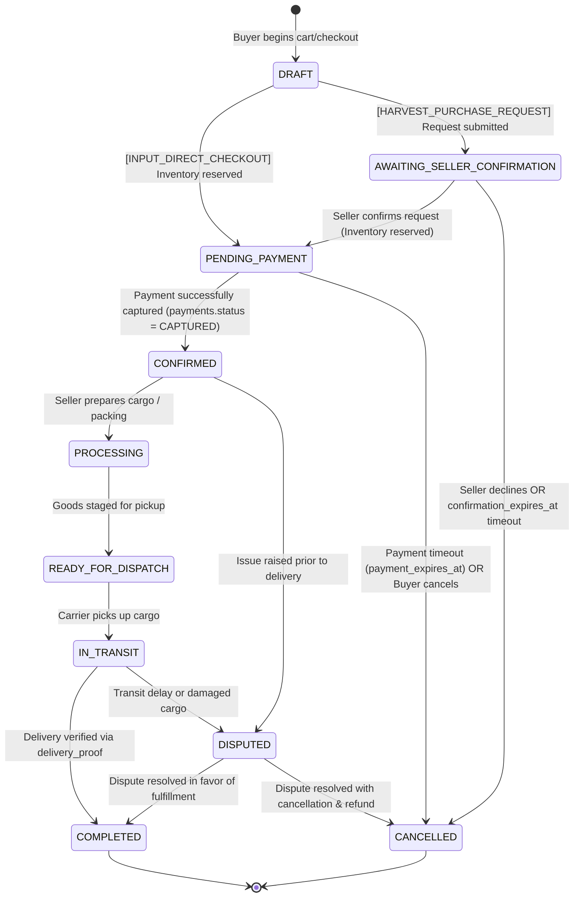

### 5.2 Payment State Machine (`payments.status`)
Operates as an independent, provider-neutral state machine:

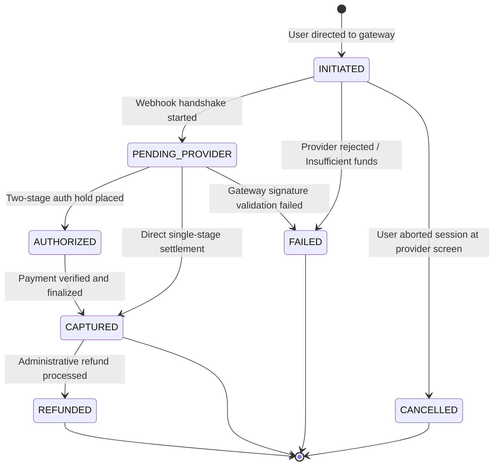

### 5.3 Harvest Batch & Listing State Machines

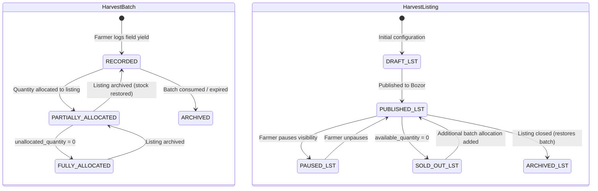

### 5.4 Shipment State Machine (`shipments.status`)

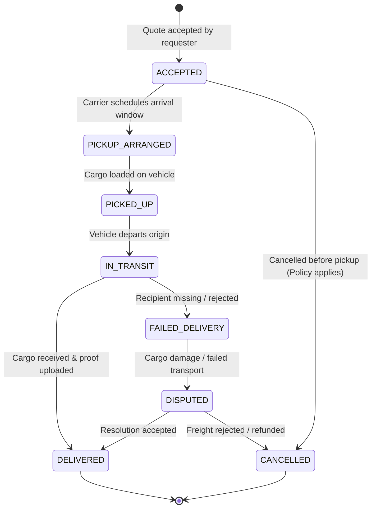

### 5.5 Review State Machine (`reviews.status`)

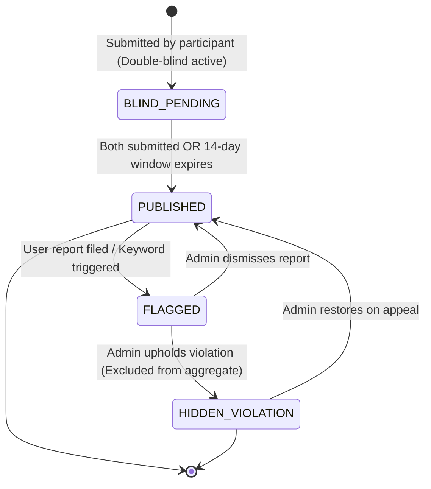

---

## 6. Quantity Invariants, Inventory Accounting & Concurrency Strategy

### 6.1 Mathematical Quantity Invariants
To prevent physical overselling, double-counting, or ghost inventory, the relational model enforces the following mathematical conservation laws across tables:

$$\begin{aligned}
\text{Harvest Batch Balance:} \quad & Q_{\text{recorded}} = Q_{\text{unallocated}} + \sum Q_{\text{allocated}} \\
\text{Listing Quantity Balance:} \quad & Q_{\text{allocated}} = Q_{\text{available}} + Q_{\text{reserved}} + Q_{\text{sold}} \\
\text{Domain Boundary Non-Negativity:} \quad & Q_{\text{unallocated}} \ge 0, \quad Q_{\text{available}} \ge 0, \quad Q_{\text{reserved}} \ge 0, \quad Q_{\text{sold}} \ge 0 \\
\text{Strict Allocation Upper Bound:} \quad & \sum_{\text{listings}} Q_{\text{allocated}} \le Q_{\text{recorded}}
\end{aligned}$$

### 6.2 The Cross-Row Aggregation Problem & Concurrency Safeguards

#### Why Row-Level `CHECK` Constraints Cannot Prevent Cross-Row Race Conditions
A standard PostgreSQL row-level `CHECK` constraint (such as `CHECK (unallocated_quantity >= 0)`) evaluates *only the single row being updated*. It cannot evaluate an aggregate query across related child rows (e.g., `CHECK ((SELECT SUM(allocated_quantity) FROM harvest_allocations WHERE ...) <= recorded_quantity)` is forbidden by PostgreSQL syntax). 

Furthermore, even if an asynchronous trigger or application check performs this calculation, concurrent transactions running at default `READ COMMITTED` isolation will suffer from write skew:
- Transaction A reads `unallocated_quantity = 500` and attempts to allocate 400 kg.
- Transaction B simultaneously reads `unallocated_quantity = 500` and attempts to allocate 300 kg.
- Both transactions verify that their individual request ($400 \le 500$ and $300 \le 500$) is valid.
- Both transactions commit, creating 700 kg of allocations against a 500 kg batch (a 200 kg phantom oversell).

#### The Mandatory Transactional Concurrency Strategy
All mutations to stock, harvest allocations, and inventory reservations must execute within an explicit database transaction utilizing **Pessimistic Row-Level Locking (`SELECT ... FOR UPDATE`)**:

```sql
-- 1. Lock the parent harvest batch row exclusively to prevent concurrent allocation
SELECT id, recorded_quantity, unallocated_quantity, status
FROM harvest_batches
WHERE id = :harvestBatchId
FOR UPDATE;

-- 2. Validate inside the transaction that unallocated_quantity >= requested_allocation
-- If insufficient, roll back immediately with HTTP 409 Conflict

-- 3. Update the parent harvest batch balance
UPDATE harvest_batches
SET unallocated_quantity = unallocated_quantity - :requestedAllocation,
    status = CASE 
        WHEN (unallocated_quantity - :requestedAllocation) = 0 THEN 'FULLY_ALLOCATED'
        ELSE 'PARTIALLY_ALLOCATED'
    END,
    sync_version = sync_version + 1
WHERE id = :harvestBatchId;

-- 4. Insert or update the allocation ledger row
INSERT INTO harvest_allocations (
    id, harvest_batch_id, harvest_listing_id, allocated_quantity, allocated_at
) VALUES (
    gen_random_uuid(), :harvestBatchId, :harvestListingId, :requestedAllocation, clock_timestamp()
);

-- 5. Commit transaction (releases row-level lock)
```

#### Lock Acquisition Hierarchy (Deadlock Prevention)
When processing orders that touch multiple inventory sources or cross-table records, locks must always be acquired in a strict, globally ordered sequence:
1. **First:** Lock the parent batch (`harvest_batches`) ordered by `id ASC`.
2. **Second:** Lock the listing (`harvest_listings`) or offer (`seller_offers`) ordered by `id ASC`.
3. **Third:** Lock or insert the reservation record (`inventory_reservations`).
4. **Fourth:** Create the order and line items (`orders`, `order_items`).

#### Concurrency Verification Test Criteria
Integration testing (`docs/12_testing_strategy.md`) must verify these invariants under simulated concurrency:
- **Test AC-CONCUR-1 (Allocation Race):** 10 parallel threads attempt to allocate 200 kg each from a single 1,000 kg harvest batch. Exactly 5 transactions must commit; exactly 5 must be rejected with `INSUFFICIENT_UNALLOCATED_QUANTITY`. The final `unallocated_quantity` must be exactly `0.000`.
- **Test AC-CONCUR-2 (Checkout Race):** 20 concurrent buyers attempt to reserve the final 100 kg of tomatoes. Exactly 1 buyer acquires the reservation; 19 receive an out-of-stock response. Final `available_quantity` must be `0.000` and `reserved_quantity` must be `100.000`.

---

## 7. Indexing Strategy & Performance Optimizations

To support sub-50ms query latency under production load, explicit B-tree and partial indexes are defined based on primary query patterns:

```sql
-- 1. Identity & Auth Lookups
CREATE INDEX idx_phone_identities_lookup ON phone_identities (phone_number) WHERE verified_at IS NOT NULL;
CREATE INDEX idx_auth_sessions_user_active ON auth_sessions (user_id) WHERE is_revoked = FALSE;
CREATE INDEX idx_otp_challenges_active ON otp_challenges (phone_number, expires_at) WHERE is_consumed = FALSE;

-- 2. Farm Management (Scoped to Farm/User)
CREATE INDEX idx_fields_farm ON fields (farm_id);
CREATE INDEX idx_crop_cycles_field_status ON crop_cycles (field_id, status);
CREATE INDEX idx_farm_activities_cycle_date ON farm_activities (crop_cycle_id, activity_timestamp DESC);
CREATE INDEX idx_harvest_batches_farm_status ON harvest_batches (farm_id, status);

-- 3. Marketplace Discovery & Search
CREATE INDEX idx_harvest_listings_discovery ON harvest_listings (region, crop_type, unit_price) 
WHERE status = 'PUBLISHED' AND available_quantity > 0;
CREATE INDEX idx_seller_offers_discovery ON seller_offers (catalog_product_id, unit_price) 
WHERE status = 'ACTIVE' AND available_quantity > 0;
CREATE INDEX idx_categories_parent ON product_categories (parent_id, display_order);

-- 4. Orders & Active Workflow Queues
CREATE INDEX idx_orders_buyer ON orders (buyer_user_id, status, created_at DESC);
CREATE INDEX idx_orders_seller ON orders (seller_user_id, status, created_at DESC);
CREATE INDEX idx_inventory_reservations_expiry ON inventory_reservations (expires_at) 
WHERE status = 'ACTIVE';

-- 5. Logistics Quoting & Tracking
CREATE INDEX idx_shipment_requests_active ON shipment_requests (origin_region, destination_region, status)
WHERE status IN ('REQUESTED', 'QUOTED');
CREATE INDEX idx_shipments_carrier ON shipments (carrier_user_id, status);

-- 6. Reputation & Double-Blind Unmasking Queue
CREATE INDEX idx_reviews_unmasking_job ON reviews (blinded_until) 
WHERE is_blinded = TRUE AND status = 'BLIND_PENDING';
CREATE INDEX idx_reviews_target_public ON reviews (target_user_id, review_type) 
WHERE status = 'PUBLISHED';
CREATE INDEX idx_reviews_listing_public ON reviews (target_harvest_listing_id) 
WHERE status = 'PUBLISHED';

-- 7. Audit & Compliance
CREATE INDEX idx_audit_logs_target ON audit_logs (target_entity_type, target_entity_id, created_at DESC);
CREATE INDEX idx_audit_logs_actor ON audit_logs (actor_user_id, created_at DESC);
```

---

## 8. Security, Tenant Isolation & Data Privacy Boundaries

### 8.1 Public vs. Private Field Separation
A major security vulnerability in multi-sided platforms is accidental data leakage across bounded contexts. The following strict privacy boundaries are enforced at the database and query projection level:

```
+--------------------------------------------------------------------------------------------------+
|                                    DATA PRIVACY BOUNDARIES                                       |
+-------------------------------------------------+------------------------------------------------+
|                 PRIVATE DOMAIN                  |                 PUBLIC DOMAIN                  |
|          (Farm Core & Internal Ops)             |          (Bozor & Logistics Market)            |
+-------------------------------------------------+------------------------------------------------+
| • Exact cadastral plot boundary (GeoJSON)       | • Regional origin (e.g., 'Samarkand, Tayloq')  |
| • Farm activity history (chemical treatments)   | • Crop species, cultivar, quality grade        |
| • Field worker identities and wage notes        | • Total listed quantity & minimum order (MOQ)  |
| • Private warehouse location & storage notes    | • Unit price (UZS) or Request-For-Quote flag   |
| • Exact harvest batch physical yield            | • Public seller rating & completed deal count  |
| • Exact buyer/seller pickup address             | • Delivery region/district destination         |
+-------------------------------------------------+------------------------------------------------+
```

### 8.2 Authorization and Ownership Verification (ABAC / Farm Boundaries)
1. **Farm Data Isolation:** Possession of a valid user token does not grant read access to farm entities. Every query accessing `farms`, `fields`, `crop_cycles`, `farm_activities`, or `harvest_batches` must enforce an ownership join:
   ```sql
   WHERE farm_id IN (
       SELECT farm_id FROM farm_memberships 
       WHERE user_id = :currentUserId AND status = 'ACTIVE'
   )
   ```
2. **Order Visibility Isolation:** Orders can only be queried where `buyer_user_id = :currentUserId` OR `seller_user_id = :currentUserId`. Administrative access requires verified operator role logging an audit reason (`ADM-005`).

---

## 9. Reputation & Review Integrity Architecture

Authoritative modeling derived from [`12_reputation_and_reviews.md`](12_reputation_and_reviews.md) (`DEC-018`):

### 9.1 Double-Blind Resolution & Scheduled Jobs
To prevent retaliatory scoring, reviews submitted by buyers and sellers are stored with `is_blinded = TRUE` and `status = 'BLIND_PENDING'`.

Unblinding is triggered by the first condition satisfied:
1. **Both Parties Submit:** When the counterparty submits their review for the same order, the transactional handler unblinds both reviews simultaneously (`is_blinded = FALSE`, `status = 'PUBLISHED'`).
2. **Timer Expiration:** A background scheduled job (`ReviewWindowCloseJob`) runs hourly:
   ```sql
   UPDATE reviews
   SET is_blinded = FALSE,
       status = 'PUBLISHED',
       published_at = clock_timestamp()
   WHERE is_blinded = TRUE
     AND status = 'BLIND_PENDING'
     AND blinded_until <= clock_timestamp();
   ```

### 9.2 Equal Weighting Invariant vs. Repeat-Pair Damping Trade-off
- **The Equal Weighting Invariant ($1.0$):** Every verified transaction review carries an identical mathematical weight of $1.0$ (`REV-002`). A 100,000,000 UZS transaction carries no more weight than a 500,000 UZS transaction.
- **The Repeat-Pair Damping Dilemma:** If a single buyer and seller execute 20 small transactions in 30 days, calculating a simple average over 20 reviews allows syndicate rating padding.
- **MVP Technical Recommendation:**
  - *Public Display:* All reviews remain visible in the review history list (transparency).
  - *Aggregate Calculation:* Subsequent reviews between the identical buyer-seller pair within a rolling 90-day window are consolidated into a single effective score contribution ($1.0$ weight total for that pair) in the materialized `user_reputation_aggregates`.
  - *Status:* `[PROPOSED: DEC-018 Safeguard]` awaiting final product owner parameter approval.

---

## 10. Open Decisions & Provisional Structures

| Decision ID | Description | Impact on Domain Model | Current Modeling Treatment |
|---|---|---|---|
| **DEC-007** | Payment Recipient & Settlement Model | Unresolved legal structure (Direct vs. Escrow vs. Split). | Provider-neutral `payments` and `refunds` tables. No escrow accounts or seller payout balance ledger entities created yet. |
| **DEC-010** | Cancellation & Refund Policy | Stage-gated cancellation rules pending final PO sign-off. | Modeled state transitions (`CANCELLED`, `DISPUTED`) with audit justification; fee calculations deferred. |
| **DEC-013** | Logistics Leasing Finance Partner | No partner bank signed under contract. | `leasing_applications` modeled as provisional skeleton with nullable `partner_bank_code`. |
| **DEC-018** | Two-Sided Review System Timing | 14-day blind window, 7-day rebuttal, 90-day damping. | Modeled with configurable timestamp fields (`blinded_until`, `created_at`); constants documented as proposed defaults. |

---

## 11. Traceability Matrix: Entities to PRD Requirements

| Module | Relational Table(s) | PRD Requirement IDs | Verified Acceptance Criteria |
|---|---|---|---|
| **Identity & Access** | `users`, `user_profiles`, `phone_identities`, `otp_challenges`, `auth_sessions`, `user_roles` | `ID-001`–`ID-006`, `ACL-001` | AC-1.1, AC-1.2, AC-1.4, AC-1.5 |
| **Seller Verification** | `seller_profiles`, `seller_verifications` | `DEC-004`, `MKT-018`, `ADM-005` | AC-1.1, AC-REV-6 |
| **Farm Management** | `farms`, `fields`, `crop_cycles`, `farm_activities` | `FARM-001`–`FARM-006`, `ACL-002`, `ACL-003` | AC-2.1–AC-2.5 |
| **Harvest Core** | `harvest_batches`, `harvest_allocations` | `FARM-007`, `FARM-008`, `DEC-008` | AC-3.1, AC-3.2, AC-3.5 |
| **Catalog & Offers** | `product_categories`, `units_of_measure`, `catalog_products`, `seller_offers` | `MKT-001`–`MKT-003`, `DEC-005`, `DEC-009` | AC-4.1, AC-4.2 |
| **Produce Listings** | `harvest_listings`, `listing_media`, `inventory_reservations` | `MKT-004`–`MKT-006`, `MKT-013`, `DEC-008` | AC-3.2, AC-3.4, AC-4.3 |
| **Orders** | `orders`, `order_items`, `order_status_history` | `MKT-010`–`MKT-017`, `DEC-006` | AC-4.1–AC-4.5 |
| **Payments** | `payments`, `payment_events`, `refunds` | `PAY-001`–`PAY-009`, `DEC-007` | AC-4.5, AC-4.8 |
| **Logistics** | `carrier_profiles`, `carrier_vehicles`, `shipment_requests`, `shipment_quotes`, `shipments`, `delivery_proofs` | `LOG-001`–`LOG-009`, `ACL-006` | AC-5.1–AC-5.6 |
| **Reputation** | `reviews`, `review_media`, `review_responses`, `review_reports`, `user_reputation_aggregates` | `REV-001`–`REV-010`, `DEC-018` | AC-REV-1–AC-REV-8 |
| **Platform** | `media_files`, `notifications`, `audit_logs` | `MEDIA-001`, `NOTIF-001`, `ADM-005` | AC-3.3, AC-5.5 |

---

## 12. Maintenance, Review Checkpoints, and Next Steps

### 12.1 Engineering Review Checkpoints Before Flyway Implementation
Before drafting the initial Flyway migration script (`V1__init.sql`), the engineering team must:
1. Confirm PostgreSQL 16 extensions: `uuid-ossp` or native `pgcrypto` (`gen_random_uuid()`), and `postgis` (if boundary polygons are stored as native geometries instead of GeoJSON text).
2. Complete the API contract (`05_api_contract.md` / Milestone 4) for the first development slice (Identity + Farm core).
3. Validate database connection pooling parameters (HikariCP sizing) against pessimistic lock durations.

### 12.2 Recommended Next Milestone
👉 **Milestone 4: Define First API Contract (`docs/05_api_contract.md` / `api/`)**  
Specify OpenAPI 3.0 REST contracts for Identity and Farm Core endpoints:
- Phone OTP registration, verification, token refresh (`/api/v1/auth/*`).
- Farm, Field, Crop Cycle, and Activity endpoints (`/api/v1/farms/*`).
- Harvest Batch creation and allocation endpoints (`/api/v1/harvest-batches/*`).
