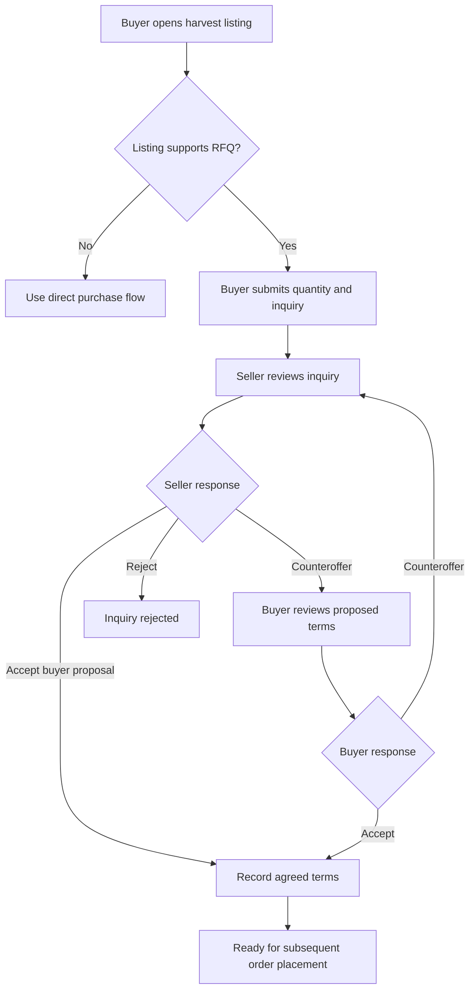
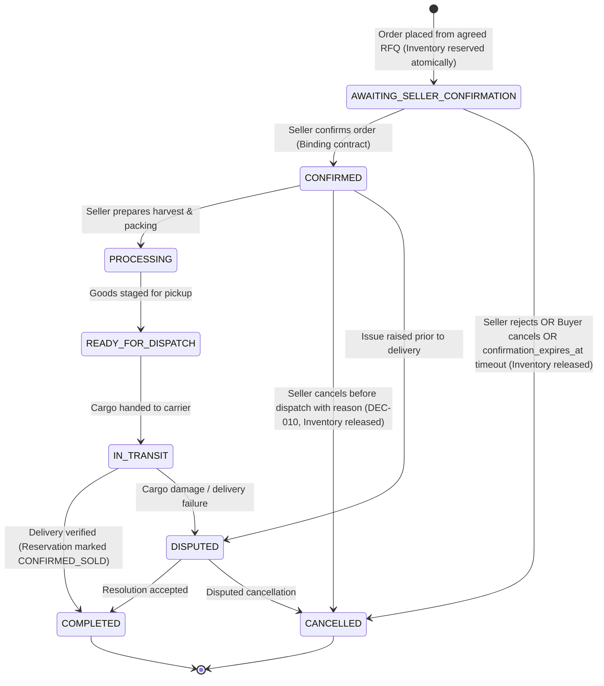
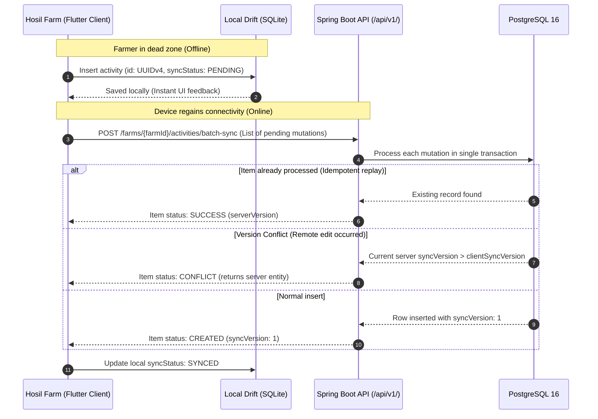

# Hosil Ecosystem — REST API Contract Specification (v1)

**Document ID:** HOSIL-API-001  
**Version:** 1.0.0 (API `/api/v1/`)  
**Date:** 14 October 2026  
**Status:** Draft — Baseline for First Implementation Slice  
**Machine-Readable Spec:** [`docs/api/openapi-v1.yaml`](api/openapi-v1.yaml) (OpenAPI 3.0.3)  
**Cross-References:** [01_prd.md](01_prd.md) (Product Requirements), [02_architecture.md](02_architecture.md) (Architecture Blueprint), [03_user_journeys_and_permissions.md](03_user_journeys_and_permissions.md) (Journeys & Permissions), [04_domain_model.md](04_domain_model.md) (Relational Domain Model), [07_offline_strategy.md](07_offline_strategy.md) (Offline Strategy), [10_admin_and_api_versioning.md](10_admin_and_api_versioning.md) (API Versioning Policy), [decision_register.md](decision_register.md) (Decision Register)

---

## 1. Overview, Protocol & Architecture Foundations

### 1.1 Purpose and Scope
This document specifies the authoritative versioned REST API contract for the **first backend development slice** of the Hosil agricultural platform. The contract bridges the relational domain model ([`04_domain_model.md`](04_domain_model.md)) and the primary user journeys ([`03_user_journeys_and_permissions.md`](03_user_journeys_and_permissions.md)) into concrete, client-facing HTTP interfaces.

The first implementation slice covers:
1. **Authentication & Identity (`hosil-identity`):** Phone number SMS OTP registration, verification, token refresh, logout, session management, and user profile management.
2. **Farm Management Core (`hosil-farm`):** Farm holding creation, membership administration, field management, crop cycles, daily agronomic activity logging, and harvest batch recording.
3. **Marketplace Publication Boundary (`hosil-marketplace`):** The controlled operational bridge enabling farmers to publish and allocate harvested produce to Hosil Bozor without exposing private agronomic data.
4. **Offline Synchronization (`07_offline_strategy.md`):** Intermittent connectivity protocols, client mutation deduplication, and batch activity sync.

Subsequent implementation slices (commercial input catalog, cart checkout, provider payment callbacks, logistics quoting, transport tracking, two-sided review submission) are identified at their architectural boundaries and scheduled for subsequent roadmap milestones.

### 1.2 Protocol & Base URI
- **Base URL:** `https://api.hosil.uz/api/v1`
- **Transport:** HTTPS exclusively (TLS 1.3 mandated; TLS 1.2 minimum). Cleartext HTTP is rejected with `301 Moved Permanently` or dropped by ingress proxies.
- **Content-Type:** `application/json; charset=UTF-8` for all request and response bodies unless explicitly noted otherwise (e.g., multipart file uploads).
- **Client Identity:** Clients must transmit standard identification headers:
  - `User-Agent`: Client application identifier (e.g., `HosilFarm/1.0.0 (Android 14; Build/UP1A.231005.007)`).
  - `X-Correlation-ID`: Client-generated UUID for end-to-end distributed tracing across logs (`08_observability.md`). If omitted, the API gateway generates one and returns it in the response header.

---

## 2. Shared API Conventions & Security Standards

### 2.1 Security & Authentication Scheme
Authentication utilizes JSON Web Tokens (JWT) adhering to RFC 7519:
- **Authorization Header:** `Authorization: Bearer <accessToken>`
- **Token Architecture:**
  - **Access Token:** Short-lived JWT (15 minutes validity). Contains standard claims: `sub` (User UUID), `iss` (`hosil.uz`), `iat`, `exp`, and custom claim `roles` (array of assigned roles).
  - **Refresh Token:** Opaque, high-entropy cryptographic token (`UUIDv4` or 256-bit random hex). Stored in the database exclusively as a salted hash (`auth_sessions.token_hash`).
- **Session Persistence (`DEC-003`):** Active sessions persist across app restarts without re-prompting for OTP. Re-authentication via SMS OTP is required only upon explicit logout, session revocation, or inactivity expiration.
- **Refresh Token Rotation:** Every call to `POST /auth/token/refresh` invalidates the submitted refresh token and issues a new refresh token. Replay of an invalidated refresh token triggers immediate revocation of the entire active session family (compromise detection).

### 2.2 Identification & Precision Conventions
To prevent floating-point drift, rounding discrepancies, and ambiguous units:
1. **Identifiers:** All business entities use lowercase canonical UUIDv4 strings (e.g., `"f47ac10b-58cc-4372-a567-0e02b2c3d479"`). Autoincrementing integer IDs are never used in public API contracts.
2. **Monetary Quantities:** Transmitted as decimal strings with exactly two fractional digits (e.g., `"150000.00"`). JSON floating-point numbers (`150000.0`) are prohibited. Currency is explicitly specified using ISO-4217 three-letter codes (default: `"UZS"`).
3. **Physical Quantities:** Transmitted as decimal strings with up to three fractional digits (e.g., `"2500.000"`). Accompanied by an authoritative unit code from the reference catalog (`units_of_measure`, e.g., `"KG"`, `"TON"`, `"BAG_50KG"`, `"LITER"`).
4. **Timestamps:** Transmitted in ISO-8601 extended UTC format with trailing `Z` (e.g., `"2026-10-14T09:30:00Z"`). Local dates without time components use ISO-8601 date strings (`"YYYY-MM-DD"`, e.g., `"2026-10-14"`).

### 2.3 Unified Error Envelope
All error responses (`4xx` and `5xx`) return a uniform, machine-readable JSON structure conforming to RFC 7807 principles:

```json
{
  "error": {
    "code": "VALIDATION_FAILED",
    "message": "The request payload failed structural or semantic validation constraints.",
    "correlationId": "req-8f4b-1234-9876",
    "timestamp": "2026-10-14T09:30:00Z",
    "details": [
      {
        "field": "allocatedQuantity",
        "rejectedValue": "5000.000",
        "message": "Allocated quantity cannot exceed unallocated batch quantity (3200.000 KG)."
      }
    ]
  }
}
```

#### Standard Error Codes & HTTP Mapping
| HTTP Status | Error Code | Description |
|---|---|---|
| **`400 Bad Request`** | `MALFORMED_REQUEST` | Syntax error, unparseable JSON, or invalid path parameters. |
| **`401 Unauthorized`** | `AUTHENTICATION_REQUIRED` | Missing, expired, or cryptographically invalid Bearer token. |
| **`403 Forbidden`** | `INSUFFICIENT_PERMISSIONS` | Caller authenticated, but lacks required role or farm membership. |
| **`404 Not Found`** | `RESOURCE_NOT_FOUND` | Referenced entity does not exist or caller is unauthorized to know it exists (IDOR prevention). |
| **`409 Conflict`** | `STATE_CONFLICT` | Resource version mismatch (`409`), duplicate unique constraint, or insufficient quantity. |
| **`422 Unprocessable`** | `VALIDATION_FAILED` | Syntactically valid JSON failing business validation rules. |
| **`428 Precondition Required`** | `TELEGRAM_LINK_REQUIRED` | Phone must be linked with Telegram bot before OTP dispatch in local/dev mode. |
| **`429 Too Many Req`** | `RATE_LIMIT_EXCEEDED` | Request rate limit exceeded. Header `Retry-After: <seconds>` included. |
| **`500 Internal Error`**| `INTERNAL_SERVER_ERROR`| Unhandled server error. Stack traces are never leaked in responses. |

### 2.4 Pagination & Filtering Standard
Collection endpoints return a standard paginated envelope:
- **Query Parameters:**
  - `page`: 0-indexed page number (default: `0`).
  - `size`: Items per page (default: `20`, maximum: `100`).
  - `sort`: Comma-delimited sorting fields (e.g., `createdAt,desc` or `activityTimestamp,desc`).
- **Response Envelope:**
  ```json
  {
    "content": [ ... ],
    "pageNumber": 0,
    "pageSize": 20,
    "totalElements": 45,
    "totalPages": 3,
    "isLast": false
  }
  ```

### 2.5 Idempotency for State-Mutating Operations
Network interruptions in rural field environments frequently cause mobile clients to retry requests whose server-side outcome is uncertain.
- All non-idempotent creation requests (`POST`) that allocate resources or record activities require an **`Idempotency-Key`** header containing a client-generated UUIDv4.
- The server caches the response of completed idempotent requests in Redis/PostgreSQL for **24 hours**.
- If a duplicate request arrives while the original is still processing, the server returns `409 Conflict` with code `CONCURRENT_MUTATION_IN_PROGRESS`.
- Once processed, retried requests with the identical key return the original cached response with HTTP header `X-Cache-Lookup: IDEMPOTENT_HIT`.

---

## 3. Detailed Endpoint Contracts: First Implementation Slice

### 3.1 Authentication & Identity Module (`/auth` & `/users`)

#### 1. Request SMS OTP Challenge
- **Endpoint:** `POST /api/v1/auth/otp/request`
- **Security:** Public (No Bearer token required).
- **Description:** Generates a 6-digit one-time passcode, stores its salted SHA-256 hash in `otp_challenges`, and dispatches it via SMS to the specified phone number.
- **Rate Limits:** Maximum 3 requests per 5 minutes per phone number and IP address (`429 Rate Limit Exceeded`).
- **Anti-Enumeration Safeguard:** Returns HTTP `200 OK` with an identical response structure regardless of whether the phone number is already registered or new.
- **Telegram Linking Precondition (Local/Development Mode - DEC-003 / Milestone 6C.5):** If the server is configured with `hosil.otp.delivery.provider=TELEGRAM` and the requested `phoneNumber` has not yet completed Telegram account linking, this endpoint returns `428 Precondition Required` with code `TELEGRAM_LINK_REQUIRED` without generating an unfulfillable challenge. Clients should initiate a linking session via `POST /api/v1/auth/telegram/link-session`.
- **Request Body:**
  ```json
  {
    "phoneNumber": "+998901234567"
  }
  ```
- **Validation Rules:**
  - `phoneNumber`: Mandatory string matching regex `^\+998[0-9]{9}$`.
- **Response (`200 OK`):**
  ```json
  {
    "challengeId": "3fa85f64-5717-4562-b3fc-2c963f66afa6",
    "expiresInSeconds": 180,
    "resendAfterSeconds": 60
  }
  ```

#### 1a. Create Telegram Linking Session (Development Mode - Milestone 6C.5)
- **Endpoint:** `POST /api/v1/auth/telegram/link-session`
- **Security:** Public.
- **Description:** Initiates a cryptographically secure 10-minute linking session for a phone number. Returns a deep-link URL directing the user to the development Telegram authentication bot (`@hosil_authentication_bot?start=<token>`).
- **Request Body:**
  ```json
  {
    "phoneNumber": "+998901234567"
  }
  ```
- **Response (`200 OK`):**
  ```json
  {
    "sessionId": "b8a5fc94-71e8-4660-8451-d41a5f187a03",
    "phoneNumber": "+998901234567",
    "botUsername": "hosil_authentication_bot",
    "deepLink": "https://t.me/hosil_authentication_bot?start=E5Gf_v4hZ3k...",
    "expiresInSeconds": 600
  }
  ```

#### 1b. Check Telegram Linking Status (Development Mode - Milestone 6C.5)
- **Endpoint:** `POST /api/v1/auth/telegram/status`
- **Security:** Public.
- **Description:** Checks whether a pending Telegram linking session has been completed by the user. Bound strictly to the cryptographic `sessionToken` to eliminate phone-number enumeration risks. Does not disclose phone numbers, Telegram user IDs, or chat IDs.
- **Request Body:**
  ```json
  {
    "sessionToken": "4s7D_f8a9_sample_session_token_32bytes"
  }
  ```
- **Response (`200 OK`):**
  ```json
  {
    "isLinked": true
  }
  ```
- **Error Responses:**
  - `400 Bad Request`: `VALIDATION_ERROR` when `sessionToken` is missing, blank, malformed, non-existent, or expired.
  - `405 Method Not Allowed`: When attempting legacy unauthenticated `GET` queries.

#### 2. Verify SMS OTP & Authenticate
- **Endpoint:** `POST /api/v1/auth/otp/verify`
- **Security:** Public.
- **Description:** Validates the submitted passcode against the active `otp_challenges` record. Upon success, marks the challenge as consumed, establishes an `auth_sessions` record, and issues an Access/Refresh token pair.
- **Brute-Force Safeguard:** Allows maximum 5 failed attempts per challenge. Upon 5 failed attempts, the challenge is immediately invalidated (`409 Conflict: OTP_CHALLENGE_LOCKED`).
- **Request Body:**
  ```json
  {
    "challengeId": "3fa85f64-5717-4562-b3fc-2c963f66afa6",
    "otpCode": "849201",
    "deviceFingerprint": "samsung-sm-a125f-uuid9876",
    "userAgent": "HosilFarm/1.0.0 (Android 14; Build/UP1A)"
  }
  ```
- **Validation Rules:**
  - `challengeId`: Valid UUIDv4 string.
  - `otpCode`: Exactly 6 numeric digits `^[0-9]{6}$`.
- **Response (`200 OK`):**
  ```json
  {
    "accessToken": "eyJhbGciOiJIUzI1NiIsInR5cCI6IkpXVCJ9...",
    "refreshToken": "7c9e6679-7425-40de-944b-e07fc1f90ae7",
    "tokenType": "Bearer",
    "expiresInSeconds": 900,
    "isNewUser": false,
    "user": {
      "id": "e4b3c2a1-0000-4000-a000-000000000001",
      "phoneNumber": "+998901234567",
      "status": "ACTIVE",
      "roles": ["REGISTERED_USER", "FARMER"]
    }
  }
  ```

#### 3. Refresh Access Token
- **Endpoint:** `POST /api/v1/auth/token/refresh`
- **Security:** Public (Authenticated via refresh token body).
- **Description:** Validates the active refresh token hash, verifies sliding inactivity limits, revokes the old refresh token, and issues a fresh rotated token pair.
- **Request Body:**
  ```json
  {
    "refreshToken": "7c9e6679-7425-40de-944b-e07fc1f90ae7",
    "deviceFingerprint": "samsung-sm-a125f-uuid9876"
  }
  ```
- **Response (`200 OK`):**
  ```json
  {
    "accessToken": "eyJhbGciOiJIUzI1NiIsInR5cCI6IkpXVCJ9...",
    "refreshToken": "8d0f7780-8536-41ef-a55c-f18gd2g01bf8",
    "tokenType": "Bearer",
    "expiresInSeconds": 900
  }
  ```
- **Error Responses:**
  - `401 Unauthorized: INVALID_REFRESH_TOKEN` (token expired, revoked, or replay detected).

#### 4. Explicit Session Logout
- **Endpoint:** `POST /api/v1/auth/logout`
- **Security:** Authenticated (`Bearer <accessToken>`).
- **Description:** Marks the active device session as revoked (`auth_sessions.is_revoked = TRUE`).
- **Request Body:**
  ```json
  {
    "refreshToken": "8d0f7780-8536-41ef-a55c-f18gd2g01bf8"
  }
  ```
- **Response (`204 No Content`):** Empty body.

#### 5. Get Current User Profile
- **Endpoint:** `GET /api/v1/users/me`
- **Security:** Authenticated (`Bearer <accessToken>`).
- **Description:** Returns the authenticated user's profile, assigned ecosystem roles, commercial seller profile (if verified), and accessible farm memberships.
- **Response (`200 OK`):**
  ```json
  {
    "id": "e4b3c2a1-0000-4000-a000-000000000001",
    "phoneNumber": "+998901234567",
    "status": "ACTIVE",
    "profile": {
      "fullName": "Rustam Karimov",
      "preferredLanguage": "uz-Latn",
      "region": "Toshkent viloyati",
      "district": "Yangiyoʻl tumani",
      "avatarMediaId": null
    },
    "roles": ["REGISTERED_USER", "FARMER"],
    "sellerProfile": {
      "sellerType": "FARMER",
      "legalBusinessName": null,
      "verificationStatus": "UNVERIFIED",
      "verifiedAt": null
    },
    "accessibleFarms": [
      {
        "farmId": "f1a2b3c4-1111-4000-a000-000000000001",
        "farmName": "Karimov Bogʻdorchilik",
        "membershipRole": "OWNER",
        "permissionsMask": "READ,WRITE_ACTIVITY,RECORD_HARVEST,PUBLISH_MARKET"
      }
    ]
  }
  ```

#### 6. Update User Profile
- **Endpoint:** `PATCH /api/v1/users/me`
- **Security:** Authenticated (`Bearer <accessToken>`).
- **Description:** Updates non-identity profile preferences.
- **Request Body:**
  ```json
  {
    "fullName": "Rustam B. Karimov",
    "preferredLanguage": "uz-Latn",
    "region": "Toshkent viloyati",
    "district": "Yangiyoʻl tumani"
  }
  ```
- **Response (`200 OK`):** Updated User DTO matching `GET /users/me`.

---

### 3.2 Farm Management Module (`/farms`)

#### 7. List Accessible Farms
- **Endpoint:** `GET /api/v1/farms`
- **Security:** Authenticated.
- **Description:** Returns all farms where the authenticated user holds an active membership (`farm_memberships.status = 'ACTIVE'`).
- **Query Parameters:** `page`, `size`.
- **Response (`200 OK`):** Paginated envelope of Farm DTOs.

#### 8. Create Farm
- **Endpoint:** `POST /api/v1/farms`
- **Security:** Authenticated (`FARMER` or `REGISTERED_USER`).
- **Headers:** `Idempotency-Key: <UUID>`
- **Description:** Creates a new farm holding. The calling user is automatically registered as the legal owner (`farm_memberships.role = 'OWNER'`).
- **Request Body:**
  ```json
  {
    "name": "Oltin Voha Agro",
    "region": "Samarqand viloyati",
    "district": "Tayloq tumani",
    "totalAreaHa": "12.50",
    "legalType": "FERMER"
  }
  ```
- **Validation Rules:**
  - `name`: 2–255 characters.
  - `region`, `district`: Mandatory strings.
  - `totalAreaHa`: Optional decimal string `> 0`.
  - `legalType`: One of `['DEHQON', 'FERMER', 'MCHJ', 'TOMORQA']`.
- **Response (`201 Created`):**
  ```json
  {
    "id": "f1a2b3c4-1111-4000-a000-000000000002",
    "ownerUserId": "e4b3c2a1-0000-4000-a000-000000000001",
    "name": "Oltin Voha Agro",
    "region": "Samarqand viloyati",
    "district": "Tayloq tumani",
    "totalAreaHa": "12.50",
    "legalType": "FERMER",
    "createdAt": "2026-10-14T09:30:00Z"
  }
  ```

#### 9. Get Farm Profile
- **Endpoint:** `GET /api/v1/farms/{farmId}`
- **Security:** Authenticated (Must hold active membership in `farmId`).
- **Response (`200 OK`):** Farm Profile DTO including summary statistics (total fields count, active crop cycles count).

#### 10. Update Farm Profile
- **Endpoint:** `PATCH /api/v1/farms/{farmId}`
- **Security:** Authenticated (`OWNER` or `MANAGER` membership required).
- **Request Body:** Modifiable fields (`name`, `totalAreaHa`, `legalType`).
- **Response (`200 OK`):** Updated Farm DTO.

#### 11. List Farm Memberships
- **Endpoint:** `GET /api/v1/farms/{farmId}/members`
- **Security:** Authenticated (`OWNER` or `MANAGER` required).
- **Response (`200 OK`):** Array of member DTOs (user ID, full name, phone number, role, permissions mask, status).

#### 12. Add Farm Member
- **Endpoint:** `POST /api/v1/farms/{farmId}/members`
- **Security:** Authenticated (`OWNER` required).
- **Request Body:**
  ```json
  {
    "phoneNumber": "+998939876543",
    "role": "AGRONOMIST",
    "permissionsMask": "READ,WRITE_ACTIVITY,RECORD_HARVEST"
  }
  ```
- **Response (`201 Created`):** Created membership DTO.

#### 13. Create Field Plot
- **Endpoint:** `POST /api/v1/farms/{farmId}/fields`
- **Security:** Authenticated (`OWNER`, `MANAGER`, or `AGRONOMIST`).
- **Headers:** `Idempotency-Key: <UUID>`
- **Description:** Creates a distinct cultivation field plot (*dala*).
- **Request Body:**
  ```json
  {
    "id": "c1d2e3f4-2222-4000-a000-000000000001",
    "name": "1-Dala Issiqxona",
    "area": "1.20",
    "areaUnit": "HECTARE",
    "boundaryGeojson": {
      "type": "Polygon",
      "coordinates": [[[69.215, 41.285], [69.218, 41.285], [69.218, 41.282], [69.215, 41.282], [69.215, 41.285]]]
    },
    "notes": "Tomchilatib sug'orish tizimi o'rnatilgan (Drip irrigation installed)"
  }
  ```
- **Validation Rules:**
  - `id`: Optional client-generated UUID for offline synchronization.
  - `name`: 1–100 characters.
  - `area`: Decimal string `> 0`.
  - `areaUnit`: One of `['HECTARE', 'SOTKA', 'SQM']`.
- **Response (`201 Created`):** Field DTO.

#### 14. Create Crop Cycle
- **Endpoint:** `POST /api/v1/farms/{farmId}/crop-cycles`
- **Security:** Authenticated (`OWNER`, `MANAGER`, or `AGRONOMIST`).
- **Headers:** `Idempotency-Key: <UUID>`
- **Request Body:**
  ```json
  {
    "id": "c2d3e4f5-3333-4000-a000-000000000001",
    "fieldId": "c1d2e3f4-2222-4000-a000-000000000001",
    "cropType": "Pomidor (Tomato)",
    "variety": "Pink Paradise F1",
    "plantingDate": "2026-03-15",
    "expectedHarvestDate": "2026-07-01"
  }
  ```
- **Validation Rules:**
  - `fieldId`: Must belong to `farmId`.
  - `expectedHarvestDate`: Must be $\ge$ `plantingDate`.
- **Response (`201 Created`):** Crop Cycle DTO (`status: 'ACTIVE'`).

#### 15. Record Daily Agronomic Activity
- **Endpoint:** `POST /api/v1/farms/{farmId}/activities`
- **Security:** Authenticated (`OWNER`, `MANAGER`, `AGRONOMIST`, or `WORKER` with `WRITE_ACTIVITY`).
- **Headers:** `Idempotency-Key: <UUID>`
- **Description:** Ingests daily field activities. Designed for seamless offline replay.
- **Request Body:**
  ```json
  {
    "id": "a1b2c3d4-4444-4000-a000-000000000001",
    "cropCycleId": "c2d3e4f5-3333-4000-a000-000000000001",
    "fieldId": "c1d2e3f4-2222-4000-a000-000000000001",
    "activityType": "FERTILIZING",
    "activityTimestamp": "2026-05-10T06:30:00Z",
    "quantity": "25.000",
    "unit": "KG",
    "notes": "Kaliy sulfat o'g'itlash o'tkazildi (Potassium sulfate applied)",
    "clientMutationId": "mut-a1b2-1001",
    "syncVersion": 1
  }
  ```
- **Validation Rules:**
  - `activityType`: One of `['PLANTING', 'IRRIGATION', 'FERTILIZING', 'CHEMICAL_TREATMENT', 'WEEDING', 'PRUNING', 'INSPECTION', 'HARVEST']`.
- **Response (`201 Created`):** Activity DTO with server-assigned `syncVersion: 1`.

#### 16. Record Physical Harvest Batch
- **Endpoint:** `POST /api/v1/farms/{farmId}/harvest-batches`
- **Security:** Authenticated (`RECORD_HARVEST` permission required).
- **Headers:** `Idempotency-Key: <UUID>`
- **Description:** Records bulk produce yield from a completed or active crop cycle. Initializes `unallocated_quantity = recorded_quantity`. **Does not create a marketplace listing.**
- **Request Body:**
  ```json
  {
    "id": "h1b2c3d4-5555-4000-a000-000000000001",
    "cropCycleId": "c2d3e4f5-3333-4000-a000-000000000001",
    "cropType": "Pomidor (Tomato)",
    "qualityGrade": "FIRST_CLASS",
    "recordedQuantity": "5000.000",
    "unitCode": "KG",
    "harvestDate": "2026-07-02",
    "storageLocationNotes": "1-Omborxona, A-seksiya (Warehouse 1, Section A)",
    "clientBatchId": "batch-local-001"
  }
  ```
- **Validation Rules:**
  - `recordedQuantity`: Decimal string `> 0`.
  - `unitCode`: Must exist in `units_of_measure`.
  - `qualityGrade`: One of `['PREMIUM', 'FIRST_CLASS', 'SECOND_CLASS', 'STANDARD', 'INDUSTRIAL']`.
- **Response (`201 Created`):**
  ```json
  {
    "id": "h1b2c3d4-5555-4000-a000-000000000001",
    "farmId": "f1a2b3c4-1111-4000-a000-000000000001",
    "cropCycleId": "c2d3e4f5-3333-4000-a000-000000000001",
    "cropType": "Pomidor (Tomato)",
    "qualityGrade": "FIRST_CLASS",
    "recordedQuantity": "5000.000",
    "unallocatedQuantity": "5000.000",
    "unitCode": "KG",
    "harvestDate": "2026-07-02",
    "storageLocationNotes": "1-Omborxona, A-seksiya (Warehouse 1, Section A)",
    "status": "RECORDED",
    "createdAt": "2026-07-02T10:00:00Z"
  }
  ```

#### 17. Get Harvest Batch Details
- **Endpoint:** `GET /api/v1/harvest-batches/{batchId}`
- **Security:** Authenticated (Farm member of owning farm).
- **Description:** Returns batch details including allocation balance and linked listings.
- **Response (`200 OK`):** Batch DTO with current `unallocatedQuantity`.

---

### 3.3 Marketplace Publication Boundary (`/market/harvest-listings`)

#### 18. Publish Harvest Listing & Allocate Batch Stock
- **Endpoint:** `POST /api/v1/market/harvest-listings`
- **Security:** Authenticated (`OWNER` or member with `PUBLISH_MARKET` authority).
- **Headers:** `Idempotency-Key: <UUID>`
- **Description:** Explicit marketplace bridge. Atomically creates a public marketplace listing and allocates stock from a private harvest batch.
- **Concurrency & Concurrency Safeguard:** Executes within a transactional boundary using pessimistic row-locking (`SELECT ... FOR UPDATE` on `harvest_batches`). If `allocatedQuantity > unallocated_quantity`, rolls back immediately with `409 Conflict: INSUFFICIENT_UNALLOCATED_QUANTITY`.
- **Data Privacy Protection:** The response DTO exposes **only** public commercial attributes. Exact farm GeoJSON, plot coordinates, chemical logs, and internal warehouse notes are excluded.
- **Request Body:**
  ```json
  {
    "harvestBatchId": "h1b2c3d4-5555-4000-a000-000000000001",
    "cropType": "Pomidor (Pink Paradise)",
    "qualityGrade": "FIRST_CLASS",
    "allocatedQuantity": "2000.000",
    "unitCode": "KG",
    "unitPrice": "6500.00",
    "currency": "UZS",
    "isRfqEnabled": false,
    "minOrderQuantity": "100.000",
    "stepQuantity": "10.000",
    "region": "Toshkent viloyati",
    "district": "Yangiyoʻl tumani",
    "mediaFileIds": [
      "m1b2c3d4-6666-4000-a000-000000000001"
    ]
  }
  ```
- **Validation Rules:**
  - `allocatedQuantity`: Must be $> 0$ and $\le$ `unallocatedQuantity`.
  - `unitCode`: Must strictly match the backing harvest batch unit code.
  - `unitPrice`: Required if `isRfqEnabled == false`.
  - `minOrderQuantity`: Must be $\le$ `allocatedQuantity`.
  - `mediaFileIds`: Array of 1 to 5 valid image media UUIDs.
- **Response (`201 Created`):**
  ```json
  {
    "id": "lst-9a8b7c6d-7777-4000-a000-000000000001",
    "sellerUserId": "e4b3c2a1-0000-4000-a000-000000000001",
    "harvestBatchId": "h1b2c3d4-5555-4000-a000-000000000001",
    "cropType": "Pomidor (Pink Paradise)",
    "qualityGrade": "FIRST_CLASS",
    "allocatedQuantity": "2000.000",
    "availableQuantity": "2000.000",
    "reservedQuantity": "0.000",
    "soldQuantity": "0.000",
    "unitCode": "KG",
    "unitPrice": "6500.00",
    "currency": "UZS",
    "isRfqEnabled": false,
    "minOrderQuantity": "100.000",
    "stepQuantity": "10.000",
    "region": "Toshkent viloyati",
    "district": "Yangiyoʻl tumani",
    "status": "PUBLISHED",
    "publishedAt": "2026-07-02T11:00:00Z"
  }
  ```
- **Error Responses:**
  - `409 Conflict: INSUFFICIENT_UNALLOCATED_QUANTITY`
  - `403 Forbidden: INSUFFICIENT_PERMISSIONS` (Caller does not own or have market publishing rights on the farm).

#### 19. Search & Browse Published Harvest Listings
- **Endpoint:** `GET /api/v1/market/harvest-listings`
- **Security:** Public (`permitAll()` — accessible to both guest buyers and authenticated users).
- **Description:** Searches and paginates publicly available wholesale harvest listings on Hosil Bozor. Returns only active listings with status `PUBLISHED`.
- **Query Parameters:**
  - `cropType` (optional string): Filter by crop type or variety substring (e.g. `Pomidor`).
  - `region` (optional string): Filter by administrative region (e.g. `Toshkent viloyati`).
  - `district` (optional string): Filter by district within region (e.g. `Yangiyoʻl tumani`).
  - `qualityGrade` (optional string): Filter by standard grade (`PREMIUM`, `FIRST_CLASS`, `SECOND_CLASS`, `STANDARD`, `INDUSTRIAL`). Invalid values return `400 Bad Request`.
  - `minPrice` (optional decimal): Minimum unit price filter ($\ge 0$). Negative returns `400 Bad Request`.
  - `maxPrice` (optional decimal): Maximum unit price filter ($\ge 0$). Negative returns `400 Bad Request`. If `minPrice > maxPrice`, returns `400 Bad Request`.
  - `isRfqEnabled` (optional boolean): Filter for Request-for-Quote listings (`true`) vs fixed-price listings (`false`). If omitted, returns both.
  - `page` (optional integer, default `0`): Zero-based page index.
  - `size` (optional integer, default `20`): Page size limit (1 to 100).
  - `sort` (optional string, default `publishedAt,desc`): Sort expression (e.g. `unitPrice,asc`, `publishedAt,desc`). Stable tie-breaker `id,desc` is automatically appended.
- **Data Privacy Protection:** Exposes only public commercial attributes and media attachments. Private farm boundaries, field names, agronomic chemical/fertilizer records, storage notes, and grower phone numbers are excluded. For RFQ listings, `unitPrice` is returned as `null` without synthetic placeholders.
- **Response (`200 OK`):**
  ```json
  {
    "content": [
      {
        "id": "lst-9a8b7c6d-7777-4000-a000-000000000001",
        "sellerUserId": "e4b3c2a1-0000-4000-a000-000000000001",
        "harvestBatchId": "h1b2c3d4-5555-4000-a000-000000000001",
        "cropType": "Pomidor (Pink Paradise)",
        "qualityGrade": "FIRST_CLASS",
        "allocatedQuantity": "2000.000",
        "availableQuantity": "2000.000",
        "reservedQuantity": "0.000",
        "soldQuantity": "0.000",
        "unitCode": "KG",
        "unitPrice": "6500.00",
        "currency": "UZS",
        "isRfqEnabled": false,
        "minOrderQuantity": "100.000",
        "stepQuantity": "10.000",
        "region": "Toshkent viloyati",
        "district": "Yangiyoʻl tumani",
        "status": "PUBLISHED",
        "publishedAt": "2026-07-02T11:00:00Z",
        "mediaFileIds": [
          "m1b2c3d4-6666-4000-a000-000000000001"
        ]
      }
    ],
    "pageNumber": 0,
    "pageSize": 20,
    "totalElements": 1,
    "totalPages": 1,
    "isLast": true
  }
  ```
- **Error Responses:**
  - `400 Bad Request: INVALID_FILTER_CRITERIA` (e.g. `minPrice > maxPrice`, `unitPrice < 0`, or invalid `qualityGrade`).

#### 20. Get Published Harvest Listing Detail
- **Endpoint:** `GET /api/v1/market/harvest-listings/{listingId}`
- **Security:** Public (`permitAll()`).
- **Description:** Retrieves full public commercial details for a single published harvest listing on Hosil Bozor.
- **Security & Privacy Boundary:** Only listings with status `PUBLISHED` are accessible. Non-published listings (`DRAFT`, `PENDING_MODERATION`, `PAUSED`, `ARCHIVED`, `SUSPENDED`) and non-existent IDs return `404 Not Found` to prevent information enumeration.
- **Response (`200 OK`):**
  ```json
  {
    "id": "lst-9a8b7c6d-7777-4000-a000-000000000001",
    "sellerUserId": "e4b3c2a1-0000-4000-a000-000000000001",
    "harvestBatchId": "h1b2c3d4-5555-4000-a000-000000000001",
    "cropType": "Pomidor (Pink Paradise)",
    "qualityGrade": "FIRST_CLASS",
    "allocatedQuantity": "2000.000",
    "availableQuantity": "2000.000",
    "reservedQuantity": "0.000",
    "soldQuantity": "0.000",
    "unitCode": "KG",
    "unitPrice": "6500.00",
    "currency": "UZS",
    "isRfqEnabled": false,
    "minOrderQuantity": "100.000",
    "stepQuantity": "10.000",
    "region": "Toshkent viloyati",
    "district": "Yangiyoʻl tumani",
    "status": "PUBLISHED",
    "publishedAt": "2026-07-02T11:00:00Z",
    "mediaFileIds": [
      "m1b2c3d4-6666-4000-a000-000000000001"
    ]
  }
  ```
- **Error Responses:**
  - `404 Not Found: LISTING_NOT_FOUND` (Listing does not exist or status is not `PUBLISHED`).

---

### 3.4 Request-for-Quote (RFQ) Negotiation Boundary (`/market/inquiries`)

Per `DEC-006` and `docs/01_prd.md §6.1`, wholesale agricultural harvest transactions follow a buyer request $\to$ seller acceptance $\to$ buyer payment lifecycle.
For RFQ-enabled harvest listings (`isRfqEnabled = true`), price and commercial conditions are negotiated in a pre-order inquiry workflow prior to formal order checkout:



**Key Architectural Invariants:**
1. **Separation of Negotiation and Stock Reservation:** An open inquiry does **not** lock farm inventory indefinitely. Agreed terms record binding pricing, quantity, and delivery parameters. Formal inventory reservation occurs when the subsequent purchase request / order is placed referencing the agreed inquiry.
2. **Payment Decoupling (DEC-007):** Agreeing to a quotation does **not** execute payment or escrow settlement. Payment integration remains deferred until commercial banking partners are selected.
3. **Turn-Taking & Immutability:** Offer proposals alternate strictly between parties. A counteroffer supersedes the previous active proposal while preserving full immutable negotiation history.

#### 21. Submit Buyer RFQ Inquiry
- **Endpoint:** `POST /api/v1/market/harvest-listings/{listingId}/inquiries`
- **Security:** Authenticated (`REGISTERED_USER` / `BUYER`).
- **Headers:** `Idempotency-Key: <UUID>` (optional).
- **Description:** Initiates an RFQ negotiation for an active harvest listing. Automatically creates the inquiry and the initial proposal (Offer #1).
- **Validation Rules:**
  - Listing must have `status = 'PUBLISHED'` and `isRfqEnabled = true`.
  - Caller cannot be the listing's seller (`buyerUserId != sellerUserId`).
  - `quantity`: Must be $> 0$, $\ge$ `minOrderQuantity`, and $\le$ `availableQuantity`.
  - Permitted step quantity: `(quantity - minOrderQuantity) % stepQuantity == 0`.
  - `unitCode`: Must match the listing's `unitCode`.
  - `unitPrice`: Optional (can be omitted for unpriced quote requests; if supplied, must be $> 0$).
- **Request Body:**
  ```json
  {
    "quantity": "500.000",
    "unitCode": "KG",
    "unitPrice": "6200.00",
    "currency": "UZS",
    "deliveryTerms": "EXW - Seller warehouse pickup",
    "notes": "Interested in 500 kg batch, can collect on Monday",
    "expiresAt": "2026-07-10T18:00:00Z"
  }
  ```
- **Response (`201 Created` or `200 OK` on idempotent hit):**
  ```json
  {
    "id": "inq-9a8b7c6d-1111-4000-a000-000000000001",
    "harvestListingId": "lst-9a8b7c6d-7777-4000-a000-000000000001",
    "cropType": "Pomidor (Pink Paradise)",
    "unitCode": "KG",
    "buyerUserId": "e4b3c2a1-0000-4000-a000-000000000002",
    "sellerUserId": "e4b3c2a1-0000-4000-a000-000000000001",
    "status": "OPEN",
    "agreedAt": null,
    "currentOffer": {
      "id": "off-1111-2222-3333-444444444441",
      "offerNumber": 1,
      "proposerUserId": "e4b3c2a1-0000-4000-a000-000000000002",
      "proposerRole": "BUYER",
      "quantity": "500.000",
      "unitCode": "KG",
      "unitPrice": "6200.00",
      "currency": "UZS",
      "totalPrice": "3100000.00",
      "deliveryTerms": "EXW - Seller warehouse pickup",
      "notes": "Interested in 500 kg batch, can collect on Monday",
      "expiresAt": "2026-07-10T18:00:00Z",
      "status": "PROPOSED",
      "createdAt": "2026-07-03T10:00:00Z"
    },
    "agreedOffer": null,
    "offers": [
      {
        "id": "off-1111-2222-3333-444444444441",
        "offerNumber": 1,
        "proposerUserId": "e4b3c2a1-0000-4000-a000-000000000002",
        "proposerRole": "BUYER",
        "quantity": "500.000",
        "unitCode": "KG",
        "unitPrice": "6200.00",
        "currency": "UZS",
        "totalPrice": "3100000.00",
        "deliveryTerms": "EXW - Seller warehouse pickup",
        "notes": "Interested in 500 kg batch, can collect on Monday",
        "expiresAt": "2026-07-10T18:00:00Z",
        "status": "PROPOSED",
        "createdAt": "2026-07-03T10:00:00Z"
      }
    ],
    "version": 1,
    "createdAt": "2026-07-03T10:00:00Z",
    "updatedAt": "2026-07-03T10:00:00Z"
  }
  ```

#### 22. List Inquiries (My Inquiries)
- **Endpoint:** `GET /api/v1/market/inquiries`
- **Security:** Authenticated.
- **Query Parameters:**
  - `role`: Optional filter (`BUYER` or `SELLER`).
  - `status`: Optional filter (`OPEN`, `AGREED`, `REJECTED`, `WITHDRAWN`, `EXPIRED`).
  - `listingId`: Optional UUID filter.
  - `page`, `size`, `sort` (deterministic pagination with `id,desc` tie-breaker).
- **Response (`200 OK`):** `PageEnvelope<InquirySummaryDto>`.

#### 23. Get Inquiry Details & Offer History
- **Endpoint:** `GET /api/v1/market/inquiries/{inquiryId}`
- **Security:** Authenticated (Must be buyer or seller of the inquiry).
- **Description:** Returns full inquiry details including complete chronological offer progression. Unauthorized users receive `403 Forbidden`.
- **Response (`200 OK`):** `InquiryDetailDto`.

#### 24. Submit Counteroffer
- **Endpoint:** `POST /api/v1/market/inquiries/{inquiryId}/offers`
- **Security:** Authenticated (Active recipient only).
- **Headers:** `Idempotency-Key: <UUID>` (optional).
- **Description:** Submits a counteroffer in response to the current active proposal. Supersedes the previous proposal and transfers negotiation turn to the other party.
- **Validation Rules:**
  - Inquiry must be in `status = 'OPEN'`.
  - Turn-taking: Proposer must be the counterparty to the last offer (e.g. seller responding to buyer proposal, or buyer responding to seller quote).
  - Current offer must not be expired (`expiresAt > NOW()`).
  - If seller proposes, `unitPrice` is mandatory and must be $> 0$.
  - Quantity must meet listing constraints ($\ge$ `minOrderQuantity`, $\le$ `availableQuantity`).
- **Response (`201 Created` or `200 OK` on idempotent hit):** Updated `InquiryDetailDto`.

#### 25. Accept Current Offer
- **Endpoint:** `POST /api/v1/market/inquiries/{inquiryId}/accept`
- **Security:** Authenticated (Active recipient only).
- **Description:** Formally accepts the current active offer, binding the agreed commercial terms. Sets inquiry status to `AGREED` and current offer status to `ACCEPTED`.
- **Validation Rules:**
  - Inquiry must be in `status = 'OPEN'`.
  - Caller must be the recipient of the active offer (cannot accept own offer).
  - Active offer must have a concrete `unitPrice > 0`.
  - Active offer must not be expired (`expiresAt > NOW()`).
- **Response (`200 OK`):** Updated `InquiryDetailDto` with `status = 'AGREED'` and `agreedOffer` set.

#### 26. Reject Inquiry
- **Endpoint:** `POST /api/v1/market/inquiries/{inquiryId}/reject`
- **Security:** Authenticated (Buyer or seller participant).
- **Description:** Formally rejects the ongoing inquiry. Transitions inquiry status to `REJECTED` and active offer to `REJECTED`.
- **Response (`200 OK`):** Updated `InquiryDetailDto` with `status = 'REJECTED'`.

#### 27. Withdraw Inquiry
- **Endpoint:** `POST /api/v1/market/inquiries/{inquiryId}/withdraw`
- **Security:** Authenticated (`buyerUserId` only).
- **Description:** Buyer withdraws their open inquiry. Transitions inquiry status to `WITHDRAWN`.
- **Response (`200 OK`):** Updated `InquiryDetailDto` with `status = 'WITHDRAWN'`.

---

### 3.5 Wholesale Order Placement & Lifecycle (`DEC-006`, `DEC-010`, `MKT-010`–`MKT-017`)

In accordance with confirmed architectural decision [`DEC-006`](decision_register.md#dec-006-purchase-request-vs-binding-order) and [`04_domain_model.md §5.1`](04_domain_model.md#51-order-state-machine-ordersstatus), wholesale harvest transactions transition from negotiated quotations into binding commercial orders.

#### Workflow Architecture & Reconciliation with DEC-006
1. **RFQ Agreement Binds Commercial Terms:** When a buyer and seller conclude an RFQ negotiation (`status = 'AGREED'`), the agreed terms (quantity, unit code, unit price, currency, delivery terms) represent a binding commercial quotation.
2. **Wholesale Order Creation:** The buyer initiates order placement via `POST /api/v1/market/orders/from-rfq`. The order is created in status `AWAITING_SELLER_CONFIRMATION`.
3. **Atomic Inventory Reservation:** At the exact instant of order placement, inventory is locked with `SELECT ... FOR UPDATE` and reserved atomically (`harvest_listings.available_quantity -= qty`, `harvest_listings.reserved_quantity += qty`, `inventory_reservations` row inserted with `status = 'ACTIVE'` and `expires_at = confirmation_expires_at`). This guarantees quantity conservation (`allocated = available + reserved + sold`) and prevents stock race conditions or overselling.
4. **Seller Confirmation:** The seller reviews the order and explicitly confirms (`POST /api/v1/market/orders/{orderId}/confirm`), transitioning the order to `CONFIRMED` (or `PENDING_PAYMENT`). At this point, the order becomes a binding commercial contract.
5. **Reservation Release:** The reservation is released atomically (`reserved_quantity -= qty`, `available_quantity += qty`) if:
   - The seller rejects the order (`POST /api/v1/market/orders/{orderId}/reject` -> `CANCELLED`).
   - The seller confirmation window expires (`confirmation_expires_at` -> `CANCELLED`).
   - The buyer cancels while still awaiting confirmation (`POST /api/v1/market/orders/{orderId}/cancel` -> `CANCELLED` under `DEC-010`).
6. **Stock Depletion Behavior:** If available stock was sold or allocated prior to order placement, order placement fails immediately with `409 Conflict: INSUFFICIENT_STOCK_AVAILABLE`. No partial order or orphaned reservation is created.
7. **Independence of Order & Payment:** `orders.status` tracks operational fulfillment while `payments.status` tracks financial transactions. DEC-007 settlement remains unresolved, so live payment capture is not executed.



#### 28. Create Wholesale Order from Agreed RFQ
- **Endpoint:** `POST /api/v1/market/orders/from-rfq`
- **Security:** Authenticated (`buyerUserId` of the RFQ only).
- **Headers:** `Idempotency-Key` (Optional).
- **Request Body:**
  ```json
  {
    "inquiryId": "UUID",
    "deliveryType": "BUYER_ARRANGES",
    "deliveryAddress": "Tashkent, Chilonzor 9-mavze",
    "notes": "Ertalab soat 8:00 da yuklashga mashina boradi"
  }
  ```
- **Validation Rules:**
  - Authenticated user must be the buyer (`inquiry.buyerUserId == principal.userId`).
  - Inquiry must be in `status = 'AGREED'` with valid `agreedOfferId`.
  - Inquiry must not have an existing active order (`uq_orders_inquiry`).
  - Listing must remain in `status = 'PUBLISHED'`.
  - Listing `available_quantity` must be >= agreed quantity.
  - Server recalculates total: `totalAmount = agreedQuantity * agreedUnitPrice`.
- **Response (`201 Created` or `200 OK` on idempotent hit):** `OrderDetailDto`.

#### 29. List My Orders
- **Endpoint:** `GET /api/v1/market/orders`
- **Security:** Authenticated.
- **Parameters:** `role` (`BUYER` or `SELLER`), `status`, `page`, `size`, `sort`.
- **Response (`200 OK`):** `PageEnvelope<OrderSummaryDto>`.

#### 30. Get Order Details
- **Endpoint:** `GET /api/v1/market/orders/{orderId}`
- **Security:** Authenticated (Buyer or seller participant only).
- **Response (`200 OK`):** `OrderDetailDto`.

#### 31. Confirm Order (Seller Confirmation)
- **Endpoint:** `POST /api/v1/market/orders/{orderId}/confirm`
- **Security:** Authenticated (Seller participant only).
- **Validation Rules:**
  - Order must be in `status = 'AWAITING_SELLER_CONFIRMATION'`.
  - `confirmation_expires_at` must not be in the past.
- **Response (`200 OK`):** Updated `OrderDetailDto` with `status = 'CONFIRMED'`.

#### 32. Reject Order (Seller Rejection)
- **Endpoint:** `POST /api/v1/market/orders/{orderId}/reject`
- **Security:** Authenticated (Seller participant only).
- **Request Body:** `{ "reason": "Hosilda kutilmagan sifat pasayishi aniqlandi" }`
- **Validation Rules:**
  - Order must be in `status = 'AWAITING_SELLER_CONFIRMATION'`.
- **Response (`200 OK`):** Updated `OrderDetailDto` with `status = 'CANCELLED'`. Releases inventory reservation.

#### 33. Cancel Order
- **Endpoint:** `POST /api/v1/market/orders/{orderId}/cancel`
- **Security:** Authenticated (Participant with permitted cancellation stage under DEC-010).
- **Request Body:** `{ "reason": "Rejalar o'zgardi" }`
- **Validation Rules:**
  - Buyer: allowed when status is `AWAITING_SELLER_CONFIRMATION` or `PENDING_PAYMENT`.
  - Seller: allowed when status is `AWAITING_SELLER_CONFIRMATION`, `PENDING_PAYMENT`, `CONFIRMED`, or `PROCESSING`. Prohibited once `READY_FOR_DISPATCH` or `IN_TRANSIT`.
- **Response (`200 OK`):** Updated `OrderDetailDto` with `status = 'CANCELLED'`. Releases inventory reservation.

#### 34. Get Order Status History
- **Endpoint:** `GET /api/v1/market/orders/{orderId}/history`
- **Security:** Authenticated (Buyer or seller participant only).
- **Response (`200 OK`):** `List<OrderStatusHistoryDto>`.

---

### 3.6 Agricultural-Input Catalog & Seller Offers (`DEC-004`, `DEC-009`, `MKT-001`, `MKT-002`, `MKT-004`)

In accordance with [`DEC-004`](decision_register.md#dec-004-seller-eligibility) (tiered seller eligibility) and [`DEC-009`](decision_register.md#dec-009-units-of-measurement) (admin-managed category unit catalog, Table 15), the agricultural input marketplace is structured as a two-sided catalog model:
1. **Master Catalog Model:** Products (seeds, fertilizers, chemicals, machinery) belong to a standardized catalog managed by platform administrators. Suppliers compete by posting commercial offers against established catalog products rather than fragmenting the catalog with duplicate product entries.
2. **Tiered Supplier Verification (`DEC-004`):** Publishing commercial input offers is strictly restricted to verified commercial suppliers and cooperatives (`seller_profiles.verification_status = 'VERIFIED'` and `seller_type IN ('COMMERCIAL_SUPPLIER', 'COOPERATIVE')`). Unverified users or ordinary farmers cannot publish commercial input offers (`403 Forbidden`).
3. **Unit Compatibility Invariant (`DEC-009`):** Offers must use an allowed unit code configured for the product's category in `category_allowed_units` (e.g. `KG`, `BAG_50KG`, `TON` for fertilizers). Incompatible units are rejected with `409 Conflict`.
4. **Public Discovery:** Any buyer or guest can freely discover active categories, search products by name, active ingredient, brand, or category, inspect detailed product specifications, and compare competitive supplier offers sorted by price or location without authentication.

#### 35. List Catalog Categories
- **Endpoint:** `GET /api/v1/market/catalog/categories`
- **Security:** Public (No authentication required).
- **Description:** Returns active input categories (`FERTILIZER`, `SEEDS`, `CHEMICALS`, `MACHINERY`, `TOOLS`, etc.) with their allowed measurement unit codes.
- **Response (`200 OK`):** `List<CategoryDto>`

#### 36. Search and Browse Catalog Products
- **Endpoint:** `GET /api/v1/market/catalog/products`
- **Security:** Public (No authentication required).
- **Parameters:**
  - `categoryId`: Optional UUID filtering by category.
  - `search`: Optional text query matching name (Uz/Ru), brand, or active ingredient.
  - `page`: Page index (default `0`).
  - `size`: Page size (default `20`).
  - `sort`: Sorting expression (default `nameUz,asc`).
- **Response (`200 OK`):** `PageEnvelope<CatalogProductSummaryDto>`

#### 37. Get Catalog Product Details
- **Endpoint:** `GET /api/v1/market/catalog/products/{productId}`
- **Security:** Public (No authentication required).
- **Description:** Returns complete specifications, active ingredients, instructions, and permitted measurement units for a master catalog item.
- **Response (`200 OK`):** `CatalogProductDetailDto`

#### 38. List Seller Offers for Catalog Product
- **Endpoint:** `GET /api/v1/market/catalog/products/{productId}/offers`
- **Security:** Public (No authentication required).
- **Parameters:**
  - `region`: Optional region filter.
  - `page`: Page index (default `0`).
  - `size`: Page size (default `20`).
  - `sort`: Sorting expression (e.g. `pricePerUnit,asc`).
- **Response (`200 OK`):** `PageEnvelope<PublicSellerOfferDto>`

#### 39. Create Master Catalog Product (Platform Administration)
- **Endpoint:** `POST /api/v1/market/catalog/products`
- **Security:** Authenticated (`ADMINISTRATOR`, `ADMIN_OPERATOR`, or `ADMIN_SUPERVISOR` role).
- **Request Body:** `CreateCatalogProductRequest`
- **Response (`201 Created`):** `CatalogProductDetailDto`

#### 40. Create Seller Offer
- **Endpoint:** `POST /api/v1/market/seller/offers`
- **Security:** Authenticated (`VERIFIED` commercial supplier or cooperative).
- **Request Body:** `CreateSellerOfferRequest`
- **Validation Rules:**
  - Authenticated user must possess a `seller_profiles` row with `verification_status = 'VERIFIED'` and `seller_type IN ('COMMERCIAL_SUPPLIER', 'COOPERATIVE')`.
  - Catalog product must exist.
  - Unit code must be present in `category_allowed_units` for the product's category.
  - `pricePerUnit`, `availableQuantity`, and `minOrderQuantity` must be strictly positive (`> 0`).
  - `availableQuantity` must be greater than or equal to `minOrderQuantity`.
- **Response (`201 Created`):** `SellerOfferDetailDto`

#### 41. List and Get My Seller Offers
- **Endpoint:** `GET /api/v1/market/seller/offers` & `GET /api/v1/market/seller/offers/{offerId}`
- **Security:** Authenticated (Owner of the seller offers).
- **Parameters (for List):** `status` (`ACTIVE`, `INACTIVE`, `OUT_OF_STOCK`), `page`, `size`, `sort`.
- **Response (`200 OK`):** `PageEnvelope<SellerOfferDetailDto>` or `SellerOfferDetailDto`

#### 42. Update and Deactivate Seller Offer
- **Endpoint:** `PUT /api/v1/market/seller/offers/{offerId}` & `POST /api/v1/market/seller/offers/{offerId}/deactivate`
- **Security:** Authenticated (Owner of the seller offer).
- **Request Body (for PUT):** `UpdateSellerOfferRequest`
- **Response (`200 OK`):** Updated `SellerOfferDetailDto`

---

### 3.7 Agricultural-Input Order Placement & Lifecycle (`DEC-005`, `DEC-007`, `DEC-010`, `MKT-003`, `MKT-010`)

In accordance with [`DEC-005`](decision_register.md#dec-005-retail-vs-wholesale-in-mvp-bozor) (direct checkout for inputs), [`DEC-007`](decision_register.md#dec-007-payment-recipient-and-settlement) (unresolved payment integration; order created in `PENDING_PAYMENT` with explicit expiry), and [`DEC-010`](decision_register.md#dec-010-cancellation-and-refund-policy) (buyer/seller stage-gated cancellation), agricultural-input orders operate under direct checkout with temporary inventory reservation:
1. **Direct Input Checkout (`order_flow_type = 'INPUT_DIRECT_CHECKOUT'`):** Buyers select one or more offers from a single verified seller (`Single-Seller Policy` for MVP). Unlike wholesale harvest listings which require RFQ negotiation (`DEC-006`), input orders are created immediately in `PENDING_PAYMENT` without requiring a prior RFQ negotiation or seller quote acceptance.
2. **Strict Inventory Conservation:** Every purchased item reserves stock from its associated `seller_offers` record. The platform guarantees the conservation equation:
   $$\text{on\_hand} = \text{available\_quantity} + \text{reserved\_quantity} + \text{sold\_quantity}$$
3. **Deterministic Deadlock Prevention:** For multi-offer orders, seller offer pessimistic write locks (`PESSIMISTIC_WRITE`) are strictly acquired in ascending UUID order, eliminating circular wait deadlocks under concurrent checkouts.
4. **Temporary Reservation Expiry:** Orders in `PENDING_PAYMENT` are bound to a configurable payment window (`hosil.marketplace.order.payment-expiry-hours`, default 24 hours). If unpaid upon expiration, the scheduled background worker (`InventoryReservationExpiryService`) releases the reserved stock back to `available_quantity` and transitions the order to `CANCELLED` with reason `Toʻlov muddati tugaganligi sababli tizim tomonidan bekor qilindi`.
5. **Stage-Gated Cancellation (`DEC-010`):** While in `PENDING_PAYMENT`, either buyer or seller can cancel the order, immediately releasing the reserved stock back to the seller offer with status `RELEASED_CANCELLED`.

#### 43. Direct Agricultural-Input Order Creation
- **Endpoint:** `POST /api/v1/market/input-orders`
- **Security:** Authenticated (`REGISTERED_USER` or `BUYER`).
- **Headers:** `Idempotency-Key` (Optional UUID or unique string).
- **Request Body:**
  ```json
  {
    "items": [
      {
        "sellerOfferId": "e4b3c2a1-1111-4000-a000-000000000001",
        "quantity": 10.000,
        "unitCode": "BAG_50KG"
      }
    ],
    "deliveryType": "BUYER_ARRANGES",
    "deliveryAddress": "Toshkent viloyati, Chirchiq ombori",
    "deliveryTerms": "Olib ketish sharti bilan",
    "notes": "Tezroq yuklash soʻraladi"
  }
  ```
- **Validation Rules:**
  - `items` must not be empty.
  - All items must belong to the same verified seller (`Single-Seller Policy`).
  - Self-ordering is strictly forbidden (`buyerUserId != sellerUserId`).
  - Each offer must have status `ACTIVE`.
  - `unitCode` must match the offer's unit code.
  - `quantity` must be $\ge \text{min\_order\_quantity}$ and $(quantity - min\_order\_quantity) \pmod{\text{step\_quantity}} = 0$.
  - `quantity` must be $\le \text{available\_quantity}$.
  - Server calculates line totals and `totalAmount` using server-side offer pricing (`unitPrice`). Client cannot manipulate price.
- **Response (`201 Created`):** `OrderDetailDto` (status: `PENDING_PAYMENT`, `paymentExpiresAt` set).
- **Idempotency Replay (`200 OK`):** Header `X-Cache-Lookup: IDEMPOTENT_HIT`.
- **Error Responses:**
  - `400 Bad Request: VALIDATION_ERROR` (Unit mismatch, MOQ, or step quantity violation).
  - `409 Conflict: CONFLICT` (Mixed sellers, inactive offer, self-order, insufficient stock).

#### 44. List My Agricultural-Input Orders
- **Endpoint:** `GET /api/v1/market/input-orders`
- **Security:** Authenticated.
- **Parameters:** `role` (`BUYER`, `SELLER`), `status`, `page`, `size`, `sort`.
- **Response (`200 OK`):** `PageEnvelope<OrderSummaryDto>`

#### 45. Get Agricultural-Input Order Details
- **Endpoint:** `GET /api/v1/market/input-orders/{orderId}`
- **Security:** Authenticated (Buyer or seller participant only).
- **Response (`200 OK`):** `OrderDetailDto`

#### 46. Cancel Agricultural-Input Order
- **Endpoint:** `POST /api/v1/market/input-orders/{orderId}/cancel`
- **Security:** Authenticated (Buyer or seller participant only).
- **Request Body:**
  ```json
  {
    "reason": "Reja oʻzgardi"
  }
  ```
- **Response (`200 OK`):** Updated `OrderDetailDto` (status: `CANCELLED`, reservations: `RELEASED_CANCELLED`).

#### 47. Get Agricultural-Input Order History
- **Endpoint:** `GET /api/v1/market/input-orders/{orderId}/history`
- **Security:** Authenticated (Buyer or seller participant only).
- **Response (`200 OK`):** `List<OrderStatusHistoryDto>`

---

### 3.6 Hosil Logistika — Shipment Requests and Status Tracking

#### 48. Create Shipment Request
- **Endpoint:** `POST /api/v1/logistics/shipment-requests`
- **Security:** Authenticated (`REGISTERED_USER`, `FARMER`, `BUYER`, `SELLER`).
- **Description:** Creates a cargo transport request linked to an eligible order, harvest batch, or standalone agricultural shipment. Prevents concurrent active requests on the same order. Defaults cargo description, weight, and delivery address from linked order or harvest batch.
- **Request Body:**
  ```json
  {
    "orderId": "3fa85f64-5717-4562-b3fc-2c963f66afa6",
    "harvestBatchId": null,
    "cargoDescription": null,
    "cargoWeightKg": "5000.00",
    "cargoVolumeM3": "12.50",
    "cargoType": "AGRICULTURAL_PRODUCE",
    "vehicleRequirements": "REFRIGERATED_TRUCK",
    "originRegion": "Samarqand viloyati",
    "originDistrict": "Jomboy",
    "originAddress": "Jomboy t., Dehqonobod MFY, 45-dala",
    "originContactName": "Salim Sotuvchi",
    "originContactPhone": "+998901110002",
    "destinationRegion": "Toshkent shahri",
    "destinationDistrict": "Yunusobod",
    "destinationAddress": null,
    "destinationContactName": "Botir Xaridor",
    "destinationContactPhone": "+998901110001",
    "pickupWindowStart": "2026-10-18T08:00:00Z",
    "pickupWindowEnd": "2026-10-19T18:00:00Z",
    "deliveryDeadline": "2026-10-20T18:00:00Z",
    "specialInstructions": "Handle refrigerated produce with care",
    "idempotencyKey": "req-idemp-001"
  }
  ```
- **Response (`201 Created`):** `ShipmentRequestDetailDto` (status: `REQUESTED`, unmasked for creator).

#### 49. Get Shipment Request Details
- **Endpoint:** `GET /api/v1/logistics/shipment-requests/{requestId}`
- **Security:** Authenticated.
- **Privacy Model (`LOG-002`, `ACL-006`):**
  - Unmasked address and phone details strictly for requester, assigned carrier, and administrator.
  - Open carrier discovery masks `originAddress`, `destinationAddress`, and contact phone numbers (`[HIDDEN_UNTIL_ASSIGNED]`).
- **Response (`200 OK`):** `ShipmentRequestDetailDto`.

#### 50. List / Discover Shipment Requests
- **Endpoint:** `GET /api/v1/logistics/shipment-requests`
- **Security:** Authenticated.
- **Query Parameters:** `status` (default: open `REQUESTED`, `QUOTED`), `originRegion`, `destinationRegion`, `mineOnly` (boolean), `assignedToMe` (boolean), `page`, `size`.
- **Response (`200 OK`):** `PageEnvelope<ShipmentRequestSummaryDto>`.

#### 51. Accept Shipment Request
- **Endpoint:** `POST /api/v1/logistics/shipment-requests/{requestId}/accept`
- **Security:** Authenticated (`CARRIER` role with `VERIFIED` profile per `DEC-011`).
- **Description:** Atomically locks the request with pessimistic write, verifies carrier credentials, assigns the carrier, sets status to `ACCEPTED`, unmasks pickup/drop-off addresses to the assigned carrier, and logs audit status history.
- **Response (`200 OK`):** `ShipmentRequestDetailDto` (status: `ACCEPTED`).

#### 52. Update Shipment Transit Status
- **Endpoint:** `PATCH /api/v1/logistics/shipment-requests/{requestId}/status`
- **Security:** Authenticated (Assigned carrier or administrator).
- **Description:** Enforces strict sequential forward transit progression: `ACCEPTED` $\to$ `PICKUP_ARRANGED` $\to$ `PICKED_UP` $\to$ `IN_TRANSIT` $\to$ `DELIVERED`. Direct stage skipping is rejected with `409 Conflict`.
- **Payment & Dispatch Boundary:** Transition to `PICKED_UP` is strictly blocked with `409 Conflict` if the linked marketplace order is in `PENDING_PAYMENT` or `CANCELLED`. Advancing shipment status to `DELIVERED` does not mutate order settlement status (`DEC-007` remains unresolved). Terminal states (`DELIVERED`, `CANCELLED`, `EXPIRED`) are immutable.
- **Request Body:**
  ```json
  {
    "targetStatus": "PICKED_UP",
    "notes": "Cargo loaded onto refrigerated vehicle"
  }
  ```
- **Response (`200 OK`):** `ShipmentRequestDetailDto`.

#### 53. Cancel Shipment Request
- **Endpoint:** `POST /api/v1/logistics/shipment-requests/{requestId}/cancel`
- **Security:** Authenticated (Requester or administrator).
- **Description:** Stage-gated cancellation permitted only prior to cargo loading (`REQUESTED`, `QUOTED`, `ACCEPTED`, `PICKUP_ARRANGED`). Blocked once `PICKED_UP` or `IN_TRANSIT` (`409 Conflict`).
- **Request Body:**
  ```json
  {
    "reason": "Logistics plan rescheduled by buyer"
  }
  ```
- **Response (`200 OK`):** `ShipmentRequestDetailDto` (status: `CANCELLED`).

#### 54. Get Shipment Status History
- **Endpoint:** `GET /api/v1/logistics/shipment-requests/{requestId}/history`
- **Security:** Authenticated (Requester, assigned carrier, or administrator).
- **Response (`200 OK`):** `List<ShipmentStatusHistoryDto>` ordered by `createdAt ASC`.

#### 55. Get / Upsert Carrier Profile
- **Endpoints:**
  - `GET /api/v1/logistics/carrier-profile`
  - `PUT /api/v1/logistics/carrier-profile`
- **Security:** Authenticated (`CARRIER`).
- **Description:** Self-service carrier profile management. Self-service registration strictly defaults to `PENDING` verification status. Carriers cannot self-grant `VERIFIED` status. Only `VERIFIED` carriers can accept shipment requests.
- **Response (`200 OK`):** `CarrierProfileDto`.

#### 56. Update Carrier Verification Status (Administrator)
- **Endpoint:** `PATCH /api/v1/logistics/carrier-profile/{carrierUserId}/verification`
- **Security:** Authenticated (`ADMINISTRATOR`).
- **Description:** Administrative vetting control per `DEC-011`. Allows administrators to inspect carrier credentials, operating licenses, and assign `VERIFIED` or `REJECTED` status.
- **Request Body:**
  ```json
  {
    "status": "VERIFIED"
  }
  ```
- **Response (`200 OK`):** `CarrierProfileDto` with updated `verificationStatus` and `verifiedAt`.

---

## 4. Offline Synchronization Protocol (`07_offline_strategy.md`)


In conformance with [`07_offline_strategy.md`](07_offline_strategy.md), *Hosil Farm* operates offline-first for field recording.



### 4.1 Batch Activity Synchronization Endpoint
- **Endpoint:** `POST /api/v1/farms/{farmId}/activities/batch-sync`
- **Security:** Authenticated (`WRITE_ACTIVITY` permission).
- **Description:** Accepts up to 50 queued offline activity mutations in a single HTTP payload. Guarantees atomic evaluation per mutation, returning itemized success, idempotency, or conflict statuses.
- **Request Body:**
  ```json
  {
    "clientBatchSyncId": "sync-batch-20261014-001",
    "mutations": [
      {
        "clientMutationId": "mut-a1b2-1001",
        "action": "CREATE",
        "entityId": "a1b2c3d4-4444-4000-a000-000000000001",
        "clientSyncVersion": 1,
        "payload": {
          "cropCycleId": "c2d3e4f5-3333-4000-a000-000000000001",
          "fieldId": "c1d2e3f4-2222-4000-a000-000000000001",
          "activityType": "FERTILIZING",
          "activityTimestamp": "2026-05-10T06:30:00Z",
          "quantity": "25.000",
          "unit": "KG",
          "notes": "Kaliy sulfat"
        }
      }
    ]
  }
  ```
- **Response (`200 OK`):**
  ```json
  {
    "clientBatchSyncId": "sync-batch-20261014-001",
    "processedAt": "2026-10-14T10:00:00Z",
    "results": [
      {
        "clientMutationId": "mut-a1b2-1001",
        "entityId": "a1b2c3d4-4444-4000-a000-000000000001",
        "status": "CREATED",
        "serverSyncVersion": 1,
        "serverUpdatedAt": "2026-10-14T10:00:00Z"
      }
    ]
  }
  ```

---

## 5. Scope Boundaries: First Slice vs. Future Roadmap Slices

To maintain rigorous development discipline, the API boundary between development slices is explicitly partitioned:

| Module / Domain | First Implementation Slice (This Contract) | Subsequent Roadmap Slices (Deferred) |
|---|---|---|
| **Identity & Access** | Full Phone OTP authentication, session management, user profile CRUD. | Social identity federation, passport/OneID verification integrations. |
| **Farm Management** | Complete Farm, Field, Crop Cycle, Activity, and Harvest Batch recording. | Telematics IoT integrations, drone mapping raster ingestion. |
| **Marketplace** | Explicit harvest listing creation & stock allocation bridge (`POST /market/harvest-listings`), public harvest listing discovery and search (`GET /market/harvest-listings/**`), buyer RFQ negotiation & counteroffer agreements (`/market/inquiries/**`), wholesale order placement from agreed RFQ, inventory reservation, seller confirmation, and stage-gated cancellation (`/market/orders/**`), agricultural-input category & catalog product discovery (`/market/catalog/**`), master catalog maintenance (`POST /market/catalog/products`), verified commercial supplier offer management (`/market/seller/offers/**`), and direct agricultural-input order placement, deterministic inventory reservations, stage-gated cancellation, and background expiry sweep (`/market/input-orders/**`). | Live payment gateway capture, split-payment escrow settlement (DEC-007). |
| **Payments** | None (DEC-007 remains unresolved). | Provider-neutral checkout session creation, webhook callbacks, refund endpoints. |
| **Logistics** | Shipment request creation linked to wholesale/direct orders or harvest batches (`POST /logistics/shipment-requests`), unmasked/masked retrieval and search (`GET /logistics/shipment-requests/**`), carrier profile management (`/logistics/carrier-profile`), carrier acceptance (`POST /logistics/shipment-requests/{id}/accept`), sequential forward transit updates (`PATCH /logistics/shipment-requests/{id}/status`), stage-gated cancellation (`POST /logistics/shipment-requests/{id}/cancel`), and audit status history (`GET /logistics/shipment-requests/{id}/history`). | Carrier quote bidding/counteroffers, GPS telematic tracking, electronic proof-of-delivery signature capture. |
| **Reputation** | None. | Two-sided review submission, double-blind resolution job, moderation tickets. |
| **Farm AI** | None (Handled by isolated Python/FastAPI service). | Asynchronous disease diagnosis job creation (`POST /farm/disease-diagnoses`). |

---

## 6. Traceability Matrix: API Operations to PRD & Domain Model

| API Endpoint | HTTP Method | PRD Requirement | Domain Entity | Verified Acceptance Criteria |
|---|---|---|---|---|
| `/auth/otp/request` | `POST` | `ID-001`, `ID-003` | `otp_challenges` | `AC-1.1`, `AC-1.4` |
| `/auth/otp/verify` | `POST` | `ID-001`, `ID-004` | `users`, `auth_sessions` | `AC-1.1`, `AC-1.2` |
| `/auth/token/refresh` | `POST` | `ID-004`, `ACL-001` | `auth_sessions` | `AC-1.5` |
| `/auth/logout` | `POST` | `ID-004` | `auth_sessions` | `AC-1.5` |
| `/users/me` | `GET` | `ID-005` | `users`, `user_profiles` | `AC-1.2` |
| `/users/me` | `PATCH` | `ID-005` | `user_profiles` | `AC-1.2` |
| `/farms` | `GET`, `POST` | `FARM-001` | `farms`, `farm_memberships`| `AC-2.1`, `AC-2.4` |
| `/farms/{id}` | `GET`, `PATCH`| `FARM-001` | `farms` | `AC-2.1`, `AC-2.5` |
| `/farms/{id}/members` | `GET`, `POST` | `ACL-003` | `farm_memberships` | `AC-2.5` |
| `/farms/{id}/fields` | `GET`, `POST` | `FARM-002` | `fields` | `AC-2.1`, `AC-2.2` |
| `/farms/{id}/crop-cycles`| `GET`, `POST` | `FARM-003` | `crop_cycles` | `AC-2.1`, `AC-2.2` |
| `/farms/{id}/activities` | `GET`, `POST` | `FARM-005` | `farm_activities` | `AC-2.1`, `AC-2.3` |
| `/farms/{id}/activities/batch-sync`| `POST`| `FARM-006` | `farm_activities` | `AC-2.3`, `AC-CONCUR-1`|
| `/farms/{id}/harvest-batches` | `GET`, `POST` | `FARM-007` | `harvest_batches` | `AC-3.1`, `AC-3.2` |
| `/harvest-batches/{id}` | `GET` | `FARM-007` | `harvest_batches` | `AC-3.2` |
| `/market/harvest-listings` | `POST` | `MKT-004`, `DEC-008`| `harvest_listings`, `harvest_allocations` | `AC-3.1`, `AC-3.2`, `AC-3.5` |
| `/market/harvest-listings` | `GET` | `MKT-001`, `MKT-002`, `MKT-004` | `harvest_listings` | `AC-4.1` |
| `/market/harvest-listings/{listingId}` | `GET` | `MKT-001`, `MKT-004` | `harvest_listings` | `AC-4.1` |
| `/market/harvest-listings/{listingId}/inquiries` | `POST` | `DEC-006`, `MKT-005` | `inquiries`, `inquiry_offers` | `AC-4.1`, `AC-RFQ-1` |
| `/market/inquiries` | `GET` | `DEC-006`, `MKT-005` | `inquiries` | `AC-4.1`, `AC-RFQ-2` |
| `/market/inquiries/{id}` | `GET` | `DEC-006`, `MKT-005` | `inquiries`, `inquiry_offers` | `AC-4.1`, `AC-RFQ-3` |
| `/market/inquiries/{id}/offers` | `POST` | `DEC-006`, `MKT-005` | `inquiry_offers` | `AC-4.1`, `AC-RFQ-4` |
| `/market/inquiries/{id}/accept` | `POST` | `DEC-006`, `MKT-005` | `inquiries`, `inquiry_offers` | `AC-4.1`, `AC-RFQ-5` |
| `/market/inquiries/{id}/reject` | `POST` | `DEC-006`, `MKT-005` | `inquiries`, `inquiry_offers` | `AC-4.1`, `AC-RFQ-6` |
| `/market/inquiries/{id}/withdraw` | `POST` | `DEC-006`, `MKT-005` | `inquiries`, `inquiry_offers` | `AC-4.1`, `AC-RFQ-7` |
| `/market/orders/from-rfq` | `POST` | `DEC-006`, `MKT-010` | `orders`, `order_items`, `inventory_reservations`, `order_status_history` | `AC-ORD-1`, `AC-CONCUR-2` |
| `/market/orders` | `GET` | `DEC-006`, `MKT-015` | `orders` | `AC-ORD-2` |
| `/market/orders/{id}` | `GET` | `DEC-006`, `MKT-015` | `orders`, `order_items`, `inventory_reservations` | `AC-ORD-3` |
| `/market/orders/{id}/confirm` | `POST` | `DEC-006`, `MKT-010` | `orders`, `order_status_history` | `AC-ORD-4` |
| `/market/orders/{id}/reject` | `POST` | `DEC-006`, `DEC-010` | `orders`, `inventory_reservations`, `order_status_history` | `AC-ORD-5` |
| `/market/orders/{id}/cancel` | `POST` | `DEC-006`, `DEC-010` | `orders`, `inventory_reservations`, `order_status_history` | `AC-ORD-6` |
| `/market/orders/{id}/history` | `GET` | `DEC-006`, `MKT-016` | `order_status_history` | `AC-ORD-7` |
| `/market/catalog/categories` | `GET` | `MKT-001`, `DEC-009` | `categories`, `category_allowed_units` | `AC-CAT-1` |
| `/market/catalog/products` | `GET` | `MKT-001`, `MKT-002` | `catalog_products`, `categories` | `AC-CAT-2` |
| `/market/catalog/products/{id}` | `GET` | `MKT-001`, `MKT-002` | `catalog_products`, `category_allowed_units` | `AC-CAT-3` |
| `/market/catalog/products/{id}/offers` | `GET` | `MKT-001`, `MKT-004` | `seller_offers`, `seller_profiles` | `AC-CAT-4` |
| `/market/catalog/products` | `POST` | `MKT-001`, `ADM-001` | `catalog_products` | `AC-CAT-5` |
| `/market/seller/offers` | `POST` | `DEC-004`, `DEC-009`, `MKT-004` | `seller_offers`, `seller_profiles`, `category_allowed_units` | `AC-OFR-1`, `AC-OFR-2` |
| `/market/seller/offers` | `GET` | `MKT-004` | `seller_offers` | `AC-OFR-3` |
| `/market/seller/offers/{id}` | `GET` | `MKT-004` | `seller_offers` | `AC-OFR-3` |
| `/market/seller/offers/{id}` | `PUT` | `MKT-004` | `seller_offers` | `AC-OFR-4` |
| `/market/seller/offers/{id}/deactivate` | `POST` | `MKT-004` | `seller_offers` | `AC-OFR-5` |
| `/market/input-orders` | `POST` | `DEC-005`, `MKT-003`, `MKT-010` | `orders`, `order_items`, `inventory_reservations`, `seller_offers`, `order_status_history` | `AC-INP-1`, `AC-INP-2` |
| `/market/input-orders` | `GET` | `DEC-005`, `MKT-015` | `orders` | `AC-INP-3` |
| `/market/input-orders/{id}` | `GET` | `DEC-005`, `MKT-015` | `orders`, `order_items`, `inventory_reservations` | `AC-INP-4` |
| `/market/input-orders/{id}/cancel` | `POST` | `DEC-005`, `DEC-010` | `orders`, `inventory_reservations`, `seller_offers`, `order_status_history` | `AC-INP-5` |
| `/market/input-orders/{id}/history` | `GET` | `DEC-005`, `MKT-016` | `order_status_history` | `AC-INP-6` |
| `/logistics/shipment-requests` | `POST` | `LOG-001`, `LOG-002` | `shipment_requests`, `shipment_status_history` | `AC-5.1` |
| `/logistics/shipment-requests` | `GET` | `LOG-002`, `ACL-006` | `shipment_requests` | `AC-5.3` |
| `/logistics/shipment-requests/{id}` | `GET` | `LOG-002`, `ACL-006` | `shipment_requests` | `AC-5.3` |
| `/logistics/shipment-requests/{id}/accept` | `POST` | `LOG-003`, `DEC-011` | `shipment_requests`, `carrier_profiles`, `shipment_status_history` | `AC-5.2` |
| `/logistics/shipment-requests/{id}/status` | `PATCH` | `LOG-006`, `LOG-007` | `shipment_requests`, `shipment_status_history` | `AC-5.4` |
| `/logistics/shipment-requests/{id}/cancel` | `POST` | `LOG-005`, `DEC-010` | `shipment_requests`, `shipment_status_history` | `AC-5.6` |
| `/logistics/shipment-requests/{id}/history` | `GET` | `LOG-006`, `LOG-009` | `shipment_status_history` | `AC-5.4` |
| `/logistics/carrier-profile` | `GET`, `PUT` | `LOG-001`, `DEC-011` | `carrier_profiles` | `AC-5.2` |
| `/logistics/carrier-profile/{carrierUserId}/verification` | `PATCH` | `DEC-011`, `ADM-002` | `carrier_profiles` | `AC-5.2` |


---

## 7. Roadmap & Pre-Implementation Prerequisites

With the API Contract and OpenAPI 3.0.3 specification defined:

### 7.1 UI/UX Design Deliverables (Preserved in Roadmap)
In accordance with user instructions, the four canonical UI/UX design documents remain mandatory prerequisites prior to full Flutter application development:
- `docs/design/01_shared_design_system.md`: Shared `hosil_design_system` tokens (colors, typography, spacing, outdoor sunlight high-contrast components).
- `docs/design/02_hosil_bozor_ui.md`: Wireframes and navigation flows for marketplace browsing, checkout, and seller management.
- `docs/design/03_hosil_farm_ui.md`: Field-tested offline-first UI for farm activities, field maps, and harvest logging.
- `docs/design/04_hosil_logistika_ui.md`: Carrier quoting, cargo manifest inspection, and proof-of-delivery flows.

### 7.2 Immediate Next Milestone
👉 **Milestone 5: Create UI/UX Design Specifications & Wireframes (`docs/design/`)**
Draft the shared design system tokens and screen-by-screen wireframe specifications for Hosil Farm, Hosil Bozor, and Hosil Logistika.
