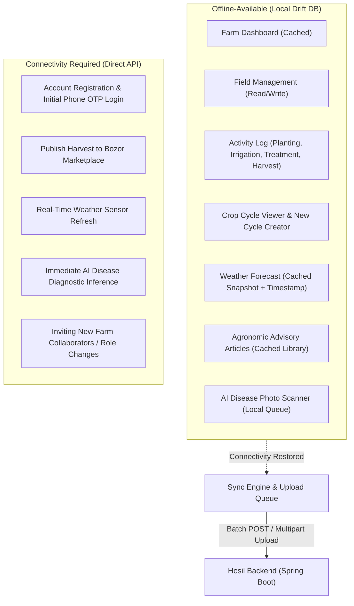
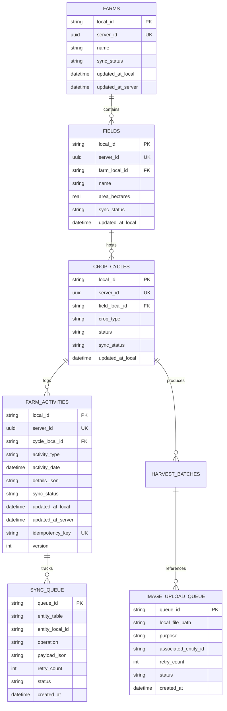
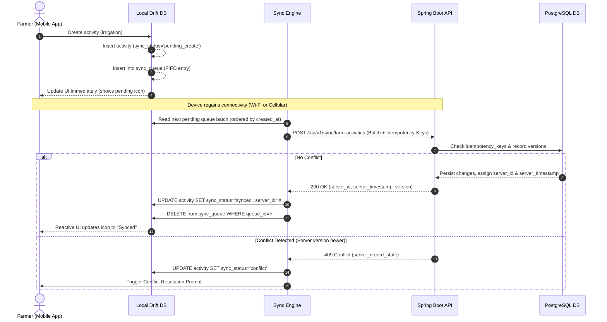
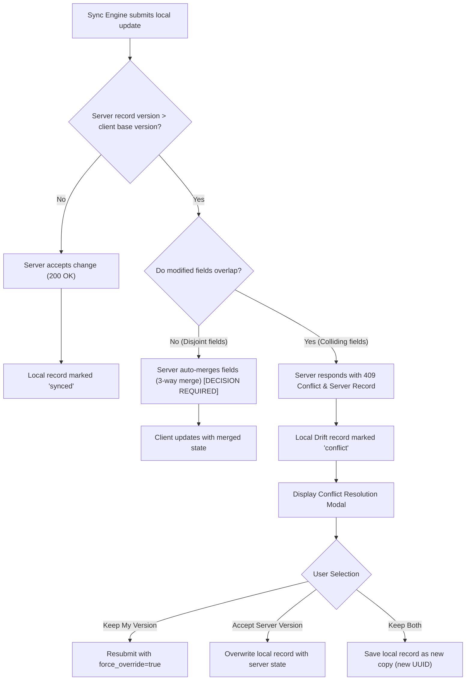
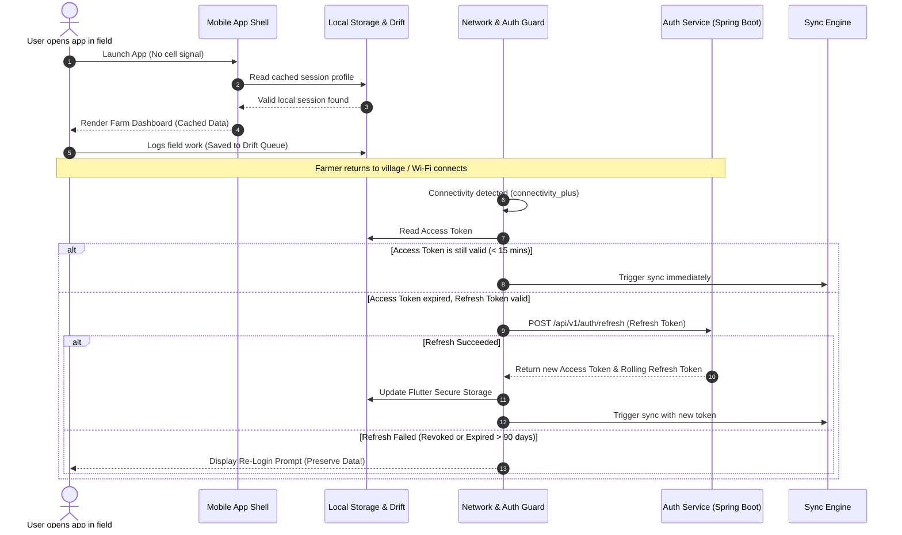
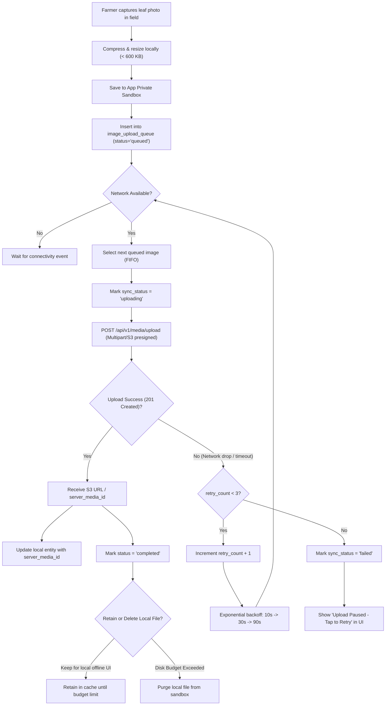
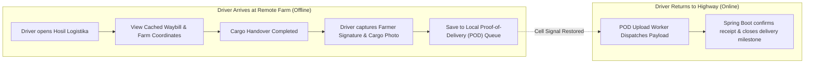

# Hosil Ecosystem — Mobile Offline & Synchronization Strategy

**Document:** Offline Strategy v0.1  
**Date:** 13 October 2026  
**Status:** Proposed — requires engineering and product review before Phase 7  
**Scope:** Hosil Farm, Hosil Bozor, Hosil Logistika (Flutter clients) + Spring Boot Backend  

---

### Revision history

| Version | Date | Author / Context | Summary |
|---|---|---|---|
| v0.1 | 13 Oct 2026 | Architecture Team | Initial proposal defining offline-first requirements for Hosil Farm, graceful degradation for Bozor and Logistika, Drift local persistence, sync queue protocol, authentication handling, and image upload pipeline. |

---

### Companion documents

| Document | Purpose |
|---|---|
| [00_documentation_index.md](00_documentation_index.md) | Master index and prioritized deliverable checklist. |
| [01_prd.md](01_prd.md) | Product vision, persona constraints, and MVP functional scope. |
| [02_architecture.md](02_architecture.md) | Platform architecture blueprint, modular monolith structure, and phase roadmap. |
| [03_user_journeys_and_permissions.md](03_user_journeys_and_permissions.md) | Primary user journeys (5 flows) and master permission matrix. |
| `04_domain_model.md` | Domain entities, constraints, and lifecycle rules (next deliverable). |
| `05_api_contract.md` | REST API specifications and sync payload schemas (subsequent deliverable). |
| `06_security_privacy.md` | Data classification, token security, and local storage encryption rules. |
| `12_testing_strategy.md` | Integration test plans, offline simulation, and network boundary tests. |

---

## 1. Scope and Principles

### 1.1 Context: Operating in Rural Uzbekistan
The Hosil platform serves agricultural communities across regional Uzbekistan (e.g., Fergana Valley, Samarkand, Kashkadarya, Surkhandarya). Agricultural fields (*dala*) frequently lack reliable 4G/LTE mobile coverage. Farmers and agronomists regularly encounter:
- Extended dead zones where no cellular connection is available.
- 2G/EDGE connectivity with extreme latency (>2000 ms) and high packet drop rates (>30%).
- Frequent intermittent disconnects during field transit.
- Devices running entry-level to mid-range Android hardware with strict memory and battery constraints.

### 1.2 Core Architectural Principles

```
+---------------------------------------------------------------------------------------+
|                                HOSIL ECOSYSTEM APPS                                   |
+------------------------------------+--------------------------------------------------+
|             Hosil Farm             |        Hosil Bozor      |     Hosil Logistika     |
|         (Offline-First)            |        (Online-First)   |     (Online-First)      |
+------------------------------------+-------------------------+-------------------------+
| - Full offline daily recording     | - Authoritative pricing | - Binding agreements    |
| - Local Drift (SQLite) database    | - Live inventory checks | - Fleet real-time state |
| - Two-way asynchronous sync queue | - Cached catalog browse | - Cached waybills       |
| - Local image capture & queue      | - Local cart draft      | - Proof-of-delivery log |
+------------------------------------+-------------------------+-------------------------+
```

1. **Tiered App Strategies:**
   - **Hosil Farm is Offline-First:** Daily farm operations (field records, watering, treatments, fertilizer applications, harvest logging) are conducted directly in the field. The farmer must never experience a blocked UI, lost form data, or a modal error blocking their workflow due to connectivity. Local state is the primary write target for daily activities; the server is an asynchronous synchronization peer.
   - **Hosil Bozor is Online-First with Read Caching:** Commercial transactions, price discovery, escrow payments, and live stock reservations require strict server-side consistency. Overselling or stale pricing creates financial and legal liabilities. Offline capability is limited to cached read-only browsing and local cart drafting.
   - **Hosil Logistika is Online-First with Selective Field Fallbacks:** Dispatching freight, binding price quotes, carrier matching, and machinery lease contracts require real-time validation. Offline capability is limited to cached inspection of accepted trip manifests, navigation addresses, and an offline queue for driver proof-of-delivery (POD) photos/signatures.

2. **Zero Data Loss Guarantee:** No offline activity recorded by a farmer may ever be discarded, wiped, or overwritten silently without explicit user consent.
3. **Transparent Network Awareness:** The UI must communicate connectivity state and synchronization progress transparently through non-intrusive status indicators, avoiding modal error popups.
4. **Idempotent Operations:** Every state mutation generated offline carries a client-generated UUID idempotency key. Network retries must never produce duplicate database records or side effects.

---

## 2. Hosil Farm — Offline-Available Screens and Records

Hosil Farm serves as the primary daily farm record-keeping assistant. Farmers spend hours away from Wi-Fi and cell towers while working parcels.



### 2.1 Screens and Data Available Offline

| Screen / Feature | Offline Capability | Data Source / Local Behavior | Sync Behavior on Reconnection |
|---|---|---|---|
| **Farm Dashboard** | Full read | Cached farm profile, list of parcels/fields, active crop cycles, and summary metrics from last sync. | Automatically refreshes summary counts once background sync completes. |
| **Activity Log** | Full read, create, and edit | Full CRUD [DECISION REQUIRED on DELETE] on activities: planting, watering (irrigation), fertilizing, chemical treatments, and harvest batches. | Queued in local `sync_queue` with status `pending`. Replays in chronological order upon reconnect. |
| **Crop Cycle Details** | Read cached, create new | View cycle progress stages, historical notes, planned inputs. User can initiate a new crop cycle offline. | New crop cycles assigned local UUID; mapped to server UUID during synchronization. |
| **Field / Parcel Registry** | Read cached, create/edit offline | View parcel boundaries (stored coordinates), area in hectares, soil types. Create new fields offline. | Reconciled via idempotency key; boundary coordinate points synced to PostGIS geometry. |
| **Weather Forecast** | Read-only cached snapshot | Displays the most recent forecast downloaded before signal loss. Prominently displays: `"Forecast updated: [Date, Time]"`. | Background worker triggers weather refresh when connection is restored. |
| **Advisory & Pest Guide** | Full read | Pre-cached library of agronomic best practices, disease catalogs, and chemical application guidelines. | Content pack version checked periodically; downloads deltas over unmetered or stable connections. |
| **AI Disease Scanner** | Photo capture & queuing | Camera captures affected plant leaf. Image stored in app's private sandbox. User enters notes/crop type. UI marks status as `"Queued for diagnosis"`. | Photo and metadata dispatched to backend upload queue immediately upon network restoration. |

### 2.2 Screens and Operations Requiring Active Connectivity

| Operation / Screen | Why Connectivity is Strictly Required | User Experience When Offline |
|---|---|---|
| **Account Registration & OTP Login** | Phone number verification via SMS OTP, cryptographic key generation, and identity creation must be validated by the auth service. | Shows standard blocking offline screen: *"Internet connection required to verify phone number and log in."* |
| **Publishing Harvest to Bozor** | Creating a public listing exposes inventory to buyers across Uzbekistan, initiates marketplace indexing, and commits goods. | Action button disabled with badge: *"Connect to internet to list harvest on marketplace"*. Listing remains saved as an offline draft batch. |
| **Live Weather Radar / Sensor Updates** | Weather snapshots depend on external provider APIs (e.g., Uzhydromet or commercial radar APIs). | Pull-to-refresh displays warning toast: *"Unable to refresh weather. Showing cached forecast from [Time]"*. |
| **Live AI Diagnosis Result** | The computer vision inference model runs on the Python FastAPI service in the cloud. | Screen informs user: *"Photo saved. Diagnosis will run automatically as soon as internet is available."* |
| **Farm Membership & Access Grants** | Modifying collaborator permissions (e.g., adding an agronomist or accountant) impacts multi-user authorization. | Screen disabled with notice: *"Managing farm members requires an active connection."* |

---

## 3. Local Persistence

### 3.1 Technology Evaluation: Drift vs. Alternatives

The Flutter application requires a local database engine that supports relational modeling, type safety, reactive streams, schema migrations, and high write throughput.

| Evaluation Criteria | Drift (SQLite wrapper) [Recommended] | Isar Database | Hive | Raw `sqflite` |
|---|---|---|---|---|
| **Data Paradigm** | Relational (SQL) | NoSQL (Object Store) | NoSQL (Key-Value) | Relational (Raw SQL) |
| **Server Schema Parity** | **High** (Direct 1:1 match with server PostgreSQL tables) | Moderate (Document/Object mappings required) | Low (Key-value blobs; lacks relational integrity) | High (Manual string queries) |
| **Type Safety** | Compile-time checked Dart DSL & SQL queries | Compile-time generated code | Runtime casts; type adapters required | None (Map<String, dynamic>) |
| **Schema Migrations** | Robust, step-by-step schema migration framework | Schema versions supported | Limited manual data migration | Manual `ALTER TABLE` scripts |
| **Foreign Keys & Constraints**| Native SQLite foreign keys and cascade rules | Links, but limited constraint enforcement | None | Native SQLite |
| **Reactive UI (Streams)** | Native `watch()` queries auto-updating Flutter widgets | Built-in watchers | ValueListenable | Manual stream controllers |
| **Cross-Platform Support** | Android, iOS, Web, Desktop (via sqlite3 native) | Android, iOS, Desktop | Android, iOS, Web, Desktop | Android, iOS |

> **Recommendation:** **Drift** is selected as the primary local persistence layer for Hosil Farm.
> 
> *Rationale:* The backend is a Spring Boot modular monolith with a relational PostgreSQL schema. Drift mirrors relational foreign key constraints (e.g., `farms` $\rightarrow$ `fields` $\rightarrow$ `crop_cycles` $\rightarrow$ `farm_activities`), enables compile-time type-safe queries, supports robust schema migrations across mobile app versions, and exposes reactive streams (`watch()`) that update Flutter UI widgets automatically when sync mutations complete. Isar is a fast NoSQL alternative, but mapping relational sync queues and foreign key graphs into a document store increases edge-case complexity.

### 3.2 Local Database Architecture & Schema Mirroring

The local Drift schema mirrors the core domain tables of the Spring Boot backend with added metadata columns for sync tracking.



### 3.3 Core Synchronization Metadata Columns

Every synchronizable Drift entity table must include the following structural columns:

| Column Name | Data Type | Nullable | Description |
|---|---|---|---|
| `local_id` | `TEXT (UUID)` | No | Primary key generated on the mobile device (UUIDv4) upon creation. |
| `server_id` | `TEXT (UUID)` | Yes | Authoritative database identifier assigned by Spring Boot. Null while unsynced. |
| `sync_status` | `TEXT (ENUM)` | No | One of: `synced`, `pending_create`, `pending_update`, `pending_delete`, `conflict`. |
| `updated_at_local`| `INTEGER (Timestamp)`| No | Device timestamp (UTC epoch ms) when the mutation occurred locally. |
| `updated_at_server`| `INTEGER (Timestamp)`| Yes | Server timestamp (UTC epoch ms) returned from the last successful sync acknowledgment. |
| `idempotency_key` | `TEXT (UUID)` | No | Unique transaction token generated on client; prevents duplicate server execution. |
| `version` | `INTEGER` | No | Monotonically increasing version number used for optimistic concurrency checks. |

---

## 4. Sync Queue and Conflict Resolution

### 4.1 Outbound Sync Queue Lifecycle

When an offline user performs a mutation (e.g., logs a watering session or records 500 kg harvested), the application executes an atomic local transaction:
1. Writes or updates the entity record in Drift with `sync_status = 'pending_create'` or `'pending_update'`.
2. Inserts a corresponding sync task into the `sync_queue` table with the serialized JSON payload.
3. Notifies the UI via Drift reactive streams (`watch()`) to display the new item with a *"Pending Sync"* icon.



### 4.2 Queue Processing Rules
1. **FIFO Execution Order:** The queue processes mutations strictly ordered by `created_at` (chronological order) to ensure dependent entities are synchronized before children (e.g., field must be created on server before planting activity referencing that field).
2. **Batching:** The sync engine bundles up to 50 pending activity records into a single `POST /api/v1/sync/farm-activities` payload to minimize radio power consumption and HTTP handshake overhead on slow cellular connections.
3. **Idempotency Guarantee:**
   - Every mutation payload includes an `idempotency_key` (UUIDv4).
   - The Spring Boot backend checks an `idempotency_log` table in PostgreSQL using a database transaction.
   - If the backend receives an idempotency key it has already processed (e.g., due to an interrupted connection during response delivery), it skips re-execution and re-emits the cached `200 OK` acknowledgment with the existing `server_id`.

### 4.3 Conflict Handling Strategy

Hosil adopts a **Last-Write-Wins with User Notification** strategy for concurrent record edits.



#### Conflict Scenarios in Hosil Farm:
1. **Single Farmer, Single Phone:** Conflicts are rare and typically arise only from server-side batch adjustments or support corrections.
2. **Collaborative Farm (Owner + Agronomist):** If an agronomist updates fertilizer dosage offline while the farm owner modifies the field boundaries online, the server identifies a version mismatch on the shared cycle.
3. **User Notification Flow:**
   - When marked as `conflict`, a non-intrusive banner appears: *"1 activity has a conflicting update from another device"*.
   - Tapping the banner opens a side-by-side diff:
     - **Local offline entry:** e.g., Dosage: 50 kg/ha (entered today at 14:00 offline)
     - **Server entry:** e.g., Dosage: 75 kg/ha (updated by Owner at 13:30 online)
   - The user selects one of three actions:
     1. **Keep Local:** Re-queues the record with a force flag to overwrite the server version.
     2. **Accept Server:** Discards the local pending change and accepts the authoritative server state.
     3. **Save as Copy:** Renames the local change to a distinct separate log entry with a new ID.

---

## 5. Authentication During Offline Use

Rural farmers frequently launch Hosil Farm while standing in fields with zero network reception. If the mobile app forced a token check or network handshake on application boot, the farmer would be locked out of recording daily field activities.

### 5.1 Token Hierarchy and Secure Storage

```
+---------------------------------------------------------------------------------+
|                       FLUTTER SECURE STORAGE (Hardware Keystore)                |
+---------------------------------------------------------------------------------+
|  1. Access Token: JWT (~15 min expiry) [DECISION REQUIRED]                      |
|     - Used for active API requests                                              |
|                                                                                 |
|  2. Refresh Token: Opaque token (~30-90 day rolling expiry) [DECISION REQUIRED] |
|     - Used to obtain fresh access tokens when online                            |
|                                                                                 |
|  3. Local Session Context: { user_id, farm_id, role, full_name, phone }         |
|     - Unencrypted user context for offline session hydration                    |
+---------------------------------------------------------------------------------+
```

- Tokens are persisted via `flutter_secure_storage` utilizing **EncryptedSharedPreferences** backed by the Android Keystore on Android, and the **Keychain** on iOS.
- **Biometric / PIN Unlocking:** When the app opens offline, the user is authenticated locally against their cached session context (optionally verified via local device PIN or biometric authentication if enabled).

### 5.2 Reconnection and Expiration Flow



### 5.3 Critical Data Preservation Rule
> [!IMPORTANT]
> **Pending offline data must NEVER be cleared on authentication failure.**
> If the user's refresh token has expired (e.g., the device remained offline for over 90 days or credentials were reset), the app must prompt the user to re-authenticate (via phone OTP).
> - **The local Drift database and pending `sync_queue` records remain intact.**
> - Once the user successfully re-authenticates with the same account, the sync engine immediately resumes dispatching pending records.
> - If the user attempts to log in with a *different* phone number/account, the app must display a blocking warning: *"There are unsynced records from the previous account. Logging in as another user will isolate these records."* [DECISION REQUIRED on multi-user account switching].

---

## 6. Image Upload Queue

Plant leaf photographs taken for AI crop disease assessment, harvest batch inspection images, and marketplace product photos are large binary payloads (1–5 MB each) that cannot be safely transmitted over weak cellular connections without an isolated, resilient upload queue.

### 6.1 Local Storage and Sandbox Isolation

1. **Sandboxed App Directory:** Photos are captured directly into the application's private documents directory via `path_provider` (`getApplicationDocumentsDirectory() / uploads /`).
2. **Access Control:** Images are stored in sandboxed storage inaccessible to third-party gallery apps or cleaners. This prevents external gallery tools or OS cleanup routines from deleting pending photos.
3. **Client-Side Compression:**
   - Raw camera images (often 12–48 megapixels, 8–15 MB) are resized and compressed on-device before queue insertion.
   - Images are normalized to **max 1920x1080 resolution, JPEG format, 80% compression quality**, reducing typical file size to ~350–600 KB without degrading agronomic diagnostic accuracy.

### 6.2 Upload Queue Schema

The local Drift database maintains a dedicated `image_upload_queue` table:

```sql
CREATE TABLE image_upload_queue (
    queue_id TEXT PRIMARY KEY,               -- UUIDv4
    local_file_path TEXT NOT NULL,           -- Absolute path in app sandbox
    purpose TEXT NOT NULL,                   -- 'ai_scan', 'harvest_photo', 'listing_photo'
    associated_entity_type TEXT NOT NULL,    -- 'disease_diagnosis', 'harvest_batch'
    associated_local_id TEXT NOT NULL,       -- Foreign key to local Drift entity
    sync_status TEXT NOT NULL DEFAULT 'queued', -- 'queued', 'uploading', 'completed', 'failed'
    retry_count INTEGER NOT NULL DEFAULT 0,
    max_retries INTEGER NOT NULL DEFAULT 3,
    last_error TEXT,
    created_at INTEGER NOT NULL,
    updated_at INTEGER NOT NULL
);
```

### 6.3 Upload Execution, Exponential Backoff, and Retention



#### Queue Rules:
- **Strict FIFO & Concurrency Limit:** Images are uploaded sequentially (maximum 1 concurrent upload) to prevent radio socket starvation and excessive battery drain on rural 2G/3G connections.
- **Exponential Backoff:** Retried on network timeout with delays of 10 seconds, 30 seconds, and 90 seconds. If all 3 retries fail, the item is flagged as `'failed'` and pauses until connectivity changes or the user explicitly taps "Retry".
- **Zero Premature Deletion:** The local image file is never deleted until the backend returns an HTTP `201 Created` confirmation with the immutable remote object key or server media ID.

---

## 7. Hosil Bozor — Online-First with Read Cache

Hosil Bozor is a commercial marketplace connecting farmers directly with wholesale buyers, retailers, and input suppliers. Unlike farm record-keeping, commercial transactions require strict online consistency.

### 7.1 Online-First Rationale
Allowing offline write operations in a marketplace introduces critical business failure modes:
- **Stale Pricing:** A farmer selling wheat might accept a price that changed hours earlier.
- **Overselling / Stockouts:** Two buyers could simultaneously purchase the same batch of onions if offline order placement were permitted.
- **Escrow / Payment Mismatches:** Payments via Payme, Click, or bank transfer cannot execute without real-time payment gateway communication.

### 7.2 Read Cache Specification
To ensure a smooth user experience when switching between cell towers or entering markets with spotty coverage, Hosil Bozor implements aggressive HTTP read caching using a local SQLite/Drift cache store:

| Marketplace Feature | Offline Capability | Cache Expiration / Invalidation Policy |
|---|---|---|
| **Product Catalog & Search** | Read cached search results and categories | Cached for 2 hours. Visual badge displays: *"Viewing cached listings. Connect to see live prices and availability."* |
| **Product Detail Page** | Read cached product descriptions, images, seller badges | Cached. "Buy Now" and "Add to Cart" buttons present live stock verification warning. |
| **Shopping Cart** | Full offline local modification | Cart state is saved locally on device. Adding/removing items works offline. |
| **Cart Checkout** | **Strictly Online** | Requires connectivity. When user taps *"Proceed to Checkout"*, app executes `POST /api/v1/bozor/cart/validate` to verify current inventory and price. |
| **Order Placement & Payment** | **Strictly Online** | Requires live connection to initiate escrow transaction, reserve stock, and open payment gateway. |
| **Seller Listing Creation** | **Strictly Online** | Creating or editing a public marketplace listing requires active connectivity. Draft listings may be saved locally as drafts. |
| **Buyer-Seller In-App Chat** | Read cached message history | Drafting messages offline queues them locally for transmission when online. Real-time typing indicators disabled. |

---

## 8. Hosil Logistika — Online-First

Hosil Logistika facilitates freight booking, truck matching (refrigerated trucks, grain haulers, flatbeds), and agricultural machinery leasing.

### 8.1 Strictly Online Operations
Logistics workflows involve contractual commitments, route tracking, and third-party financial assessments:
1. **Shipment Request Creation:** Farmers submitting a freight request require real-time geocoding, route mileage calculation, and initial platform price bounds.
2. **Carrier Quote Acceptance:** Accepting a carrier's quote creates a legally binding contract and reserves the vehicle. This operation requires an active connection to prevent conflicting quote acceptances.
3. **Machinery Leasing Applications:** Applications for tractors, combines, or irrigation systems require credit scoring, partner bank handoffs, and identity verification.

### 8.2 Offline Graceful Degradation & Field Exceptions



| Logistics Feature | Offline Behavior |
|---|---|
| **Active Shipment Waybill** | **Available Offline:** Once a shipment is accepted, the driver and farmer can view the full trip manifest, pickup address coordinates, recipient phone numbers, and agreed freight specifications offline. |
| **Historical Shipments** | **Available Offline:** Browsing completed shipments and downloadable tax receipts from local Drift cache. |
| **Proof of Delivery (POD)** | **Offline Capture Queue:** Truck drivers delivering to remote fields with no signal can capture the recipient's signature and cargo photo offline. The app marks the local status as *"Delivery Logged (Pending Upload)"* and dispatches the confirmation as soon as cell signal is detected on the highway. |

---

## 9. Unresolved Decisions

The following architectural and product decisions remain open and require resolution prior to entering implementation phases.

| # | Decision | Impact | Required By Phase | Proposed Recommendation [DECISION REQUIRED] |
|---|---|---|---|---|
| 1 | **Maximum local storage budget per app** | Low-end Android devices in rural areas have constrained flash storage. Uncontrolled photo caching could crash the app or trigger OS eviction. | Phase 7 (Mobile UI) | Cap Drift SQLite database at 50 MB; cap image thumbnail cache at 200 MB. Automatically purge synced thumbnail images older than 30 days using LRU policy. |
| 2 | **Full sync vs. Incremental delta sync protocol** | High bandwidth usage on rural 2G connections if full datasets are transferred. | Phase 3 (Domain/API) | Implement incremental delta sync using `since_timestamp` and an append-only server change-log per farm. Avoid full dataset downloads after initial onboarding. |
| 3 | **Multi-device concurrent sync for same farm** | Conflict probability increases if a farm owner on a tablet and an agronomist on a smartphone edit the same field simultaneously. | Phase 7 (Mobile UI) | Adopt record-level versioning (`version` column). For MVP, disallow concurrent multi-user writes on the same `crop_cycle`; serialize edits via Last-Write-Wins with conflict prompt. |
| 4 | **Data retention policy for local offline records** | A farm with 5 years of activity history could bloat local storage to hundreds of thousands of rows. | Phase 7 (Mobile UI) | Retain only active crop cycles plus the last 12 months of completed activity history locally. Older historical data accessible only on demand via online search. |
| 5 | **Offline DELETE operation support** | Handling deleted records offline requires tombstone records (`is_deleted = true`) to propagate deletions to the server without resurrecting deleted items during delta syncs. | Phase 3 (Domain/API) | Prohibit hard deletions in offline mode. Implement soft-deletes with tombstones (`deleted_at` timestamp). Restrict offline UI primarily to create and edit; require online confirmation for irreversible deletions. |
| 6 | **Background sync execution framework** | iOS and Android aggressively throttle background workers and network jobs on battery-saver mode. | Phase 7 (Mobile UI) | Utilize Android `WorkManager` and iOS `BGAppRefreshTask` for periodic background syncing when connected to unmetered Wi-Fi; execute immediate foreground sync whenever the app enters active state. |

---

## 10. Implementation Notes

> [!IMPORTANT]
> **Implementation Timeline:**
> This document describes the proposed offline architecture and synchronization contract. **Synchronization is not implemented until Phase 7 (Mobile UI and pilot hardening)**, as defined in [02_architecture.md §13](file:///c:/Users/Oliya/Desktop/Hosil/docs/02_architecture.md#L649-L653).
> 
> Domain modeling (Phase 1), API contract definition (Phase 2), and backend core feature implementations (Phases 3–6) must proceed with sync-awareness in mind—specifically ensuring all entity tables support `idempotency_key`, `version`, and timestamps—but client-side local database sync logic will be built during Phase 7.

### 10.1 Alignment with API Contract (`04_api_contract.md`)
The sync endpoints must be co-designed alongside the REST API contracts:
- `POST /api/v1/sync/farm-activities`: Accepts a batch of pending activity objects, validates each `idempotency_key`, commits changes in a single database transaction or returns partial batch results, and returns mapped `{ local_id, server_id, server_timestamp, version }`.
- `GET /api/v1/sync/delta?since={timestamp}`: Returns incremental updates for farms, fields, and cycles modified on the server since the client's last synchronization timestamp.
- Standardized idempotency headers (`X-Idempotency-Key: {uuid}`) must be supported across all state-mutating endpoints.

### 10.2 Mobile Testing and Simulation Plan
During Phase 7 hardening, the offline engine must be verified under realistic network degradation scenarios:
1. **Airplane Mode Toggling:** Initiating multiple field records, enabling airplane mode, editing them, re-enabling connection, and validating clean resolution.
2. **Bandwidth Throttling:** Simulating 2G speeds (50 kbps uplink, 1500 ms latency, 20% packet drop) using Android Emulator network emulation profiles.
3. **Abrupt Process Termination:** Force-killing the mobile app process in the middle of a batch sync or photo upload, ensuring database transaction atomicity and zero queue corruption.
