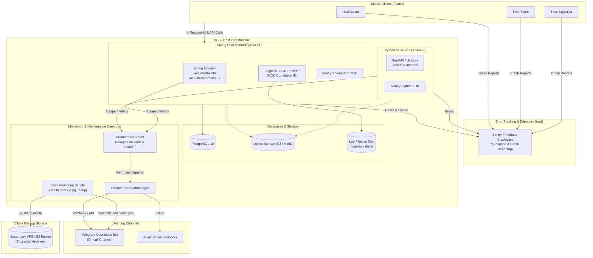
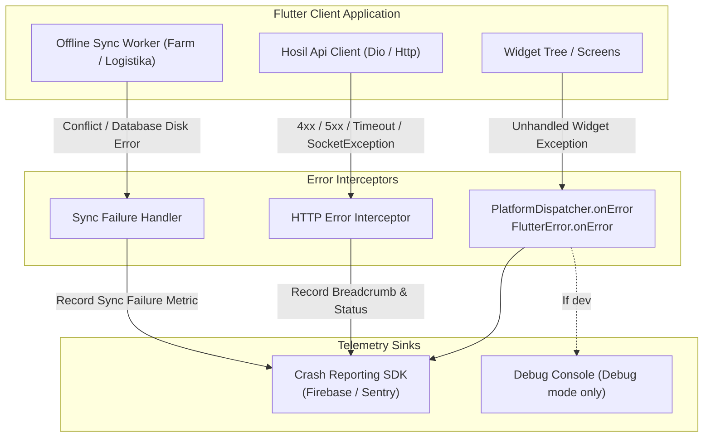

# Hosil Ecosystem — Observability, Monitoring, Alerting & Operations Strategy

**Document:** Observability Strategy v0.1  
**Date:** 13 October 2026  
**Status:** Proposed  
**Product:** Hosil Bozor, Hosil Farm, Hosil Logistika + shared platform  

---

## 1. Principles

This document defines the observability, monitoring, logging, alerting, and backup operations strategy for the Hosil agricultural platform. In alignment with [02_architecture.md](02_architecture.md), the initial production deployment targets a single virtual private server (VPS) or small cloud instance in Uzbekistan. Operational architecture must prioritize simplicity, high signal-to-noise ratio, and rapid failure detection over complex enterprise telemetry tooling.

### 1.1 Core Tenets

1. **Start Small and Pragmatic:** Prioritize reliable structured logging, endpoint health checks, automated error tracking, and routine backups over elaborate distributed tracing meshes or multi-node telemetry clusters.
2. **Mean-Time-To-Detect Under 5 Minutes:** Any production-relevant outage or core workflow impairment (database partition, payment gateway integration failure, service crash) must alert the engineering team within minutes.
3. **Strict Zero-PII and Secrets Redaction:** No authentication tokens, plaintext passwords, SMS one-time passwords (OTPs), bank card numbers, passport/PINFL identifiers, or private crop lease terms may appear in log outputs, traces, or error dumps.
4. **Non-Blocking Observability:** Telemetry collection, logging sinks, and error reporters must operate asynchronously and must never block incoming HTTP requests or degrade primary database transactions.
5. **Progressive Investment:** Scale monitoring tooling strictly along development phases (bootstrap shell scripts in Phase 1; Prometheus and Alertmanager in Phase 7; AI inference telemetry in Phase 8).

### 1.2 Observability Architecture Overview

The following diagram illustrates the telemetry flow across client applications, backend services, external monitoring services, and operational notification channels.



### 1.3 Data Privacy, Security & Redaction Rules

Compliance with Uzbekistan data protection legislation and standard secure software practices requires defensive logging boundaries.

| Category | Forbidden In Logs | Permitted In Logs | Redaction Mechanism |
| :--- | :--- | :--- | :--- |
| **Authentication & Auth** | Bearer tokens, JWT signatures, session IDs, client secrets | User UUID, tenant/farm UUID, token expiry timestamp | Servlet Filter sanitization; regex masking |
| **Identity & OTP** | 4-6 digit SMS OTPs, user passwords, passport serials, PINFL | Phone number hashed or masked (`+99890****1234`), verification status (`SUCCESS`, `EXPIRED`) | Service-level logger argument masking |
| **Financial / Payments** | Full PAN (card number), CVV/CVC, cardholder expiry, private merchant keys | Card mask (`8600 **** **** 1234`), payment attempt UUID, gateway transaction ID, status code | Dedicated payment gateway serializer |
| **Legal / Logistics** | Exact lease agreement contract text, driver personal biometric files | Document UUID, storage key, SHA-256 file checksum, MIME type | Generic metadata DTO logging |

---

## 2. Backend Observability (Java 21 / Spring Boot)

The core backend modular monolith is implemented in Java 21 and Spring Boot. Operational visibility relies on Spring Boot Actuator, Logback with JSON formatting, Micrometer metrics, and Sentry exception capture.

### 2.1 Health Checks & Probes

Spring Boot Actuator exposes health indicators over HTTP. Endpoints must distinguish between lightweight liveness checks (process alive) and readiness checks (all backing systems operational to accept traffic).

#### Configuration (`application.yml`)

```yaml
management:
  endpoints:
    web:
      base-path: /actuator
      exposure:
        include: health, info, prometheus
  endpoint:
    health:
      show-details: when-authorized
      roles: SYSTEM_ADMIN
      probes:
        enabled: true
      group:
        liveness:
          include: livenessState, diskSpace
        readiness:
          include: readinessState, db, diskSpace, fileStorageHealthIndicator, paymentGatewayHealthIndicator
```

#### Health Check Responsibilities

- **Liveness (`/actuator/health/liveness`):** Validates JVM state, internal thread starvation, and local root disk space. Used by host-level monitoring and process supervisors (systemd / Docker) to trigger service restarts if unresponsive.
- **Readiness (`/actuator/health/readiness`):** Confirms PostgreSQL connection pool availability, object storage reachability, and critical external provider readiness.
- **Custom Health Indicators:**

```java
package uz.hosil.platform.shared.infrastructure.health;

import org.springframework.boot.actuate.health.Health;
import org.springframework.boot.actuate.health.HealthIndicator;
import org.springframework.stereotype.Component;

import javax.sql.DataSource;
import java.sql.Connection;
import java.sql.Statement;

@Component
public class DatabasePingHealthIndicator implements HealthIndicator {

    private final DataSource dataSource;

    public DatabasePingHealthIndicator(DataSource dataSource) {
        this.dataSource = dataSource;
    }

    @Override
    public Health health() {
        try (Connection conn = dataSource.getConnection();
             Statement stmt = conn.createStatement()) {
            stmt.execute("SELECT 1");
            return Health.up().withDetail("database", "PostgreSQL available").build();
        } catch (Exception ex) {
            return Health.down(ex)
                    .withDetail("database", "PostgreSQL unreachable or pool exhausted")
                    .build();
        }
    }
}
```

```java
package uz.hosil.platform.shared.infrastructure.health;

import org.springframework.boot.actuate.health.Health;
import org.springframework.boot.actuate.health.HealthIndicator;
import org.springframework.stereotype.Component;

@Component
public class FileStorageHealthIndicator implements HealthIndicator {

    // [UNVERIFIED] Inject S3/MinIO client once object storage provider is confirmed
    @Override
    public Health health() {
        try {
            // Ping MinIO/S3 bucket metadata
            boolean bucketAccessible = true; // placeholder for storageAdapter.checkBucket();
            if (bucketAccessible) {
                return Health.up().withDetail("storage", "S3/MinIO bucket accessible").build();
            }
            return Health.down().withDetail("storage", "Bucket not found or permission denied").build();
        } catch (Exception ex) {
            return Health.down(ex).withDetail("storage", "Object storage connection failed").build();
        }
    }
}
```

### 2.2 Structured Logging & Request Tracing

All backend log outputs in production must be formatted as single-line JSON records written to `stdout` and rotated disk logs. This ensures deterministic parsing by search agents, log shippers, and crash analyzers.

#### Standard JSON Log Payload Schema

Every log entry must emit the following core schema:

```json
{
  "timestamp": "2026-10-13T14:32:05.123+05:00",
  "level": "INFO",
  "logger": "uz.hosil.platform.marketplace.OrderService",
  "thread": "http-nio-8080-exec-4",
  "request_id": "a9c3e551-789d-4876-b33a-9e32a6e0c401",
  "user_id": "f47ac10b-58cc-4372-a567-0e02b2c3d479",
  "client_ip": "195.158.12.44",
  "service": "hosil-backend",
  "environment": "production",
  "message": "Order placed successfully. OrderID=ord-8831, TotalAmount=450000 UZS",
  "context": {
    "module": "marketplace",
    "order_id": "ord-8831"
  }
}
```

#### Log Levels Policy

- **ERROR:** Unrecoverable conditions, unhandled exceptions, database transaction aborts, external gateway outage, data integrity violations. Requires immediate notification or Sentry review.
- **WARN:** Recoverable anomalies, transient external network retries, deprecated API call usage, non-critical validation rejections.
- **INFO:** Key business lifecycle transitions (user registered, harvest listed, order confirmed, payment callback verified, delivery completed, batch job finished).
- **DEBUG:** Verbose developer diagnostics, query payload details (excluding secrets), routing steps. **Disabled in staging and production.**

#### Correlation ID Propagation (MDC Filter)

Every request entering the Spring Boot backend must possess a unique Correlation ID (`X-Request-Id`). If the client (mobile app or admin UI) sends one, validate and reuse it; otherwise, generate a standard UUIDv4.

```java
package uz.hosil.platform.shared.infrastructure.logging;

import jakarta.servlet.FilterChain;
import jakarta.servlet.ServletException;
import jakarta.servlet.http.HttpServletRequest;
import jakarta.servlet.http.HttpServletResponse;
import org.slf4j.MDC;
import org.springframework.core.Ordered;
import org.springframework.core.annotation.Order;
import org.springframework.security.core.Authentication;
import org.springframework.security.core.context.SecurityContextHolder;
import org.springframework.stereotype.Component;
import org.springframework.web.filter.OncePerRequestFilter;

import java.io.IOException;
import java.util.UUID;

@Component
@Order(Ordered.HIGHEST_PRECEDENCE)
public class CorrelationIdFilter extends OncePerRequestFilter {

    public static final String CORRELATION_ID_HEADER = "X-Request-Id";
    public static final String MDC_REQUEST_ID_KEY = "request_id";
    public static final String MDC_USER_ID_KEY = "user_id";

    @Override
    protected void doFilterInternal(HttpServletRequest request,
                                    HttpServletResponse response,
                                    FilterChain filterChain) throws ServletException, IOException {
        String requestId = request.getHeader(CORRELATION_ID_HEADER);
        if (requestId == null || requestId.isBlank()) {
            requestId = UUID.randomUUID().toString();
        }

        MDC.put(MDC_REQUEST_ID_KEY, requestId);
        response.setHeader(CORRELATION_ID_HEADER, requestId);

        try {
            Authentication auth = SecurityContextHolder.getContext().getAuthentication();
            if (auth != null && auth.isAuthenticated() && !"anonymousUser".equals(auth.getPrincipal())) {
                MDC.put(MDC_USER_ID_KEY, auth.getName());
            }
            filterChain.doFilter(request, response);
        } finally {
            MDC.remove(MDC_REQUEST_ID_KEY);
            MDC.remove(MDC_USER_ID_KEY);
            MDC.clear();
        }
    }
}
```

#### Logback Configuration (`logback-spring.xml`)

```xml
<?xml version="1.0" encoding="UTF-8"?>
<configuration scan="true" scanPeriod="30 seconds">
    <include resource="org/springframework/boot/logging/logback/defaults.xml"/>

    <springProperty scope="context" name="appName" source="spring.application.name" defaultValue="hosil-backend"/>
    <springProperty scope="context" name="env" source="spring.profiles.active" defaultValue="default"/>

    <!-- Console Appender for JSON output in Production / Docker -->
    <appender name="JSON_CONSOLE" class="ch.qos.logback.core.ConsoleAppender">
        <encoder class="net.logstash.logback.encoder.LoggingEventCompositeJsonEncoder">
            <providers>
                <timestamp>
                    <timeZone>Asia/Tashkent</timeZone>
                </timestamp>
                <logLevel/>
                <loggerName/>
                <threadName/>
                <message/>
                <mdc/>
                <stackTrace>
                    <throwableConverter class="net.logstash.logback.stacktrace.ShortenedThrowableConverter">
                        <maxDepthPerThrowable>30</maxDepthPerThrowable>
                        <maxLength>2048</maxLength>
                        <shortenedClassNameLength>20</shortenedClassNameLength>
                        <exclude>sun\..*</exclude>
                        <exclude>java\..*</exclude>
                    </throwableConverter>
                </stackTrace>
            </providers>
        </encoder>
    </appender>

    <!-- Rolling File Appender for local VPS durability -->
    <appender name="ROLLING_FILE" class="ch.qos.logback.core.rolling.RollingFileAppender">
        <file>/var/log/hosil/backend.log</file>
        <rollingPolicy class="ch.qos.logback.core.rolling.SizeAndTimeBasedRollingPolicy">
            <fileNamePattern>/var/log/hosil/backend-%d{yyyy-MM-dd}.%i.log.gz</fileNamePattern>
            <maxFileSize>100MB</maxFileSize>
            <maxHistory>14</maxHistory>
            <totalSizeCap>2GB</totalSizeCap>
        </rollingPolicy>
        <encoder class="net.logstash.logback.encoder.LoggingEventCompositeJsonEncoder">
            <providers>
                <timestamp><timeZone>Asia/Tashkent</timeZone></timestamp>
                <logLevel/>
                <loggerName/>
                <threadName/>
                <message/>
                <mdc/>
                <stackTrace/>
            </providers>
        </encoder>
    </appender>

    <root level="INFO">
        <appender-ref ref="JSON_CONSOLE"/>
        <appender-ref ref="ROLLING_FILE"/>
    </root>
</configuration>
```

### 2.3 Metrics (Micrometer + Prometheus)

Spring Boot Actuator integrates Micrometer to produce operational metrics collected via Prometheus.

#### Standard Out-of-the-Box Metrics

1. **JVM Health:** Heap usage (`jvm.memory.used`), garbage collection overhead (`jvm.gc.pause`), live and peak thread counts (`jvm.threads.live`).
2. **HTTP Traffic:** Request rate, status code counts (`http.server.requests`), latency quantiles (p50, p95, p99).
3. **Database Connection Pool (HikariCP):** Active connections (`hikaricp.connections.active`), idle connections (`hikaricp.connections.idle`), connection acquisition wait duration (`hikaricp.connections.acquire`).

#### Custom Business & Domain Metrics

Custom meters track high-value business actions and operational friction points:

| Metric Name | Type | Tags | Purpose |
| :--- | :--- | :--- | :--- |
| `hosil.orders.created` | Counter | `category`, `payment_type` | Velocity of marketplace transactions |
| `hosil.payments.callback.received` | Counter | `provider` (`click`/`payme`), `status` (`success`/`failed`) | Real-time payment gateway health & settlement monitoring |
| `hosil.shipments.created` | Counter | `region_from`, `region_to` | Logistics request volume across provinces |
| `hosil.farms.activity.logged` | Counter | `activity_type` (`irrigation`/`fertilizer`/`harvest`) | Farm engagement and agronomy record frequency |
| `hosil.ai.inference.duration` | Timer | `model_version`, `status` | Phase 8 crop disease inference execution time |

```java
package uz.hosil.platform.marketplace.domain;

import io.micrometer.core.instrument.Counter;
import io.micrometer.core.instrument.MeterRegistry;
import org.springframework.stereotype.Component;

@Component
public class MarketplaceMetrics {

    private final MeterRegistry meterRegistry;

    public MarketplaceMetrics(MeterRegistry meterRegistry) {
        this.meterRegistry = meterRegistry;
    }

    public void incrementOrdersCreated(String category, String paymentType) {
        Counter.builder("hosil.orders.created")
                .description("Total number of marketplace orders placed")
                .tag("category", category)
                .tag("payment_type", paymentType)
                .register(meterRegistry)
                .increment();
    }

    public void incrementPaymentCallback(String provider, String status) {
        Counter.builder("hosil.payments.callback.received")
                .description("Incoming payment provider callbacks")
                .tag("provider", provider)
                .tag("status", status)
                .register(meterRegistry)
                .increment();
    }
}
```

#### Pilot Grafana Dashboard Specification

For the pilot deployment on a single VPS, Prometheus scrapes `http://localhost:8080/actuator/prometheus` every 15 seconds. A single Grafana dashboard provides immediate operational visibility:

```
+-----------------------------------------------------------------------------------+
| HOSIL BACKEND OVERVIEW (PILOT)                                                    |
+-----------------------------------------+-----------------------------------------+
| [Panel 1: Service Uptime & Instance Info]| [Panel 2: HTTP Request Rate & 5xx Errors]|
| Status: UP (Liveness OK, Readiness OK)  | Rate: 12 req/s                          |
| Active Threads: 24 / Heap: 480MB (35%)  | Error Rate (5xx): 0.02% (Target < 0.5%) |
+-----------------------------------------+-----------------------------------------+
| [Panel 3: HTTP Latency Quantiles]       | [Panel 4: Hikari Connection Pool]       |
| p50: 28ms                               | Active: 4 / Idle: 6 / Max: 10           |
| p95: 140ms                              | Acquire Wait Duration p95: 1.2ms        |
| p99: 380ms                              | Connection Timeouts (1h): 0             |
+-----------------------------------------+-----------------------------------------+
| [Panel 5: Host VPS Resources]           | [Panel 6: Business Events Velocity]     |
| CPU Usage: 14%                          | Orders Created / Hr: 18                 |
| RAM: 2.1GB / 4.0GB (52%)                | Payment Callbacks / Hr: 19 (100% OK)    |
| Disk /: 18.4GB / 50.0GB (37%)           | SMS OTP Verifications / Hr: 42          |
+-----------------------------------------+-----------------------------------------+
```

### 2.4 Error Tracking (Sentry for Spring Boot)

Sentry provides unhandled exception alerting, grouping identical stack traces, and tracking regressions across software releases.

#### Setup & Integration

Add `sentry-spring-boot-starter-jakarta` to `pom.xml`. Configure Sentry in `application.yml`:

```yaml
sentry:
  dsn: "${SENTRY_DSN:}" # Set via environment variable on staging/production
  enabled: true
  environment: "${SPRING_PROFILES_ACTIVE:production}"
  release: "${BUILD_VERSION:0.1.0}"
  sample-rate: 1.0 # 100% of exceptions captured during pilot
  traces-sample-rate: 0.1 # 10% performance sampling to preserve bandwidth
  send-default-pii: false # Enforce zero personal identifiable information
```

#### Context Enrichment & Masking

```java
package uz.hosil.platform.shared.infrastructure.error;

import io.sentry.Sentry;
import io.sentry.SentryEvent;
import io.sentry.protocol.User;
import org.slf4j.MDC;
import org.springframework.web.bind.annotation.ExceptionHandler;
import org.springframework.web.bind.annotation.RestControllerAdvice;
import uz.hosil.platform.shared.infrastructure.logging.CorrelationIdFilter;

@RestControllerAdvice
public class GlobalExceptionHandler {

    @ExceptionHandler(Exception.class)
    public void captureUnhandledException(Exception ex) {
        SentryEvent event = new SentryEvent(ex);
        
        String requestId = MDC.get(CorrelationIdFilter.MDC_REQUEST_ID_KEY);
        if (requestId != null) {
            event.setTag("request_id", requestId);
        }

        String userId = MDC.get(CorrelationIdFilter.MDC_USER_ID_KEY);
        if (userId != null) {
            User user = new User();
            user.setId(userId); // Only UUID, no email, phone, or name
            event.setUser(user);
        }

        Sentry.captureEvent(event);
    }
}
```

---

## 3. Python AI Service Observability

The Python AI service handles crop disease diagnosis from mobile-submitted images. In accordance with [02_architecture.md](02_architecture.md), this service is introduced in **Phase 8** as a separate container. Its observability configuration ships with the service code.

### 3.1 Architectural Scope & Integration Boundary

- The Python AI service runs as an isolated FastAPI container on the same host or internal network.
- It **never** connects directly to PostgreSQL; all diagnosis jobs and metadata pass through the Java backend.
- Communication with Java occurs over internal HTTP REST or an asynchronous queue.

### 3.2 Health Check Endpoint (`/health`)

FastAPI exposes an unauthenticated internal `/health` endpoint validating model memory loading, runtime environment, and container uptime.

```python
# ai-service/app/main.py
import time
from fastapi import FastAPI, status
from pydantic import BaseModel
from typing import Optional

app = FastAPI(title="Hosil AI Inference Service", version="0.1.0")
START_TIME = time.time()

class HealthResponse(BaseModel):
    status: str
    model_loaded: bool
    model_version: str
    uptime_seconds: float
    device: str
    memory_allocated_mb: Optional[float] = None

@app.get("/health", response_model=HealthResponse, status_code=status.HTTP_200_OK)
def get_health():
    # Verify model presence in memory
    is_model_ready = hasattr(app.state, "model") and app.state.model is not None
    uptime = time.time() - START_TIME
    
    return HealthResponse(
        status="UP" if is_model_ready else "DEGRADED",
        model_loaded=is_model_ready,
        model_version=getattr(app.state, "model_version", "v1.0-leaf-pilot"),
        uptime_seconds=round(uptime, 2),
        device="cpu", # [UNVERIFIED: Confirm if GPU or CPU instance deployed]
        memory_allocated_mb=None
    )
```

### 3.3 Structured Logging & Request Context

FastAPI uses Uvicorn configured with custom JSON logging. Each incoming inference request inherits or generates an `X-Request-Id` and logs execution time and predicted disease class.

```python
# ai-service/app/middleware.py
import logging
import json
import time
import uuid
from starlette.middleware.base import BaseHTTPMiddleware
from starlette.requests import Request

logger = logging.getLogger("hosil_ai")
logging.basicConfig(level=logging.INFO, format="%(message)s")

class JsonLoggingMiddleware(BaseHTTPMiddleware):
    async def dispatch(self, request: Request, call_next):
        request_id = request.headers.get("X-Request-Id", str(uuid.uuid4()))
        start_time = time.time()
        
        response = await call_next(request)
        duration_ms = round((time.time() - start_time) * 1000, 2)
        
        log_entry = {
            "timestamp": time.strftime("%Y-%m-%dT%H:%M:%SZ", time.gmtime()),
            "level": "INFO",
            "service": "hosil-ai-service",
            "request_id": request_id,
            "path": request.url.path,
            "method": request.method,
            "status_code": response.status_code,
            "duration_ms": duration_ms
        }
        logger.info(json.dumps(log_entry))
        response.headers["X-Request-Id"] = request_id
        return response
```

### 3.4 Inference Metrics & Error Tracking

- **Metrics Collection:** Uses `prometheus-fastapi-instrumentator` exposing `/metrics` scraped by the host Prometheus.
  - `ai_inference_requests_total`: Counter tagged by `crop_type` and `outcome` (`success`, `low_confidence`, `error`).
  - `ai_inference_duration_seconds`: Histogram measuring inference processing time.
- **Error Tracking:** Uses `sentry-sdk[fastapi]`:
  ```python
  import sentry_sdk
  sentry_sdk.init(
      dsn=os.getenv("SENTRY_DSN"),
      environment=os.getenv("APP_ENV", "production"),
      traces_sample_rate=0.05,
      send_default_pii=False,
  )
  ```

---

## 4. Flutter Mobile Observability

The Hosil client ecosystem comprises three distinct Flutter applications:
1. **Hosil Bozor** (farmers, buyers, input suppliers)
2. **Hosil Farm** (growers, field activity records, agronomy advisory)
3. **Hosil Logistika** (transporters, vehicle operators, shipment fulfillment)

Mobile monitoring in rural Uzbekistan faces unique challenges: high latency, intermittent 3G/2G mobile connectivity, device battery constraints, and a wide variety of lower-end Android hardware.

### 4.1 Telemetry Objectives & Constraints

- **Minimal Network Overhead:** Crash and error reports must be batched, compressed, and queued locally on SQLite / disk until network connectivity is confirmed.
- **Crash Containment:** Any uncaught Flutter framework exception must not freeze the application silently; it must show an error dialog, preserve offline drafts, and log the incident.
- **Zero-PII on Device:** Mobile logs must never record entered passwords, phone numbers, or unencrypted local SQLite records.

### 4.2 Crash Reporting: Firebase Crashlytics vs. Sentry Evaluation

| Evaluation Criteria | Firebase Crashlytics | Sentry Flutter SDK | Assessment for Hosil Pilot |
| :--- | :--- | :--- | :--- |
| **Pricing & Quota** | **Free** (part of Firebase / Google Cloud suite) | Free tier limited to 5k events/mo; paid plans thereafter | Firebase has zero ongoing subscription cost for pilot. |
| **Flutter Integration** | First-class (`firebase_crashlytics` package); official Flutter plugin | First-class (`sentry_flutter` package); excellent breadcrumbs | Both have high community maturity and stability. |
| **Backend Unification** | Mobile only. Backend requires Google Cloud Logging or separate stack | **Unified**: Single dashboard for Java monolith, Python AI, and Flutter | Sentry enables cross-stack trace correlation via `X-Request-Id`. |
| **Offline Breadcrumb Caching** | Native SDK automatically caches crashes and events offline until online | Robust offline caching with SQLite event queue | Equal capability for rural offline scenarios. |
| **Setup Complexity** | Requires `google-services.json`, Google Cloud project configuration | Simple DSN string initialization in `main.dart` | Sentry is faster to bootstrap without cloud console setup. |
| **Recommendation** | **Recommended for pilot if budget is zero** | **Recommended if single pane of glass is prioritized** | **[DECISION REQUIRED: Confirm Firebase Crashlytics vs Sentry for Flutter]** |

### 4.3 Mobile Error Logging & Breadcrumbs

Regardless of whether Crashlytics or Sentry is selected, the shared mobile package `hosil_api_client` and app shells must intercept failures at three layers:



#### Global Error Interception Pattern (`main.dart`)

```dart
import 'dart:async';
import 'package:flutter/foundation.dart';
import 'package:flutter/material.dart';
// Example using Sentry (or FirebaseCrashlytics equivalent)
import 'package:sentry_flutter/sentry_flutter.dart';

Future<void> bootstrapApp(Widget rootWidget) async {
  runZonedGuarded(() async {
    WidgetsFlutterBinding.ensureInitialized();

    // Catch framework Flutter layout and render errors
    FlutterError.onError = (FlutterErrorDetails details) {
      FlutterError.presentError(details);
      Sentry.captureException(details.exception, stackTrace: details.stack);
    };

    // Catch asynchronous and platform-level dispatch errors
    PlatformDispatcher.instance.onError = (error, stack) {
      Sentry.captureException(error, stackTrace: stack);
      return true;
    };

    await SentryFlutter.init(
      (options) {
        options.dsn = const String.fromEnvironment('SENTRY_DSN');
        options.tracesSampleRate = 0.05;
        options.environment = kReleaseMode ? 'production' : 'development';
        options.sendDefaultPii = false;
      },
      appRunner: () => runApp(rootWidget),
    );
  }, (exception, stackTrace) {
    Sentry.captureException(exception, stackTrace: stackTrace);
  });
}
```

#### HTTP Failure Breadcrumb Logging

The HTTP client must record breadcrumbs for network failures without leaking payloads:

- **Recorded:** Endpoint path (e.g. `/api/v1/market/orders`), HTTP method (`POST`), response status code (`503`), request latency (`4200ms`), failure type (`SocketException: Network is unreachable`).
- **Forbidden:** Request body (contains buyer delivery address, item price, payment card token), Authorization header value.

### 4.4 Mobile Analytics Policy

- **Pilot Baseline:** Detailed event product analytics (such as mixpanel/amplitude user flow funnels) are deferred until after pilot validation.
- **Permitted Initial Telemetry:** Basic anonymous screen view navigation logging (`BozorHomeScreen`, `FarmFieldDetailScreen`, `LogistikaTripScreen`) and installation version tracking to assess upgrade compliance.

---

## 5. Alerting Strategy

Alerting ensures the engineering team is notified of critical system degradation before users report business interruption.

### 5.1 Phased Alerting Progression

1. **Phase 1 (Bootstrap & Development):** Lightweight shell script executed via local VPS `cron` every 2 minutes. Curls the backend `/actuator/health` endpoint and triggers a Telegram bot webhook if HTTP status $\neq 200$.
2. **Phase 2 (Pilot Baseline):** Prometheus Alertmanager scraping metrics every 15s. Evaluates metric rules against thresholds (connection pool saturation, disk capacity, 5xx rate) and posts formatted alert cards to a dedicated Telegram channel, with email fallback.

### 5.2 Telegram Channel Integration

Telegram is universally utilized by engineers, operators, and business stakeholders in Uzbekistan, making it the highest-priority alerting channel.

#### Minimal Health Check Script (`/opt/hosil/scripts/healthcheck_alert.sh`)

```bash
#!/usr/bin/env bash
# Minimal VPS health check alerting script for Hosil pilot
set -euo pipefail

TARGET_URL="http://localhost:8080/actuator/health"
TELEGRAM_BOT_TOKEN="${TELEGRAM_BOT_TOKEN:-}"
TELEGRAM_CHAT_ID="${TELEGRAM_CHAT_ID:-}"
HOSTNAME=$(hostname)

# Check HTTP status code
HTTP_STATUS=$(curl -s -o /tmp/health_out.json -w "%{http_code}" --connect-timeout 5 --max-time 10 "$TARGET_URL" || echo "000")

if [ "$HTTP_STATUS" -ne 200 ]; then
    MESSAGE="🚨 *CRITICAL: Hosil Backend Down!*
*Host:* \`$HOSTNAME\`
*Target:* \`$TARGET_URL\`
*HTTP Status:* \`$HTTP_STATUS\`
*Time:* \`$(date -u +"%Y-%m-%dT%H:%M:%SZ")\`
*Action:* Investigate backend container / systemd service immediately."

    curl -s -X POST "https://api.telegram.org/bot${TELEGRAM_BOT_TOKEN}/sendMessage" \
        -d "chat_id=${TELEGRAM_CHAT_ID}" \
        -d "parse_mode=Markdown" \
        -d "text=${MESSAGE}" > /dev/null || true
fi
```

### 5.3 Alert Rules & Thresholds Specification

The following Prometheus alert rules must be loaded into Alertmanager:

| Alert Rule Name | Expression / Condition | Duration | Severity | Routing Target | Operational Meaning |
| :--- | :--- | :--- | :--- | :--- | :--- |
| `HosilServiceDown` | `up{job="hosil-backend"} == 0` | `> 2 min` | **Critical** | Telegram (Instant) | Backend process crashed or host unresponsive |
| `HighHttp5xxRate` | `rate(http_server_requests_seconds_count{status=~"5.."}[5m]) / rate(http_server_requests_seconds_count[5m]) > 0.05` | `> 5 min` | **High** | Telegram | Over 5% of API requests failing with server errors |
| `HikariPoolExhaustion`| `hikaricp_connections_active / hikaricp_connections_max > 0.90` | `> 2 min` | **Critical** | Telegram | Database connection pool starved; query deadlock or leak |
| `DiskSpaceCriticallyLow`| `node_filesystem_free_bytes{mountpoint="/"} / node_filesystem_size_bytes{mountpoint="/"} < 0.15` | `> 5 min` | **Warning** | Telegram + Email | Host disk usage > 85%; risk of database halt |
| `PostgresDown` | `pg_up == 0` | `> 1 min` | **Critical** | Telegram | PostgreSQL daemon stopped or deadlocked |
| `PaymentCallbackFailures`| `rate(hosil_payments_callback_received_total{status="failed"}[15m]) > 3` | `> 5 min` | **High** | Telegram | Repeated payment callback rejections (Click/Payme) |

#### Sample Alertmanager Rule Definition (`alert_rules.yml`)

```yaml
groups:
  - name: hosil_platform_alerts
    rules:
      - alert: HosilServiceDown
        expr: up{job="hosil-backend"} == 0
        for: 2m
        labels:
          severity: critical
        annotations:
          summary: "Hosil Backend Monolith is DOWN"
          description: "Instance {{ $labels.instance }} has been unreachable for more than 2 minutes."

      - alert: HighHttp5xxErrorRate
        expr: sum(rate(http_server_requests_seconds_count{status=~"5.."}[5m])) / sum(rate(http_server_requests_seconds_count[5m])) > 0.05
        for: 5m
        labels:
          severity: high
        annotations:
          summary: "Elevated HTTP 5xx Server Error Rate (> 5%)"
          description: "Server error rate is {{ $value | humanizePercentage }} over the past 5 minutes."

      - alert: HikariPoolExhaustion
        expr: (hikaricp_connections_active{pool="HosilHikariPool"} / hikaricp_connections_max{pool="HosilHikariPool"}) > 0.90
        for: 2m
        labels:
          severity: critical
        annotations:
          summary: "PostgreSQL HikariCP Connection Pool Nearing Exhaustion"
          description: "Hikari pool utilization is at {{ $value | humanizePercentage }} on {{ $labels.instance }}."
```

---

## 6. Backup and Disaster Recovery Strategy

Data durability is critical. In an agricultural platform, loss of harvest listings, order payments, or seasonal crop records directly destroys farmer livelihood and partner trust.

### 6.1 PostgreSQL Backup Architecture

1. **Automated Logical Backups:** Daily full dump via `pg_dump` with custom directory/gzip format (`-Fc`).
2. **Dedicated Backup User:** A least-privilege PostgreSQL user (`hosil_backup`) possessing `CONNECT` and `pg_read_all_data` roles without superuser rights.
3. **Storage Isolation:** Backups are written first to a dedicated mount point `/var/backups/postgres` and subsequently synchronized to an offsite location (secondary VPS or remote S3-compatible bucket). Backups **must not** reside solely on the primary database disk.

### 6.2 Retention & Archival Policy

- **Daily Backups:** Retain last **7 daily backups**.
- **Weekly Backups:** Retain last **4 weekly backups** (captured every Sunday).
- **Monthly Backups:** Retain last **3 monthly backups** (captured on the 1st of each month).
- **[DECISION REQUIRED: Confirm retention period based on host storage limits vs remote S3 storage budget].**

### 6.3 File & Media Storage Backup Policy (S3 / MinIO)

Product listing images, harvest inspection photos, and lease contract attachments reside in S3-compatible object storage.
- Enable bucket versioning to guard against accidental deletion or overwrite.
- Daily synchronization script (`rclone sync` or `aws s3 sync`) replicates storage objects to a secondary remote bucket or archive directory.

### 6.4 Verification, Automated Scripts & Restore Procedures

A backup is unverified until a restore test succeeds. The engineering team must execute a restore rehearsal **before pilot launch** and **quarterly** thereafter.

#### Automated Daily Backup Script (`/opt/hosil/scripts/backup_postgres.sh`)

```bash
#!/usr/bin/env bash
# Hosil PostgreSQL daily backup script
set -euo pipefail

BACKUP_DIR="/var/backups/postgres"
TIMESTAMP=$(date +"%Y%m%d_%H%M%S")
DB_NAME="${DB_NAME:-hosil_db}"
DB_USER="${DB_USER:-hosil_backup}"
DB_HOST="${DB_HOST:-localhost}"
DB_PORT="${DB_PORT:-5432}"
TARGET_FILE="${BACKUP_DIR}/${DB_NAME}_${TIMESTAMP}.dump"

mkdir -p "$BACKUP_DIR"

echo "[$(date -Iseconds)] Starting backup of ${DB_NAME}..."
PGPASSWORD="${DB_PASSWORD:-}" pg_dump \
    -h "$DB_HOST" \
    -p "$DB_PORT" \
    -U "$DB_USER" \
    -F c \
    -b \
    -v \
    -f "$TARGET_FILE" \
    "$DB_NAME"

echo "[$(date -Iseconds)] Backup complete: ${TARGET_FILE} ($(du -h "$TARGET_FILE" | cut -f1))"

# Prune local daily backups older than 7 days
find "$BACKUP_DIR" -type f -name "${DB_NAME}_*.dump" -mtime +7 -delete
echo "[$(date -Iseconds)] Local prune complete."

# [UNVERIFIED: Optional S3 sync if remote storage configured]
# aws s3 cp "$TARGET_FILE" "s3://hosil-backups-offsite/postgres/${DB_NAME}_${TIMESTAMP}.dump"
```

#### Step-by-Step Restore Verification Procedure

To verify backup integrity on a test/staging environment or recovery instance:

```bash
# 1. Create a clean isolated target database
createdb -h localhost -U postgres hosil_restore_test

# 2. Execute pg_restore from selected backup file
pg_restore -h localhost -U postgres -d hosil_restore_test -v /var/backups/postgres/hosil_db_20261013_020000.dump

# 3. Verify database integrity via SQL checks
psql -h localhost -U postgres -d hosil_restore_test -c "
  SELECT 'Flyway Migrations' AS check, count(*) AS count FROM flyway_schema_history WHERE success = true;
  SELECT 'Users Table' AS check, count(*) AS count FROM users;
  SELECT 'Farms Table' AS check, count(*) AS count FROM farms;
  SELECT 'Orders Table' AS check, count(*) AS count FROM orders;
"

# 4. Clean up test database after verification
dropdb -h localhost -U postgres hosil_restore_test
```

#### Disaster Recovery Targets

| Metric | Target for Pilot | Operational Target (Post-Pilot) | Rationale |
| :--- | :--- | :--- | :--- |
| **RPO (Recovery Point Objective)** | **24 hours** | **1 hour** (WAL archiving) | Daily pg_dump acceptable for low pilot transaction volume. |
| **RTO (Recovery Time Objective)** | **< 2 hours** | **< 30 minutes** | Time required to provision VPS, run pg_restore, and launch app container. |

---

## 7. Pilot-Ready Checklist

Before opening Hosil Bozor, Hosil Farm, or Hosil Logistika to pilot farmers and commercial users, all of the following operational criteria must be verified and signed off.

| Status | Verification Item | Target Component | Verification Method / Command | Acceptance Criteria |
| :---: | :--- | :--- | :--- | :--- |
| [ ] | **Health Endpoint Accessible** | Backend (Spring Boot) | `curl -f -s http://localhost:8080/actuator/health` | Returns HTTP 200 with `status: UP` and includes DB connectivity |
| [ ] | **Structured JSON Logs** | Backend Logback | `tail -n 20 /var/log/hosil/backend.log \| jq .` | Every line is valid JSON containing `timestamp`, `level`, `request_id` |
| [ ] | **Log Rotation Configured** | Host OS (logrotate / Logback) | Verify `/var/log/hosil/` rolling policy and logrotate daemon | Files rotate at 100MB; total log footprint capped under 2GB |
| [ ] | **Correlation ID in Responses** | API Gateway / Filter | `curl -i http://localhost:8080/api/v1/health` | Response header contains non-empty `X-Request-Id` UUID |
| [ ] | **No Secrets in Logs Verified** | Codebase & Log Inspection | Grep log files for `password`, `token`, `otp`, `secret` | Zero credentials or authorization tokens discoverable in plain text |
| [ ] | **Backend Error Tracking Active** | Sentry SDK | Trigger synthetic test error `/api/v1/debug/trigger-error` | Exception appears in Sentry dashboard within 60s with full stack trace |
| [ ] | **Mobile Crash Reporting Active**| Flutter Apps (3 clients) | Trigger test crash in debug build (`FirebaseCrashlytics.instance.crash()`) | Crash event appears in Crashlytics console with device metadata |
| [ ] | **Daily Database Backup Running**| Host Cron / PostgreSQL | Inspect `/var/backups/postgres` for current date dump file | Valid `.dump` archive exists, non-empty, created within last 24h |
| [ ] | **Database Restore Verified** | Staging / Test DB | Execute `pg_restore` on sandbox instance | Clean schema and sample data restored with zero fatal SQL errors |
| [ ] | **Service-Down Alerting Active** | Telegram Bot / Cron | Temporarily stop backend service on staging | Telegram on-call group receives critical alert within 2 minutes |
| [ ] | **Disk Capacity Guarded** | Host OS | Check `df -h /` and verify Alertmanager / cron threshold | Disk usage is under 50% with alerting configured at 85% |

---

## 8. Unresolved Decisions & Operational Roadmap

The following decisions represent trade-offs that must be resolved as the platform matures from early implementation into the pilot launch.

| Decision Item | Options / Trade-offs | Impact on Architecture | Required By Phase | Current Status |
| :--- | :--- | :--- | :--- | :--- |
| **Log Aggregation Stack** | 1. Simple local file rotation + `grep`<br/>2. Grafana Loki (lightweight)<br/>3. ELK / OpenSearch (heavy) | Host RAM footprint (Loki ~200MB vs ELK ~2GB). On a small 4GB VPS, local files or a remote Loki instance is needed. | **Phase 7** | [DECISION REQUIRED]: Start with local file rotation; evaluate remote Loki if log search becomes bottleneck. |
| **Metrics Retention Period** | 1. 7 days (minimal disk)<br/>2. 30 days (trend analysis)<br/>3. 90 days | Host disk consumption on VPS. Prometheus TSDB requires ~2 bytes per sample. | **Phase 7** | [DECISION REQUIRED]: Set Prometheus retention to 15 days on pilot VPS. |
| **Mobile Crash Tool: Firebase vs Sentry** | 1. Firebase Crashlytics (free, standard Flutter)<br/>2. Sentry Flutter (unified with Java backend) | Developer ergonomics vs monthly SaaS subscription cost after pilot limits. | **Phase 7** | [DECISION REQUIRED]: Evaluate whether Sentry free tier covers pilot traffic; fallback to Firebase Crashlytics. |
| **Alert Escalation & On-Call Policy** | 1. Single shared Telegram group<br/>2. Telegram + automated phone call (PagerDuty/Opsgenie) | Team interruption vs response speed during overnight agricultural harvest hours (04:00 - 08:00 AM). | **Before Pilot** | [DECISION REQUIRED]: Use Telegram group with critical sound overrides for on-call engineer. |
| **Monitoring Server Sizing & Budget** | 1. Co-locate monitoring on main VPS<br/>2. Separate monitoring VPS ($5-$10/mo) | Resource contention: Prometheus/Grafana competing for RAM with Spring Boot and PostgreSQL. | **Before Pilot** | [DECISION REQUIRED]: Co-locate with strict memory limits for pilot; split to dedicated monitoring instance if RAM > 75%. |
| **Offsite Backup Storage Destination** | 1. Secondary VPS in different DC<br/>2. S3-compatible cloud storage (Wasabi / AWS / Cloudflare R2) | Disaster recovery protection against total primary VPS provider failure. | **Before Pilot** | [DECISION REQUIRED]: Configure remote S3 bucket sync for database dump archives. |
