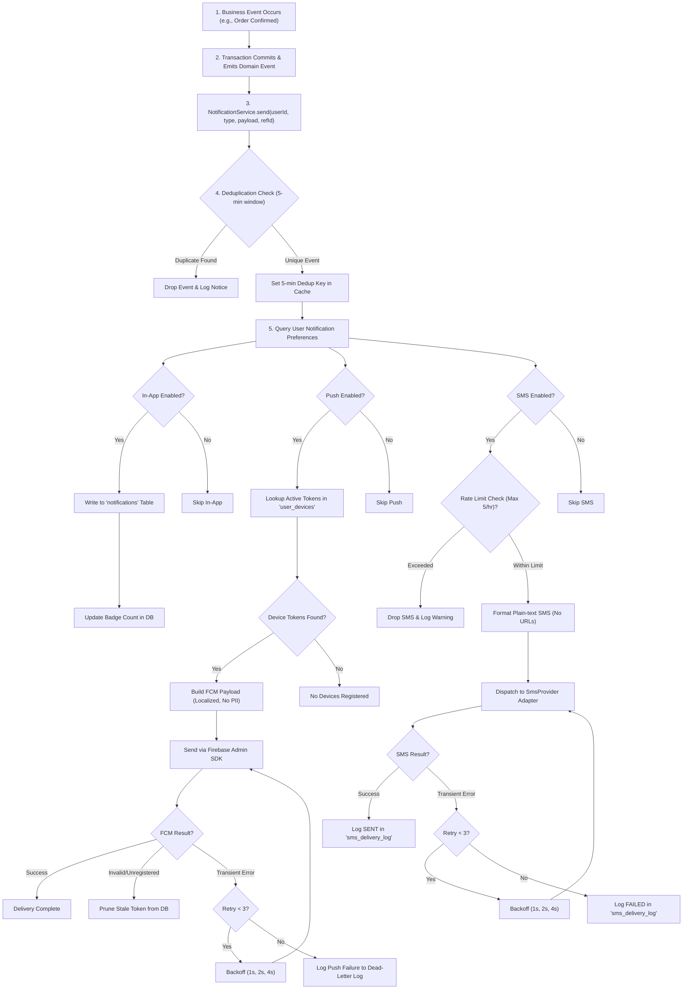

# Hosil Ecosystem — Notification Architecture & Delivery Specification

**Document:** Notification Specification v0.1  
**Date:** 13 October 2026  
**Status:** Proposed  
**Product:** Hosil Bozor, Hosil Farm, Hosil Logistika + Shared Platform  
**Target Market:** Republic of Uzbekistan  

---

## 1. Notification Channels

The Hosil Ecosystem uses a unified notification subsystem deployed within the Spring Boot modular monolith (`com.hosil.notifications`). The subsystem coordinates message delivery across three distinct delivery channels:

1. **In-App Notifications (Persistent):** Server-persisted event log rendered within the Flutter mobile clients.
2. **Push Notifications (Firebase Cloud Messaging):** Real-time device-level alerts and background sync signals.
3. **SMS Notifications:** High-reliability fallback channel restricted strictly to mission-critical transactional events.

```
+-----------------------------------------------------------------------------------+
|                            Hosil Notification Module                              |
+-----------------------------------------------------------------------------------+
                               |
         +---------------------+---------------------+
         |                     |                     |
         v                     v                     v
+-----------------+   +-----------------+   +-----------------+
|  1.1 In-App     |   |  1.2 Push (FCM) |   |    1.3 SMS      |
|  (PostgreSQL)   |   | (Google FCM v1) |   | (SmsProvider)   |
|                 |   |                 |   |                 |
| Persistent Log  |   | Flutter Clients |   | Critical / OTP  |
| Unread Badges   |   | Topics & Direct |   | Rate Limited    |
+-----------------+   +-----------------+   +-----------------+
```

---

### 1.1 In-App Notifications (Persistent)

In-app notifications represent the system of record for user alerts across Hosil Bozor, Hosil Farm, and Hosil Logistika. Even if an external push or SMS fails or is dismissed by the operating system, the in-app record remains accessible to the user.

#### 1.1.1 Data Schema

In-app notifications are stored in PostgreSQL via Flyway migration `V012__create_notification_tables.sql`:

```sql
CREATE TYPE notification_type AS ENUM (
    'ORDER_STATUS',
    'PAYMENT_STATUS',
    'SHIPMENT_UPDATE',
    'WEATHER_ALERT',
    'AI_SCAN_RESULT',
    'CROP_REMINDER',
    'LISTING_MODERATION',
    'QUOTE_RECEIVED',
    'LEASING_STATUS',
    'SYSTEM_ANNOUNCEMENT'
);

CREATE TYPE app_target AS ENUM (
    'BOZOR',
    'FARM',
    'LOGISTIKA',
    'ALL'
);

CREATE TABLE notifications (
    id UUID PRIMARY KEY DEFAULT gen_random_uuid(),
    user_id UUID NOT NULL REFERENCES users(id) ON DELETE CASCADE,
    type notification_type NOT NULL,
    title VARCHAR(255) NOT NULL,
    body TEXT NOT NULL,
    data JSONB NOT NULL DEFAULT '{}'::jsonb,
    app_target app_target NOT NULL DEFAULT 'ALL',
    read_at TIMESTAMPTZ NULL,
    created_at TIMESTAMPTZ NOT NULL DEFAULT CURRENT_TIMESTAMP
);

CREATE INDEX idx_notifications_user_created 
    ON notifications(user_id, created_at DESC);

CREATE INDEX idx_notifications_user_app_unread 
    ON notifications(user_id, app_target, read_at) 
    WHERE read_at IS NULL;
```

#### 1.1.2 Field Definitions

| Column | Type | Nullable | Description |
|---|---|---|---|
| `id` | `UUID` | No | System-generated unique identifier. |
| `user_id` | `UUID` | No | Recipient user ID (foreign key to `users`). |
| `type` | `notification_type` | No | High-level categorization of the event. |
| `title` | `VARCHAR(255)` | No | Localized header text displayed in client notification center. |
| `body` | `TEXT` | No | Localized descriptive summary of the notification. |
| `data` | `JSONB` | No | Structured context (e.g., `entity_id`, `entity_type`, `deep_link`, `action`). |
| `app_target` | `app_target` | No | Target client application: `BOZOR`, `FARM`, `LOGISTIKA`, or `ALL`. |
| `read_at` | `TIMESTAMPTZ` | Yes | Timestamp when user marked notification as read; `NULL` if unread. |
| `created_at` | `TIMESTAMPTZ` | No | Timestamp of creation. |

#### 1.1.3 REST API Endpoints

All endpoints require an authenticated bearer JWT (`Authorization: Bearer <token>`).

##### 1. List Notifications (Paginated)
```http
GET /api/v1/notifications?app_target=BOZOR&unread_only=false&page=0&size=20
```

**Query Parameters:**
- `app_target` (optional, default `ALL`): Filter by target application (`BOZOR`, `FARM`, `LOGISTIKA`, `ALL`). Requests for a specific app return both that app's notifications and notifications targeted to `ALL`.
- `unread_only` (optional, boolean, default `false`): If `true`, returns only records where `read_at IS NULL`.
- `page` (integer, default `0`): Zero-based page index.
- `size` (integer, default `20`): Maximum page size (clamped to max `50`).

**Response (`200 OK`):**
```json
{
  "content": [
    {
      "id": "7bfa5db2-0df4-41d3-9876-0bfdc5a9ec01",
      "type": "ORDER_STATUS",
      "title": "Buyurtma holati o'zgardi",
      "body": "Buyurtmangiz #B-10842 yetkazib beruvchi tomonidan qabul qilindi.",
      "data": {
        "order_id": "99e15dfa-b184-486a-84fb-52467d4f4e22",
        "status": "CONFIRMED",
        "deep_link": "hosil-bozor://orders/99e15dfa-b184-486a-84fb-52467d4f4e22"
      },
      "app_target": "BOZOR",
      "read_at": null,
      "created_at": "2026-10-13T10:15:30Z"
    }
  ],
  "page": 0,
  "size": 20,
  "total_elements": 1,
  "total_pages": 1,
  "last": true
}
```

##### 2. Mark Single Notification as Read
```http
PATCH /api/v1/notifications/{id}/read
```

**Response (`200 OK`):**
```json
{
  "id": "7bfa5db2-0df4-41d3-9876-0bfdc5a9ec01",
  "read_at": "2026-10-13T10:18:02Z"
}
```
*Errors:* `404 Not Found` if notification does not exist or belongs to another user.

##### 3. Mark All Notifications as Read
```http
POST /api/v1/notifications/read-all
Content-Type: application/json

{
  "app_target": "BOZOR"
}
```

**Response (`200 OK`):**
```json
{
  "marked_count": 5,
  "read_at": "2026-10-13T10:18:15Z"
}
```

##### 4. Unread Notification Count Badge
```http
GET /api/v1/notifications/unread-count?app_target=BOZOR
```

**Response (`200 OK`):**
```json
{
  "app_target": "BOZOR",
  "unread_count": 3
}
```

#### 1.1.4 Client Badge Synchronization
- Flutter client displays an unread count badge on the notification bell icon.
- The badge value is loaded on initial app launch via `GET /api/v1/notifications/unread-count?app_target={CURRENT_APP}`.
- Whenever an active FCM push arrives while the app is in the foreground, the local badge count increments by 1.
- Viewing the notification screen or invoking `read-all` resets the local badge count to 0 and persists the read state on the backend.

---

### 1.2 Push Notifications (Firebase Cloud Messaging)

Firebase Cloud Messaging (FCM) is the unified mobile push transport for both Android and iOS Flutter applications. Push notifications deliver immediate user-facing alerts and trigger silent background sync tasks.

#### 1.2.1 Device Registration Schema

A user can authenticate on multiple devices (e.g., Android phone, tablet) and access multiple Hosil client apps. Device registration tokens are managed in `user_devices`:

```sql
CREATE TYPE device_platform AS ENUM ('ANDROID', 'IOS', 'WEB');

CREATE TABLE user_devices (
    id UUID PRIMARY KEY DEFAULT gen_random_uuid(),
    user_id UUID NOT NULL REFERENCES users(id) ON DELETE CASCADE,
    token VARCHAR(512) NOT NULL UNIQUE,
    platform device_platform NOT NULL,
    app_id app_target NOT NULL,
    device_id VARCHAR(128) NULL,
    model VARCHAR(128) NULL,
    last_seen_at TIMESTAMPTZ NOT NULL DEFAULT CURRENT_TIMESTAMP,
    created_at TIMESTAMPTZ NOT NULL DEFAULT CURRENT_TIMESTAMP,
    CONSTRAINT uq_user_device_token UNIQUE (token)
);

CREATE INDEX idx_user_devices_user_app 
    ON user_devices(user_id, app_id);
```

#### 1.2.2 Device Token Management API

##### Register Device Token
```http
POST /api/v1/devices
Content-Type: application/json

{
  "token": "eXamP1e-Fcm-Tok3n-v1_abc123456789...",
  "platform": "ANDROID",
  "app_id": "BOZOR",
  "device_id": "a9b1c834-0128-4ef1",
  "model": "Samsung Galaxy A54"
}
```

**Semantics:**
- Upsert logic: if `token` already exists, update `user_id`, `app_id`, `last_seen_at`, and `model`.
- This ensures tokens are correctly reassigned if a device changes accounts.

##### Unregister Device Token (Logout)
```http
DELETE /api/v1/devices/{token}
```

**Semantics:**
- Called by the Flutter client during user logout.
- Completely removes the token record from `user_devices` to prevent sending notifications of the former account to the device.

##### Automated Stale Token Pruning
- When the backend sends a push via the Firebase Admin SDK and FCM responds with `UNREGISTERED` or `INVALID_ARGUMENT`, the `NotificationDispatcher` immediately deletes the corresponding row from `user_devices`.

#### 1.2.3 FCM Delivery Rules & Principles
1. **Push is a delivery conduit, not a storage layer:** Every push notification intended for the user must correspond to an entry created in the `notifications` table. The push notification provides real-time transit; the persistent table provides durability.
2. **Direct Token Targeting:** User-specific events (e.g., `ORDER_STATUS`, `PAYMENT_STATUS`, `AI_SCAN_RESULT`) query `user_devices` for the user's registered tokens matching the target `app_id` and send direct FCM multi-cast messages.
3. **Topic Subscriptions (Broadcasts):** Public or broadcast notifications utilize FCM Topics to avoid millions of individual API calls:
   - `hosil-farm-weather-alerts`: Broadcast severe frost or storm warnings to all farmers in an agronomic region.
   - `hosil-bozor-announcements`: System-wide maintenance announcements for marketplace users.
   - `hosil-logistika-announcements`: Freight regulation or seasonal road restriction updates.
4. **Silent Push (Background Data Sync):**
   - Push payload without `notification` block, containing only a `data` block and `content_available: true` (iOS) / `priority: high` (Android).
   - Used to notify the Flutter client to quietly sync fresh operational state (e.g., active shipment GPS route cache, urgent catalog price update) while app is backgrounded.

---

### 1.3 SMS Notifications

SMS is a high-cost, high-intrusiveness channel reserved strictly for mission-critical transactional events:
- Authentication & Login OTP codes
- Account security alerts (phone number change, password reset)
- High-value payment confirmations
- Final delivery/order completion confirmations (when offline)

#### 1.3.1 Pluggable `SmsProvider` Adapter Pattern

To avoid vendor lock-in, all SMS dispatches are abstracted behind a domain port:

```java
package com.hosil.notifications.domain.port;

public interface SmsProvider {
    /**
     * Dispatches an SMS message through the underlying gateway.
     *
     * @param phoneNumber Recipient MSISDN in international E.164 format (+998XXXXXXXXX)
     * @param messageText Plain text message (no URLs)
     * @return SmsSendResult containing external provider reference ID and dispatch status
     */
    SmsSendResult send(String phoneNumber, String messageText);

    /**
     * Checks provider status or remaining quota/balance.
     */
    ProviderHealthStatus checkStatus();
}
```

```java
public record SmsSendResult(
    String providerReferenceId,
    SmsDeliveryStatus status,
    String rawResponse,
    String errorMessage
) {}

public enum SmsDeliveryStatus {
    SENT,
    DELIVERED,
    FAILED,
    REJECTED
}
```

> [!WARNING]
> **Vendor Neutrality [UNVERIFIED]:**
> SMS aggregator vendors in Uzbekistan (such as Eskiz.uz, PlayMobile, SMS Traffic) vary in per-message pricing, alphanumeric sender ID registration lead times, and callback reliability. No provider is hard-coded into business logic. Concrete implementations (e.g., `EskizSmsProvider`, `PlayMobileSmsProvider`) must implement `SmsProvider`, and the active provider is configured via Spring environment properties (`hosil.sms.provider=eskiz`).

#### 1.3.2 Rate Limiting Architecture
To prevent SMS bombing, malicious OTP exhaustion, and budget overruns:
- **Enforcement:** Enforced at the application service level before calling `SmsProvider`.
- **Threshold:** Maximum **5 SMS per user per sliding 1-hour window**.
- **Implementation:** Redis sliding-window rate limiter key: `ratelimit:sms:{userId}` with a 3600-second TTL. If Redis is unavailable, an in-memory bucket or database timestamp check enforces the safety threshold.
- **Exceeded Threshold Behavior:** Additional SMS requests within the window fail fast with `429 Too Many Requests` or are downgraded, while an incident log entry is recorded for administrative security review.

#### 1.3.3 SMS Content Constraints in Uzbekistan
1. **Plain Text Only:** Messages must consist of standard alphanumeric text.
2. **Strictly No Links / URLs:** Mobile network operators in Uzbekistan (Ucell, Beeline, Mobiuz, Uztelecom) aggressively filter and drop SMS containing HTTP/HTTPS hyperlinks as suspected phishing or spam. Hosil SMS messages must never contain web links.
3. **Sender ID (Alpha-name):** All SMS must be dispatched under the registered sender ID `Hosil` [UNVERIFIED: registration with regulatory authority and telecom operators required].

#### 1.3.4 SMS Delivery Logging Schema

Every SMS dispatch attempt is recorded in `sms_delivery_log`:

```sql
CREATE TABLE sms_delivery_log (
    id UUID PRIMARY KEY DEFAULT gen_random_uuid(),
    user_id UUID NULL REFERENCES users(id) ON DELETE SET NULL,
    phone_number VARCHAR(20) NOT NULL,
    message_text TEXT NOT NULL,
    provider_name VARCHAR(64) NOT NULL,
    provider_ref_id VARCHAR(128) NULL,
    status VARCHAR(32) NOT NULL,
    error_reason TEXT NULL,
    sent_at TIMESTAMPTZ NULL,
    created_at TIMESTAMPTZ NOT NULL DEFAULT CURRENT_TIMESTAMP
);

CREATE INDEX idx_sms_log_user_created 
    ON sms_delivery_log(user_id, created_at DESC);

CREATE INDEX idx_sms_log_phone_created 
    ON sms_delivery_log(phone_number, created_at DESC);
```

---

## 2. Notification Preferences

Users control which types of alerts they receive on which channels via the notification preferences system. However, system-critical security notifications remain non-disableable.

### 2.1 Database Schema

Preferences are persisted in `notification_preferences`:

```sql
CREATE TYPE delivery_channel AS ENUM ('IN_APP', 'PUSH', 'SMS');

CREATE TABLE notification_preferences (
    id UUID PRIMARY KEY DEFAULT gen_random_uuid(),
    user_id UUID NOT NULL REFERENCES users(id) ON DELETE CASCADE,
    notification_type notification_type NOT NULL,
    channel delivery_channel NOT NULL,
    enabled BOOLEAN NOT NULL DEFAULT TRUE,
    updated_at TIMESTAMPTZ NOT NULL DEFAULT CURRENT_TIMESTAMP,
    CONSTRAINT uq_user_type_channel UNIQUE (user_id, notification_type, channel)
);

CREATE INDEX idx_notif_pref_user 
    ON notification_preferences(user_id);
```

### 2.2 Default Preference Rules

When a user registers, their preferences default to the standard ecosystem configuration:

| Notification Type | In-App Enabled | Push Enabled | SMS Enabled | User Configurable? |
|---|---|---|---|---|
| `ORDER_STATUS` | **Yes** (Default) | **Yes** (Default) | No (Default) | Yes |
| `PAYMENT_STATUS` | **Yes** (Default) | **Yes** (Default) | **Yes** (Default) | Yes |
| `SHIPMENT_UPDATE` | **Yes** (Default) | **Yes** (Default) | No (Default) | Yes |
| `WEATHER_ALERT` | **Yes** (Default) | **Yes** (Default) | No (Default) | Yes |
| `AI_SCAN_RESULT` | **Yes** (Default) | **Yes** (Default) | No (Default) | Yes |
| `CROP_REMINDER` | **Yes** (Default) | **Yes** (Default) | No (Default) | Yes |
| `LISTING_MODERATION` | **Yes** (Default) | **Yes** (Default) | No (Default) | Yes |
| `QUOTE_RECEIVED` | **Yes** (Default) | **Yes** (Default) | No (Default) | Yes |
| `LEASING_STATUS` | **Yes** (Default) | **Yes** (Default) | **Yes** (Default) | Yes |
| `SYSTEM_ANNOUNCEMENT` | **Yes** (Default) | No (Default) | No (Default) | In-App Locked |
| *OTP & Security Alerts* | **Yes** (Mandatory) | No | **Yes** (Mandatory) | **No (Immutable)** |

> [!IMPORTANT]
> **Non-Disableable Notifications:**
> Security alerts (OTP, phone number verification, suspicious login) and critical legal notices are flagged as system-critical. The backend disallows changing or muting these alerts. Any `PATCH` request attempting to disable mandatory channels returns `400 Bad Request`.

### 2.3 Preferences Management API

#### 1. Retrieve Current User Preferences
```http
GET /api/v1/notification-preferences
```

**Response (`200 OK`):**
```json
{
  "preferences": [
    {
      "notification_type": "ORDER_STATUS",
      "channel": "IN_APP",
      "enabled": true,
      "mutable": true
    },
    {
      "notification_type": "ORDER_STATUS",
      "channel": "PUSH",
      "enabled": true,
      "mutable": true
    },
    {
      "notification_type": "ORDER_STATUS",
      "channel": "SMS",
      "enabled": false,
      "mutable": true
    },
    {
      "notification_type": "PAYMENT_STATUS",
      "channel": "SMS",
      "enabled": true,
      "mutable": true
    },
    {
      "notification_type": "SYSTEM_ANNOUNCEMENT",
      "channel": "IN_APP",
      "enabled": true,
      "mutable": false
    }
  ]
}
```

#### 2. Update Notification Preferences
```http
PATCH /api/v1/notification-preferences
Content-Type: application/json

{
  "updates": [
    {
      "notification_type": "ORDER_STATUS",
      "channel": "PUSH",
      "enabled": false
    },
    {
      "notification_type": "WEATHER_ALERT",
      "channel": "PUSH",
      "enabled": true
    }
  ]
}
```

**Response (`200 OK`):**
```json
{
  "status": "SUCCESS",
  "updated_count": 2
}
```

---

## 3. Notification Dispatch Flow

Notification dispatch is fully decoupled from transactional business methods using Spring Application Events (`ApplicationEventPublisher`) and resilient async workers.

### 3.1 Step-by-Step Dispatch Sequence

1. **Business Event Triggered:** A business service (e.g., `OrderService`, `LogisticsService`, `WeatherService`) completes a state transition inside an `@Transactional` block and publishes a domain event (e.g., `OrderConfirmedEvent`).
2. **Event Listener Invocation:** The `@TransactionalEventListener(phase = TransactionPhase.AFTER_COMMIT)` in the notification module captures the event and invokes `NotificationService.send(userId, type, payload, referenceId)`.
3. **Deduplication Check:**
   - A deduplication key is calculated: `dedup:notif:{type}:{userId}:{referenceId}`.
   - The key is evaluated against a **5-minute sliding window** in Redis (or PostgreSQL fallback table).
   - If the key exists, the dispatch is dropped as a duplicate event, preventing redundant alerts for rapid state oscillations.
4. **Preference Resolution:**
   - `NotificationService` retrieves the user's `notification_preferences` for the given `notification_type`.
   - Channels configured as enabled (e.g., `IN_APP`, `PUSH`, `SMS`) are assembled into a dispatch set.
5. **Parallel Channel Execution (Isolated Failure Domains):**
   - The dispatch set executes independently across channels using isolated executors.
   - A network failure or quota exhaustion in the SMS provider does **not** abort In-App creation or FCM push.
   - **In-App:** Writes record to `notifications` table immediately.
   - **Push (FCM):** Resolves tokens in `user_devices` for `app_target`, formats payload, sends via Firebase Admin SDK.
   - **SMS:** Checks 5 SMS/hour rate limit, formats plain text message, dispatches via `SmsProvider`, logs result to `sms_delivery_log`.
6. **Exponential Backoff Retry:**
   - Network timeouts or 5xx server errors from FCM or SMS gateways trigger automatic retries.
   - Retry policy: maximum **3 attempts** with exponential backoff (**1s, 2s, 4s**).
   - Terminal failures are logged to audit logs and dead-letter queue tables for operational investigation.

### 3.2 Mermaid Dispatch Flowchart



---

## 4. Notification Types per App

The table below defines the supported notification types, client target scoping, and standard channel defaults across the Hosil platform.

### 4.1 Application Matrix

| Notification Type | Hosil Bozor | Hosil Farm | Hosil Logistika | Default Channels | Primary Trigger Event |
|---|:---:|:---:|:---:|---|---|
| `ORDER_STATUS` | **Yes** | — | — | In-App + Push | Buyer or seller order status transitions (`CREATED`, `CONFIRMED`, `SHIPPED`, `CANCELLED`). |
| `PAYMENT_STATUS` | **Yes** | — | — | In-App + Push + SMS | Escrow hold, payment release, or refund confirmed via payment gateway. |
| `LISTING_MODERATION`| **Yes** | — | — | In-App + Push | Admin approval, rejection, or edit request on marketplace produce/input listings. |
| `WEATHER_ALERT` | — | **Yes** | — | In-App + Push | Severe frost warning, high wind, or precipitation alert for registered farm plot. |
| `AI_SCAN_RESULT` | — | **Yes** | — | In-App + Push | Crop leaf disease diagnosis job completed by Python FastAPI vision service. |
| `CROP_REMINDER` | — | **Yes** | — | In-App + Push | Scheduled agro-technical task due (irrigation cycle, fertilizer application). |
| `SHIPMENT_UPDATE` | — | — | **Yes** | In-App + Push | Cargo status changed (`DISPATCHED`, `IN_TRANSIT`, `DELIVERED`, `POD_UPLOADED`). |
| `QUOTE_RECEIVED` | — | — | **Yes** | In-App + Push | Logistics carrier submitted freight price quote for farmer's transport request. |
| `LEASING_STATUS` | — | — | **Yes** | In-App + Push + SMS | Partner financing application stage updated (`SUBMITTED`, `DOCS_REQUIRED`, `APPROVED`). |
| `SYSTEM_ANNOUNCEMENT`| **Yes** | **Yes** | **Yes** | In-App | Platform-wide service maintenance, terms update, or regional holidays. |

### 4.2 Standard Payload Schema

All notifications conform to a standardized JSON structure stored in `notifications.data` and mirrored in the FCM data payload:

```json
{
  "entity_id": "8c01d9f0-2f2b-47b8-b4b6-3a789437190e",
  "entity_type": "ORDER",
  "status": "CONFIRMED",
  "deep_link": "hosil-bozor://orders/8c01d9f0-2f2b-47b8-b4b6-3a789437190e",
  "app_target": "BOZOR",
  "metadata": {
    "carrier_name": "Toshkent Logistika MCHJ",
    "updated_at": "2026-10-13T10:30:00Z"
  }
}
```

---

## 5. Security and Privacy

### 5.1 Push Notification Payload Minimization
Mobile lock screens and third-party notification loggers are vulnerable to shoulder surfing and device interception.
- **Strict Privacy Rule:** Push notification alert text must contain **no sensitive personal, order-specific financial, or agricultural yield data**.
- **Compliant Example:** `"Buyurtmangiz bo'yicha yangilik mavjud"` (*"There is an update on your order"*).
- **Prohibited Example:** `"[VIOLATION] Sizning #4812 buyurtmangiz 50 tonna paxta uchun 150,000,000 UZS to'landi"` (*"Order #4812 for 50 tons cotton paid 150,000,000 UZS"*).
- The detailed payload is retrieved securely by the Flutter app via authenticated REST call (`GET /api/v1/notifications`) only after the user opens the application.

### 5.2 SMS Content Privacy & Safety
- SMS messages must never contain passwords, PINs, full bank card numbers, or transaction totals.
- OTP messages must specify the action context to prevent social engineering:
  - `"Hosil platformasiga kirish kodi: 849201. Kodni hech kimga bermang!"`
- No hyperlinks are permitted in SMS messages (see Section 1.3.3).

### 5.3 Device Token Lifecycle & Session Hygiene
- Device tokens are bound to authenticated `user_id` records in `user_devices`.
- **Logout Action:** When a user logs out of an application, the client calls `DELETE /api/v1/devices/{token}`. The backend invalidates the token record immediately.
- **Account Switching:** If another user logs into the same physical device, the registration endpoint (`POST /api/v1/devices`) reassigns the existing device token to the new user and revokes the association with the previous user.
- **Token Invalidation Handling:** The push dispatcher automatically deletes tokens flagged as invalid or uninstalled by FCM error responses.

### 5.4 Localization Strategy
The Hosil platform serves users in the Republic of Uzbekistan with two primary language requirements: Uzbek (Latin script, default) and Russian.
- User profile contains `preferred_language` (`UZ` or `RU`).
- The backend notification dispatcher resolves localized message templates from Spring `MessageSource` bundles:
  - `messages_uz.properties`: `notification.order.confirmed.title=Buyurtma tasdiqlandi`
  - `messages_ru.properties`: `notification.order.confirmed.title=Заказ подтвержден`
- Template interpolation inserts dynamic parameters (e.g., short order code, crop name) before generating in-app and push notification titles/bodies.

---

## 6. Unresolved Decisions

The following architectural and operational decisions require formal evaluation and sign-off during upcoming milestone phases:

| Decision ID | Decision Description | Architectural & Operational Impact | Required By Phase | Status |
|---|---|---|---|---|
| **DEC-NOTIF-01** | **SMS Provider Selection & Commercial Verification** | Selection of primary and secondary Uzbekistan SMS aggregator (Eskiz.uz vs PlayMobile vs SMS Traffic). Requires verifying API SLA, alpha-name registration, and cost per message (UZS). | Before Pilot Launch (Phase 5) | [UNVERIFIED] |
| **DEC-NOTIF-02** | **FCM Topics vs Direct Token Targeting for Weather** | Determining whether regional weather alerts should use FCM Geo-Topics (e.g., `weather-fergana`) or targeted queries based on plot polygon coordinates in PostgreSQL PostGIS. | Phase 6 (Advisory) | [DECISION REQUIRED] |
| **DEC-NOTIF-03** | **Notification Retention & Archival Policy** | Data growth policy for `notifications` table: how long to keep read notifications (e.g., 90 days retention, scheduled purge vs cold storage). | Phase 6 (Platform Ops) | [DECISION REQUIRED] |
| **DEC-NOTIF-04** | **Telegram Bot Notification Channel Integration** | Telegram is ubiquitous in Uzbekistan. Evaluating whether to offer a Hosil Telegram Bot as an opt-in notification channel for quotes, advisories, and order updates. | Post-MVP (Phase 7+) | [DECISION REQUIRED] |
| **DEC-NOTIF-05** | **Email Notification Channel Scope** | Assessing whether email delivery (SMTP/Sendgrid) is needed for B2B supplier invoices, logistics contracts, and leasing documents. Low utility for smallholder farmers. | Post-MVP (Phase 7+) | [DECISION REQUIRED] |
| **DEC-NOTIF-06** | **Push Notification Localization Mechanics** | Deciding whether push notifications send pre-localized server strings in the payload, or send translation keys + parameters for the Flutter client app to resolve locally. | Phase 7 (Refinement) | [DECISION REQUIRED] |
