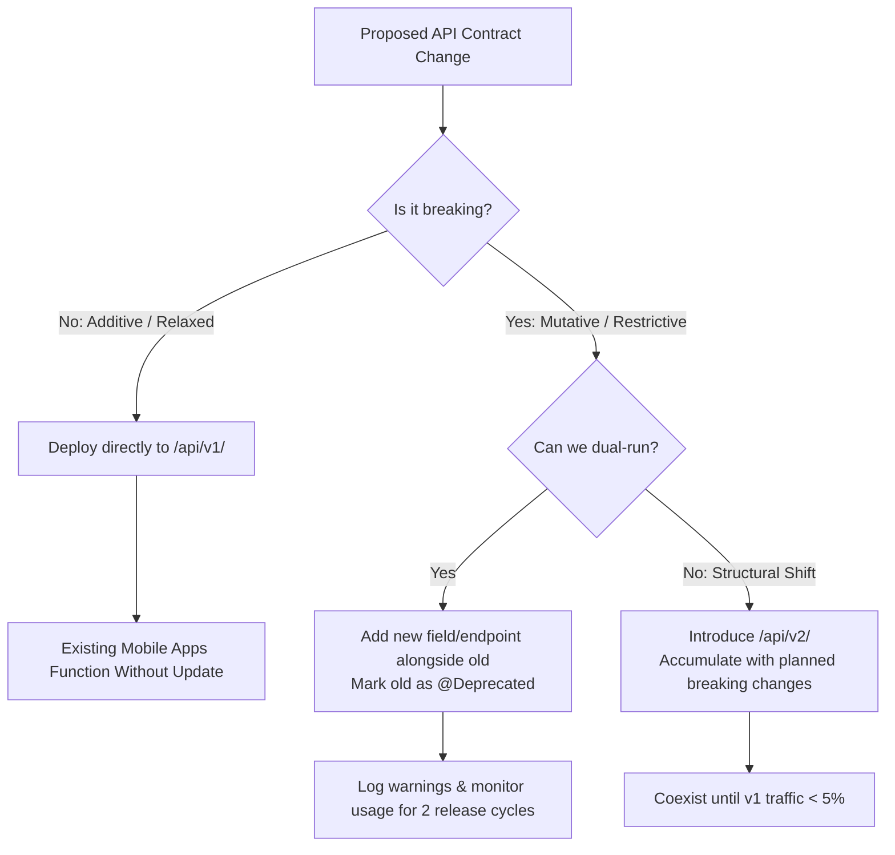
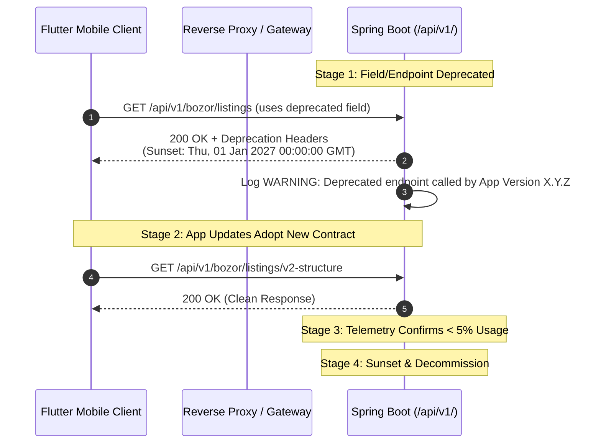
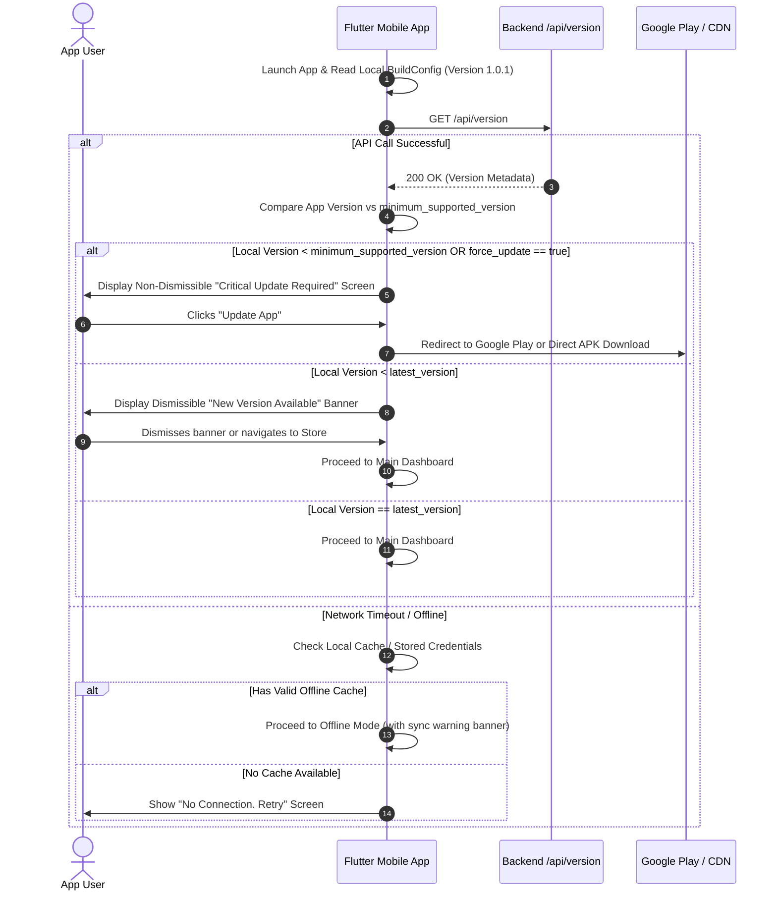

# Hosil Ecosystem — Admin Panel Architecture & API Versioning Strategy

**Document ID:** HOSIL-DOC-010  
**Version:** 0.1  
**Date:** 13 October 2026  
**Status:** Proposed  
**Product:** Hosil Bozor, Hosil Farm, Hosil Logistika, Shared Platform & Admin Panel  
**Target Audience:** Engineering Team, Product Managers, Operations & QA  

---

## Executive Summary

This document establishes two foundational operational architectures for the Hosil platform:
1. **Admin Panel Architecture:** The technical evaluation, selection, and functional scope of the internal web interface used by the Hosil operational team (< 10 operators initially) to moderate marketplace listings, manage user accounts, resolve order disputes, publish agricultural content, and inspect audit logs.
2. **API Versioning Strategy:** The formal contract governing endpoint namespaces, backward compatibility invariants, deprecation lifecycles, multi-version coexistence within the Spring Boot modular monolith, and mobile client runtime compatibility checks for the three Flutter applications (*Hosil Bozor*, *Hosil Farm*, *Hosil Logistika*).

---

## 1. Admin Panel: Technology Comparison & Selection

### 1.1 Operational Context and Requirements

The Hosil administrative interface serves internal staff operating from desktop or tablet web browsers. In the MVP stage:
- **User Base:** Internal Hosil staff only (< 10 simultaneous users initially across moderation, support, and agronomy content roles).
- **Workload Profile:** Primarily read-heavy tabular inspection, form-based data entry (listing review, status toggling, dispute notes), and transactional state transitions.
- **Backend Architecture:** Java 21 + Spring Boot 3.x/4.x modular monolith backed by PostgreSQL and Spring Data JPA.
- **Constraint:** Engineering capacity is tightly focused on delivering the three Flutter consumer applications and core backend business modules. Minimizing infrastructure and build pipeline overhead is essential.

### 1.2 Technology Comparison Matrix

| Evaluation Dimension | Option A: Spring Boot + Thymeleaf (Server-Rendered) | Option B: Separate React / Next.js SPA |
|---|---|---|
| **Architecture & Deployment** | **Monolithic co-deployment.** Packaged as part of the core Spring Boot JAR artifact. Single deployment unit. | **Decoupled frontend service.** Requires standalone Node.js build, separate hosting (Vercel, S3/CloudFront, or Nginx container), and multi-stage CI/CD. |
| **Development Velocity (CRUD)** | **High for CRUD screens.** Direct integration with Spring MVC controllers, form validation, and Spring Data repositories without intermediate DTO mapping layers. | **Moderate to Low.** Requires defining REST endpoints, serialization DTOs, TypeScript interfaces, React query hooks, and form state plumbing. |
| **Authentication & Security** | **Trivial Spring Security integration.** Leverages standard HTTP-only session cookies, built-in CSRF token protection, and standard form login. | **Complex auth flow.** Requires JWT bearer token storage (handling XSS/refresh rotation), custom CSRF protection, and CORS configuration. |
| **CORS & Network Overhead** | **Zero CORS issues.** All requests are origin-relative to the backend domain (`/admin/*`). | **Requires CORS management.** Frontend origin must be explicitly whitelisted in Spring Security CORS configuration. |
| **Interactivity & UX** | **Traditional page reloads by default.** Interactivity can be enhanced incrementally with lightweight hypermedia libraries like HTMX. | **Rich, reactive single-page app.** Instant UI state transitions, complex client-side sorting/filtering, and dynamic dashboards. |
| **Real-time / Dashboard Capabilities** | **Basic.** Real-time data requires polling or server-sent events (SSE). Visual charting relies on client-side JS libraries (e.g., Chart.js) embedded in templates. | **Native.** Rich ecosystem of dashboard components, canvas charts, and WebSocket state management (e.g., TanStack Table, Recharts). |
| **Team Skill & Headcount** | **Java/Spring backend engineers.** No dedicated frontend engineer required; backend developers build views using standard HTML/CSS. | **Requires React/TypeScript skills.** Requires a dedicated frontend engineer or splits backend team focus across two distinct ecosystems. |
| **Maintenance Burden** | **Low.** Zero npm dependency drift, no Node.js security patches, single runtime environment. | **Moderate to High.** Package vulnerability patching (`npm audit`), frontend bundling updates, API contract synchronization. |
| **Best Suited For** | **MVP CRUD operations**, moderation queues, dispute workflows, administrative tables, and low-concurrency internal tools. | **Complex visual analytics**, interactive drag-and-drop logistics dispatch, live telematics tracking, and large enterprise support desks. |

### 1.3 Detailed Option Analysis

#### Option A: Spring Boot + Thymeleaf (Server-Rendered)
- **Pros:**
  - **Single Pipeline:** No separate Node.js build step, bundler (Vite/Webpack), or separate deployment target.
  - **Spring Security Native:** Session-based authentication with `SecurityFilterChain` integrates directly with role-based authorization tags (`sec:authorize`).
  - **Rapid CRUD Delivery:** Form binding via `@ModelAttribute` and Spring `BindingResult` handles server-side validation error rendering out-of-the-box.
  - **Zero CORS Friction:** Administrative routes reside under the same origin as the application server (e.g., `hosil.uz/admin`).
  - **Universal Client Support:** Runs on any desktop browser without modern client-side JavaScript execution dependencies.
- **Cons:**
  - **Limited Client Interactivity:** Page reloads on form submission unless augmented with hypermedia tools (HTMX) or Alpine.js.
  - **Not Suited for Heavy Analytics:** Complex real-time charting and multi-dimensional pivot tables become cumbersome in pure server templates.
  - **Coupled Scaling:** Admin panel traffic, while negligible for < 10 users, shares the same runtime process as public API traffic.
- **Best For:** MVP operations, listing moderation, user management, order disputes, category maintenance, and basic metrics.

#### Option B: Separate React / Next.js Dashboard
- **Pros:**
  - **Superior User Experience:** Smooth, client-side transitions, dynamic multi-filter tables, and instant feedback.
  - **Component Ecosystem:** Access to mature enterprise admin UI kits (Ant Design, shadcn/ui, MUI, Tremor) and rich charting engines.
  - **Independent Development Lifecycle:** Frontend developers can iterate on admin layouts without redeploying the Spring Boot backend.
- **Cons:**
  - **Doubled Deployment Complexity:** Requires setting up a second CI/CD pipeline, container registry, environment variable management, and static hosting.
  - **Authentication Overhead:** Requires coordinating JWT storage, refresh token rotation, or cross-domain cookie configurations across origins.
  - **Staffing Cost:** Demands dedicated frontend development resources that are currently needed for the three Flutter mobile apps.
- **Best For:** Post-MVP phase with real-time fleet map dispatching, multi-tenant partner portals, or executive analytics dashboards.

### 1.4 Recommendation & Strategic Path

**Recommendation:** Adopt **Option A (Spring Boot + Thymeleaf)** for the Hosil MVP admin panel.

1. **Alignment with MVP Constraints:** The administrative needs of Hosil at launch are strictly operational CRUD workflows: reviewing harvest listings, suspending fraudulent accounts, inspecting transport requests, and publishing agronomic guides. A server-rendered approach delivers these workflows with minimal lines of code and zero additional infrastructure.
2. **Resource Efficiency:** The engineering team must concentrate on the core Java 21 backend and the three Flutter mobile applications. A Thymeleaf admin panel allows Java engineers to build operational tooling without diverting attention to React state management, Webpack configurations, or Node deployments.
3. **Hypermedia Extension (HTMX):** To overcome the traditional limitation of full page reloads, Thymeleaf can be paired with **HTMX** [DECISION REQUIRED: DEC-01]. HTMX allows partial DOM swaps, inline table filtering, and dynamic modal dialogs via standard HTML attributes (`hx-get`, `hx-target`), providing an SPA-like feel while retaining server-side simplicity.
4. **Clean Migration Path:** The mobile applications already consume a pure REST API under `/api/v1/`. If business growth later demands advanced analytics, map-based vehicle dispatching, or a dedicated partner portal, an external React/Next.js dashboard can be developed and plugged directly into the existing REST backend without changing core domain services.

---

### 1.5 Architectural Decision Record: ADR-002

```
================================================================================
ADR-002: Selection of Spring Boot + Thymeleaf for MVP Admin Panel
================================================================================
Status:        Accepted
Date:          13 October 2026
Deciders:      Hosil Core Engineering Team
Consulted:     Product Lead, Operations Lead

CONTEXT:
Hosil requires an administrative back-office tool for internal staff (< 10 users)
to moderate agricultural listings, manage user accounts, oversee marketplace orders,
resolve logistics disputes, and manage agricultural advisory content. The primary
backend is a Java 21 + Spring Boot modular monolith. Developer resources are finite,
with mobile frontend development fully occupied by three Flutter applications.
Deploying and maintaining an independent SPA (React/Next.js) introduces separate
build pipelines, CORS configurations, JWT token refresh flows, and hosting costs.

DECISION:
Implement the MVP administrative panel using Spring Boot MVC with Thymeleaf
server-side templates, co-located within the modular monolith under the `/admin/*`
route namespace. Optionally enhance dynamic UI interactions using HTMX.

CONSEQUENCES:
Positive:
- Single Maven build and unified deployment artifact (one JAR).
- Native Spring Security integration using secure HTTP-only session cookies and CSRF.
- Instant access to Spring Data JPA repositories and domain service layer.
- Zero CORS configuration or independent API gateway routing required.
- No dedicated JavaScript/React frontend engineer required for back-office tooling.

Negative:
- Limited out-of-the-box UI component flair compared to modern React component libraries.
- Not suited for complex client-side graphics or real-time spatial logistics dispatching.

NEUTRAL / MIGRATION TRIGGER:
- The public API contract remains clean and RESTful under `/api/v1/`.
- If administrative user counts exceed 50, or if logistics dispatch requires real-time
  map-based vehicle tracking and live telematics, the admin interface may be extracted
  into an independent SPA consuming dedicated internal API endpoints.
================================================================================
```

---

## 2. MVP Admin Capabilities & Operational Workflows

### 2.1 Core Screen Inventory

The MVP administrative portal requires seven discrete screen modules accessible via a left-hand navigation layout.

| Screen / Module | Primary Capabilities | Key Data Fields & Actions |
|---|---|---|
| **1. User Management** | User directory, identity inspection, account state control | - List and search by phone number (`+998...`), display name, role, registration date.<br>- View user profile, registered farms, active listings, order history.<br>- Account status management: `ACTIVE`, `PENDING_VERIFICATION`, `SUSPENDED`.<br>- Suspend/reactivate action with mandatory audit reason modal. |
| **2. Listing Moderation** | Moderation queue for marketplace harvest and input listings | - Filter by status: `PENDING_REVIEW`, `FLAGGED`, `APPROVED`, `REJECTED`.<br>- Inspect crop type, quantity, pricing (UZS), region/district, photo gallery, seller details.<br>- Actions: **Approve**, **Reject** (with predefined rejection code + custom feedback), **Flag for Review**. |
| **3. Order Management & Disputes** | Marketplace transactions, transport shipments, dispute resolution | - List marketplace and logistics orders with status badges (`PENDING`, `CONFIRMED`, `IN_TRANSIT`, `DELIVERED`, `DISPUTED`, `CANCELLED`).<br>- Detailed timeline view: buyer, seller, transporter, delivery address, agreed price.<br>- Dispute resolution actions: record mediation notes, override order status, initiate refund recommendation [UNVERIFIED: Escrow payment flow]. |
| **4. Category Management** | Taxonomy management for agricultural supplies and crops | - Hierarchical tree view (Root Categories, Subcategories).<br>- CRUD operations: category name (Uzbek Latin, Russian), icon/image upload, supported measurement units (`KG`, `TON`, `PIECE`, `LITER`).<br>- Status toggle: `ACTIVE`, `INACTIVE`. |
| **5. Advisory & Content Management** | Agricultural knowledge base articles and pest advisories | - Rich text / Markdown editor for articles published to *Hosil Farm* feed.<br>- Fields: title, crop tag, category (e.g., Irrigation, Pest Control, Fertilization), region applicability, publication date, cover photo.<br>- Lifecycle: `DRAFT`, `PUBLISHED`, `ARCHIVED`. |
| **6. Audit Log Viewer** | Security and compliance audit trail of administrative actions | - Read-only chronological event table.<br>- Fields: timestamp (Asia/Tashkent), admin user ID, client IP, action type (`USER_SUSPENDED`, `LISTING_REJECTED`, `ORDER_OVERRIDDEN`), target entity ID, before/after JSON diff.<br>- Filterable by admin user, date range, and action type. |
| **7. Operational Metrics Dashboard** | High-level system health and volume indicators | - Metric cards: Total registered users (split by Farmer, Buyer, Transporter), active marketplace listings, orders created today, open dispute count, pending moderation queue depth.<br>- Backed by simple SQL queries/indexed aggregations (no external BI dependencies). |

### 2.2 Operational Workflows

The two primary state machines managed by internal staff via the admin interface are **Listing Moderation** and **Dispute Resolution**.

```mermaid
flowchart TD
    subgraph Listing Moderation Workflow
        A[Seller Submits Listing in Hosil Bozor] --> B[Status: PENDING_REVIEW]
        B --> C{Admin Inspection}
        C -->|Content Valid & Accurate| D[Status: APPROVED]
        D --> E[Visible in Marketplace Search]
        C -->|Policy Violation / Fraud| F[Status: REJECTED]
        F --> G[Notification Sent to Seller with Reason Code]
        C -->|Suspicious Imagery / Pricing| H[Status: FLAGGED]
        H --> I[Secondary Admin Review]
        I -->|Cleared| D
        I -->|Confirmed Violation| F
    end

    subgraph Order Dispute Resolution Workflow
        J[Buyer or Seller Raises Dispute] --> K[Status: DISPUTED]
        K --> L[Assigned to Support Operator]
        L --> M[Operator Reviews Order Timeline & Evidence]
        M --> N{Mediation Outcome}
        N -->|Mutual Resolution Reached| O[Status: RESOLVED - Complete Order]
        N -->|Order Cancelled / Refund Authorized| P[Status: RESOLVED - Cancelled]
        N -->|Unresolvable Fraud| Q[Suspend Offending Account + Escalate]
    end
```



### 2.3 Administrative Security and Data Rules

1. **Role-Based Access Control (RBAC):** Access to `/admin/**` requires the `ROLE_ADMIN` authority. Fine-grained roles (`ROLE_MODERATOR`, `ROLE_SUPPORT`, `ROLE_CONTENT_EDITOR`) [DECISION REQUIRED: DEC-03] restrict access to specific screens.
2. **Mandatory Audit Logging:** Every administrative mutation (approving/rejecting listings, modifying user status, editing categories, overriding orders) writes a synchronous, immutable record to the `audit_logs` database table before committing the transaction.
3. **Session Invalidation:** Administrative sessions enforce strict inactivity timeouts (30 minutes) and require re-authentication for sensitive actions (e.g., account suspension).

---

## 3. API Versioning Strategy

### 3.1 Namespace & URL Routing Design

All external REST API endpoints consumed by mobile applications and third-party integrations follow **explicit path-based versioning**.

```
https://api.hosil.uz/api/{version}/{resource}
```

- **Initial Mobile Production Version:** `/api/v1/`
- **Example Endpoints:**
  - `POST /api/v1/auth/otp/send`
  - `GET  /api/v1/bozor/listings`
  - `GET  /api/v1/farm/fields`
  - `POST /api/v1/logistika/shipments`
- **Routing Partitioning:**
  - `/api/v1/**` — Protected and public REST API for mobile clients (stateless, JWT authentication).
  - `/admin/**` — Internal server-rendered web portal (stateful, HTTP-only session cookies).
  - `/api/version` — Unversioned system discovery endpoint used by mobile clients on startup for version negotiation and update checks.

#### Why Path-Based Versioning?
Alternative versioning approaches (Accept Headers, Custom HTTP Headers, Query Parameters) were evaluated and rejected for the following technical reasons:

| Approach | Verdict | Technical Rationale |
|---|---|---|
| **URI Path (`/api/v1/`)** | **Selected** | Transparent, simple to configure in mobile HTTP clients (base URL parameter), fully visible in web proxy and access logs, effortlessly cached by CDNs and reverse proxies without `Vary: Accept` complications. |
| **Header (`Accept: application/vnd.hosil.v1+json`)** | Rejected | Prone to stripping by intermediate proxies; complicates manual cURL testing, mobile client interceptors, and Swagger/OpenAPI documentation grouping. |
| **Query Parameter (`/api/listings?v=1`)** | Rejected | Easily forgotten in mobile client requests, polluted query strings, complex route mapping in Spring MVC. |

---

### 3.2 Backward Compatibility Invariants

The platform maintains a strict compatibility contract. An existing major version (`/api/v1/`) is guaranteed to remain backward compatible across all minor mobile application releases.



#### What Constitutes a NON-BREAKING Change (Safe for `/api/v1/`)
Changes that do not violate existing mobile client deserialization or business assumptions can be deployed immediately without bumping the major API version:
1. **Adding new optional fields to response DTOs:** Mobile clients must be built to ignore unknown JSON fields (`JsonConfig` / `@JsonIgnoreProperties(ignoreUnknown = true)`).
2. **Adding brand-new endpoints:** Introducing new REST routes does not impact existing client workflows.
3. **Adding new optional request parameters:** Adding an optional query parameter (e.g., `?sort=date_desc`) or optional request body field.
4. **Adding new enum values (with client fallback):** Adding values to an enumerated type, provided mobile clients implement a default/unknown fallback handler rather than throwing runtime parsing exceptions.
5. **Internal performance optimizations and bug fixes:** Rectifying backend logic or SQL queries without altering HTTP status codes, request constraints, or response schemas.

#### What Constitutes a BREAKING Change (Requires Deprecation or `/api/v2/`)
Any modification that disrupts an already-installed mobile client's ability to communicate with the backend is strictly prohibited in `/api/v1/`:
1. **Removing or renaming an existing field** in a request or response DTO.
2. **Mutating the data type or structure of an existing field** (e.g., changing an integer ID `104` to a UUID string `"e4b...""`, or changing a scalar value to an object/array).
3. **Removing an active endpoint or changing its HTTP method** (e.g., changing `POST` to `PUT`).
4. **Adding new required fields** to a request body or URL path.
5. **Tightening validation constraints** on existing request fields (e.g., lowering max character length or restricting valid input formats).
6. **Altering authentication or authorization requirements** for an existing route.
7. **Mutating business semantics of a field** (e.g., changing a price field from Uzbek soʻm (UZS) to tiyin/cents without renaming the field).
8. **Modifying the standard error response schema** or altering established error code identifiers.

---

### 3.3 Deprecation Policy & Lifecycle

When an existing endpoint or field contract must be phased out, the engineering team follows a structured deprecation process spanning a minimum of **two mobile release cycles** [DECISION REQUIRED: Release cycle duration, typically 4–8 weeks].



#### Deprecation Protocol Rules:
1. **Side-by-Side Coexistence:** Never modify the legacy field in place. Introduce the new field or endpoint alongside the existing one (e.g., introduce `crop_category_id` while maintaining deprecated `category_id`).
2. **OpenAPI & Code Annotation:**
   - Annotate Java controllers and DTO properties with `@Deprecated(since = "...", forRemoval = true)`.
   - Document replacement instructions in the Springdoc OpenAPI description tag (`@Schema(description = "Deprecated. Use crop_category_id instead.", deprecated = true)`).
3. **Standard Deprecation Headers:** Responses from deprecated endpoints must include RFC 8594 standard headers:
   - `Deprecation: @<unix-timestamp>`
   - `Sunset: <http-date>` (indicating projected removal date)
   - `Link: </api/v1/replacement-endpoint>; rel="successor-version"`
4. **Telemetry & Log Monitoring:**
   - Spring Boot interceptors inspect incoming requests. If a deprecated endpoint is accessed, a structured warning is emitted:
     ```json
     {"level":"WARN","event":"deprecated_api_access","endpoint":"/api/v1/old-route","client_app":"hosil_bozor","client_version":"1.0.2","user_id":"..."}
     ```
   - Operations monitors dashboard metrics to evaluate the remaining active audience before executing sunsetting.
5. **Minimum Deprecation Window:** An endpoint or field cannot be decommissioned until it has been deprecated for at least **two full mobile store release cycles** and active traffic drops below the defined decommission threshold.

---

### 3.4 Criteria & Architecture for `/api/v2/`

#### Introduction Thresholds
A new major version (`/api/v2/`) must **not** be introduced for isolated field changes or incremental feature additions. A major version bump is justified **only** when:
- Multiple accumulated breaking changes render backward compatibility maintenance in `/api/v1/` technically unsustainable.
- The fundamental domain model or authentication architecture undergoes a systemic shift (e.g., migrating from phone OTP + session tokens to OAuth2/OIDC social identity federation).
- Payload structure redesign yields substantial performance or latency gains across the platform.

#### Architectural Implementation in Spring Boot Modular Monolith
The modular monolith hosts multiple API versions concurrently within the same Spring Boot runtime. Business logic remains consolidated within domain services; only web controllers and DTO adapters are duplicated.

```
com.hosil.bozor/
├── domain/                      <-- Shared domain logic & entities
│   ├── model/Listing.java
│   └── service/ListingService.java
└── adapter/
    └── rest/
        ├── v1/                  <-- API Version 1 Controllers & DTOs
        │   ├── ListingControllerV1.java   (@RequestMapping("/api/v1/bozor/listings"))
        │   └── dto/ListingResponseV1.java
        └── v2/                  <-- API Version 2 Controllers & DTOs
            ├── ListingControllerV2.java   (@RequestMapping("/api/v2/bozor/listings"))
            └── dto/ListingResponseV2.java
```

#### Sunsetting `/api/v1/`
- `/api/v1/` remains fully operational and maintained until telemetry confirms that **less than 5% of monthly active users (MAU)** across all three mobile applications are communicating via v1 endpoints.
- Once the < 5% threshold is achieved, a coordinated force-update is pushed to the remaining user base, after which `/api/v1/` controllers are cleanly removed from the codebase.

---

### 3.5 Mobile Client Compatibility & Version Negotiation Protocol

Mobile applications deployed to end users cannot be updated synchronously like web applications. Rural connectivity constraints and delayed app store update adoption in Uzbekistan mean legacy apps will remain in the wild indefinitely.

To prevent crashes and corrupted transactions, all three Flutter apps (*Hosil Bozor*, *Hosil Farm*, *Hosil Logistika*) must implement an automated version handshake at startup.

#### 3.5.1 The Version Discovery Contract: `GET /api/version`

The backend exposes an unversioned discovery endpoint:
`GET https://api.hosil.uz/api/version`

**Response Payload Specification:**

```json
{
  "current_api_version": "v1",
  "minimum_supported_api_version": "v1",
  "deprecated_api_versions": [],
  "apps": {
    "hosil_bozor": {
      "minimum_supported_version": "1.0.0",
      "latest_version": "1.2.4",
      "force_update": false,
      "store_url_android": "https://play.google.com/store/apps/details?id=uz.hosil.bozor",
      "direct_apk_url": "https://cdn.hosil.uz/apps/bozor/hosil-bozor-v1.2.4.apk"
    },
    "hosil_farm": {
      "minimum_supported_version": "1.0.0",
      "latest_version": "1.1.2",
      "force_update": false,
      "store_url_android": "https://play.google.com/store/apps/details?id=uz.hosil.farm",
      "direct_apk_url": "https://cdn.hosil.uz/apps/farm/hosil-farm-v1.1.2.apk"
    },
    "hosil_logistika": {
      "minimum_supported_version": "1.0.0",
      "latest_version": "1.0.8",
      "force_update": false,
      "store_url_android": "https://play.google.com/store/apps/details?id=uz.hosil.logistika",
      "direct_apk_url": "https://cdn.hosil.uz/apps/logistika/hosil-logistika-v1.0.8.apk"
    }
  },
  "announcements": {
    "has_announcement": false,
    "title_uz": "",
    "title_ru": "",
    "message_uz": "",
    "message_ru": ""
  }
}
```

#### 3.5.2 Mobile Startup Handshake Flow



#### 3.5.3 Force-Update & APK Delivery Strategy for Uzbekistan
- **Direct APK Fallback:** In rural Uzbekistan, mobile data limits and Google Play connectivity constraints can prevent farmers from updating via the Play Store. The `direct_apk_url` provides an alternative direct download link hosted on the local Tashkent CDN/server infrastructure.
- **Emergency Security Revocation:** If a zero-day vulnerability or critical financial calculation bug is discovered in a deployed mobile release, backend administrators set `force_update: true` or increment `minimum_supported_version` for that app in the backend config. This immediately locks out the vulnerable release upon next network contact.

---

## 4. Unresolved Decisions & Implementation Roadmap

The following architectural and operational decisions require formal resolution as the project progresses through its implementation phases:

| Decision ID | Decision Description | Architectural Impact | Required By Phase | Candidate Options | Status |
|---|---|---|---|---|---|
| **DEC-01** | Adoption of HTMX with Thymeleaf for dynamic admin interactions | Affects UI responsiveness, frontend script footprint, and server controller response mapping (returning HTML fragments vs full templates). | Phase 6 (Admin Refinement) | 1. Plain Thymeleaf (full page reloads).<br>2. Thymeleaf + HTMX (fragment swaps).<br>3. Thymeleaf + Alpine.js. | `[DECISION REQUIRED]` |
| **DEC-02** | Admin panel authentication mechanism | Determines whether admin users authenticate via standard session cookies or share the mobile JWT token architecture. | Phase 2 (Identity & Auth) | 1. HTTP-only session cookies (standard for Thymeleaf).<br>2. Shared JWT bearer tokens (stored in secure cookies). | `[DECISION REQUIRED]` |
| **DEC-03** | Granular admin Role-Based Access Control (RBAC) hierarchy | Dictates security authorization rules on admin controllers and database user schemas. | Phase 2 (Identity & Auth) | 1. Flat `ROLE_ADMIN` for all internal users.<br>2. Multi-tier hierarchy: `SUPER_ADMIN`, `MODERATOR`, `SUPPORT_AGENT`, `CONTENT_EDITOR`. | `[DECISION REQUIRED]` |
| **DEC-04** | Mobile app update enforcement mechanism | Influences Flutter client package dependencies and Play Store policy compliance. | Phase 7 (Mobile Release) | 1. Google Play In-App Updates library (Play Core).<br>2. Custom Flutter dialog directing to Play Store URL.<br>3. In-app APK self-installer (Android only) [UNVERIFIED: Security & Play Store compliance]. | `[DECISION REQUIRED]` |

---

## 5. Architectural Alignment & Cross-References

This document complies with and directly supports established ecosystem architecture documents:
- **`01_product_requirements (1).md`**: Fulfills administrative moderation and dispute resolution requirements outlined in PRD Section 3.
- **`02_architecture.md` §1.1**: Adheres to the baseline decision to keep administrative tooling lightweight during MVP, deferring heavy frontend SPA development until warranted by business scale.
- **`02_architecture.md` §3**: Preserves the integrity of the Java 21 Spring Boot modular monolith without introducing microservices or unneeded infrastructure components.
- **`docs/decisions/ADR-002.md`**: Officially recorded as Architecture Decision Record ADR-002.
