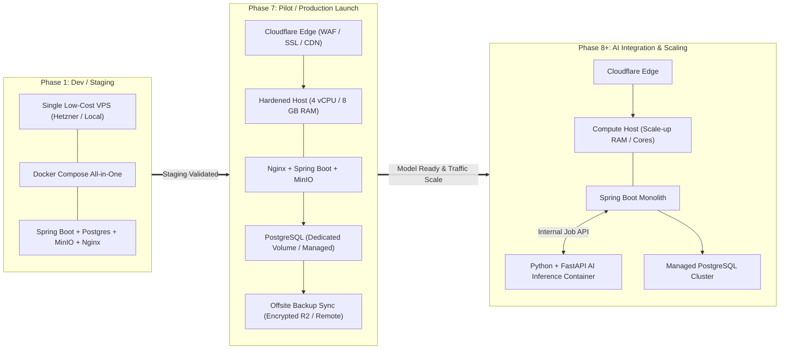
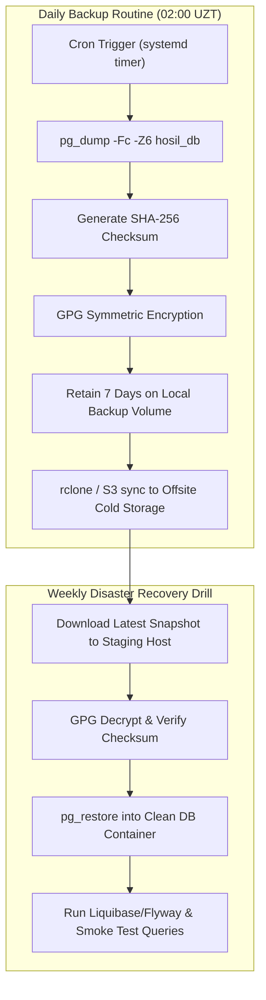
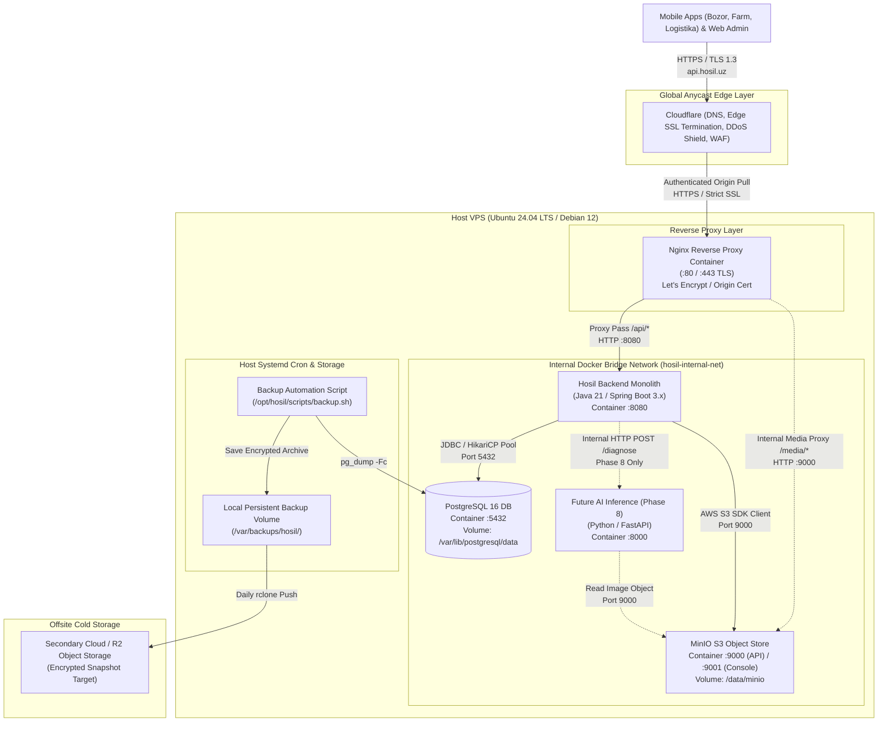

# Hosil Ecosystem — Hosting & Infrastructure Evaluation

**Document ID:** HOSIL-DOC-011  
**Version:** 0.1  
**Date:** 13 October 2026  
**Status:** Proposed — all vendor claims UNVERIFIED  
**Target Market:** Uzbekistan (Tashkent, Samarkand, Fergana Valley, and rural agricultural regions)  
**Cross-References:** [02_architecture.md](02_architecture.md) (Architecture Blueprint), [01_prd.md](01_prd.md) (Product Requirements Document)

---

## 1. Requirements Summary

### 1.1 Platform Context & Scope

The Hosil Ecosystem serves three client applications ([Hosil Bozor](01_prd.md#L147), [Hosil Farm](01_prd.md#L138), and [Hosil Logistika](01_prd.md#L158)) backed by a single Java 21 + Spring Boot modular monolith, PostgreSQL 16+, and an S3-compatible object store. A secondary Python + FastAPI service will be integrated during [Phase 8](02_architecture.md#L613) for crop disease image inference.

Because the engineering team is small with limited DevOps capacity and operates in an early-stage, bootstrapped context, the infrastructure strategy must prioritize **operational simplicity, cost predictability, low network latency within Uzbekistan, and robust data protection**.

### 1.2 Core Infrastructure Requirements

| Requirement Area | Specification & Target Criteria | Justification & Architectural Constraint |
| :--- | :--- | :--- |
| **User Latency** | Low round-trip latency to users across Uzbekistan (target: < 60 ms to Tashkent; acceptable < 120 ms to rural regions over 3G/4G). | Mobile app users (farmers, carriers, traders) often operate in areas with variable mobile connectivity. High network latency degrades interactive workflows (order creation, field records). |
| **Compute / Runtimes** | Support Linux containers via Docker and Docker Compose. Initial load: Java 21 Spring Boot runtime (JVM memory footprint ~1.5–2.5 GB heap/RSS). Phase 8 load: add Python 3.11+ FastAPI runtime (~1.0–2.0 GB RSS). | Standard OCI containers ensure parity between local development ([02_architecture.md Section 1.1](file:///c:/Users/Oliya/Desktop/Hosil/docs/02_architecture.md#L26)) and production. |
| **Database** | Relational database: PostgreSQL 16+ with ACID guarantees, persistent SSD storage, connection pooling, and UTF-8 collation. | Single source of truth for platform identity, marketplace orders, farm operations, and logistics contracts. Managed or self-hosted depending on SLA and budget. |
| **Object Storage** | S3-compatible private object storage for user uploads (harvest listing photos, farm field receipts, vehicle documents, and leaf disease diagnostic photos). | Decouples media storage from application compute disks. Prevents local filesystem bloat and allows seamless bucket migration. |
| **Backups & Recovery** | Automated daily database snapshots and `pg_dump` backups, cryptographically signed or encrypted, transferred off-host to secondary physical storage. Mandated restore verification. | Disaster recovery readiness before production launch ([PRD DATA-006](01_prd.md#L614), [02_architecture.md Section 11.2](02_architecture.md#L532)). |
| **Transport Security** | Automated SSL/TLS certificates (Let's Encrypt or Cloudflare Edge SSL) with strict HTTPS enforcement, TLS 1.2/1.3, and HSTS headers. | Mobile client communication security, authentication token protection (JWT/OAuth2), and payment provider callback integrity. |
| **Operations & Access** | Secure SSH key-based root/sudo access, systemd service management, Docker daemon socket control, and log collection via standard outputs. | Direct administrative triage capability without proprietary vendor lock-in. |
| **Budget Discipline** | Strict cost containment: early-stage project without venture capital funding. Target pilot running cost under $40–$70/month total infrastructure. | Prevents runaway hyperscaler consumption fees (e.g., ingress/egress bandwidth, idle managed service baselines). |
| **Operational Model** | Single-host or minimal dual-node deployment managed via standard Docker Compose and shell scripts. **Explicit anti-requirement: NO Kubernetes at launch.** | Eliminates orchestrator overhead (control plane RAM, etcd quorum, complex CNI/CSI drivers) that the small team cannot sustain. |

---

## 2. Option Comparison

### 2.1 Comparative Analysis Matrix

> [!WARNING]
> All vendor-specific pricing, hardware quotas, data center locations, and feature availability listed below are **[UNVERIFIED]**. No commercial contracts or formal vendor quotes have been executed. Detailed testing and quote validation are required prior to Phase 1 engineering deployment.

| Provider | Data Center Location | Estimated Base Cost/mo [UNVERIFIED] | Managed PostgreSQL? | Object Storage Option | Key Pros | Key Cons | Status |
| :--- | :--- | :--- | :--- | :--- | :--- | :--- | :--- |
| **Serverspace.uz** | Tashkent, Uzbekistan | ~$25 – $45 / mo (4 vCPU, 8 GB RAM, 80 GB NVMe) [UNVERIFIED] | No (Self-hosted on VPS) [UNVERIFIED] | MinIO self-hosted on VPS [UNVERIFIED] | • Sub-20ms latency in UZ • Local TAS-IX network peering • In-country data residency [UNVERIFIED] • National UZS currency billing | • Unknown uptime SLA track record • No managed DB or S3 API • Limited programmatic CLI/API tooling • Team handles all OS hardening | [UNVERIFIED] Proposed for local pilot |
| **Ahost.uz** | Tashkent, Uzbekistan | ~$20 – $40 / mo (Equivalent VPS configuration) [UNVERIFIED] | No (Self-hosted on VPS) [UNVERIFIED] | MinIO self-hosted on VPS [UNVERIFIED] | • Low in-country latency • Local support during Tashkent business hours • UZS bank transfer / local card payments | • Legacy hosting focus (cPanel/shared history) • Variable hypervisor IOPS guarantees • Minimal developer automation docs | [UNVERIFIED] Evaluated |
| **SUSPENDED.uz** | Tashkent, Uzbekistan (Domain / Provider Status Inactive) [UNVERIFIED] | N/A [UNVERIFIED] | N/A | N/A | • Historical local presence | • Domain appears suspended/unresolved • High operational and viability risk • Unusable for production | [UNVERIFIED] Rejected (Inactive) |
| **Hetzner Cloud** | Falkenstein/Nuremberg (DE), Helsinki (FI) | ~€12 – €22 / mo (~$13 – $24 / mo for CPX31: 4 vCPU, 8 GB RAM, 160 GB SSD) [UNVERIFIED] | Available via external managed DB partners or self-hosted [UNVERIFIED] | Self-hosted MinIO or Hetzner Storage Boxes / Cloudflare R2 [UNVERIFIED] | • Industry-leading price/performance • Rock-solid reliability and network SLA • Excellent Terraform/Docker documentation • Hourly billing with predictable caps | • Latency to Tashkent ~65–100ms [UNVERIFIED] • EUR billing / requires international card • Data stored outside Uzbekistan (legal check needed) | [UNVERIFIED] Recommended primary alternative |
| **AWS (Amazon Web Services)** | Bahrain (`me-south-1`) or Frankfurt (`eu-central-1`) | ~$120 – $220+ / mo (t4g.xlarge EC2 + RDS db.t4g.medium + S3 + NAT Gateway) [UNVERIFIED] | Yes (AWS RDS PostgreSQL) | Yes (AWS S3 native) | • Enterprise SLAs and automated backups • Managed multi-AZ failover and point-in-time recovery • Unlimited object scalability | • Prohibitive cost for early-stage Hosil • Complex pricing (NAT Gateways, IOPS, egress) • Higher ping to UZ (~90–140ms from Bahrain/EU) • Significant administrative overhead | [UNVERIFIED] Defer until Series A / Scale |
| **Google Cloud (GCP) / Azure** | Doha/Dammam (GCP) or UAE North (Azure) | ~$110 – $200+ / mo (Equivalent Compute + Managed DB + Cloud Storage) [UNVERIFIED] | Yes (Cloud SQL / Azure Database) | Yes (GCS / Azure Blob) | • Fully managed platform services • High compliance standards | • High base cost • Foreign currency invoicing • Over-engineered for initial single-container load | [UNVERIFIED] Defer |
| **Hybrid Approach** (Local/Hetzner VPS + Cloudflare + MinIO + R2) | VPS (UZ or DE) + Cloudflare Global Edge | ~$20 – $45 / mo (VPS) + $0 (Cloudflare Free) + $0–$5 (Backup storage) [UNVERIFIED] | Self-hosted PostgreSQL on persistent SSD + automated dumps | MinIO on VPS + Cloudflare R2 for offsite media backups [UNVERIFIED] | • Combines low VPS compute cost with enterprise-grade edge caching/WAF • Zero-cost SSL via Cloudflare / Let's Encrypt • High resilience against edge network spikes | • Requires disciplined self-management of PostgreSQL dumps and monitoring • Cloudflare routing through nearest PoP (Tashkent PoP availability [UNVERIFIED]) | [UNVERIFIED] Recommended architectural pattern |

---

### 2.2 Category A: Uzbekistan-Local VPS Providers

#### Serverspace.uz & Ahost.uz
- **Network Performance & Peering:** Hosting directly within Tashkent datacenters ensures traffic routes through the national peering exchange (TAS-IX). This yields optimal round-trip times (~5–20 ms in Tashkent, ~25–50 ms in regional provinces such as Andijan or Fergana) [UNVERIFIED]. In contrast, routing to Europe or the Middle East adds 60–110 ms round-trip overhead.
- **Regulatory & Data Residency Factor:** Uzbekistan Law No. ZRU-547 "On Personal Data" (specifically Article 27-1) imposes explicit requirements regarding the processing and storage of personal data of Uzbekistani citizens inside the physical boundaries of the Republic of Uzbekistan [UNVERIFIED]. Utilizing a local VPS mitigates legal compliance friction if the platform processes user identity data, biometric images, or passport numbers during later farmer/carrier verification phases.
- **Commercial & Billing:** Local providers accept payments in Uzbek soʻm (UZS) via national payment rails (Uzcard, Humo, national bank invoices), avoiding foreign exchange conversion fees and corporate international credit card dependency.
- **Operational Deficits:** Local providers generally offer unmanaged IaaS (raw KVM VPS). Managed database instances (e.g., managed PostgreSQL with automated point-in-time recovery) and S3-compatible managed object storage are rarely available or lack standard APIs. The Hosil team must handle OS patching, disk LVM management, firewalling, and backup automation manually.

#### SUSPENDED.uz
- Flagged during research as unreachable or suspended [UNVERIFIED]. Highlighted as an explicit warning that smaller domestic regional hosters face business continuity risks. Only reputable, licensed tier-2/tier-3 local data center operators should be considered.

---

### 2.3 Category B: Nearby International VPS Providers (e.g., Hetzner Cloud)

#### Hetzner (Germany / Finland)
- **Price-to-Performance Benchmark:** Hetzner provides exceptional hardware density per dollar (e.g., AMD EPYC or ARM Ampere 4 vCPU, 8 GB RAM, NVMe storage for ~€12–€15/month) [UNVERIFIED]. It represents the global developer benchmark for lean startup infrastructure.
- **Reliability & Tooling:** Automated snapshots, floating IPs, private virtual networks, mature REST APIs, and comprehensive community documentation make infrastructure maintenance predictable.
- **Network Latency Impact:** Round-trip transit between Tashkent and Falkenstein/Helsinki routes across international transit backbones, averaging ~65 ms to 105 ms [UNVERIFIED]. While imperceptible for bulk API calls, mobile clients on unstable 3G networks in rural Syrdarya or Surkhandarya will experience compounding TCP handshake latency unless aggressive HTTP/2 connection reuse and edge caching are utilized.
- **Currency & Legal Exposure:** Invoicing is in Euros (EUR), requiring international corporate cards. Furthermore, storing Uzbek citizen records exclusively on European servers requires legal sign-off regarding compliance with Law No. ZRU-547 [DECISION REQUIRED].

---

### 2.4 Category C: Hyperscale Cloud Providers (AWS / GCP / Azure)

- **Regional Proximity:** AWS Bahrain (`me-south-1`) and UAE regions (`me-central-1`) or GCP Doha are geographically closer than Frankfurt, but inter-regional telecom routing often traverses European internet exchange points (e.g., Frankfurt DE-CIX) anyway, resulting in negligible latency improvement over direct European VPS links [UNVERIFIED].
- **Cost Inefficiency for MVP:** A minimal production-grade AWS setup (1x `t4g.medium` EC2 for Spring Boot, 1x `db.t4g.medium` Multi-AZ RDS PostgreSQL, 1x NAT Gateway for private subnet isolation, Application Load Balancer, and S3 standard storage) costs approximately $180–$260/month [UNVERIFIED], excluding bandwidth egress fees.
- **Verdict:** Unjustified burn rate for Hosil's pre-revenue pilot phase. Hyperscalers should be evaluated only if external grant capital mandates them or when traffic scales beyond 100,000 active monthly transactions.

---

### 2.5 Category D: Pragmatic Hybrid Architecture

The hybrid deployment model combines the cost-efficiency of bare VPS compute with managed edge security and resilient object storage:
1. **Compute & Database:** Hosted on a high-spec single VPS (either local Tashkent VPS or Hetzner).
2. **Edge Security & Routing:** Cloudflare Free / Pro tier deployed as the authoritative DNS, DDoS shield, and TLS termination proxy. Cloudflare terminates SSL at edge nodes and proxies traffic to the VPS Nginx reverse proxy.
3. **Primary Object Storage:** MinIO container running locally on the VPS, writing to an isolated persistent host volume.
4. **Disaster Recovery Replication:** Database dumps (`pg_dump`) and critical object snapshots are encrypted and synced offsite (e.g., to Cloudflare R2 or an external secondary encrypted storage node) daily.

---

## 3. Recommended Approach

### 3.1 Phased Infrastructure Strategy

#### Phase 1: Development & Staging
- **Host:** Single low-cost virtual private server (e.g., Hetzner CPX21 or entry-level local VPS, ~€8–$15/mo) [UNVERIFIED].
- **Topology:** Single Docker Compose orchestration stack:
  - `nginx-proxy`: Reverse proxy handling Let's Encrypt TLS renewal and rate limiting.
  - `hosil-backend`: Spring Boot JAR running under Java 21 JRE container.
  - `hosil-postgres`: PostgreSQL 16 container mounting a host filesystem directory (`/var/lib/hosil/postgres-data`).
  - `hosil-minio`: MinIO container providing S3 API compatibility for media upload testing.
- **Goal:** Enable rapid API integration for Flutter client developers ([02_architecture.md Section 13.2](file:///c:/Users/Oliya\Desktop\Hosil\docs\02_architecture.md#L565-L574)) with zero operational friction.

#### Phase 7: Pilot & Production Launch
- **Host:** Upgraded, hardened VPS (4 vCPU, 8 GB RAM, 80–120 GB NVMe SSD) hosted either at a verified Tashkent datacenter (preferred for latency & compliance) or Hetzner [DECISION REQUIRED].
- **Edge Layer:** Cloudflare proxy placed in front of the domain (`api.hosil.uz`), enforcing TLS 1.3, DDoS throttling, and geographic IP header injection (`CF-IPCountry`).
- **Database Hardening:**
  - PostgreSQL container configured with tuned memory parameters (`shared_buffers = 2GB`, `effective_cache_size = 6GB`, `work_mem = 32MB`, `maintenance_work_mem = 512MB`).
  - Database data files mounted onto a dedicated, isolated SSD volume mount.
  - Automated cron script executing daily `pg_dump` with compression, timestamping, SHA-256 verification, and encrypted transmission to an off-site secondary location.
- **Media Storage:** MinIO container configured with bucket lifecycle rules, private access policies, and pre-signed URL generation handled by the Spring Boot storage adapter ([PRD MEDIA-001](01_prd.md#L405)).

#### Phase 8: AI Inference Integration
- **Container Addition:** Once crop disease detection models pass offline validation, the Python 3.11 + FastAPI inference service is added directly to the existing production Docker Compose file as an internal container (`hosil-ai-inference`).
- **Isolation:** The AI container is attached strictly to the internal Docker network. It has **no public port exposure** and **no direct database credentials**.
- **Communication:** Spring Boot communicates with FastAPI over internal HTTP (`http://hosil-ai-inference:8000/internal/v1/diagnose`), passing private S3 object keys. FastAPI fetches the image from MinIO, runs inference, and returns diagnosis scores to Spring Boot ([02_architecture.md Section 8.4](file:///c:/Users/Oliya\Desktop\Hosil\docs\02_architecture.md#L397-L418)).

---

### 3.2 Scaling Triggers & Migration Criteria

The platform should remain on the single-host Docker Compose architecture until specific empirical operational thresholds are breached. Do not prematurely split services.

| Architectural Move | Operational Trigger Criteria | Implementation Action |
| :--- | :--- | :--- |
| **Migrate PostgreSQL to Dedicated / Managed Host** | • Database dataset exceeds 30 GB. • Daily `pg_dump` duration exceeds 20 minutes or causes visible CPU/IO spikes during active hours. • Memory contention occurs between JVM heap (2.5 GB) and Postgres buffer cache (> 3 GB). | Provision a dedicated database server or migrate to a managed PostgreSQL provider with point-in-time recovery (PITR) and automatic WAL archiving. |
| **Separate AI Inference Compute** | • AI leaf scan requests exceed 500 requests/day. • PyTorch / ONNX CPU inference causes CPU starvation for Spring Boot API threads. • Inference execution time averages > 4.0 seconds per image. | Move `hosil-ai-inference` container to a separate GPU-enabled or compute-optimized worker instance; introduce a Redis-backed durable queue (e.g., RabbitMQ or Redis Streams). |
| **Horizontal Monolith Scaling (Multi-Node)** | • Sustained concurrent API requests exceed 250 req/sec. • CPU utilization consistently surpasses 75% across peak morning trading hours. • Need zero-downtime rolling deploys with multi-instance redundancy. | Transition from Docker Compose to a lightweight orchestrator (Docker Swarm or Nomad, or managed Kubernetes if team capacity permits); place an external HAProxy / ALB in front. |

---

### 3.3 Backup & Disaster Recovery Architecture

- **RPO (Recovery Point Objective):** Maximum 24 hours of data loss during MVP pilot. Target reducible to 1 hour upon implementing continuous WAL-G / pgBackRest archiving in Phase 7.
- **RTO (Recovery Time Objective):** Maximum 2 hours to provision a fresh VPS, clone the Hosil repository, launch Docker Compose, and restore the latest database dump.
- **Mandatory Drill Policy:** Backups are considered nonexistent until verified by a successful restore test ([02_architecture.md Section 11.2](file:///c:/Users/Oliya\Desktop\Hosil\docs\02_architecture.md#L532)). A weekly automated or manual staging restoration drill must be logged prior to public launch.

---

## 4. Deployment Architecture

### 4.1 Topology Diagram

The following diagram details the end-to-end network flow, reverse proxy boundaries, and internal container communication channels:

### 4.2 Network & Security Boundaries

1. **Public Host Exposure:**
   - Only TCP ports `80` (HTTP redirect) and `443` (HTTPS) are exposed through the host firewall (`ufw`) to the public internet.
   - SSH access (TCP port `22` or custom port) is restricted to SSH key pairs with password authentication disabled and rate-limited via `fail2ban`.
2. **Internal Container Isolation:**
   - The PostgreSQL container (`hosil-postgres`), MinIO API (`hosil-minio`), and future Python AI container (`hosil-ai-inference`) do **not** bind ports to `0.0.0.0` on the host.
   - They reside exclusively on an isolated internal Docker bridge network (`hosil-internal-net`), accessible only by container name resolution from `hosil-backend`.
3. **Storage Access Pattern:**
   - Mobile clients never access MinIO storage directly using administrative credentials.
   - When users view or upload listing media, the Spring Boot backend generates short-lived, cryptographically signed pre-signed URLs or streams data through cached Nginx endpoints with strict MIME-type validation ([PRD MEDIA-002, DATA-008](01_prd.md)).

---

## 5. Cost Estimates

### 5.1 Estimated Monthly Budget (Pilot Baseline)

> [!NOTE]
> The figures below represent projected estimates based on prevailing European and Central Asian hosting market ranges as of October 2026. All pricing must be verified with current provider quotes prior to financial commitment.

| Component | Resource Specification | Provider Option A (Local UZ VPS) [UNVERIFIED] | Provider Option B (Hetzner Cloud VPS) [UNVERIFIED] | Billing Period | Notes / Assumptions |
| :--- | :--- | :--- | :--- | :--- | :--- |
| **Compute VPS** | 4 vCPU, 8 GB RAM, 80–120 GB SSD | ~$25.00 – $40.00 / mo | ~€14.00 (~$15.50) / mo | Monthly | Dedicated resources sufficient for JVM heap (2.5GB), Postgres (3GB), MinIO (1GB), and OS buffers. |
| **Domain Name** | `.uz` ccTLD registration | ~$1.00 – $1.50 / mo (~$12 – $18 / yr) | ~$1.00 – $1.50 / mo (~$12 – $18 / yr) | Annual | Registered via licensed Uzbekistan `.uz` registrar (e.g., CCTLD.uz partners). |
| **Edge Proxy & WAF** | Cloudflare Free Tier | $0.00 | $0.00 | Monthly | Global DNS, basic DDoS mitigation, SSL termination, and static asset caching. |
| **TLS Certificates** | Let's Encrypt / Cloudflare Edge | $0.00 | $0.00 | Automated | Zero licensing cost; automated renewal via Certbot or Cloudflare Origin CA. |
| **Offsite Backup Storage** | Cloudflare R2 / Remote S3 (10–50 GB storage) | ~$0.15 – $0.75 / mo | ~$0.15 – $0.75 / mo | Monthly | Cloudflare R2 offers 10 GB free storage with zero egress bandwidth charges [UNVERIFIED]. |
| **Out-of-Band Alerts** | Healthchecks.io / UptimeRobot Free Tier | $0.00 | $0.00 | Monthly | External heartbeat monitoring pinging `/actuator/health` every 60 seconds. |
| **Estimated Total Monthly Cost** | **Pilot Deployment Baseline** | **~$26.15 – $42.25 / mo** | **~$16.65 – $17.75 / mo** | **Monthly** | **Highly economical starting baseline (< $50/mo target).** |

---

## 6. Unresolved Decisions & Action Items

The following architectural and procurement decisions remain open and must be formally resolved prior to the target milestone phases:

| Item ID | Decision Required | Architectural & Operational Impact | Required By Phase | Responsible Owner | Status |
| :--- | :--- | :--- | :--- | :--- | :--- |
| **DEC-011-1** | **Final Hosting Provider Selection** (Local Tashkent VPS vs. Hetzner Cloud) | Determines base API latency across Uzbekistan provinces, billing currency (UZS vs. EUR), and hardware replacement SLAs. | **Phase 1** (Engineering Foundation) | Infrastructure Lead | [DECISION REQUIRED] [UNVERIFIED] |
| **DEC-011-2** | **Uzbekistan Personal Data Residency Law Verification** (Law No. ZRU-547 Article 27-1) | If user identity records (names, phone numbers, tax IDs) are legally mandated to reside physically within Uzbekistan, hosting on Hetzner or foreign clouds becomes non-compliant. Requires formal legal interpretation. | **Phase 1** (Prior to DB schema deployment) | Legal Counsel / Product Lead | [DECISION REQUIRED] [UNVERIFIED] |
| **DEC-011-3** | **Database Strategy:** Managed PostgreSQL vs. Hardened Docker Container | Self-hosted container minimizes financial cost but shifts failover and backup recovery burden entirely onto the team. Managed database costs 2–3x more but provides automated PITR. | **Phase 1** (Engineering Foundation) | Tech Lead | [DECISION REQUIRED] |
| **DEC-011-4** | **Offsite Backup Storage Destination & Retention Schedule** | Needs definitive selection of secondary encrypted destination (Cloudflare R2, Wasabi, or secondary domestic backup host) and formal retention policy (e.g., 7 daily, 4 weekly, 3 monthly). | **Phase 1** (Engineering Foundation) | Infrastructure Lead | [DECISION REQUIRED] |
| **DEC-011-5** | **Official `.uz` Domain Procurement & Registrar Selection** | Selection of accredited registrar for `hosil.uz` (or variant); DNS delegation to Cloudflare nameservers. | **Phase 1** (Engineering Foundation) | Operations Lead | [DECISION REQUIRED] |
| **DEC-011-6** | **Cloudflare Edge Proxy Routing & Tashkent PoP Peering** | Verification of Cloudflare's routing behavior for traffic originating inside Uzbekistan telecom networks (Beeline, Ucell, Mobiuz, Uztelecom) to prevent suboptimal routing tromboning through European PoPs. | **Phase 7** (Pilot Hardening) | Infrastructure Lead | [DECISION REQUIRED] [UNVERIFIED] |

---

## 7. Architecture Decision Record (ADR-003)

### ADR-003: Hosting Selection & Deployment Topology

- **Status:** Proposed
- **Date:** 13 October 2026
- **Deciders:** Hosil Engineering & Product Architecture Team
- **Cross-References:** [02_architecture.md Section 11 & Section 13](file:///c:/Users/Oliya\Desktop\Hosil\docs\02_architecture.md#L539-L574), [ADR Index](file:///c:/Users/Oliya\Desktop\Hosil\docs\decisions/)

#### 1. Context
The Hosil Ecosystem requires an infrastructure hosting environment to deploy its backend platform (Java 21 Spring Boot modular monolith, PostgreSQL, MinIO) for initial internal integration and an upcoming regional pilot in Uzbekistan.

Key constraints:
1. Low latency for mobile app users across Tashkent and agricultural regions.
2. Lean startup operating budget (target < $50–$70/mo total infrastructure).
3. Minimal operational complexity suitable for a small engineering team without a dedicated full-time DevOps engineer.
4. Compliance uncertainty regarding Uzbekistan's personal data residency mandates (Law No. ZRU-547).
5. Future-proof extensibility to incorporate a Python + FastAPI computer vision inference container during Phase 8 without an immediate architectural rewrite.

#### 2. Decision
**[TO BE DECIDED AFTER PROVIDER RESEARCH AND LEGAL DATA RESIDENCY REVIEW]**

*Pending Evaluation Options:*
- **Option 1 (Local Tashkent VPS):** Deploy production compute and database to a vetted domestic provider (e.g., Serverspace.uz) behind Cloudflare. Satisfies local data residency and achieves lowest latency; requires self-managing PostgreSQL and Linux host security.
- **Option 2 (Hetzner Cloud VPS):** Deploy compute and database to Hetzner Cloud (Germany or Finland) behind Cloudflare. Maximizes hardware reliability, developer tooling, and cost efficiency (~$18/mo); requires legal sign-off on data export compliance and network latency tolerance testing (~75–90ms).
- **Option 3 (Hybrid Domestic DB + Foreign Compute):** Split topology. Rejected due to cross-datacenter latency on database network round-trips.

#### 3. Consequences
*(To be formalized upon selection between Option 1 and Option 2)*

- **If Option 1 is selected:**
  - *Positive:* Full alignment with Uzbekistan data residency regulations; lowest round-trip latency (< 30ms) for rural cellular networks; payment in local currency (UZS).
  - *Negative:* Higher dependency on local datacenter operational stability; team assumes full responsibility for PostgreSQL crash recovery and OS patch management.
- **If Option 2 is selected:**
  - *Positive:* Proven hypervisor reliability, automated snapshot tooling, superior price-to-performance ratio, rapid server provisioning.
  - *Negative:* Higher network ping times to Uzbekistan; vulnerability to international fiber route instability; risk of regulatory non-compliance under Law No. ZRU-547 unless personal data is excluded or exempted.
