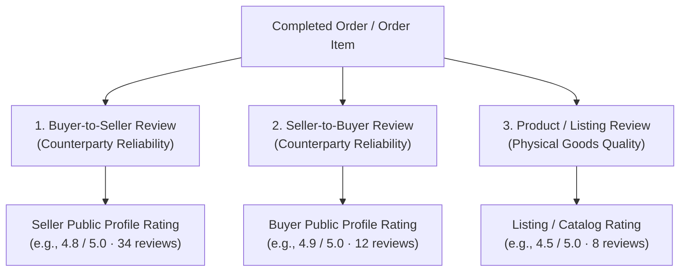
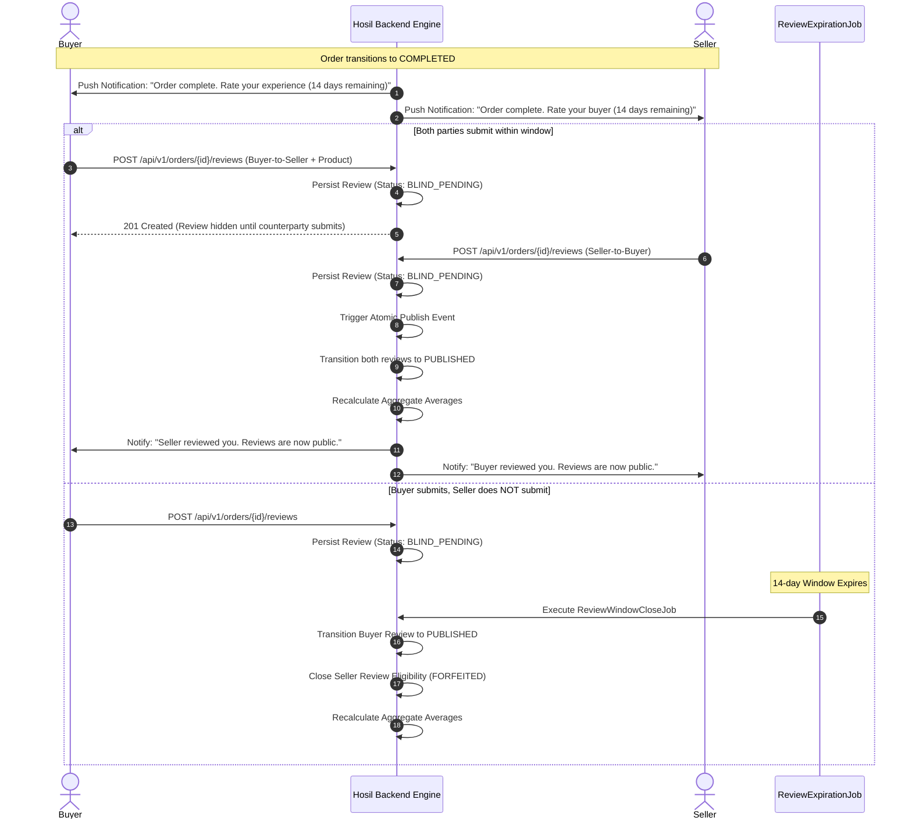
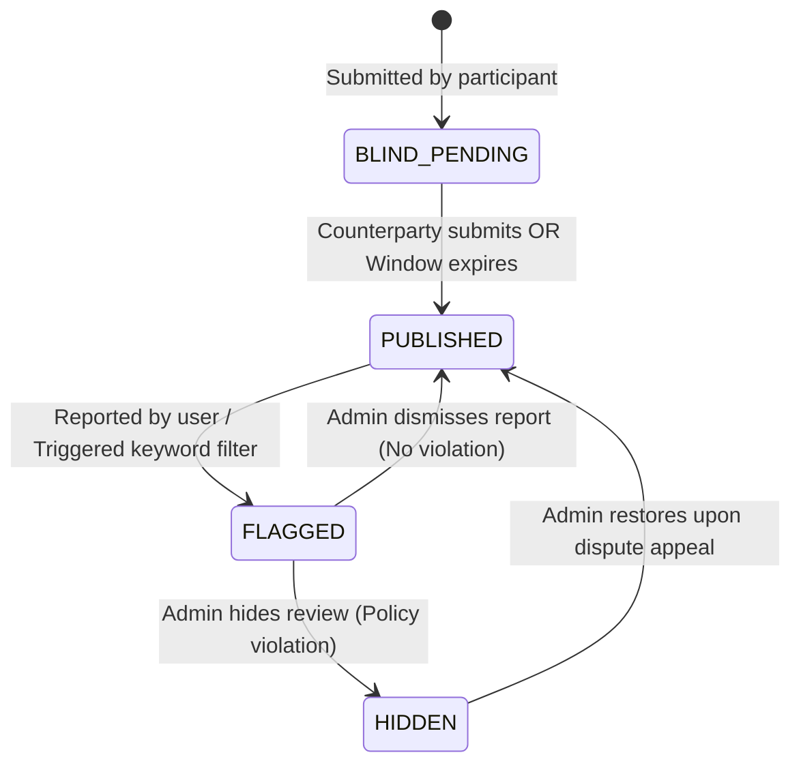

# Hosil Ecosystem — Two-Sided Reputation and Transaction Reviews

**Document ID:** HOSIL-DOC-012  
**Version:** 0.1  
**Status:** Proposed — requires user confirmation on proposed parameters  
**Date:** 14 October 2026  
**Products:** Hosil Bozor, Shared Platform Backend, Platform Admin  
**Target Market:** Uzbekistan (Initial Phase)  
**Cross-References:** [01_prd.md](01_prd.md) (PRD `MKT-018`, `REV-001`–`REV-010`), [02_architecture.md](02_architecture.md) (§5, §6, §8), [03_user_journeys_and_permissions.md](03_user_journeys_and_permissions.md) (Journey 4, Journey 6, Permission Matrix), [10_admin_and_api_versioning.md](10_admin_and_api_versioning.md) (Admin & Audit), [decision_register.md](decision_register.md) (`DEC-018`).

---

## 1. Executive Summary and Principles

In agricultural marketplaces, trust is the primary determinant of liquidity. Buyers risk paying for substandard produce, mislabeled seed varieties, or unfulfilled orders; sellers risk dead freight, arbitrary refusal upon delivery, and delayed payments. 

The Hosil Reputation System provides a **two-sided, transaction-verified review architecture** enabling buyers and sellers to evaluate counterparties based strictly on real transaction behavior.

### Core Architectural Principles

1. **Transaction-Gated Integrity (No Unverified Reviews):**  
   A user cannot review another user or product unless they participated as an authenticated buyer or seller in a qualifying, completed transaction. Public, unsolicited, or pre-transaction reviews are strictly forbidden (`REV-001`).
2. **Equal Weighting (Anti-Plutocracy Invariant):**  
   Every qualifying review carries an identical mathematical weight of $1.0$. Transaction monetary value (UZS), order volume (kg or metric tons), and historical user spending **must never multiply, amplify, or skew review weight** (`REV-002`). A 500,000 UZS fertilizer order and a 50,000,000 UZS cherry order contribute identically to counterparty reputation scores.
3. **Decoupled Person vs. Product Feedback:**  
   Counterparty reliability (communication, payment compliance, punctuality) is strictly separated from listing/product physical quality (crop condition, packaging, grading accuracy) (`REV-003`). A good farmer delivering slightly bruised fruit due to third-party transit does not receive an unfair hit to personal integrity.
4. **Retaliation Mitigation (Double-Blind Publishing):**  
   To eliminate retaliatory negative scoring, reviews submitted by buyer and seller remain completely private and hidden until **both** counterparties have submitted their review or the designated review window has elapsed (`REV-004`).
5. **No Automatic Dispute or Refund Determination:**  
   Reviews are reputation instruments, not arbitration mechanisms. Negative reviews do not trigger automatic financial clawbacks, chargebacks, or order cancellations; payment disputes are handled strictly through the formal support dispute pipeline (`ADM-006`, `PAY-006`).
6. **Audited Moderation & Transparency:**  
   Reviews cannot be silently deleted or altered. All administrative hides, removals, or user flags generate immutable audit log records (`REV-005`). Aggregate ratings and total review counts are displayed alongside, but separate from, total verified transaction volume.

---

## 2. Review Types and Schemas

The system supports three distinct review vectors:



### 2.1 Buyer-to-Seller Review (`BUYER_TO_SELLER`)

Evaluates the seller's commercial conduct, reliability, and fulfillment integrity.

- **Target Entity:** `seller_user_id` / `seller_profiles`
- **Scoring Dimensions:**
  - **Overall Seller Rating:** Integer, 1 to 5 stars (Mandatory).
  - **Listing Accuracy:** Integer, 1 to 5 stars (Did the actual cargo correspond to listing descriptions, photos, and harvest specs?).
  - **Communication & Professionalism:** Integer, 1 to 5 stars (Responsiveness, clarity, proactive updates).
  - **Fulfillment & Dispatch Reliability:** Integer, 1 to 5 stars (Adherence to agreed packaging, loading schedule, pickup window).
- **Written Commentary:** Optional free-text (max 1,000 characters). Must pass automated profanity/PII filters.
- **Counterparty Response:** Seller is permitted **one** public factual response (max 500 characters) after publication; response cannot be further replied to.

### 2.2 Seller-to-Buyer Review (`SELLER_TO_BUYER`)

Evaluates the buyer's reliability, communication, and adherence to agreed trade terms.

- **Target Entity:** `buyer_user_id` / `users`
- **Scoring Dimensions:**
  - **Overall Buyer Rating:** Integer, 1 to 5 stars (Mandatory).
  - **Communication & Responsiveness:** Integer, 1 to 5 stars (Prompt responses to inquiries and logistics coordination).
  - **Commitment Honoring:** Integer, 1 to 5 stars (Did buyer fulfill purchase request commitments without unreasonable mid-transit abandonment?).
  - **Payment & Collection Timeliness:** Integer, 1 to 5 stars (Prompt payment authorization, smooth recipient handover, punctuality).
- **Written Commentary:** Optional free-text (max 1,000 characters).
- **Counterparty Response:** Buyer is permitted **one** public factual response (max 500 characters).

### 2.3 Product / Listing Feedback (`LISTING_PRODUCT`)

Evaluates the physical commodity or agricultural input item received by the buyer.

- **Target Entity:** `listings` / `order_items`
- **Scoring Dimensions:**
  - **Product Rating:** Integer, 1 to 5 stars (Mandatory).
  - **Quality & Grade Conformance:** Integer, 1 to 5 stars (Produce freshness, ripeness, seed germination, fertilizer packaging integrity).
  - **Packaging & Condition:** Integer, 1 to 5 stars (Adequacy of crates, sacks, or palletization).
- **Written Commentary:** Optional free-text (max 1,000 characters).
- **Media Uploads:** Optional photographic evidence of received goods (up to 3 photos; strictly validated image MIME types per `MEDIA-003`).
- **Catalog Linkage:** If the order item represents a standardized agricultural input (e.g., branded fertilizer), aggregate ratings roll up to both the specific seller's listing and the global catalog product.

---

## 3. Eligibility, Transaction States, and Lifecycle

### 3.1 Qualifying Transaction Criteria

To prevent bogus ratings, review eligibility requires meeting strict lifecycle conditions:

| Review Type | Permitted Reviewer | Required Order Status | Excluded Pre-Conditions |
|---|---|---|---|
| **Buyer-to-Seller** | Verified Buyer of Order | `COMPLETED` | `AWAITING_SELLER_CONFIRMATION`, `PENDING_PAYMENT`, `CANCELLED` (unconfirmed) |
| **Seller-to-Buyer** | Verified Seller of Order | `COMPLETED` *(or `CANCELLED_NO_SHOW`)* | `AWAITING_SELLER_CONFIRMATION`, `PENDING_PAYMENT` |
| **Listing / Product** | Verified Buyer of Order | `COMPLETED` | Any non-completed status |

#### The "Failure to Honor Confirmed Commitment" Exception (`CANCELLED_NO_SHOW`)
Mere price inquiries, browsing, or unaccepted purchase requests **never** grant review eligibility (`REV-006`). However, if an order reached `PAID_CONFIRMED` or `CONFIRMED`, and a party completely failed to appear, refused cargo at the farm gate without legitimate reason, or abandoned the transaction, the platform allows an auditable review under the following policy:
1. The status must be formally transitioned to `CANCELLED_NO_SHOW` or resolved via Support Dispute (`DISPUTED` $\to$ closed with fault finding).
2. The non-defaulting party may submit a counterparty conduct review documenting the failure.
3. The defaulting party receives explicit notification and may submit a dispute or factual rebuttal.

### 3.2 Double-Blind Review Window Workflow



### 3.3 Temporal Parameters (Proposed Defaults)

- **Review Window Duration:** 14 calendar days from order completion (`[PROPOSED: 14 days]`). Once expired, eligibility lapses permanently (`FORFEITED`).
- **Editing Grace Period:** A user may edit their draft/submitted review **only** while in `BLIND_PENDING` status. Once both parties submit or the window elapses and status becomes `PUBLISHED`, reviews are **immutable**.
- **Rebuttal Window:** Counterparties have 7 calendar days post-publication to post their single factual response (`[PROPOSED: 7 days]`).

---

## 4. Rating Aggregation and Anti-Manipulation Controls

### 4.1 Transparent Equal-Weight Aggregation

The platform rejects complex, opaque, "black-box" algorithmic reputation scores in favor of simple, auditable arithmetic metrics:

$$\text{Aggregate Rating} = \frac{\sum_{i=1}^{N} \text{OverallRating}_i}{N}$$

Where:
- $N$ is the total count of published, non-moderated reviews.
- Each $\text{OverallRating}_i \in \{1, 2, 3, 4, 5\}$.
- Display precision: rounded to 1 decimal place (e.g., `4.7` / 5.0).

#### Presentation Invariant
Mobile apps must display the **Aggregate Rating**, the **Total Review Count**, and the **Total Verified Transaction Count** side-by-side as distinct metrics:
$$\text{"⭐ 4.8 (34 reviews) · 142 completed deals"}$$
This prevents a seller with 1 five-star review on 1 deal from appearing identical to an established producer with 100 five-star reviews.

### 4.2 Anti-Collusion & Reciprocal Padding Safeguards

To prevent syndicates, friendly accounts, or family members from artificially inflating ratings through micro-transactions:

1. **Transaction Quantity Independence:**
   Splitting an order into ten 10-kg orders instead of one 100-kg order cannot generate 10 reviews. Review eligibility is scoped to **one review per distinct counterparties per 30-day window**, or subsequent reviews between the identical buyer-seller pair are pooled with damped mathematical weight:
   - **Proposed Damping Rule:** For any subsequent transaction between the same buyer and seller within a rolling 90-day window, the review commentary is published, but the numeric score contribution to the public overall rating is aggregated as a single consolidated counterparty score (`[PROPOSED: DEC-018 Safeguard]`).
2. **Device Fingerprint & IP Cross-Referencing:**
   If the buyer and seller devices share identical hardware UUIDs, SIM MSISDN identities, or identical payment credentials, review submission is rejected with HTTP 403 (`COLLUSION_DETECTED`) and flagged for administrative inspection.
3. **No Review Spam:**
   Maximum 1 review per eligible order per role. Repeated API submissions return HTTP 409 (`CONFLICT: REVIEW_ALREADY_EXISTS`).

---

## 5. Review Reporting, Moderation, and Auditability

### 5.1 Reporting Flow

Any authenticated user viewing a published review may report it for:
- Offensive language, hate speech, or harassment.
- Disclosure of private personal data (MSISDN, home address, passport data).
- Extortion, blackmail, or off-platform payment solicitation.
- Fraudulent or demonstrably false factual assertions.

### 5.2 Moderation States and Workflow



- **`BLIND_PENDING`:** Stored securely; hidden from counterparty and public.
- **`PUBLISHED`:** Publicly visible; included in aggregate score.
- **`FLAGGED`:** Publicly visible, but placed in admin moderation queue.
- **`HIDDEN`:** Removed from public view; excluded from aggregate score calculation.
- **`REMOVED_AUDITED`:** Permanently removed; retained in database solely for legal/audit compliance.

### 5.3 Administrative Audit Requirements (`ADM-005`)
Administrators cannot delete reviews directly via database queries or unlogged actions. Every moderation action (`HIDE`, `RESTORE`, `REJECT_REPORT`) mandates:
- `admin_user_id`: Operator ID executing the action.
- `target_review_id`: Review being modified.
- `action`: `REVIEW_HIDE`, `REVIEW_RESTORE`, etc.
- `justification_code`: Structured category code.
- `admin_notes`: Mandatory narrative explaining the evidentiary basis.
- `timestamp`: UTC audit timestamp.

---

## 6. Access Control and Permissions (RBAC + ABAC)

Review operations enforce strict dual-layer authorization:

| Operation | Permitted Roles | Resource Ownership / ABAC Constraint | Audit Logged? |
|---|---|---|---|
| **Submit Buyer Review** | `BUYER`, `REGISTERED_USER` | Must be `order.buyer_id == principal.id` AND `order.status == COMPLETED` | No (Standard operational event) |
| **Submit Seller Review** | `SELLER`, `FARMER` | Must be `order.seller_id == principal.id` AND `order.status IN (COMPLETED, CANCELLED_NO_SHOW)` | No |
| **Submit Listing Review** | `BUYER` | Must be `order.buyer_id == principal.id` AND `item IN order.items` | No |
| **View Published Reviews** | `GUEST`, All Roles | None (Public data) | No |
| **View Blind Pending Reviews** | System, Author only | Author can view own draft; counterparty strictly blocked | No |
| **Submit Counterparty Response** | Counterparty of Review | Must be counterparty AND `review.status == PUBLISHED` AND response not yet given | No |
| **Report Review** | `REGISTERED_USER` | Authenticated user | Yes (`REPORT_FILED`) |
| **Moderate / Hide Review** | `SUPPORT_OPERATOR`, `ADMIN` | Authorized admin role | **Yes (`ADM-005` Mandatory)** |
| **Inspect Unblinded Audit Log** | `ADMIN` | Investigating documented dispute/legal escalation | **Yes (`ADM-005` Mandatory)** |

---

## 7. Domain Model Preparation (ERD Requirements)

To prepare for `docs/04_domain_model.md`, the review subsystem requires the following relational entities, constraints, and indexes:

### 7.1 Entities and Foreign Keys

1. **`reviews`:**
   - `id` (UUID, Primary Key)
   - `order_id` (UUID, Foreign Key $\to$ `orders.id`, Mandatory)
   - `order_item_id` (UUID, Foreign Key $\to$ `order_items.id`, Nullable, used for listing/product feedback)
   - `author_id` (UUID, Foreign Key $\to$ `users.id`, Mandatory)
   - `target_user_id` (UUID, Foreign Key $\to$ `users.id`, Mandatory for B2S and S2B)
   - `target_listing_id` (UUID, Foreign Key $\to$ `listings.id`, Nullable, used for product feedback)
   - `review_type` (VARCHAR(30): `BUYER_TO_SELLER`, `SELLER_TO_BUYER`, `LISTING_PRODUCT`)
   - `overall_rating` (SMALLINT, 1 to 5, Mandatory)
   - `dimension_scores` (JSONB: e.g. `{"accuracy": 5, "communication": 4, "fulfillment": 5}`)
   - `commentary` (TEXT, Nullable, max 1,000 chars)
   - `status` (VARCHAR(30): `BLIND_PENDING`, `PUBLISHED`, `FLAGGED`, `HIDDEN`, `REMOVED`)
   - `is_counterparty_blind` (BOOLEAN, default true)
   - `blind_until` (TIMESTAMPTZ, expiration of double-blind window)
   - `published_at` (TIMESTAMPTZ, Nullable)
   - `created_at`, `updated_at` (TIMESTAMPTZ)

2. **`review_responses`:**
   - `id` (UUID, Primary Key)
   - `review_id` (UUID, Foreign Key $\to$ `reviews.id`, Unique 1:1)
   - `author_id` (UUID, Foreign Key $\to$ `users.id`)
   - `response_text` (TEXT, max 500 chars)
   - `created_at` (TIMESTAMPTZ)

3. **`review_reports`:**
   - `id` (UUID, Primary Key)
   - `review_id` (UUID, Foreign Key $\to$ `reviews.id`)
   - `reporter_id` (UUID, Foreign Key $\to$ `users.id`)
   - `reason_code` (VARCHAR(50))
   - `details` (TEXT)
   - `status` (VARCHAR(30): `PENDING`, `DISMISSED`, `ACTIONED`)
   - `created_at`, `resolved_at` (TIMESTAMPTZ)

4. **`user_reputation_aggregates` (Materialized View or Cache Table):**
   - `user_id` (UUID, Primary Key $\to$ `users.id`)
   - `role_context` (VARCHAR(20): `SELLER`, `BUYER`)
   - `average_rating` (NUMERIC(3, 2))
   - `total_reviews` (INTEGER)
   - `total_completed_orders` (INTEGER)
   - `dimension_averages` (JSONB)
   - `last_calculated_at` (TIMESTAMPTZ)

### 7.2 Integrity Constraints and Indexes

- **Single Review Constraint:**
  ```sql
  CREATE UNIQUE INDEX uq_reviews_order_author_type 
  ON reviews (order_id, author_id, review_type);
  ```
- **Single Product Review Constraint:**
  ```sql
  CREATE UNIQUE INDEX uq_reviews_order_item_product 
  ON reviews (order_id, order_item_id, author_id) 
  WHERE review_type = 'LISTING_PRODUCT';
  ```
- **Fast Profile Lookup Index:**
  ```sql
  CREATE INDEX idx_reviews_target_user_published 
  ON reviews (target_user_id, status) 
  WHERE status = 'PUBLISHED';
  ```
- **Fast Product Lookup Index:**
  ```sql
  CREATE INDEX idx_reviews_target_listing_published 
  ON reviews (target_listing_id, status) 
  WHERE status = 'PUBLISHED';
  ```

---

## 8. Failure Paths and Edge Cases

1. **Uncompleted Order Review Attempt:**
   - *Trigger:* Buyer attempts to review an order with status `PROCESSING`.
   - *Response:* HTTP 400 Bad Request (`ORDER_NOT_COMPLETED`). User is informed reviews open upon delivery completion.
2. **Double Review Submission:**
   - *Trigger:* Client retries submission.
   - *Response:* HTTP 409 Conflict (`REVIEW_ALREADY_EXISTS`). Client renders existing review.
3. **Collusion Attempt (Self-Review):**
   - *Trigger:* User attempts to review an order where `buyer_id == seller_id`.
   - *Response:* HTTP 403 Forbidden (`CANNOT_REVIEW_SELF`).
4. **Window Expiration:**
   - *Trigger:* User attempts submission 15 days after completion.
   - *Response:* HTTP 410 Gone (`REVIEW_WINDOW_EXPIRED`).
5. **Profanity or PII Detection:**
   - *Trigger:* Free-text commentary contains phone numbers or abusive slurs.
   - *Response:* HTTP 422 Unprocessable Entity (`CONTENT_POLICY_VIOLATION`) with guidance on flagged phrases.

---

## 9. Acceptance Criteria

- **AC-REV-1 (Transaction Verification):** Only authenticated buyers and sellers of an order in `COMPLETED` (or permitted `CANCELLED_NO_SHOW`) status can submit reviews. Unauthenticated or uninvolved users are rejected with HTTP 401/403.
- **AC-REV-2 (Anti-Duplication):** A participant cannot submit more than one review per permitted type for a given transaction. Subsequent attempts return HTTP 409.
- **AC-REV-3 (Equal Weighting):** Rating calculations use a transparent unweighted arithmetic mean. Order currency value, volume, or spending must not amplify a review's weight.
- **AC-REV-4 (Decoupled Dimensions):** Product physical quality ratings are stored and presented distinctly from seller personal counterparty reputation.
- **AC-REV-5 (Double-Blind Publishing):** Submitted reviews remain completely invisible to the counterparty until either both parties have submitted or the 14-day window has expired.
- **AC-REV-6 (Immutable Publication):** Once published, reviews cannot be edited by the author. A counterparty may post at most one factual rebuttal within 7 days.
- **AC-REV-7 (Dispute Independence):** Submitting a negative review (1 star) does not automatically trigger an order refund or dispute status transition.
- **AC-REV-8 (Audited Moderation):** Any administrative action that flags, hides, or restores a review generates an immutable audit record containing operator ID, justification, and timestamp.

---

## 10. Open Decisions Requiring User Confirmation

While the core architecture is established above, the following parameter defaults require final stakeholder sign-off:

1. **Review Window Duration:** Proposed as **14 calendar days** from order completion. (Options: 7 days, 14 days, 30 days).
2. **Rebuttal Window Duration:** Proposed as **7 calendar days** from publication. (Options: 3 days, 7 days, 14 days).
3. **Repeated Pair Damping Window:** Proposed as **rolling 90 days** where multiple reviews between identical parties consolidate into a single weighted score contribution to prevent reciprocal rating farming.
4. **Photographic Evidence on Product Reviews:** Proposed as allowing up to 3 photos of received produce/goods, subject to MIME validation.
