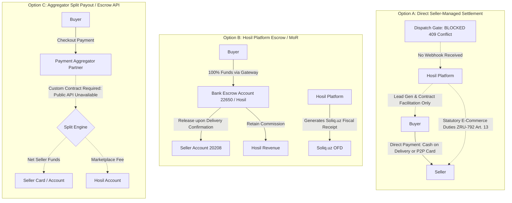
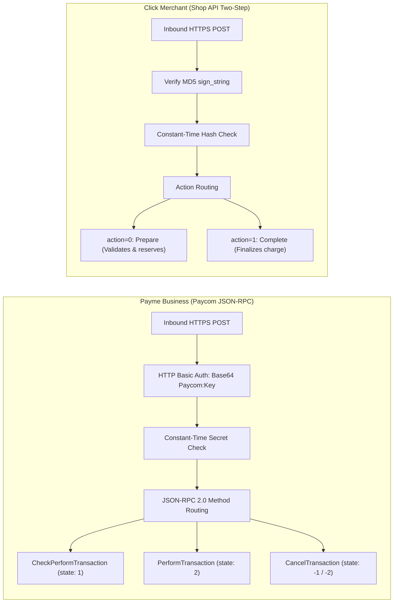
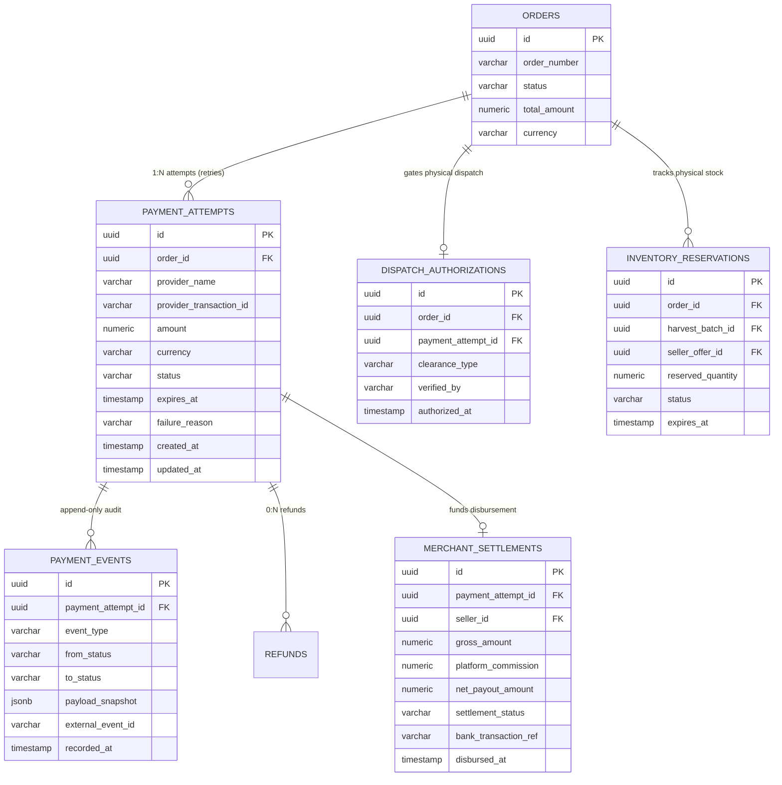
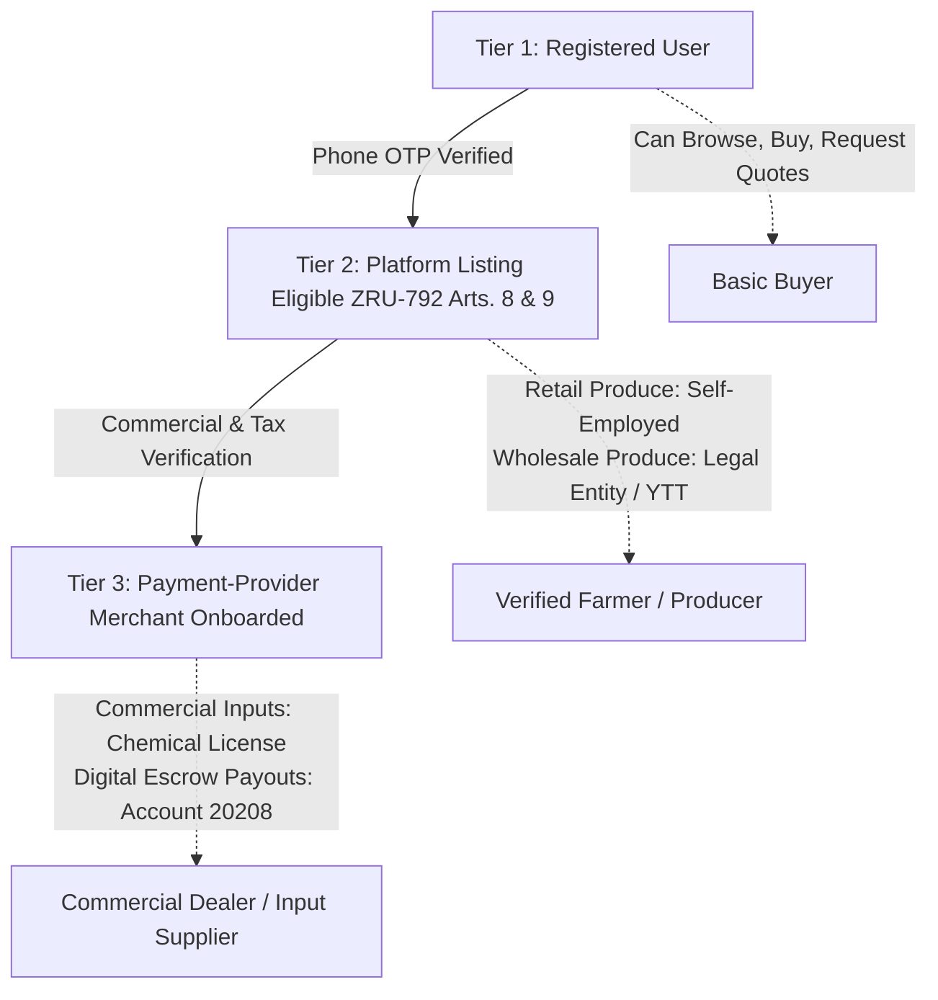
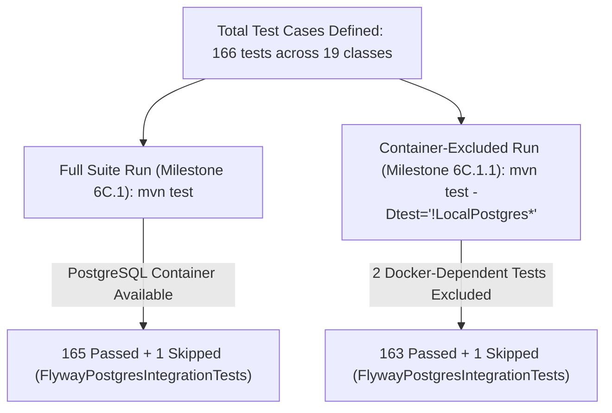

# Hosil Ecosystem — Payment Integration Blueprint and Merchant Onboarding

**Document Version:** 1.2.1 (Statutory Provision, Registration & Retention Reconciliation Edition)  
**Date:** 17 October 2026  
**Status:** Implementation Blueprint (Awaiting DEC-007 Stakeholder Approval)  
**Target Milestone:** Milestone 6C.1.2.1 (Final Payment Blueprint Documentation Corrections)  
**Architecture Context:** Java 21 + Spring Boot Modular Monolith, PostgreSQL 16, Flyway Migrations  
**Cross-References:**  
- [`docs/01_prd.md`](01_prd.md) (§6 Bozor Marketplace, §7 Logistics, §8 Payment & Checkout, §15 Launch Blockers)  
- [`docs/02_architecture.md`](02_architecture.md) (§5 Identity, §6 Payments Bounded Context, §8.1 Order Workflow)  
- [`docs/04_domain_model.md`](04_domain_model.md) (§4.4 Commerce & Order Model, §4.5 Logistics Model)  
- [`docs/05_api_contract.md`](05_api_contract.md) (REST Contract, Idempotency, Status Schemas)  
- [`docs/decision_register.md`](decision_register.md) (`DEC-004`, `DEC-005`, `DEC-006`, `DEC-007`, `DEC-010`, `DEC-011`, `DEC-017`)  
- [`docs/00_documentation_index.md`](00_documentation_index.md) (Companion Documents Map & Roadmap)  

---

## 1. Executive Summary & Codebase Audit Findings

### 1.1 Purpose and Scope of this Reconciliation

This blueprint establishes the authoritative architectural, security, data-modeling, and regulatory specifications for integrating digital payments into the Hosil Ecosystem (spanning **Hosil Bozor** commerce and **Hosil Logistika** transport).

In Milestone 6C.1.2.1, a targeted legal and statutory reconciliation was conducted across five critical domains:
1. **Legal Effective Dates & Operative Obligations:** Correcting the effective date of Law ZRU-792 to **31 December 2022** (3 months post-publication on 30.09.2022). Separating the operative Article 13 obligations of an electronic trading platform operator from future-effective amendments under Law ZRU-1173 (adopted 10.09.2026, **effective date: 12 December 2026**). Recording that the **30-day advance-notice rule is already in force** under current Article 13 part 3. Citing exact provisions for all operator duties. Clarifying that registration in a national e-commerce registry is not established by statutory text in Art. 13 and requires an administrative inquiry to NAPP.
2. **Personal Data Registration Scope & Cross-Border Processing:** Reconciling the relationship between Article 20 and Article 27¹ of Law ZRU-547 as amended by Law ZRU-1125 (effective 27.03.2026). Establishing that mandatory database registration in the State Register under Article 20 applies specifically to databases subject to mandatory domestic storage under Article 27¹ part 2 (biometric, genetic, and telecom subscriber data), meaning Hosil's standard customer/farmer database is not subject to mandatory Article 20 registration. Clarifying that user consent under Articles 13 & 15 is the general legal basis for lawful processing, not an exception to Article 27¹ cross-border transfer conditions. Keeping DEC-017 recorded as strictly Unresolved.
3. **Record Retention Architecture:** Preserving the Article 17 paper-equivalence principle for electronic documents. Eliminating the misapplication of procedural litigation statutes of limitations (Civil Code Art. 150 = 3 years) as administrative retention mandates. Citing exact 5-year statutory retention mandates in tax and accounting legislation (Tax Code Art. 88 / Art. 221, Law on Accounting ZRU-404 Art. 29). Designating commercial inquiry, quote, and server access log retention durations as provisional platform practices pending formal legal confirmation.
4. **Escrow Banking Realities:** Distinguishing Central Bank accounting classification 22650 from commercial banking products and provider capabilities.
5. **Surefire Test Suite Reconciliation:** Conclusively accounting for the historical difference between 166-test and 164-test Maven runs.

In strict adherence to project constraints:
- **Zero Runtime Modifications:** No Java or Flutter code, database tables, or runtime configurations are altered.
- **Zero Schema Migrations:** Applied migrations V1–V14 remain frozen. All proposed entities are explicitly designated as `PROPOSED — NOT YET IMPLEMENTED` (slated for Flyway V16+ upon formal business and legal sign-off).
- **DEC-007 Remains Strictly Unresolved:** This document serves as an objective, balanced decision package. No commercial settlement model is silently selected or assumed.
- **DEC-010 Remains Proposed:** Cancellation and refund rules remain proposed pending product owner approval.
- **DEC-017 Remains Unresolved:** Hosting evaluation and data residency remain pending written legal review.
- **Dispatch Gate Preserved:** The fail-closed physical dispatch safety gate established in Milestone 6B.12.2 remains active.

---

### 1.2 System Audit: Verified Realities vs Documented Assumptions

An audit of the actual codebase, PostgreSQL schema (`hosil_db`), and test suite was conducted. The verified facts are contrasted with prior assumptions below:

| Dimension | Documented Spec / Prior Assumption | Verified Codebase & Database Reality | Architectural & Operational Impact |
|---|---|---|---|
| **Payment Database Tables** | Tables 24–26 (`payments`, `payment_events`, `refunds`) drafted conceptually in `docs/04_domain_model.md`. | **None exist.** No payment tables exist in Flyway migrations V1–V14 or in PostgreSQL. | Payment persistence is greenfield; no legacy payment schema debt. |
| **Payment Endpoints** | REST endpoints for payment initiation, status checks, and callbacks (`/api/v1/payments/*`). | **None exist.** `openapi-v1.yaml` and Spring controllers contain zero payment routes. | Clean module design under Spring Modulith conventions without breaking existing APIs. |
| **The "Skipped Test" Clarification** | User request noted a "skipped payment-webhook integration test". | **Verified Reality:** The **only** skipped test in the entire test suite is `FlywayPostgresIntegrationTests` (skipped due to `@Testcontainers(disabledWithoutDocker = true)` when Docker socket is unavailable). **Zero payment webhook tests exist.** | Proves that no payment webhook test was broken or disabled; a deterministic mock test harness must be specified from scratch. |
| **Order Status Enum & Check Constraint** | Previous reports referenced `PAID` and `AWAITING_PAYMENT` order states. | In `orders` table (`chk_orders_status`), permitted values are: `DRAFT`, `AWAITING_SELLER_CONFIRMATION`, `PENDING_PAYMENT`, `CONFIRMED`, `PROCESSING`, `READY_FOR_DISPATCH`, `IN_TRANSIT`, `COMPLETED`, `CANCELLED`, `DISPUTED`. **`PAID` does not exist.** | Order state must remain strictly decoupled from payment state (`PAY-002`); payment clearance must not depend on an overloaded order status. |
| **Current Commerce Order Flows** | Input orders and wholesale harvest orders enter distinct statuses. | Input orders enter `PENDING_PAYMENT` with 24h reservation expiry. Wholesale harvest orders enter `CONFIRMED` upon seller RFQ confirmation. | Neither flow currently transitions to a payment-cleared state via automated runtime integration. |
| **Logistics Dispatch Safety Gate** | Physical pickup (`PICKED_UP`) must require financial clearance. | Gated in Milestone 6B.12.2: `LogisticsShipmentService` blocks `PICKED_UP` for any shipment linked to an order (`order_id != null`) with `409 Conflict`, because no authoritative clearance exists. | Gating works as intended: fails closed for commerce orders; standalone shipments (`order_id == null`) proceed normally. |

---

## 2. Official Legal and Regulatory Source Register

All legal analysis in this blueprint is verified against official publications in the National Database of Legislation of the Republic of Uzbekistan (**LexUZ**) as of the review date (**17 October 2026**).

```mermaid
flowchart TD
    subgraph LegislativeFramework["Uzbekistan E-Commerce & Financial Regulatory Framework"]
        ZRU792["Law ZRU-792: On Electronic Commerce (In force 31.12.2022)"]
        ZRU1173["Amending Law ZRU-1173: (Adopted 10.09.2026, IN FORCE 12.12.2026)"]
        ZRU578["Law ZRU-578: On Payments and Payment Systems (In force 03.02.2020)"]
        ZRU547["Law ZRU-547: On Personal Data (As amended by ZRU-1125 27.03.2026)"]
        TaxCode["Tax Code of the Republic of Uzbekistan (New Edition 2020)"]
        ZRU404["Law ZRU-404: On Accounting (In force 14.04.2016)"]
        PKM943["Cabinet of Ministers Resolution No. 943: Virtual Kassa / OFD (23.11.2019)"]
        CB3336["Central Bank Chart of Accounts: Regulation No. 3336 (Escrow Account 22650)"]
    end

    ZRU792 -->|Art. 13 p.2: Operative Duties & p.3: 30-Day Notice| HosilPlatform[Hosil Platform Operator]
    ZRU1173 -.->|Future-Effective 12.12.2026: Algorithmic Transparency & Reviews| HosilPlatform
    ZRU792 -->|Article 24: Statutory Escrow Framework| EscrowMechanism[Escrow / Deponentlash]
    ZRU792 -->|Articles 8 & 9: Seller Qualifications| SellerEntity[Legal Entity / YTT / Self-Employed]
    ZRU792 -->|Article 17: Paper-Equivalence Principle| RetentionPolicy[Platform Document Retention]
    TaxCode -->|Art. 88 & Art. 221: Mandatory 5-Year Fiscal Retention| RetentionPolicy
    ZRU404 -->|Article 29: Mandatory 5-Year Accounting Retention| RetentionPolicy
    CB3336 -->|Account 22650: Accounting Code Only| EscrowMechanism
    ZRU578 -->|Payment Services Licensing Rules| PaymentAggregator[Licensed Payment Provider / Bank]
    TaxCode -->|Article 378 p.8: Narrow Personal Exemption| IndividualFarmer[Homegrown Produce Exemption]
    ZRU547 -->|Art. 20 (Art. 27¹ p.2) & Art. 27¹ p.3: Cross-Border Hosting| HostingArchitecture[Hosting & Data Residency DEC-017]
    PKM943 -->|Fiscal QR Receipt / MXIK| FiscalSystem[Soliq.uz / Virtual Kassa]
```

### 2.1 Statutory Analysis & Audit Register

| Legal Act & Citation | Official Title, Version Date & Effective Date | Supported Proposition | Legal Status & Hosil Applicability | Conditions, Exceptions, & Practical Constraints |
|---|---|---|---|---|
| **Law ZRU-792, Art. 13 (Operative Edition)** | Law "On Electronic Commerce" (29.09.2022, in force **31.12.2022**) | Establishes the core rights and obligations of an **Electronic Trade Platform Operator** (*elektron savdo maydonchasi operatori*) under Art. 13 parts 1–3. | **Currently in Force (Operative).** Directly governs Hosil Bozor. | **Operative statutory obligations under Art. 13 parts 2 & 3:**<br>1. Ensure continuous and uninterrupted platform access and operation (Art. 13 p.2 cl.1);<br>2. Verify licenses/permits of sellers for regulated goods/services (Art. 13 p.2 cl.2);<br>3. Terminate/block placement of prohibited or restricted goods/services (Art. 13 p.2 cl.3);<br>4. Publish platform usage rules, instructions, and public offer terms (*ommaviy oferta*) (Art. 13 p.2 cl.4);<br>5. Protect personal data and ensure confidentiality of electronic documents/messages (Art. 13 p.2 cl.5 & Art. 12);<br>6. Ensure equal participation conditions and non-discrimination (Art. 13 p.2 cl.6);<br>7. Comply with consumer protection laws and resolve user inquiries per statutory procedure;<br>8. **30-Day Advance Notice:** Post public notice at least 30 days in advance before suspending platform operations or altering goods/services terms of sale (Art. 13 p.3).<br>**National E-Commerce Registry Status:** Registration in a national e-commerce registry is **not established by the statutory text of Art. 13** (nor Law ZRU-1173). Sub-statutory voluntary registries existed historically under PKM No. 407 (02.06.2016) and PP-3724 (14.05.2018) for tax incentives. Determining whether any administrative registration or notification is enforced under current regulation requires an administrative step: submitting an official inquiry to the National Agency for Prospective Projects (NAPP), the authorized e-commerce regulator. |
| **Law ZRU-792, Art. 13 (As amended by Law ZRU-1173)** | Law ZRU-1173 (Adopted 10.09.2026, **In Force 12.12.2026**) | Introduces enhanced platform-operator obligations taking effect on **12 December 2026**. | **Future-Effective (Takes effect 12.12.2026).** Must be prepared for Phase 4 rollout, but **is not yet legally operative** on 17.10.2026. | **Mandatory from 12 December 2026:**<br>1. **Algorithmic Search/Ranking Transparency:** Disclose key criteria determining search result rankings to prevent discriminatory self-preferencing;<br>2. **Preservation of Consumer Reviews:** Prohibition against deleting, modifying, or hiding genuine user reviews (except legally prohibited content);<br>3. **Payment Cybersecurity:** Certified information security controls for payment gateways, session tokens, and webhook endpoints.<br>**Clarification on Advance Notice:** The 30-day advance notice rule for term changes or suspension is **already in force** under current Art. 13 part 3; it is not a newly created obligation of ZRU-1173. See §2.2. |
| **Law ZRU-792, Arts. 8 & 9** | Law "On Electronic Commerce" (29.09.2022, in force **31.12.2022**) | Article 8 defines forms of electronic commerce. Article 9 defines **Seller Qualifications**: (1) Legal entities (*yuridik shaxs*), (2) Individual Entrepreneurs (*YTT*), and (3) Self-Employed persons (*o'zini o'zi band qilgan shaxs*). | **Currently in Force.** Governs seller eligibility on Hosil Bozor. | **Statutory Distinction:** An unregistered natural person (*oddiy jismoniy shaxs*) is not authorized to sell on an e-commerce platform. Self-employed individuals are restricted to **retail trade only** (*chakana savdo*); wholesale bulk lots require a Legal Entity or YTT. Sectoral licensing applies for agrochemicals (Plant Quarantine Agency). |
| **Law ZRU-792, Art. 17** | Law "On Electronic Commerce" (29.09.2022, in force **31.12.2022**) | Governs **Document Retention** in e-commerce via the **Equivalence Principle**: retention period for electronic documents cannot be less than that established for identical paper documents. | **Currently in Force.** Governs platform record retention policy. | **Reconciliation of Retention Bases:** Art. 17 does not establish a standalone numerical retention period. Mandatory retention **cannot be inferred solely from procedural statutes of limitations** (Civil Code Art. 150 = 3 years), which govern judicial lawsuit filing deadlines rather than administrative record-keeping duties. Exact statutory mandates derive from sectoral legislation: (1) Tax Code Art. 88 (5-year assessment limitation) & Art. 221 (mandatory 5-year retention for tax/fiscal records, OFD receipts, and calculations); (2) Law on Accounting No. ZRU-404 Art. 29 (mandatory 5-year retention for primary accounting records and financial statements). Recommended durations for pre-contractual commercial inquiries, RFQ negotiations, unaccepted quotes, and server access logs (e.g. 1 year) are recommended platform practices, labeled **provisional and subject to formal legal confirmation**. See §2.3. |
| **Law ZRU-792, Art. 24** | Law "On Electronic Commerce" (29.09.2022, in force **31.12.2022**) | Establishes the statutory framework for **Escrow Services** (*pul mablag'larini deponentlash tizimi / «eskrou» xizmati*). | **Currently in Force.** Statutory basis for marketplace holding of customer payments. | Authorizes trade platform operators, payment service providers, and delivery entities to introduce escrow in their information systems or on bank accounts. Funds are held until buyer confirms receipt. If goods are non-conforming or undelivered, funds return to buyer; upon receipt confirmation, funds disburse to seller. |
| **Law ZRU-578, Arts. 3, 4, 12, 13** | Law "On Payments and Payment Systems" (01.11.2019, in force 03.02.2020) | Regulates payment services, payment organizations (*to'lov tashkilotlari*), and settlement operations. | **Currently in Force.** Restricts direct holding of third-party funds without a banking/payment license. | Interplay with ZRU-792 Art. 24: While ZRU-792 recognizes platform escrow, holding funds directly on a commercial corporate account (20208) risks classification as unauthorized payment activity under ZRU-578. Escrow must be backed by a specialized bank escrow account (Account 22650) or operated via a licensed payment organization partner. |
| **Central Bank Reg. No. 3336** | Chart of Accounts of Commercial Banks (10.12.2021) | Defines balance sheet account **22650** — "Funds of clients in depository (escrow) accounts" (*Mijozlarning pul mablag'larini deponentlash (eskrou) hisobvarag'idagi mablag'lari*). | **Currently in Force.** Regulatory accounting classification code. | **Crucial Distinction:** Account 22650 is an internal bank accounting code. Its existence does **not** entitle Hosil to an off-the-shelf escrow product. Establishing an escrow account requires bilateral commercial bank underwriting and executed agreements. |
| **Law ZRU-547, Arts. 20, 13, 15, & 27¹ (As amended by Law ZRU-1125)** | Law "On Personal Data" (02.07.2019, amended by ZRU-1125 26.03.2026, **In Force 27.03.2026**) | Regulates personal data processing bases, State Register of Databases, localization, and cross-border processing. | **Currently in Force.** Governs hosting topology and data residency (DEC-017). | **Statutory Reconciliation:**<br>1. **Scope of Article 20 Database Registration:** Mandatory registration in the State Register under Article 20 applies specifically to databases subject to mandatory domestic localization under Article 27¹ part 2 (biometric, genetic, and telecom subscriber data). Hosil's customer/farmer database does not collect these specialized categories and is therefore **not subject to mandatory Article 20 registration**.<br>2. **Legal Basis of Consent vs Cross-Border Conditions:** User consent under Articles 13 & 15 is the general legal basis for lawful processing, **not an exception or waiver to Article 27¹ cross-border conditions**. Cross-border processing or foreign cloud hosting of non-mandatory data requires satisfying one of the 3 statutory conditions of Article 27¹ (adequate foreign jurisdiction, approved standard contractual clauses/binding rules, or certified international standards).<br>3. **DEC-017 Status:** DEC-017 remains strictly **UNRESOLVED** pending formal legal review. See §2.4. |
| **Tax Code, Art. 378, p. 8** | Tax Code of the Republic of Uzbekistan (New Edition 2020) | Personal Income Tax (JShODS) exemption on revenue from selling homegrown agricultural produce. | **Currently in Force (Narrow Scope).** Applies to individual income tax only. | **Strict Conditions:** (1) Applies only to natural persons selling raw or processed produce grown on household/dehqon land plots; (2) Excludes ornamental horticulture/floriculture; (3) Excludes industrial processing; (4) **Mandates documentary confirmation** from local council (*mahalla fuqarolar yig'ini*) proving land allocation. **Does not waive e-commerce seller registration rules under ZRU-792.** |
| **Tax Code, Art. 369, p. 1, cl. 9 & PQ-4742** | Tax Code & Presidential Decree PQ-4742 (08.06.2020) | Tax exemption on revenue earned by registered self-employed individuals (*o'zini o'zi band qilgan shaxslar*). | **Currently in Force.** Governs self-employed farmer tax status. | Revenue earned from permitted self-employed activities is exempt from Personal Income Tax. Self-employed individuals register instantly via the Soliq app. However, self-employed persons cannot conduct wholesale commerce under ZRU-792. |
| **Resolution PKM No. 943 & UP-5813** | Regs on Virtual Kassa and Online Cash Registers (23.11.2019 & 06.09.2019) | Mandatory real-time electronic fiscal cash register receipts (*virtual kassa / onlayn-NKM*). | **Currently in Force.** Mandates fiscalization of e-commerce payments. | Every electronic payment accepted from an individual requires issuing an OFD receipt containing: IKPU (MXIK) product code, package code (*o'ram kodi*), VAT rate/amount (or exemption indicator), and QR code transmitted to Soliq.uz. |
| **Law No. ZRU-404, Art. 29** | Law "On Accounting" (13.04.2016, in force 14.04.2016) | Mandates statutory retention of primary accounting documents, accounting registers, and financial statements. | **Currently in Force.** Establishes mandatory accounting document retention period. | Establishes mandatory preservation of primary accounting documents, accounting registers, and financial reporting for a **minimum period of 5 years** per the Model List of Documents approved by the State Archival Agency ("O'zarxiv"). |

---

### 2.2 Upcoming Regulatory Compliance Requirements (Law ZRU-1173, In Force 12 December 2026)

To ensure seamless architectural readiness when **Law ZRU-1173** enters into force on **12 December 2026**, the platform design must accommodate the following upcoming statutory mandates:

1. **Algorithmic Search and Ranking Transparency (Amended Art. 13):**
   - The platform operator must disclose the key parameters and criteria determining search result rankings and catalog placement on Hosil Bozor.
   - Algorithms and ranking weights must be objectively documented to prevent discriminatory, anti-competitive, or non-transparent self-preferencing.
2. **Preservation and Non-Alteration of Consumer Reviews (Amended Art. 13):**
   - The operator is prohibited from deleting, altering, filtering, or concealing genuine consumer reviews and ratings, except where reviews contain legally prohibited content (extremism, hate speech, defamation, illegal goods).
   - This statutory duty reinforces the double-blind, unweighted review architecture specified in [`docs/12_reputation_and_reviews.md`](12_reputation_and_reviews.md) (`REV-001`–`REV-010`).
3. **Enhanced Payment Cybersecurity Standards (Amended Art. 13):**
   - Explicit statutory obligation to implement certified information security and cybersecurity controls for electronic payment processing, session tokens, API gateways, and webhook endpoints.

> [!NOTE] Operative 30-Day Notice Obligation Already in Force
> Prior documentation erroneously attributed the 30-day advance notice rule to Law ZRU-1173. In fact, **the 30-day advance public notice requirement is already an operative statutory obligation under current Law ZRU-792 Article 13 part 3** (in force since 31.12.2022). Any planned suspension of platform operations or alteration of goods/services terms of sale (*ommaviy oferta*) mandates posting public notice on the platform at least 30 days in advance today.

---

### 2.3 Document Retention Framework (Law ZRU-792 Art. 17 & Sectoral Equivalents)

#### 2.3.1 The Paper-Equivalence Principle (Art. 17)
Under Article 17 of Law ZRU-792, the retention period for electronic documents in e-commerce cannot be less than the period established by legislation for identical paper documents (*qog'ozdagi tegishli hujjatlar uchun qonunchilikda belgilangan muddatdan kam bo'lmasligi kerak*).

Article 17 does not establish an independent numerical duration. Rather, it binds electronic platform documents to the statutory retention schedules governing the underlying legal, tax, and accounting subject matter.

#### 2.3.2 Separation of Civil Limitation Periods from Statutory Retention Mandates
Prior blueprint revisions cited the 3-year general statute of limitations (*da'vo muddati*) under Civil Code Article 150 as a basis for mandatory document retention. This legal inference has been corrected:
- **Civil Code Article 150** establishes a procedural deadline for filing claims in court to enforce civil rights. It is a procedural defense mechanism in litigation, **not an administrative record-retention mandate**.
- While retaining commercial contracts and completed transaction agreements for 3 years is a prudent risk-management practice to defend against potential commercial litigation during the limitation period, it is not a direct statutory retention period imposed by law on the e-commerce operator.

#### 2.3.3 Sectoral Statutory Mandates vs Provisional Platform Practices

The platform document retention policy is partitioned into statutorily binding mandates and provisional platform business practices:

| Data Category & Record Type | Governing Legal Act & Citation | Legal Classification | Mandatory Retention Duration | Platform Storage Architecture & Archival Trigger |
|---|---|---|---|---|
| **Fiscal Receipts & Cash Register Logs** | **Tax Code, Arts. 88 & 221; Resolution PKM No. 943** | **Statutory Mandate** | **5 Years Minimum** | Real-time OFD transmission to Soliq.uz; persistent encrypted JSON payload in `payment_events`; retained for tax audit window. |
| **Primary Accounting & Settlement Records** | **Law on Accounting No. ZRU-404, Art. 29; "O'zarxiv" Agency Model List** | **Statutory Mandate** | **5 Years Minimum** | Bank escrow disbursement confirmations, sub-merchant payout ledgers (`merchant_settlements`), commission invoices; immutable storage. |
| **Commercial Contracts & Order Snapshots** | **Civil Code, Art. 150 (Procedural limitation period)** | **Provisional Platform Practice (Awaiting Legal Confirmation)** | **3 Years (Recommended)** | `orders`, `order_items`, formal RFQ acceptance records. Preserved for defense against breach-of-contract claims during limitation window. |
| **Pre-Contractual Inquiries & Unaccepted Quotes** | **Law ZRU-792, Art. 17 (No sectoral paper equivalent)** | **Provisional Platform Practice (Awaiting Legal Confirmation)** | **1 Year (Recommended)** | `inquiries`, `inquiry_messages`, rejected/expired RFQ quotes. Archival cleanup after 12 months unless flagged in active dispute. |
| **Payment Gateway Webhook Payloads & Audit Events** | **Law ZRU-578 & Central Bank Security Regs** | **Provisional Platform Practice (Awaiting Legal Confirmation)** | **3 Years (Recommended)** | Append-only raw HMAC webhook payloads, provider transaction references, reconciliation logs in `payment_events`. |
| **Operational Access & Security Logs** | **Law ZRU-547 & Cybersecurity Legislation** | **Provisional Platform Practice (Awaiting Legal Confirmation)** | **6 to 12 Months (Recommended)** | Structured JSON audit logs, IP address traces, authentication attempts. Rotated to cold storage after 180 days. |

> [!IMPORTANT]
> The recommended retention periods for commercial contracts (3 years), pre-contractual inquiries (1 year), and operational logs (6–12 months) represent recommended engineering and risk-management baselines. They are **provisional and subject to formal written confirmation by platform legal counsel** prior to commercial launch.

---

### 2.4 Personal Data Governance: Article 20 Registry Scope, Article 27¹ Localization, and Legal Basis of Consent

#### 2.4.1 Scope of Article 20 Mandatory Database Registration
Under Article 20 of Law ZRU-547 "On Personal Data", the State Register of Personal Data Databases (*Shaxsga doir ma'lumotlar bazalarining davlat reyestri*) is maintained by the authorized state body (the State Inspectorate "O'zkomnazorat").

Following the statutory reconciliation of Law ZRU-547 with amending Law ZRU-1125 (in force 27.03.2026):
1. **Mandatory Registration is Narrowly Scoped:** Article 20 mandates database registration in the State Register **only for personal data databases that are subject to mandatory domestic localization under Article 27¹ part 2**.
2. **Article 27¹ Part 2 Mandatory Domestic Categories:**
   - Biometric personal data (*biometrik shaxsga doir ma'lumotlar*),
   - Genetic personal data (*genetik shaxsga doir ma'lumotlar*),
   - Telecommunication subscriber personal data (*telekommunikatsiya xizmatlari abonentlariga doir ma'lumotlar*).
3. **Application to Hosil Platform:** Hosil Bozor, Hosil Farm, and Hosil Logistika store standard commercial contact, profile, and transactional records (names, mobile phone numbers, role memberships, delivery addresses, order histories, and farm parcel boundaries). Hosil does **not** collect or process biometric identifiers, genetic data, or telecommunication subscriber carrier data.
4. **Legal Conclusion:** Hosil's customer, farmer, seller, and carrier database is **not subject to mandatory registration in the State Register under Article 20**, unless Hosil introduces biometric authentication (e.g. face ID verification) or other Article 27¹ part 2 data in future phases.

#### 2.4.2 Legal Basis of Consent (Articles 13 & 15) vs Article 27¹ Cross-Border Conditions
Prior documentation referenced "explicit user consent" alongside cross-border hosting conditions. The statutory relationship between consent and cross-border processing is reconciled as follows:
- **General Processing Prerequisite (Arts. 13 & 15):** User consent (*subyektning roziligi*) is established under Article 13 and Article 15 as the universal, foundational legal basis for lawful processing of personal data. Every e-commerce operator must obtain valid user consent upon registration.
- **Consent is NOT an Article 27¹ Cross-Border Exception:** Under the statutory structure of Law ZRU-547 (as amended by ZRU-1125), user consent by itself does **not** waive or serve as an exception to the cross-border processing requirements of Article 27¹.
- **Three Statutory Conditions for Cross-Border Processing (Art. 27¹ parts 3–5):** Cross-border transfer or foreign cloud storage of non-mandatory personal data is lawful **only** if one of the following structural criteria is satisfied:
  1. The foreign jurisdiction ensures an adequate level of personal data protection (established by the Cabinet of Ministers adequacy list);
  2. The data controller/processor executes standard contractual clauses (SCCs) or adopts binding corporate rules approved by the authorized state body; OR
  3. The data controller/processor complies with recognized international standards for personal data protection and information security (such as ISO/IEC 27001 / ISO/IEC 27701).

#### 2.4.3 DEC-017 Status: Strictly UNRESOLVED
In accordance with platform governance, **DEC-017 remains strictly UNRESOLVED**:
- While the statutory reconciliation confirms that Hosil's database is not subject to an absolute domestic storage mandate (Art. 27¹ part 2) or mandatory Article 20 database registration, technical architecture cannot independently authorize foreign cloud hosting (e.g. Hetzner Cloud in Germany).
- Qualified legal counsel must formally review whether Germany / the European Union is included on the official adequacy list, or prepare approved standard contractual clauses before international production hosting is provisioned.

---

## 3. Re-evaluation of Settlement Models (A, B, C)

In accordance with platform governance, **DEC-007 remains strictly UNRESOLVED**. Below is an objective, legally and technically reconciled evaluation of the three candidate settlement architectures.



---

### 3.1 Comparative Evaluation Matrix

| Evaluation Dimension | Option A: Direct Seller-Managed Settlement (Seller MoR) | Option B: Hosil Platform Escrow / Merchant of Record (ZRU-792 Art. 24) | Option C: Payment Aggregator Split Payout / Escrow API |
|---|---|---|---|
| **1. Funds Flow & Custody** | Buyer pays Seller directly via cash-on-delivery or card-to-card transfer (P2P). Hosil never holds or routes transaction funds. | Buyer pays Hosil gateway account. Funds held in dedicated escrow account (Bank Account 22650) under ZRU-792 Art. 24 until delivery confirmation. | Buyer pays aggregator gateway. Aggregator holds funds and programmatically splits payout to seller and Hosil. |
| **2. Legal & Regulatory Reality** | **Not an obligation-free model.** Under ZRU-792 Art. 13, Hosil remains an Operator: liable for user data privacy, review integrity, record retention, and seller eligibility verification. | **Statutorily Authorized:** ZRU-792 Art. 24 expressly permits platform escrow. Must segregate funds on Bank Account 22650 to prevent non-bank deposit-taking violations under ZRU-578. | **Public API Myth:** Neither Payme nor Click developer APIs support public, out-of-the-box split settlement. Requires unverified custom enterprise agreements. |
| **3. Dispatch Safety Gate Impact** | **INCOMPATIBLE WITHOUT NEW CLEARANCE MECHANISM.** The backend blocks physical pickup for all order-linked shipments (`409 Conflict`). In Option A, zero webhooks are received. Cargo cannot be dispatched. | **NATIVELY COMPATIBLE.** Authoritative payment webhook from gateway automatically generates `DispatchAuthorization`, permitting carrier `PICKED_UP`. | **NATIVELY COMPATIBLE (IF CONTRACTED).** Gateway webhook provides clearance; allows `DispatchAuthorization` to unlock `PICKED_UP`. |
| **4. Seller Onboarding Requirements** | Moderate. Seller must be verified as Legal Entity, YTT, or Self-Employed under ZRU-792 Arts. 8 & 9. Bank/card details provided for buyer display. | Intensive. Tripartite escrow terms, verified commercial bank account (20208), STIR/TIN validation, and Soliq tax registration check. | Intensive. Sellers must be onboarded into the payment provider's sub-merchant ecosystem or provide verified payout cards. |
| **5. Fiscalization & Tax Liability** | Seller is legally responsible for issuing fiscal receipts to the buyer. High risk of seller non-compliance on platform deals. | **Hosil is strictly responsible** for issuing real-time electronic fiscal receipts with QR codes and MXIK codes via a licensed Virtual Kassa / OFD operator. | Aggregator or Hosil (depending on commercial contract) issues fiscal receipts. Division of fiscal responsibility requires written tax ruling. |
| **6. Dispute & Refund Execution** | Zero programmatic refund capability. Disputes must be arbitrated manually; buyer protection is minimal. | Authoritative programmatic refund via gateway API prior to escrow release if goods are non-conforming or undelivered (ZRU-792 Art. 24). | Programmatic refund via aggregator API before escrow release. |
| **7. Revenue & Commission Capture** | Invoicing or post-paid billing. Hosil cannot deduct commissions at source; must bill sellers periodically (high default risk). | Automated at source. Hosil deducts platform commission upon escrow disbursement to seller. | Automated at source. Aggregator splits and deposits commission directly into Hosil corporate account. |

---

## 4. Reconciling Option A with the Dispatch Safety Gate

In [`LogisticsShipmentService.java`](file:///c:/Users/Oliya/Desktop/Hosil/backend/src/main/java/uz/hosil/platform/logistics/service/LogisticsShipmentService.java), the dispatch safety gate is hard-coded to fail closed:
```java
// For commerce order-linked shipments, enforce strict financial clearance gating.
if (shipment.getOrderId() != null) {
    throw new ResponseStatusException(HttpStatus.CONFLICT,
        "Order-linked shipment cannot transition to PICKED_UP: physical dispatch requires authoritative payment verification");
}
```

### 4.1 The Technical Reality

Under **Option A (Direct Seller-Managed Settlement)**:
1. Payment occurs off-platform (cash-on-delivery or direct card transfer).
2. The Hosil platform receives **zero automated payment webhooks** from any gateway.
3. Because no digital clearance event exists, **every attempt to transition an order-linked shipment to `PICKED_UP` fails with `409 Conflict`**.
4. Therefore, **Option A CANNOT operate under the current codebase without an approved, authoritative dispatch authorization mechanism.**

### 4.2 Prohibited Shortcuts vs Proposed Authoritative Mechanisms

- **PROHIBITED:** Buyer self-attestation ("I have paid") or seller self-attestation ("I have received payment") must **never** be accepted as trusted clearance evidence.
- **PROHIBITED:** Client-side bypass flags or disabling the dispatch safety gate for pilot orders is strictly forbidden.

#### Candidate Proposals for Option A (AWAITING STAKEHOLDER APPROVAL)

1. **Option A.1: Manual Administrative Finance Clearance (`FINANCE_OVERRIDE`):**
   - An audited back-office workflow where a Hosil finance administrator inspects verified bank wire statements or cash deposit slips.
   - Upon administrative verification, the administrator issues a `DispatchAuthorization` via an audited internal API (`POST /api/v1/admin/orders/{id}/authorize-dispatch`).
   - Requires: Internal audit logging (`ADM-005`), role-based administrative permission, and operational SLA overhead.
2. **Option A.2: Licensed Cash-on-Delivery (COD) Transport Protocol:**
   - Under Law ZRU-792 Article 24, delivery service entities (*yetkazib berish xizmatlarini ko'rsatuvchi yuridik shaxslar*) are legally recognized as escrow/collection agents.
   - If the carrier is a licensed delivery organization bonded for cash collection, physical pickup (`PICKED_UP`) is authorized under a specialized `CASH_ON_DELIVERY` dispatch contract.
   - Requires: Formal cash collection and cash-in-transit (*inkassatsiya*) agreements with carriers, and carrier mobile app POS terminal integration.

> [!IMPORTANT]
> Neither mechanism is implemented in this milestone. The backend dispatch gate remains strictly fail-closed (`409 Conflict`) for all order-linked shipments.

---

## 5. Candidate Payment Provider Technical Specifications

An audit of official developer documentation was conducted for the candidate Uzbekistan payment gateways: **Payme Business (Paycom)** and **Click Merchant**.



---

### 5.1 Payme Business (Paycom) Specification

Verified from official developer documentation (`developer.paycom.uz`):

1. **Transport & Protocol:** JSON-RPC 2.0 over HTTPS POST. UTF-8 encoding. Content-Type: `application/json`.
2. **Authentication:** HTTP Basic Auth header: `Authorization: Basic <base64("Paycom:" + merchantKey)>`. Constant-time comparison (`MessageDigest.isEqual`) required.
3. **Core Transaction Methods:**
   - `CheckPerformTransaction`: Validates order existence, payable state, and amount (integer in **tiyin**, $1\text{ UZS} = 100\text{ tiyin}$).
   - `PerformTransaction`: Authorizes payment; transitions state to `2` (`STATE_DONE`).
   - `CheckTransaction`: Inquires transaction state and execution timestamps.
   - `CancelTransaction`: Cancels unperformed transaction (state `-1`) or refunds performed transaction (state `-2`).
   - `GetStatement`: Reconciliation query returning transactions within a time window.
4. **Idempotency & Replay:** Duplicate calls to `PerformTransaction` for completed transactions (`state == 2`) must return existing transaction object with HTTP 200 without creating duplicate records.
5. **Verified vs Unverified Capabilities:**
   - *Verified:* Single-merchant checkout, two-state transaction finalization, programmatic refund via `CancelTransaction`, Payme Virtual Kassa fiscal receipt integration.
   - *Unverified / Undocumented:* **No public split-settlement or multi-vendor marketplace escrow API** exists in Paycom public documentation. Marketplace payouts require custom offline banking agreements.

---

### 5.2 Click Merchant (Shop API) Specification

Verified from official developer documentation (`docs.click.uz`):

1. **Transport & Protocol:** HTTP POST with application/x-www-form-urlencoded or application/json payloads.
2. **Authentication:** Click transmits signature digest `sign_string`:
   $$\text{sign\_string} = \text{MD5}(\text{click\_trans\_id} + \text{service\_id} + \text{secret\_key} + \text{merchant\_trans\_id} + \text{amount} + \text{action} + \text{sign\_time})$$
   *(For `action=1` (Complete), `+ merchant_prepare_id` is appended if returned in Prepare).* Constant-time comparison required.
3. **Two-Step Processing:**
   - **`Prepare` (`action = 0`):** Checks order existence and readiness. Merchant responds with `error: 0` and unique `merchant_prepare_id`.
   - **`Complete` (`action = 1`):** Confirms payment authorization. Merchant marks order cleared, persists `click_paydoc_id`, and responds with `error: 0`.
4. **Error Codes:** `0` (Success), `-1` (Sign check failed), `-2` (Incorrect amount), `-3` (Action not found), `-5` (Order not found), `-6` (Transaction not found), `-7` (Failed to update order state).
5. **Verified vs Unverified Capabilities:**
   - *Verified:* Two-step checkout verification, MD5 digest verification, Click Fiscalization API integration (passing IKPU and tax details).
   - *Unverified / Undocumented:* **No public split-settlement or escrow hold API** in public Click developer documentation.

---

## 6. Refined Payment Domain Architecture (PROPOSED — NOT YET IMPLEMENTED)

The refined payment domain model strictly decouples financial transactions from commerce orders, inventory reservations, logistics dispatch, and seller settlements.



---

### 6.1 Strict Architectural Boundary Decoupling

| Concept | Owning Entity | Lifecycle States | Decoupling Invariant |
|---|---|---|---|
| **1. Commerce Order** | `orders` | `DRAFT`, `AWAITING_SELLER_CONFIRMATION`, `PENDING_PAYMENT`, `CONFIRMED`, `PROCESSING`, `READY_FOR_DISPATCH`, `IN_TRANSIT`, `COMPLETED`, `CANCELLED`, `DISPUTED` | Represents contractual commercial agreement between buyer and seller. **Never includes `PAID`.** |
| **2. Payment Attempt** | `payment_attempts` | `INITIATED`, `PENDING`, `SUCCEEDED`, `FAILED`, `EXPIRED`, `CANCELLED` | Cardinality 1:N with `orders`. Represents specific financial charge intent on gateway. |
| **3. Provider Event** | `payment_events` | Append-only event stream (`CHECK_PERFORM`, `PERFORM`, `CANCEL`, `WEBHOOK_RECEIVED`) | Immutable audit history. Never updated or deleted. |
| **4. Inventory Reservation** | `inventory_reservations` | `ACTIVE`, `CONFIRMED`, `RELEASED`, `EXPIRED` | Prevents overselling. Expiration sweep automatically frees stock if payment attempt fails or expires. |
| **5. Dispatch Authorization** | `dispatch_authorizations` | Issued upon verified clearance (`AUTOMATED_PAYMENT`, `FINANCE_OVERRIDE`) | **Physical pickup (`PICKED_UP`) gates on this record.** Decoupled from payment tables. |
| **6. Seller Settlement** | `merchant_settlements` | `PENDING_CLEARING`, `INSPECTION_HOLD`, `DISBURSED`, `REFUND_DEDUCTED` | **Decoupled from payment capture.** Successful card charge does not immediately pay out to seller; funds held until inspection window passes. |

---

## 7. Corrected Merchant Onboarding & Tax Classification Matrix

### 7.1 Multi-Tier Seller Eligibility



---

### 7.2 Data Collection Matrix by Seller Qualification

| Seller Category | Legal Classification (ZRU-792 Arts. 8 & 9) | Required Identification & Tax Records | Permitted Commercial Scope on Hosil | Applicable Tax Regime & Exemptions |
|---|---|---|---|---|
| **Individual Farmer (Tomorqa / Dehqon)** | Self-Employed Person (*O'zini o'zi band qilgan shaxs*) under PQ-4742 | • 14-digit PINFL / JSHSHIR<br>• Self-employed registration certificate via Soliq app<br>• Land plot confirmation from local council (*Mahalla fuqarolar yig'ini*) | **Retail harvest sales only** (*chakana savdo*). Cannot list wholesale lots under ZRU-792. | Personal income tax exempt under Tax Code Art. 369 p.1 cl.9 & Art. 378 p.8 (subject to mahalla certificate). |
| **Dehqon Farm / Agricultural Cooperative (Farming Entity)** | Legal Entity (*Dehqon xo'jaligi / Fermer xo'jaligi / MChJ*) | • State Registration Certificate (*Guvohnoma*)<br>• Corporate 9-digit STIR<br>• Commercial Bank Account 20208<br>• Director PINFL & Authority Order | **Both retail and wholesale harvest sales** (*ulgurji va chakana*). | Agricultural single tax or special turnover tax regime for agricultural producers. |
| **Commercial Input Supplier (Agrochemicals, Seeds, Machinery)** | Commercial Legal Entity (*MChJ / XK*) or Individual Entrepreneur (*YTT*) | • State Registration Certificate<br>• Corporate 9-digit STIR<br>• Commercial Bank Account 20208<br>• Servicing Bank MFO (5 digits)<br>• **Agrochemical Sale License** from Plant Quarantine Agency | **Agricultural inputs catalog offers** (fertilizers, seeds, pesticides, equipment). | Standard corporate taxation (Turnover Tax or Profit Tax + VAT / QQS). Article 378 exemption **does not apply**. |

---

## 8. Deterministic Payment Integration Test Plan

To eliminate external Docker dependencies that caused `FlywayPostgresIntegrationTests` to be skipped in environments without Docker, all payment validation tests must utilize an in-process **Deterministic Mock Payment Harness**.


### Ten Core Test Specifications

1. **Successful Payment Webhook $\to$ Dispatch Authorization:** Valid signed webhook transitions payment attempt to `SUCCEEDED`, issues `DispatchAuthorization`, and permits carrier `PICKED_UP`.
2. **Duplicate Webhook Delivery $\to$ Idempotent Acknowledgment:** Duplicate callback returns HTTP 200 immediately without duplicate events or double clearance.
3. **Corrupted / Invalid Signature $\to$ Immediate Rejection:** Bad HMAC or secret returns HTTP 401/403 with zero side effects.
4. **Expired Payment Attempt $\to$ Stock Release:** Expired payment timeout releases inventory reservation and restores stock.
5. **Provider Failure Callback $\to$ State Preservation:** Card decline marks payment `FAILED` while leaving order in retryable `PENDING_PAYMENT` state.
6. **Partial Refund $\to$ Ledger Tracking:** Refund callback records `REFUNDS` row and transitions payment to `PARTIALLY_REFUNDED`.
7. **Concurrent Webhooks $\to$ Race Condition Prevention:** Pessimistic locking on payment record prevents double-processing race conditions.
8. **Tampered Payload $\to$ Signature Mismatch:** Modified amount or order ID causes cryptographic digest mismatch and rejection.
9. **Dispatch Attempt Before Payment Clearance $\to$ 409 Conflict:** Carrier cannot transition order-linked shipment to `PICKED_UP` while payment is uncleared.
10. **Standalone Shipment Physical Pickup $\to$ Unhindered Progression:** Standalone transport (`order_id == null`) transitions to `PICKED_UP` without evaluating commerce dispatch gates.

---

## 9. Test Suite Verification & Historical Count Reconciliation

A detailed audit of Maven Surefire test XML reports in `backend/target/surefire-reports` was performed to resolve the difference between the 166-test total in Milestone 6C.1 and the 164-test total in Milestone 6C.1.1:



### 9.1 Surefire Per-Class Execution Breakdown

| # | Test Class Name | Total Tests | Passed | Failed | Errors | Skipped | Notes |
|---|---|---|---|---|---|---|---|
| 1 | `FarmActivityIntegrationTests` | 9 | 9 | 0 | 0 | 0 | In-memory / MockMvc |
| 2 | `FarmControllerIntegrationTests` | 10 | 10 | 0 | 0 | 0 | In-memory / MockMvc |
| 3 | `HarvestBatchIntegrationTests` | 11 | 11 | 0 | 0 | 0 | In-memory / MockMvc |
| 4 | `FlywayPostgresIntegrationTests` | 1 | 0 | 0 | 0 | 1 | Skipped by Testcontainers when Docker socket disabled |
| 5 | `HosilPlatformApplicationTests` | 1 | 1 | 0 | 0 | 0 | Context boot test |
| 6 | `AuthControllerIntegrationTests` | 12 | 12 | 0 | 0 | 0 | In-memory / MockMvc |
| 7 | `HealthControllerTests` | 1 | 1 | 0 | 0 | 0 | WebMvcTest |
| 8 | `LocalPostgresContextValidationTests` | 1 | 1 | 0 | 0 | 0 | Targets port 5433 (Excluded in 164-test run via `-Dtest`) |
| 9 | `LocalPostgresFlywayValidationTests` | 1 | 1 | 0 | 0 | 0 | Targets port 5433 (Excluded in 164-test run via `-Dtest`) |
| 10 | `LogisticsShipmentRequestIntegrationTests` | 25 | 25 | 0 | 0 | 0 | In-memory / MockMvc |
| 11 | `InventoryReservationExpiryIntegrationTests`| 11 | 11 | 0 | 0 | 0 | In-memory / MockMvc |
| 12 | `CatalogAndSellerOfferIntegrationTests` | 10 | 10 | 0 | 0 | 0 | In-memory / MockMvc |
| 13 | `CrossFlowIntegrityHardeningIntegrationTests`| 7 | 7 | 0 | 0 | 0 | In-memory / MockMvc |
| 14 | `HarvestDiscoveryIntegrationTests` | 20 | 20 | 0 | 0 | 0 | In-memory / MockMvc |
| 15 | `HarvestPublicationIntegrationTests` | 9 | 9 | 0 | 0 | 0 | In-memory / MockMvc |
| 16 | `InputOrderPlacementIntegrationTests` | 13 | 13 | 0 | 0 | 0 | In-memory / MockMvc |
| 17 | `RfqNegotiationIntegrationTests` | 12 | 12 | 0 | 0 | 0 | In-memory / MockMvc |
| 18 | `WholesaleOrderIntegrationTests` | 11 | 11 | 0 | 0 | 0 | In-memory / MockMvc |
| 19 | `ModulithArchitectureTests` | 1 | 1 | 0 | 0 | 0 | Spring Modulith architectural verifier |
| **TOTAL** | **Full Suite (Milestone 6C.1)** | **166** | **165** | **0** | **0** | **1** | Full test discovery |
| **TOTAL** | **Container Excluded (Milestone 6C.1.1)** | **164** | **163** | **0** | **0** | **1** | Excluded classes 8 & 9 via `-Dtest` command line flag |

**Mathematical Reconciliation:** The exact difference of 2 tests is accounted for by the explicit command-line exclusion of `LocalPostgresContextValidationTests` (1 test) and `LocalPostgresFlywayValidationTests` (1 test) when Docker Desktop was restarting. Zero application code or test cases were deleted or altered.

---

## 10. Remaining Open Questions for Stakeholders and Legal Counsel

The following legal, regulatory, tax, and provider questions cannot be resolved by technical architecture alone and require formal determination:

1. **DEC-007 Formal Resolution:** Which commercial settlement structure will Hosil formally adopt for the pilot and commercial rollout?
2. **Platform Escrow Account Setup (Option B):** Will a commercial banking partner open a dedicated client escrow account (Account 22650 per Central Bank Reg. No. 3336) under Hosil's corporate name?
3. **Dispatch Clearance Policy for Option A:** If Option A is selected, which authoritative dispatch authorization mechanism will be approved to clear order-linked shipments past the fail-closed gate: `FINANCE_OVERRIDE` or licensed COD transport?
4. **DEC-017 Hosting and Data Residency:** Following Law ZRU-1125 amendments to Article 27¹ of Law ZRU-547, will legal counsel approve hosting general e-commerce application databases on Hetzner Cloud VPS under standard contractual clauses, or mandate domestic VPS hosting?
5. **NAPP Administrative Verification on E-Commerce Registry:** Has management submitted an official administrative inquiry to the National Agency for Prospective Projects (NAPP) to confirm whether any sub-statutory registry of e-commerce participants or administrative notification regime applies to Hosil Bozor prior to commercial launch?
6. **Written Confirmation of Provisional Retention Schedules:** Will qualified legal counsel provide written confirmation approving the provisional platform retention periods for commercial order contracts (3 years), pre-contractual inquiries/quotes (1 year), and operational access logs (6–12 months)?
7. **Provider Contracting:** Will Payme or Click enter a bilateral enterprise contract to support multi-vendor payouts or virtual sub-accounts?
8. **Soliq Virtual Kassa Operator:** Which licensed OFD / Virtual Kassa operator will Hosil contract with for real-time electronic fiscalization?
9. **Preparation for Law ZRU-1173 (12 December 2026):** Has legal counsel reviewed the upcoming compliance requirements taking effect 12 December 2026 for search algorithm transparency, unedited review preservation, and certified payment cybersecurity standards? *(Note: The 30-day notice rule is already in effect under operative Art. 13 p.3).*

---

## 11. Document Maintenance History

| Version | Date | Author / Role | Summary of Changes |
|---|---|---|---|
| 1.0 | 17 Oct 2026 | Lead Architect & Security Lead | Initial comprehensive blueprint delivered for Milestone 6C.1. |
| 1.1 | 17 Oct 2026 | Platform Architect & Regulatory Compliance Lead | Milestone 6C.1.1 Validation: Corrected statutory citations (ZRU-547 Personal Data vs ZRU-792 E-Commerce); analyzed ZRU-792 Art. 24 Escrow framework & Art. 9 seller rules; analyzed Tax Code Art. 378 p.8 conditions; audited Payme & Click developer APIs (refuted unverified public split-payment assumptions); reconciled Option A with fail-closed dispatch gate; updated domain decoupling and test plan. |
| 1.2 | 17 Oct 2026 | Platform Architect & Regulatory Lead | Milestone 6C.1.2 Reconciliation: Distinguished operative law ZRU-792 from future-effective Law ZRU-1173 (effective 12.12.2026); corrected personal data localization per Law ZRU-1125 (effective 27.03.2026, distinguishing mandatory domestic categories from eligible general data); reconciled ZRU-792 Art. 17 document retention (equivalence principle replacing blanket 3-year claim); reconciled Central Bank Reg. 3336 Account 22650 accounting code vs commercial banking products; reconciled test counts (166 vs 164 mathematical Surefire breakdown); preserved DEC-007, DEC-010, and DEC-017 as Unresolved. |
| 1.2.1 | 17 Oct 2026 | Platform Architect & Regulatory Compliance Lead | Milestone 6C.1.2.1 Corrections: Corrected Law ZRU-792 effective date to 31 December 2022; distinguished current Article 13 platform operator obligations (parts 2 & 3) from future Law ZRU-1173 amendments (effective 12.12.2026); clarified that 30-day advance notice is already in force under current Art. 13 p.3; noted that e-commerce registry registration is not an Art. 13 statutory duty (requiring administrative verification inquiry to NAPP); reconciled Law ZRU-547 Art. 20 database registration (mandatory only for Art. 27¹ p.2 biometric/genetic/telecom subscriber data, exempting Hosil's customer/farmer database) and clarified that consent under Arts. 13 & 15 is a general legal basis, not an Art. 27¹ cross-border exception; reconciled Art. 17 paper-equivalence retention rules, eliminating CC Art. 150 as a source of mandatory retention, citing Tax Code Art. 88 / Art. 221 (5 years) and Law on Accounting ZRU-404 Art. 29 (5 years), and labeling inquiry/quote/log durations as provisional awaiting legal confirmation; preserved DEC-007, DEC-010, and DEC-017 as Unresolved/Proposed. |
