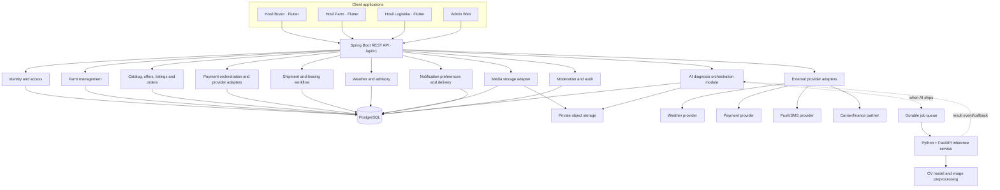
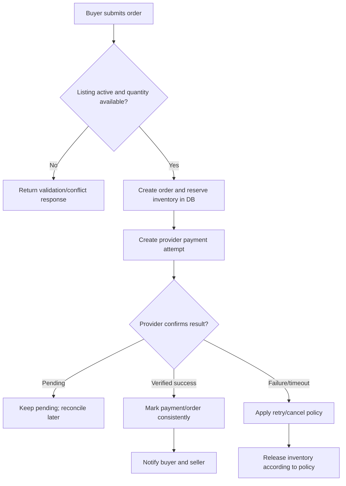

# Hosil Ecosystem — Java Architecture & AI-Assisted Build Plan

**Document:** Architecture Blueprint v0.3  
**Date:** 13 October 2026  
**Status:** Proposed baseline — validate business assumptions before implementation  
**Product:** Hosil Bozor, Hosil Farm, Hosil Logistika + shared platform

---

## 1. Executive recommendation

Build **one agricultural platform with three distinct mobile applications**, an administrative web panel, and one shared backend.

### Recommended starting architecture

- **Backend:** Java 21 + Spring Boot, organized as a modular monolith.
- **Database:** PostgreSQL.
- **Persistence:** Spring Data JPA + Hibernate.
- **Database migrations:** Flyway.
- **API:** REST, JSON, versioned under `/api/v1`.
- **Mobile clients:** Flutter, with shared UI/design-system and API-client packages.
- **Admin panel:** Start with a minimal web interface; select its frontend technology after wireframes. Do not make it a prerequisite for the first API tests.
- **Background work:** Spring-managed scheduled jobs at first; add a durable queue/worker when a workflow needs reliable asynchronous processing.
- **Farm AI:** Python + FastAPI as a separate inference service when crop-image analysis is introduced; Python is not the main business backend.
- **File storage:** S3-compatible private object storage, accessed through a storage adapter.
- **Local environment:** Docker Compose for the app dependencies, initially PostgreSQL and optionally Redis.
- **Testing:** JUnit 5, Spring Boot Test, Testcontainers, API integration tests, and Flutter widget/integration tests.
- **API documentation:** OpenAPI generated from the backend.
- **Build:** Maven Wrapper, so the project controls its Maven version.

Use Spring Boot's current stable release from Spring Initializr and check compatibility for every added library. Current official docs list Spring Boot 4.1.1 as stable and require Java 17 or later; Java 21 is the conservative initial target because it is widely supported by tooling and libraries. Recheck the official requirements when creating the repository: https://docs.spring.io/spring-boot/system-requirements.html

### Why not begin with microservices?

Three mobile apps do not require three backend services. Early microservices add network failures, distributed transactions, service discovery, deployment and monitoring overhead. Begin with modules that have clear boundaries inside one Spring Boot deployment. Split a module into a separate service only after measured scaling, reliability, ownership, or deployment needs justify it. Spring Modulith can help verify and document these boundaries later: https://spring.io/projects/spring-modulith

### What “building with models” means here

AI coding models can generate and modify a large amount of code, but they must work from small, testable specifications. We will not ask a model to “build the whole Hosil platform” in one prompt. We will use models to draft documents, implement one bounded feature at a time, run tests, review diffs, and fix verified failures. Human approval is still needed for product decisions, credentials, legal/provider agreements, and production deployment.

---

## 2. Product boundaries

### 2.1 Hosil Bozor — marketplace

**Customers:** farmers, agricultural suppliers, wholesalers, and buyers.

**MVP capabilities:**
- Browse/search categories and products.
- Supplier profiles and offers for seeds, fertilizer, tools and small equipment.
- Farmer/producer harvest listings for wholesale buyers.
- Listing photos, quantity, unit, quality/grade, region, minimum order and availability.
- Shopping cart or an order flow appropriate to the chosen seller model.
- Create order, view order history and track order status.
- Seller-side listing and order management.
- Payment provider sandbox integration after commercial onboarding is verified.
- Admin moderation of accounts, categories, listings and disputes.

**Defer:** multi-seller checkout complexity, automated seller split settlements, advanced promotions, loyalty programs and recommendations requiring extensive data.

### 2.2 Hosil Farm — daily farm assistant

**Customers:** farmers and authorized farm workers.

**MVP capabilities:**
- Farm profile, region/location and approximate area.
- Fields and crop cycles.
- Planting, watering, fertilizing, treatment and harvest activity logs.
- Harvest batch records.
- Weather forecast and opt-in weather notifications from a selected provider.
- Basic agricultural articles/advisories with source and publication date.
- Link a harvest batch to a Bozor listing only after the user explicitly publishes it.

**Later:** pest/disease photo assessment, personalized crop recommendations, satellite imagery, yield prediction, soil analysis and offline-first synchronization beyond basic cached screens.

**AI principle:** label image-based results as assistance, not a guaranteed diagnosis. Show uncertainty, model/version information when useful, and when to consult a qualified agronomist. Collect local labeled image data and evaluate accuracy before public launch.

### 2.3 Hosil Logistika — transportation and leasing workflow

**Customers:** farmers, produce buyers, transport providers and finance partners.

**MVP capabilities:**
- Create a transport request related to an order or harvest batch.
- Pickup/drop-off location, planned time, crop/cargo details, quantity, vehicle needs and notes.
- Carrier profile and service area.
- Carrier offers/quotes, acceptance and cancellation rules.
- Shipment status timeline: requested → quoted → accepted → pickup/delivery in progress → delivered or cancelled.
- Basic proof-of-delivery upload and notifications.
- Leasing application capture, document upload and status tracking, if a finance partner agrees to the workflow.

**Later:** live GPS/fleet routing, automated carrier dispatch, dynamic pricing, credit scoring, financing decisions or money movement by Hosil itself.

**Finance boundary:** Hosil may collect and forward an application through an authorized partner; partner institutions control eligibility, credit decisions, contracts and disbursement. Do not represent Hosil as a bank or lender unless the relevant legal and regulatory position has been verified.

---

## 3. Platform architecture



This is a **logical architecture**. At the start, the business modules run in one Spring Boot process and use one PostgreSQL database. They are not individual servers. The Python AI service is a planned, separate runtime introduced with the AI feature—not a reason to split the rest of the platform into microservices. Java remains the source of truth for accounts, farm permissions, diagnosis records and public API behavior. Python performs inference only and must not access the platform database directly.

### Core design rules

1. Each module owns its business rules and persistence entities.
2. Modules interact through public service interfaces or defined application events, not by changing another module's tables directly.
3. REST controllers handle HTTP concerns; application services enforce use cases; repositories perform persistence; DTOs define the API contract.
4. Do not expose JPA entities directly as API responses.
5. Use database transactions for single-database business operations. Do not assume one transaction can atomically include a payment provider's remote system.
6. External integrations sit behind interfaces/adapters so a provider can be replaced without rewriting the business module.
7. Record architectural decisions in `docs/decisions/` when a choice has long-term impact.

---

## 4. Java backend technology choices

| Concern | Initial choice | Notes |
|---|---|---|
| Language | Java 21 | Conservative ecosystem compatibility; validate exact runtime when project is generated. |
| Framework | Spring Boot stable release | Generate the starter project with only required dependencies. |
| Build | Maven Wrapper | Reproducible commands across developer/AI environments. |
| Web API | Spring MVC + Bean Validation | REST controllers and validated request DTOs. |
| Persistence | Spring Data JPA + Hibernate | Use JPA for normal transactional business data. Use SQL/projections where query complexity or performance calls for it. |
| Database | PostgreSQL | Foreign keys, unique constraints, transactions, indexes and fixed-precision numeric types. |
| Schema changes | Flyway | Versioned SQL migrations; production schema must not silently change via ORM auto-update. |
| Security | Spring Security | Authentication, route rules and method/resource authorization. |
| Tokens | Select after auth flow is specified | Prefer a proven identity provider where appropriate; otherwise use a well-reviewed implementation. Do not invent cryptography. |
| Validation | Jakarta Bean Validation | Request-level constraints plus domain/database rules. |
| API documentation | OpenAPI / Springdoc compatible with chosen Spring Boot version | Verify compatibility before adding dependency. |
| Testing | JUnit 5, Spring Boot Test, Testcontainers | Test the real PostgreSQL behavior for important persistence flows. |
| Logging/health | Spring Boot Actuator + structured logs | Keep secrets and sensitive personal data out of logs. |
| File storage | S3-compatible object storage adapter | Database stores metadata, not file binaries. Keep private documents private by default. |
| Farm AI, when introduced | Python + FastAPI; model stack selected after data/model evaluation | Isolated image preprocessing and inference service. Pin Python/library versions to the chosen model stack; package as its own container. |
| Cache / job queue | Not required immediately | Introduce Redis or a broker only for a specific use case and documented reason. |

The Spring ecosystem has first-party support for JPA repositories and transaction boundaries. Business use cases that modify multiple records should define their transaction boundary at the service/application layer: https://docs.spring.io/spring-data/jpa/reference/jpa/transactions.html

Spring Security can validate JWT bearer tokens when that is the selected identity design. Token handling, key rotation, issuer and audience checks must be configured for the real deployment rather than copied blindly from a tutorial: https://docs.spring.io/spring-security/reference/servlet/oauth2/resource-server/jwt.html

---

## 5. Authentication, users and permissions

A user can have more than one role. For example, one person may farm, buy produce and also sell equipment. Avoid a `role` column that permits exactly one value.

### Initial concepts

- `users`: stable account identity and account status.
- `user_profiles`: display name and contact/profile information.
- `user_roles`: account-level platform roles, where suitable.
- `farm_memberships`: which users can access which farms and their farm-specific role.
- `refresh_tokens` or external identity-provider records: only if required by the chosen authentication approach.
- `audit_logs`: important administrative and financial actions.

### Access control rules

- A user can read or modify only resources they own or have permission to access.
- Seller actions require permission over the relevant seller profile/listing.
- Farm data requires membership/ownership authorization, not merely a valid ID.
- Admin privileges must be separate, explicit and audited.
- Payment callbacks must be authenticated/verified according to the provider's official protocol.
- Uploaded files must be authorized at download time; knowing a file URL or ID must not make a private file public.
- Enforce authorization on the server for every resource operation; hiding a button in the app is not security.

A major API risk is broken object-level authorization: changing a path or body ID must not allow access to someone else's object. See OWASP API Security guidance: https://api-security.owasp.org/editions/2023/en/0xa1-broken-object-level-authorization/

### Login decision still to make

For Uzbekistan, phone-number login and OTP may be useful, but it depends on the SMS provider, abuse protection, recovery rules and cost. We should compare phone OTP with a suitable identity provider/email/password option before finalizing the PRD. Never hard-code OTPs or store passwords in plaintext.

---

## 6. Data model: first-pass domain map

This is a conceptual model, not final SQL. Exact columns and constraints are finalized during ERD design.

### Identity

- `users`
- `user_profiles`
- `roles` / `user_roles` if platform roles are needed
- `farm_memberships`
- `sessions` or refresh-token records, depending on authentication design

### Farm management

- `farms` — owner/creator, name, region, location, area, status
- `farm_memberships` — user, farm, farm-specific role
- `fields` — farm, area, geometry/location if required, soil notes
- `crop_types` — canonical crop catalog
- `crop_cycles` — field, crop type, planting date, expected/actual harvest dates, status
- `farm_activities` — crop cycle/field, activity type, date, quantity, unit, notes
- `harvest_batches` — crop cycle, available quantity, unit, grade/quality, harvest date, status

### Bozor marketplace

- `categories`
- `catalog_products` — reference product such as fertilizer or seed type
- `seller_profiles`
- `seller_offers` — seller, product, price, currency, unit, available quantity, active period
- `harvest_listings` — seller/farm/harvest batch if applicable, produce type, grade, quantity, unit, price, minimum quantity, region, status
- `listing_media`
- `carts` and `cart_items` if a persistent cart is justified by the UX
- `orders`
- `order_items` — snapshot of product/listing name, quantity, unit price and relevant item details at time of purchase
- `order_status_history`
- `reviews` after a verified transaction, if reviews are in MVP

**Important distinction:** a `catalog_product` describes what an item is; a `seller_offer` is a specific supplier's sale offer; a `harvest_listing` is a specific quantity of produce being offered. These should not be one overloaded table.

### Payments

- `payments` — internal payment attempt and current reconciled status
- `payment_events` — verified provider event/callback identifiers, timestamps and processing result
- `refunds` if refunds are in scope
- `provider_reconciliation_records` if required by the chosen provider

Never use a client redirect alone as proof of payment. Store provider references and make callback handling idempotent. Do not store card secrets or sensitive payment credentials unless a provider-certified flow explicitly requires and authorizes it.

### Logistics and leasing

- `transport_providers`
- `vehicles` if needed for matching requests to vehicle capacity
- `shipment_requests`
- `shipment_quotes`
- `shipments`
- `shipment_status_history`
- `delivery_proofs`
- `leasing_applications`
- `leasing_documents`
- `finance_partner_submissions` or integration references, if agreed with a partner

### Advice and platform

- `weather_snapshots` or cached forecast records as needed
- `advisories` with author/source and published date
- `disease_diagnoses` with image reference, status, model version, result and uncertainty/confidence fields if AI becomes available
- `media_files` with private object key, content type, size, owner and scan/status metadata
- `notifications` and `notification_preferences`
- `audit_logs`
- `idempotency_keys` for sensitive retried commands where needed

### Data rules

- Use UUIDs or another consistent non-guessable public identifier strategy; IDs alone never replace authorization.
- Use `NUMERIC` / Java `BigDecimal` for money, not `float` or `double`.
- Store currency explicitly, do not assume every future transaction is always in one currency.
- Store timestamps consistently (typically UTC in storage) and render local time for the user.
- Record quantity units explicitly; do not treat kilograms, tonnes, bags and pieces as interchangeable.
- Use database foreign keys, unique constraints, and check constraints where appropriate.
- Avoid hard-deleting paid orders, payment records or audit history; use controlled state transitions/retention rules.
- Design soft deletion only where it has a defined business/privacy purpose; do not add it to every table automatically.

---

## 7. API conventions

Base path: `/api/v1/`.

Example initial endpoints (finalize from user journeys and OpenAPI contract):

| Capability | Endpoint idea |
|---|---|
| Current account | `GET /api/v1/me` |
| Farms | `GET/POST /api/v1/farms` |
| Farm fields | `GET/POST /api/v1/farms/{farmId}/fields` |
| Crop cycles | `GET/POST /api/v1/fields/{fieldId}/crop-cycles` |
| Activities | `POST /api/v1/crop-cycles/{cycleId}/activities` |
| Harvest batches | `POST /api/v1/crop-cycles/{cycleId}/harvest-batches` |
| Product catalog | `GET /api/v1/market/catalog` |
| Seller offers | `GET/POST /api/v1/market/offers` |
| Produce listings | `GET/POST /api/v1/market/harvest-listings` |
| Orders | `POST /api/v1/market/orders`, `GET /api/v1/market/orders/{orderId}` |
| Payment status | `GET /api/v1/payments/{paymentId}` |
| Shipment requests | `POST /api/v1/logistics/shipment-requests` |
| Carrier quotes | `POST /api/v1/logistics/shipment-requests/{id}/quotes` |
| Notifications | `GET /api/v1/notifications`, `PATCH /api/v1/notification-preferences` |
| AI analysis, later | `POST /api/v1/farm/disease-diagnoses` (returns `202 Accepted` with a diagnosis/job ID when processing asynchronously) |

### Contract rules

- Validate all request DTOs and return a consistent error format.
- Do not return database entities directly.
- Use pagination for collections and document sort/filter parameters.
- Define stable status enums and allowed state transitions.
- Define idempotency for order creation/payment commands where repeated submissions could duplicate effects.
- Publish the OpenAPI contract and keep example requests/responses in `docs/api/`.
- Use appropriate HTTP status codes and never return stack traces or internal secrets to clients.
- Make authorization rules part of every endpoint's acceptance criteria.

---

## 8. Key workflows and failure handling

### 8.1 Marketplace order/payment



Before implementation, explicitly decide when stock is reserved, reservation expiry, whether payment is required immediately, order cancellation, refund conditions, and what happens if the provider accepts payment but Hosil times out. Keep provider communication separate from the database transaction; reconcile uncertain outcomes rather than assuming failure.

### 8.2 Harvest published to marketplace

1. Farmer creates a harvest batch in Farm.
2. Farmer selects **Publish in Bozor** and supplies price, minimum quantity, unit, grade and availability.
3. Backend verifies farm permission and batch availability.
4. Backend creates a listing linked to the harvest batch and records the relationship.
5. The farmer can pause or close the listing; sales/reservations must not exceed available quantity.
6. Public buyers see only fields intentionally approved for publication.

### 8.3 Shipment

1. User creates a shipment request linked to an order or harvest batch.
2. Backend checks requester access to the referenced resource.
3. Eligible carriers can submit quotes.
4. Requester accepts a quote; backend records selected carrier and price.
5. Shipment moves through allowed statuses, with actor and timestamp history.
6. Delivery proof and final status are recorded; relevant parties are notified.

### 8.4 Crop image assessment (future)

1. Client obtains permission to upload and requests an upload target or uploads through the backend.
2. Image is stored privately; metadata and ownership are recorded.
3. A background job performs validation and sends the image to the AI inference adapter/service.
4. Result is saved with model version, status and calibrated uncertainty if available.
5. App presents cautious guidance and clear limitations.
6. Failed jobs can be retried safely; private images expire/delete according to the data policy.

Do not make the first launch depend on the accuracy of an unvalidated model. Use Python for computer vision because the model-training, image-processing and inference ecosystem is strongest there; keep accounts, farm permissions, workflows and persistent business records in Java.

**Recommended responsibility boundary:**
- **Java/Spring Boot:** authenticate the user, authorize access to the farm, create a `disease_diagnoses` record, validate the image reference, set the job status, expose status/results to the mobile app, and persist the final result.
- **Python/FastAPI:** accept internal inference jobs, retrieve the approved image from private storage, validate/preprocess the image, run the model, and return structured predictions plus model metadata. Treat it as an inference component, not the source of truth for users or business records.
- **Object storage:** hold the original image privately. Avoid passing large image bytes through several services unnecessarily.
- **Queue/worker:** use a durable queue once inference is integrated, so slow model execution does not block the public API and failed jobs can be retried safely. FastAPI itself documents that heavy computation may need a separate task system rather than lightweight in-process background tasks: https://fastapi.tiangolo.com/tutorial/background-tasks/
- **Data boundary:** Python must not query or modify the platform PostgreSQL tables directly. Communicate through a versioned internal API or queue messages. The public mobile apps must never call the Python service directly.
- **Result schema:** diagnosis/job ID, processing status, suggested class/conditions, per-class scores where appropriate, model name/version, timestamps, and a carefully worded uncertainty/limitations field. Do not present raw confidence as a guaranteed probability unless calibrated and evaluated.
- **Security:** internal service authentication, strict upload size/type checks, image decoding safeguards, private URLs with short expiry or equivalent scoped access, request timeouts, rate limits and no credentials in logs.
- **Model lifecycle:** keep model weights out of Git; document dataset provenance/consent, label definitions, train/validation/test splits, crop coverage, per-class performance and release/version rollback procedure.

For an early prototype, we can test model quality locally in Python before deploying a separate service. Add the deployed FastAPI inference service and durable queue only when the feature is ready for end-to-end integration. This preserves a simple backend while making the eventual boundary explicit.
---

## 9. Flutter applications and shared design system

I interpret “use Java” as using Java for the backend. For three apps that may need both Android and iOS, **Flutter is the practical mobile choice** and Java/Spring Boot remains the backend. Native Android Java does not automatically provide an iOS app; that would require another client implementation. If launch is deliberately Android-only, native Android can be reconsidered separately.

### App-specific experiences

- **Bozor navigation:** Home, Search, Categories, Listing details, Cart/Orders, Messages/Notifications, Profile.
- **Farm navigation:** Overview, Farms/Fields, Crop cycles, Activity log, Weather/Advice, Harvest, Profile.
- **Logistika navigation:** Shipments, New request, Quotes, Active delivery, History, Leasing, Profile.

Exact navigation should be settled through user journeys and wireframes, not assumed solely from this list.

### Shared Flutter packages

- `hosil_design_system`: colors, typography, spacing, buttons, form fields and reusable UI components.
- `hosil_api_client`: base URL, token handling, request/response conversion, error mapping and timeouts.
- `hosil_auth`: common authentication/session UX, without sharing mutable screen state across all apps indiscriminately.
- `hosil_shared_models`: only truly shared API concepts; avoid making one massive package that couples every app.

Use feature-oriented organization and a UI/data separation. Flutter's official guidance describes views, view models, repositories and services as useful boundaries: https://docs.flutter.dev/app-architecture/guide

The apps can share colors and components without sharing all navigation or business logic. Each app must have its own package ID, app name, icons, permissions, analytics/crash reporting configuration and release settings.

---

## 10. Repository structure

Start with a monorepo so one set of architecture documents and API changes is easy to coordinate. Keep the backend modules and individual mobile apps distinct within it.

```text
hosil/
├── README.md
├── AGENTS.md                         # Global instructions for coding models
├── docs/
│   ├── 00_product_vision.md
│   ├── 01_prd.md
│   ├── 02_architecture.md
│   ├── 03_domain_model.md
│   ├── 04_api_contract.md
│   ├── 05_security_privacy.md
│   ├── 06_testing_strategy.md
│   ├── api/
│   └── decisions/
├── backend/
│   ├── pom.xml
│   ├── mvnw / mvnw.cmd
│   ├── src/main/java/uz/hosil/platform/
│   │   ├── HosilApplication.java
│   │   ├── shared/                   # common error/clock/config abstractions only
│   │   ├── identity/
│   │   ├── farms/
│   │   ├── marketplace/
│   │   ├── payments/
│   │   ├── logistics/
│   │   ├── advisory/
│   │   ├── media/
│   │   ├── notifications/
│   │   └── admin/
│   ├── src/main/resources/
│   │   ├── application.yml
│   │   └── db/migration/
│   └── src/test/java/uz/hosil/platform/
├── ai-service/                         # add when AI inference work begins
│   ├── pyproject.toml
│   ├── Dockerfile
│   ├── app/
│   │   ├── main.py                    # FastAPI internal inference API
│   │   ├── api/                       # internal request/health schemas
│   │   ├── inference/                 # preprocessing and model adapter
│   │   └── settings.py
│   ├── tests/
│   └── MODEL_CARD.md                  # intended use, limitations, evaluation
├── apps/
│   ├── hosil_bozor/                  # Flutter
│   ├── hosil_farm/                   # Flutter
│   ├── hosil_logistika/              # Flutter
│   └── admin_web/                    # choose after wireframes
├── packages/
│   └── flutter/
│       ├── hosil_design_system/
│       ├── hosil_api_client/
│       └── hosil_shared_models/
├── infra/
│   ├── docker-compose.yml
│   └── deployment/                   # later
└── .github/workflows/                # CI later
```

Each module should usually have its own internal packages, such as `api`, `application`, `domain`, and `persistence` (or a simpler package layout where complexity is low). Avoid creating empty layers or interfaces for every class merely to look “enterprise.” The rules should make boundaries clear without burying simple features in boilerplate.

---

## 11. Non-functional requirements

These must become testable acceptance criteria before pilot launch.

### Security and privacy
- All non-local environments use HTTPS.
- Secrets live in environment/secret-management configuration, never committed to Git.
- Per-resource authorization tests cover other-user IDs and farm-membership boundaries.
- Rate-limit OTP/auth endpoints and sensitive public endpoints.
- Restrict upload size/type and consider malware scanning for documents.
- Keep private images, identity documents and leasing records inaccessible without authorization.
- Redact tokens, passwords, OTPs and sensitive personal data from logs.
- Define account deletion, document retention and data export/retention policies with local legal review.

### Reliability and data integrity
- Database migrations are committed and tested from a clean database.
- Critical workflows use transactions and constraints.
- Order, payment and shipment status changes are auditable.
- Provider callback and retry handling is idempotent.
- Backups and a restore test are required before production use.
- Health endpoints, error monitoring and actionable logs exist before external pilot.

### Performance and accessibility
- Paginate search and list endpoints.
- Add indexes based on actual query patterns and `EXPLAIN ANALYZE`, not guesses alone.
- Compress/resize mobile image uploads appropriately and avoid loading full images in result lists.
- Support localization from the start (provisionally Uzbek and Russian; confirm script and copy requirements).
- Consider low bandwidth and intermittent connectivity in rural areas.

---

## 12. Before coding: required deliverables

Do not begin full implementation until the first seven items are reasonably settled. We can still scaffold a repository while documenting, but production domain tables should wait for the domain model.

1. **Product vision and MVP boundary** — who the first users are, region, main pain points, must-have and out-of-scope features.
2. **PRD for each app + shared platform** — requirements, priorities, success measures and acceptance criteria.
3. **Role/permission matrix** — every role and action, including admin and farm membership.
4. **User journeys and workflow state diagrams** — especially order/payment, publishing a harvest and shipment acceptance.
5. **ERD/domain model** — entities, relationships, constraints, ownership and lifecycle rules.
6. **API contract** — endpoint list, DTO shapes, status codes, errors, paging and idempotency behavior.
7. **Wireframes/design system** — key screens, navigation and common components.
8. **Integration feasibility checklist** — SMS/OTP, payment merchant onboarding, weather, maps/geocoding, push and finance partner.
9. **Security/privacy threat review** — data classes, access boundaries, uploads, audit requirements and retention.
10. **Test plan and definition of done** — which unit, integration, API, security and end-to-end tests must pass.
11. **Deployment plan** — environments, secrets, database hosting, storage, backups, monitoring and rollback.
12. **Architecture decisions** — record why Java/Spring, Flutter, database, auth method and provider interfaces were selected.

### Decisions to verify, not silently assume

- First launch location and pilot region.
- Languages and required scripts.
- Whether Bozor supports retail, wholesale, or both in the first release.
- Who receives money: seller directly, marketplace-mediated flow or another approved arrangement.
- Inventory reservation, cancellation, refund and delivery responsibility.
- Phone OTP vs another authentication flow.
- Payment provider onboarding and marketplace settlement support.
- Carrier vetting and whether carriers need their own app or can use a web interface initially.
- Which finance partner, if any, agrees to accept leasing applications.
- Which weather data provider and geography/resolution are adequate.
- Admin panel scope and who will moderate disputes/listings.

---

## 13. Development phases and exit criteria

### Phase 0 — Product and architecture
**Outputs:** PRD, role matrix, user journeys, ERD, API contract, initial wireframes, integration checklist, security notes and AI coding instructions.

**Exit criteria:** The first user journey can be described from screen action through API, business rule, database change and outcome. Open questions are recorded rather than guessed.

### Phase 1 — Engineering foundation
- Generate Spring Boot project with only agreed dependencies.
- Configure Maven Wrapper, Java version, formatting and test commands.
- Add local PostgreSQL via Docker Compose.
- Configure Flyway and prove a clean database can be created from migrations.
- Add common error response, validation, health endpoint and OpenAPI.
- Set a CI check for build, unit tests and integration tests.

**Exit criteria:** One small health/profile endpoint works locally; clean build and tests pass; secrets are not committed; the project setup is documented.

### Phase 2 — Identity and access
- Implement agreed login/session flow.
- Build account profile and role/farm-membership authorization.
- Add tests proving one user cannot access another user's resources.

**Exit criteria:** Authentication and authorization are tested, not just successful login.

### Phase 3 — Farm core
- Farms, memberships, fields, crop cycles, activities and harvest batches.
- Ownership, units, timestamps, status transitions and migrations.

**Exit criteria:** Farmer can complete the core data-entry flow via API and mobile shell; database integrity tests pass.

### Phase 4 — Bozor listings and order lifecycle
- Catalog, seller profile, seller offer, harvest listing, search/pagination.
- Order creation, inventory policy and order status history.
- Payment provider sandbox adapter only after the provider workflow is confirmed.

**Exit criteria:** Automated end-to-end tests cover happy paths, race/duplicate requests, insufficient stock, failed/pending payment and cancellation.

### Phase 5 — Logistika
- Shipment requests, quotes, quote acceptance, status history and delivery proof.
- Connect shipment requests to authorized orders/harvest batches.
- Leasing application capture only to the depth agreed with a partner.

**Exit criteria:** Unauthorized linking is rejected; status transitions are validated and audited.

### Phase 6 — Farm advisory and platform operations
- Weather provider adapter, scheduled refresh, notification preferences, push/SMS provider adapter.
- Admin moderation, audit views, basic metrics and support workflows.

**Exit criteria:** Provider failures do not crash core order/farm flows; retries and user-visible failures are handled.

### Phase 7 — Mobile UI and pilot hardening
Mobile scaffolds can begin earlier, but before pilot all critical workflows need finished screens, loading/error/empty/offline states, accessibility/language review and device tests.

**Exit criteria:** A small group can complete agreed journeys on test devices; monitoring, backups, restore checks and support procedures work.

### Phase 8 — Python AI crop diagnosis
- First prototype and evaluate image classification/diagnosis in Python independently of the production API.
- Document the dataset's provenance and use rights, crop/disease labels, regional coverage, leakage-safe train/validation/test splits and an evaluation protocol.
- Add the Python FastAPI inference service in its own container; do not add its tables to, or direct database access against, the Java platform database.
- Define a versioned internal request/result contract between Java and Python.
- Add a durable queue and asynchronous status lifecycle (`queued` → `processing` → `completed` / `failed`) before relying on production inference.
- Persist diagnosis/job records and final user-visible results through the Java backend.
- Add retry/idempotency behavior, monitoring, model versioning, rollback and deletion/retention rules for private images.

**Exit criteria:** Defined evaluation metrics and minimum thresholds are met for the intended use cases; the end-to-end job lifecycle is tested; unsafe overconfident results are handled appropriately; and provider/model failures do not affect ordinary farm or marketplace operations.

---

## 14. How to build with AI coding models safely

AI models should be treated as coding assistants working inside a controlled engineering process, not as an unlimited autonomous team.

### The working loop for every task

1. **Specify:** give the model the exact task, relevant docs and files, constraints and acceptance criteria.
2. **Plan:** ask it to identify files to change, design assumptions and tests before editing.
3. **Implement one vertical slice:** limit scope to one issue/feature. No unrelated cleanup or architecture rewrite.
4. **Test:** require it to run the documented build/test commands and provide the real output. If it cannot run tests, it must say so explicitly.
5. **Review:** use a second review pass/model to inspect the diff for business logic, security, data integrity, API compatibility and unnecessary complexity.
6. **Verify:** you (or the coding environment) inspect the actual diff, run tests, and check the app/endpoint.
7. **Checkpoint:** commit a working slice to Git before the next task.

### Model roles

- **Planning model:** helps prepare PRDs, user journeys, ERD and API contract; it should not silently implement its own assumptions.
- **Implementation model:** edits the repository for one approved task and runs tests.
- **Review model:** independently reviews the diff against architecture and acceptance criteria; it should not rewrite the whole feature by default.
- **Debugging model:** receives the real failure, command and relevant logs, then proposes the smallest fix.

One model can do more than one role, but separating implementation and review often exposes mistakes that the first pass missed.

### Global instructions for `AGENTS.md`

Create a repository guidance file stating that models must:

- Read the relevant docs and inspect existing code before making changes.
- Preserve existing decisions unless an architecture change is requested and documented.
- Follow module boundaries and never access another module's persistence layer directly.
- Use DTOs for API input/output and validate all untrusted input.
- Add or update tests for each behavior change.
- Use Flyway migrations for schema changes; never rely on production `ddl-auto=update`.
- Never invent successful test results, credentials, external API responses or completed deployments.
- Never commit `.env`, tokens, keys, real customer information or private documents.
- Avoid unrelated refactors, dead code, duplicate abstractions and dependencies not justified by the task.
- Summarize files changed, tests run, results, limitations and decisions at the end.

### Task prompt template

Use a bounded prompt like this for each implementation step:

> Read `AGENTS.md` and the linked architecture/API documents before editing. Implement only: **[one defined feature]**. Business rules: **[numbered rules]**. API contract: **[request/response and status codes]**. Authorization: **[who may do what]**. Database/migration impact: **[expected tables/constraints]**. Acceptance criteria: **[observable results]**. Add tests covering normal behavior, validation failures, authorization failures and relevant edge cases. Do not change unrelated modules or silently change the architecture. First state the implementation plan and files you expect to touch; then implement. Run the documented tests and report the exact commands and actual results. If a requirement is unclear, record the ambiguity rather than inventing a business rule.

### Independent review prompt

> Review this diff against the relevant Hosil architecture documents and acceptance criteria. Do not implement a rewrite. Identify concrete defects only, prioritizing: authorization/data leakage, payment/order integrity, race conditions, migration safety, input validation, broken API contract, missing tests and unnecessary complexity. For each finding, cite the file and behavior, explain a reproducible failure scenario, and propose the smallest fix. Distinguish confirmed bugs from questions or style preferences.

### Git and review rules

- Keep `main` buildable.
- Create small branches/commits per feature.
- Never let a model overwrite work it has not inspected.
- Review generated migrations and dependency changes carefully.
- Do not paste production secrets into prompts.
- Save test output or CI links for important milestones.
- A passing compilation is not the same as a correct feature.
- No direct production database edits for routine schema changes; create a migration.

---

## 15. Testing strategy and Definition of Done

Each feature is done only when the applicable checks pass.

### Backend
- **Unit tests:** domain rules and calculations.
- **Repository/integration tests:** real PostgreSQL behavior through Testcontainers for constraints, queries and transaction outcomes.
- **API tests:** DTO validation, status codes, error response schema, pagination and serialization.
- **Authorization tests:** owner/member/admin versus unrelated user.
- **Workflow tests:** payment callback duplicates, insufficient stock, cancellation, shipment transitions, retries.
- **Migration tests:** fresh database and upgrade from previous schema.
- **Contract tests:** published OpenAPI matches actual endpoints, where tooling supports it.

### Mobile
- Widget tests for loading/error/empty/success states.
- Repository/API-client tests for timeout, expired session and server errors.
- Integration tests for critical flows on target devices/emulators.
- Localization checks and realistic low-bandwidth behavior.

### Minimum Definition of Done
- Requirements and acceptance criteria are met.
- Code remains within approved module boundaries.
- Input validation and per-resource authorization are covered.
- Tests are added/updated and run successfully, or the exact blocker is reported.
- Migration and API docs are updated when relevant.
- No secrets or sensitive data appear in the diff/logs.
- No unrelated changes are included.
- Changes are reviewable and summarized.

---

## 16. What not to build at the beginning

Do not start with:

- Ten separate microservices.
- Kafka/event streaming without a clear event-volume or decoupling need.
- Kubernetes before a simple deployment path is working.
- A custom payment processor or stored-card system.
- Home-grown encryption, authentication protocols or token algorithms.
- AI diagnosis marketed as medically/agronomically certain without evaluation.
- Real-time GPS fleet optimization before basic shipment workflows work.
- Sophisticated recommendations before data quality and user needs are understood.
- One giant prompt that generates the full app without tests or review.
- Three completely independent codebases that duplicate auth, networking and design components unnecessarily.

---

## 17. Immediate next step

Start with **Phase 0 — Product Requirements**, not Java code.

Create `docs/01_prd.md` with these sections:

1. Product vision and launch region.
2. User personas and jobs-to-be-done.
3. MVP scope per app.
4. Role and permission matrix.
5. User journeys for the top five scenarios.
6. Functional requirements with priorities.
7. Non-functional/security requirements.
8. Integrations and external dependencies.
9. Acceptance criteria and success measures.
10. Explicit open questions and assumptions.

Then derive the domain model/ERD, API contract and wireframes from that PRD. Only after those are coherent should a coding model scaffold Spring Boot and the Flutter apps.

### Proposed source links

- Spring Boot system requirements: https://docs.spring.io/spring-boot/system-requirements.html
- Spring Modulith: https://spring.io/projects/spring-modulith
- Spring Data JPA transactions: https://docs.spring.io/spring-data/jpa/reference/jpa/transactions.html
- Spring Security JWT resource server: https://docs.spring.io/spring-security/reference/servlet/oauth2/resource-server/jwt.html
- Flutter app architecture guide: https://docs.flutter.dev/app-architecture/guide
- OWASP API Security — Broken Object Level Authorization: https://api-security.owasp.org/editions/2023/en/0xa1-broken-object-level-authorization/

---

**Status:** Recommended baseline, not yet a final specification. Any undecided business choice must be recorded as an open question and resolved before the affected code is implemented.
