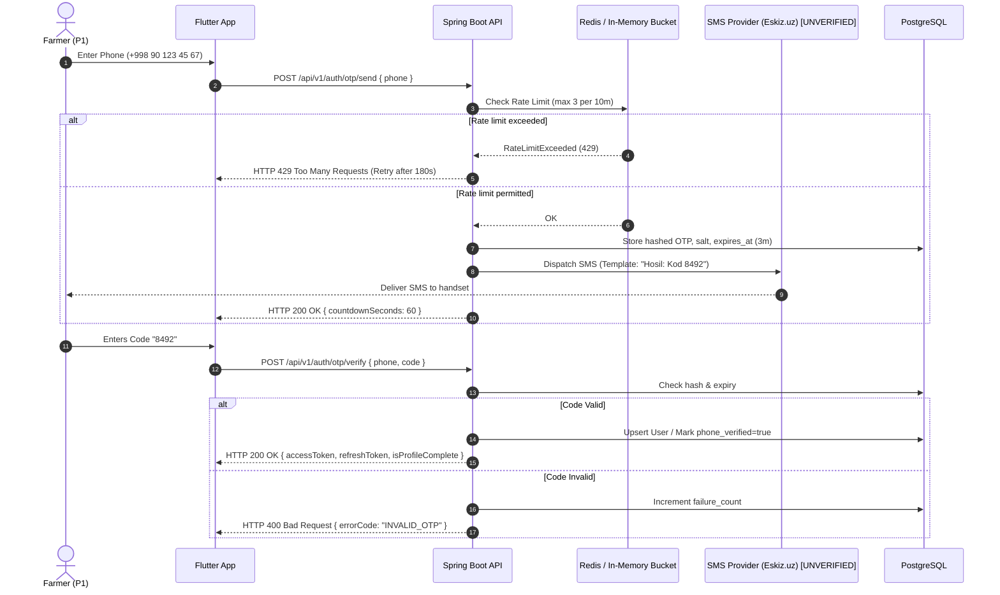
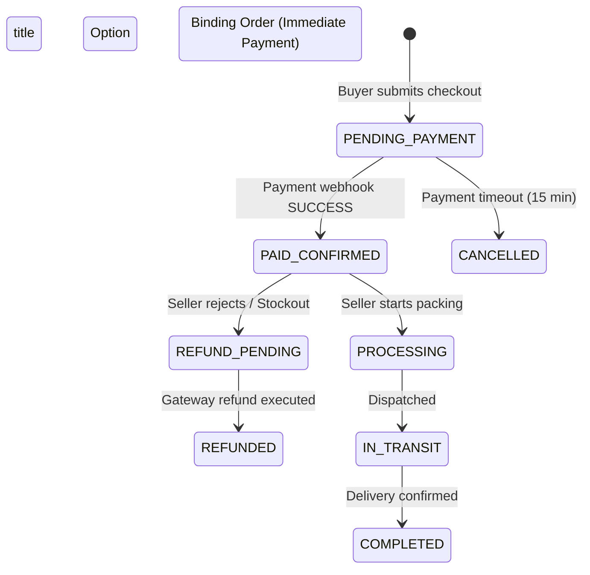
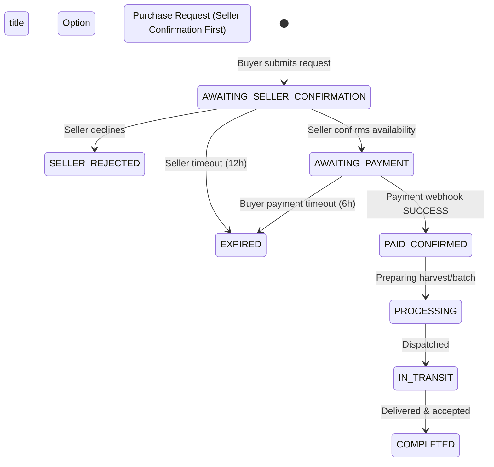

# Hosil Ecosystem — Master Decision Register

**Document ID:** HOSIL-DEC-REG-001  
**Version:** 0.1  
**Date:** 13 October 2026  
**Status:** Draft — recommendations are not confirmed decisions  
**Cross-References:** [01_prd.md](file:///c:/Users/Oliya/Desktop/Hosil/docs/01_prd.md) (Product Requirements Document), [02_architecture.md](file:///c:/Users/Oliya/Desktop/Hosil/docs/02_architecture.md) (Architecture Blueprint), [11_hosting.md](file:///c:/Users/Oliya/Desktop/Hosil/docs/11_hosting.md) (Hosting Evaluation), [10_admin_and_api_versioning.md](file:///c:/Users/Oliya/Desktop/Hosil/docs/10_admin_and_api_versioning.md) (Admin & API Versioning), [decisions/ADR-001_modular_monolith.md](file:///c:/Users/Oliya/Desktop/Hosil/docs/decisions/ADR-001_modular_monolith.md), [decisions/ADR-002_admin_panel_thymeleaf.md](file:///c:/Users/Oliya/Desktop/Hosil/docs/decisions/ADR-002_admin_panel_thymeleaf.md)

---

## 1. Overview and Governance

This document serves as the single source of truth for architectural, operational, regulatory, and product decisions governing the Hosil platform. Each entry captures the contextual problem statement, evaluated options, trade-offs, blocking dependencies, and current lifecycle status.

### 1.1 Decision Status Taxonomy
- **`unresolved`**: Pending decision; trade-offs identified, formal stakeholder resolution missing. Marked with **`[DECISION REQUIRED]`**.
- **`proposed`**: Working recommendation documented with architectural rationale, awaiting final formal sign-off. Marked as **`Recommendation, not confirmed`**.
- **`confirmed`**: Explicitly approved by the designated responsible party (Product Owner or Engineering Lead) and binding for implementation.

### 1.2 Master Summary Matrix

| ID | Title / Domain | Status | Recommendation | Blocks | Responsible |
|---|---|---|---|---|---|
| [DEC-001](#dec-001-pilot-geography) | Pilot geography | Proposed | Tashkent region (Recommendation, not confirmed) | PRD finalization, Hosting decision | Product owner |
| [DEC-002](#dec-002-launch-languages) | Launch languages | Proposed | Uzbek Latin + Russian (Recommendation, not confirmed) | PRD finalization, UI implementation | Product owner |
| [DEC-003](#dec-003-authentication-method) | Authentication method | Confirmed | Phone OTP primary; shared identity across 3 apps; inactive session re-auth [Parameters pending] | Initial ERD, First implementation slice | Product owner & Engineering lead |
| [DEC-004](#dec-004-seller-eligibility) | Seller eligibility | Confirmed | Open for harvest listings; verified for commercial suppliers; auditable status | Initial ERD, First implementation slice | Product owner |
| [DEC-005](#dec-005-retail-vs-wholesale-in-mvp-bozor) | Retail vs wholesale in MVP Bozor | Confirmed | Retail for inputs; wholesale for harvests; MOQ and step increments | PRD finalization, Initial ERD | Product owner |
| [DEC-006](#dec-006-purchase-request-vs-binding-order) | Purchase request vs binding order | Confirmed | Retail inputs: direct order + reservation; Wholesale harvest: purchase request → seller confirmation → payment | Initial ERD, First implementation slice, Payment integration | Product owner |
| [DEC-007](#dec-007-payment-recipient-and-settlement) | Payment recipient & settlement | Unresolved | None — pending legal counsel; provider-neutral core [UNVERIFIED] [DECISION REQUIRED] | Real-money launch, Payment provider selection | Product owner |
| [DEC-008](#dec-008-stock-and-harvest-allocation-model) | Stock & harvest allocation model | Confirmed | 1 batch may supply multiple listings via explicit allocation ledger; 1:1 listing-to-batch link; no overselling | Initial ERD, Inventory logic | Engineering lead & Product owner |
| [DEC-009](#dec-009-units-of-measurement) | Units of measurement | Confirmed | Admin-managed category-scoped unit catalog; fixed-precision; explicit conversions only | Initial ERD, Marketplace search/filter | Engineering lead |
| [DEC-010](#dec-010-cancellation-and-refund-policy) | Cancellation & refund policy | Proposed | Buyer cancels pre-confirm, seller pre-dispatch (Recommendation, not confirmed) | First implementation slice, Real-money launch | Product owner |
| [DEC-011](#dec-011-carrier-onboarding) | Carrier onboarding | Proposed | Invitation-only during pilot (Recommendation, not confirmed) | Logistika implementation | Product owner |
| [DEC-012](#dec-012-delivery-responsibility) | Delivery responsibility | Proposed | Configurable per listing (Recommendation, not confirmed) | PRD finalization, Order/shipment logic | Product owner |
| [DEC-013](#dec-013-finance-partner-for-leasing) | Finance partner for leasing | Unresolved | Build UI skeleton, disable submission [UNVERIFIED] (Recommendation, not confirmed) | Logistika leasing feature (P1) | Product owner |
| [DEC-014](#dec-014-weather-provider) | Weather provider | Proposed | Open-Meteo for MVP [UNVERIFIED coverage] (Recommendation, not confirmed) | Farm weather feature implementation | Engineering lead |
| [DEC-015](#dec-015-hosting-provider) | Hosting provider | Proposed | Hetzner Cloud VPS + Cloudflare [UNVERIFIED] (Recommendation, not confirmed) | First implementation slice | Engineering lead |
| [DEC-016](#dec-016-admin-panel-sessions) | Admin panel sessions | Proposed | Server-side sessions (Spring Security) (Recommendation, not confirmed) | Phase 2 (Identity & Access) | Engineering lead |
| [DEC-017](#dec-017-data-residency) | Data residency | Unresolved | None — requires legal review of ZRU-547 [UNVERIFIED] [DECISION REQUIRED] | Hosting decision (DEC-015) | Product owner |
| [DEC-018](#dec-018-two-sided-reputation-and-transaction-reviews) | Two-sided reputation and transaction reviews | Proposed | Two-sided review; double-blind window; equal weighting; decoupled person vs product (Recommendation, not confirmed) | PRD finalization, Initial ERD (`reviews`), Bozor completion | Product owner & Engineering lead |

---

## 2. Decision Register Entries

### DEC-001: Pilot geography

- **Question:** Which province/district for the first pilot deployment?
- **Available Options:**
  - **Option 1: Tashkent region (Toshkent viloyati / suburban districts like Yangiyoʻl, Zangiota, Parkent, Kibray).** Urban adjacent, high cellular network penetration (4G/LTE), proximity to engineering and operational staff.
  - **Option 2: Fergana Valley (Fergana, Andijan, Namangan viloyatlari).** Major agricultural hub with the highest smallholder farm density and intensive fruit/vegetable horticulture.
  - **Option 3: Samarkand / Bukhara.** Central agricultural trading corridors with large greenhouse clusters and historical produce aggregation hubs.
  - **Option 4: Kashkadarya / Surkhandarya.** Southern agrarian zone; harsh rural topography, sporadic cellular coverage; rigorously stress-tests offline-first synchronization.
- **Recommended Default and Rationale:**
  - **Tashkent region for first pilot** (`Recommendation, not confirmed`).
  - *Rationale:* Easiest physical logistics for founding team field visits, highest baseline network connectivity for debugging telemetry, direct access to wholesale markets (Qoʻyliq) for price validation, and minimal travel friction for physical onboarding.
- **Consequences of Each Option:**
  - *Option 1 (Tashkent region):*
    - *Positive:* Low operational overhead; rapid bug reproduction with physical users; reliable network reduces false-positive connectivity failures.
    - *Negative:* Higher land/labor costs; may not fully reflect extreme rural connectivity bottlenecks experienced by remote dehqon farmers.
  - *Option 2 (Fergana Valley):*
    - *Positive:* Authentic test of high-density smallholder transactions and local produce liquidity.
    - *Negative:* High field travel costs; remote support logistics during early unstable software releases.
  - *Option 3 (Samarkand/Bukhara):*
    - *Positive:* Strong commercial agro-dealer network for Bozor inputs.
    - *Negative:* Dispersed agricultural geography increases field team coordination complexity.
  - *Option 4 (Kashkadarya/Surkhandarya):*
    - *Positive:* Ideal stress-test for [07_offline_strategy.md](file:///c:/Users/Oliya/Desktop/Hosil/docs/07_offline_strategy.md).
    - *Negative:* High pilot failure risk if network interruptions prevent early onboarding and error telemetry delivery.
- **Blocks:** PRD finalization ([01_prd.md §2.1](file:///c:/Users/Oliya/Desktop/Hosil/docs/01_prd.md#L45-L55)), Hosting latency targets ([11_hosting.md §1.2](file:///c:/Users/Oliya/Desktop/Hosil/docs/11_hosting.md#L20-L33)).
- **Responsible:** Product owner.
- **Status:** Proposed (`Recommendation, not confirmed`).
- **Cross-References:** PRD: `PRD-001`, `FARM-001`, `FARM-004`; Architecture: §2, §11, §13 (Phase 0).

---

### DEC-002: Launch languages

- **Question:** Which languages and scripts must be supported at launch?
- **Available Options:**
  - **Option A: Uzbek Latin (`uz-Latn`) + Russian (`ru`).**
  - **Option B: Uzbek Latin (`uz-Latn`) only.**
  - **Option C: Uzbek Latin (`uz-Latn`) + Russian (`ru`) + Uzbek Cyrillic (`uz-Cyrl`).**
- **Recommended Default and Rationale:**
  - **Option A: Uzbek Latin + Russian** (`Recommendation, not confirmed`).
  - *Rationale:* Captures the overwhelming majority of demographic personas: younger farmers and rural operators use Uzbek Latin; older commercial aggregators, wholesale traders, input suppliers, and logistics dispatchers frequently conduct trade in Russian. Omits Uzbek Cyrillic initially to prevent 3x translation overhead.
- **Consequences of Each Option:**
  - *Option A (Uzbek Latin + Russian):*
    - *Positive:* Broad market adoption; manageable i18n bundle maintenance across 3 mobile apps and admin panel.
    - *Negative:* Older rural farmers accustomed exclusively to Cyrillic text may experience initial reading friction.
  - *Option B (Uzbek Latin only):*
    - *Positive:* Halves string localization maintenance and backend notification templates.
    - *Negative:* Causes severe churn among commercial B2B input distributors, seed companies, and institutional buyers in Tashkent/Samarkand who operate in Russian.
  - *Option C (Uzbek Latin + Russian + Uzbek Cyrillic):*
    - *Positive:* 100% linguistic coverage across all generations and demographics.
    - *Negative:* Massive operational burden: triples catalog taxonomy translation, system advisories, push templates, and search index tokenization (requires dual-script fuzzy normalization).
- **Blocks:** PRD finalization ([01_prd.md §1.1](file:///c:/Users/Oliya/Desktop/Hosil/docs/01_prd.md#L30-L42)), UI implementation (Flutter localization strings, backend error messages).
- **Responsible:** Product owner.
- **Status:** Proposed (`Recommendation, not confirmed`).
- **Cross-References:** PRD: `ID-005`, `PLAT-004`; Architecture: §7, §9, §11.4.

---

### DEC-003: Authentication method

- **Question:** How do users authenticate across mobile applications and identity services?
- **Available Options:**
  - **Option A: Phone number + SMS OTP primary.** User enters mobile MSISDN (`+998XXXXXXXXX`), receives a 4- or 6-digit OTP via SMS, backend validates and issues JWT pair.
  - **Option B: Email + password.** Classic e-commerce authentication model with email confirmation links.
  - **Option C: Phone OTP primary + optional recovery email.** Phone OTP for primary login, with optional secondary email for account recovery and transactional invoices.
  - **Option D: External Identity Provider / OAuth2 / OIDC (e.g., Keycloak, Logto, OneID.uz).** Centralized identity federation server.
- **Status:** Confirmed (`Core direction approved by stakeholder; implementation parameters pending`).
- **Confirmed Direction & Behavior:**
  - **Primary Identity:** Users verify their Uzbekistan phone number (`+998XXXXXXXXX`) during initial registration via SMS OTP.
  - **Shared Ecosystem Identity:** The identical Hosil ID credential is shared seamlessly across Hosil Bozor, Hosil Farm, and Hosil Logistika without separate user accounts (`ID-001`).
  - **Session Persistence:** An active mobile session must **not** require OTP re-authentication on every app opening.
  - **Inactivity Re-Authentication:** If the authenticated device's session expires after a period of inactivity, the user must re-authenticate using phone OTP.
- **Still to Determine (Unresolved Implementation Parameters):**
  - *Inactivity / Session Expiry Duration:* Exact timeout threshold (e.g., 30 days vs 60 days vs 90 days of inactivity) [PENDING CONFIRMATION].
  - *SMS Provider & Commercial Terms:* Provider contract (Eskiz.uz vs PlayMobile vs SMS Traffic) and contractual cost per message [UNVERIFIED].
  - *OTP Lifespan & Rate Limits:* Exact OTP expiration window (e.g., 180 seconds), retry limit (e.g., max 3 per 10 min), and IP-level throttling [PENDING CONFIRMATION].
  - *Token Lifecycle Details:* Refresh token rotation mechanics, server-side blocklisting, and multi-device revocation rules.
- **Consequences of Confirmed Choice:**
  - *Positive:* Native alignment with Uzbekistan digital consumer expectations; minimal friction for rural farmers; validated phone number immediately available for delivery logistics.
  - *Negative:* Variable per-user SMS operational cost; requires carrier rate-limit defenses and automated token refresh worker.
- **Sequence Diagram (Confirmed Phone OTP Workflow):**



- **Blocks:** Initial ERD (`users` table primary key & identity columns: `phone_number` vs `email`), First implementation slice (Auth module & JWT security filter).
- **Responsible:** Product owner (SMS commercial costs & user onboarding) & Engineering lead (rate limiting, cryptographic token flow).
- **Status:** Confirmed (`Core direction approved by stakeholder; implementation parameters pending`).
- **Implementation Note (Milestone 6C.5 — Local / Development Mode Telegram Bot OTP Delivery):**
  - *Context:* During local development and pre-commercial pilot stages, sending real SMS messages incurs per-message costs and requires registered telecom alphanumeric sender IDs (`SMS-PROV`).
  - *Adapter Solution:* Introduced `TelegramOtpDeliveryAdapter` implementing `OtpDeliveryPort` alongside `TelegramLinkService` and `TelegramPollingService`.
  - *Delivery Mechanism:* The user performs a one-time link of their phone number with the official Telegram bot (`@hosil_authentication_bot`) via deep link `https://t.me/<bot_username>?start=<token>`. The linking session uses a single-use SHA-256 hashed token with 10-minute TTL. Contact card sharing verifies `from.id == contact.user_id` and normalizes the MSISDN (`+998XXXXXXXXX`).
  - *Production Compatibility:* The abstraction guarantees zero behavioral divergence between SMS and Telegram OTP delivery from the perspective of core identity logic, session tokens, user journeys, and Flutter client libraries. When transitioning to production, the `OtpDeliveryPort` bean is simply bound to the commercial SMS provider adapter (`Eskiz` or `PlayMobile`) with zero mobile app changes.
- **Cross-References:** PRD: `ID-001`, `ID-002`, `ID-003`, `ID-004`, `ACL-001`, §15; Architecture: §5, §6 (Identity), §13 (Phase 2).

---

### DEC-004: Seller eligibility

- **Question:** Can any registered user post listings on Bozor, or must sellers undergo formal identity verification first?
- **Status:** Confirmed (`Approved by stakeholder`).
- **Confirmed Direction & Behavior:**
  - **Tiered Eligibility Policy:**
    - **Farm Harvest Listings (`HARVEST`):** Registered, eligible farmers may publish direct produce/harvest listings under approved rules with post-moderation.
    - **Commercial Agricultural Inputs (`INPUTS`):** Commercial suppliers of fertilizers, pesticides, seeds, tools, and machinery require formal verification before selling.
  - **Verification Lifecycle & Auditability:** The platform must support an explicit `verification_status` (`UNVERIFIED`, `PENDING_REVIEW`, `VERIFIED`, `REJECTED`, `SUSPENDED`) on `seller_profiles`, recording business registration details (STIR/TIN, entity type) with an immutable audit log of all administrative verification decisions (`ADM-002`, `ADM-005`).
- **Available Options:**
  - **Option A: Open registration with post-moderation.**
  - **Option B: Mandatory pre-verification for all sellers.**
  - **Option C: Tiered eligibility: Open for harvest listings, verified for commercial suppliers.** (Confirmed)
- **Consequences of Confirmed Choice:**
  - *Positive:* Balanced risk profile; low barrier for agricultural produce liquidity; strict compliance for regulated chemicals.
  - *Negative:* Requires conditional validation logic in listing submission endpoints based on product category.
- **Blocks:** Initial ERD (`seller_profiles` table, `verification_status` enum, listing creation database constraints), First implementation slice (Listing API).
- **Responsible:** Product owner.
- **Cross-References:** PRD: `ACL-001`, `ACL-002`, `MKT-001`, `MKT-002`, `ADM-002`, `ADM-003`; Architecture: §5, §6 (Bozor marketplace), §13 (Phase 4).

---

### DEC-005: Retail vs wholesale in MVP Bozor

- **Question:** Does Hosil Bozor support retail purchases, bulk wholesale orders, or a hybrid model during MVP?
- **Status:** Confirmed (`Approved by stakeholder`).
- **Confirmed Direction & Behavior:**
  - **Segmented Model:**
    - **Agricultural Inputs:** Support retail purchasing (single units, bags, small canisters) suited for individual smallholders and dehqon farms.
    - **Harvest Listings:** Wholesale-oriented transactions (commercial bulk produce, minimum order quantities).
  - **Listing Constraints:** Listings must define applicable measurement units, minimum order quantities (`min_order_quantity`), and permitted quantity increments (`increment_step`). Orders are validated against these rules on the backend.
- **Available Options:**
  - **Option A: Both retail and wholesale across all product categories.**
  - **Option B: Strict wholesale only.**
  - **Option C: Segmented model: Retail for input supplies + Wholesale for harvest produce.** (Confirmed)
- **Consequences of Confirmed Choice:**
  - *Positive:* Aligns directly with persona economics (P1 buys retail inputs, sells wholesale harvest; P2 sells retail inputs; P3 buys wholesale harvest); avoids smallholder delivery friction for single kg produce.
  - *Negative:* Requires category-specific validation schemas for `min_order_quantity` and `increment_step`.
- **Blocks:** PRD finalization ([01_prd.md §6.1](01_prd.md#L205-L225)), Initial ERD (`listings` table constraints, `orders` minimum quantity checks).
- **Responsible:** Product owner.
- **Cross-References:** PRD: `MKT-001`, `MKT-003`, `MKT-005`, `MKT-008`; Architecture: §2.1, §6 (Bozor marketplace), §8.1.

---

### DEC-006: Purchase request vs binding order

- **Question:** Is an order immediately binding with immediate payment upon checkout, or does it initiate as a purchase request requiring explicit seller confirmation before payment?
- **Status:** Confirmed (`Approved by stakeholder`).
- **Confirmed Direction & Behavior:**
  - **Segmented Order Flows:**
    - **Standardized Agricultural Inputs:** Uses an order flow with appropriate inventory reservation upon checkout, proceeding to payment.
    - **Wholesale Harvests:** Uses a two-step purchase request flow: Buyer submits request $\to$ Seller confirms availability and feasibility $\to$ Buyer completes payment.
  - **State Decoupling:** Order state (`orders.status`) and payment state (`payments.status`) remain strictly decoupled state machines (`PAY-002`).
  - **Operational Invariants:** Stock reservation, reservation expiration timers (`confirmation_timeout_at`, `payment_timeout_at`), cancellation workflows, and payment reconciliation rules must be fully documented and enforced.
- **Available Options:**
  - **Option A: Binding order with immediate payment (Direct Checkout).**
  - **Option B: Purchase request → seller confirmation → buyer payment (Two-Step Confirmation).**
  - **Option C: Split model based on category.** (Confirmed direction)
- **Consequences of Confirmed Choice:**
  - *Positive:* Prevents taking payments for non-existent or damaged crops; gives rural harvest sellers operational breathing room; retains fast e-commerce UX for packaged inputs.
  - *Negative:* Requires dual order state validation pathways and automated timer expiration workers (`OrderExpirationJob`).
- **Blocks:** Initial ERD (`orders` table schema, state transition constraints, reservation timers), First implementation slice, Payment integration.
- **Responsible:** Product owner.
- **Cross-References:** PRD: `MKT-008`, `MKT-009`, `MKT-010`, `MKT-011`, `PAY-001`, `PAY-002`, §9.2, §15; Architecture: §6 (Bozor marketplace), §8.1, §13 (Phase 4).

#### Workflow Visualizations (Comparing Option A vs Option B)

````carousel

<!-- slide -->

````

- **Consequences of Each Option:**
  - *Option A (Binding Order):*
    - *Positive:* Fast, frictionless e-commerce UX; immediate transaction finality.
    - *Negative:* High dispute and refund rate when rural farmers discover actual field stock does not match digital listings; significant financial friction with local payment aggregators.
  - *Option B (Purchase Request):*
    - *Positive:* Prevents taking payments for non-existent or damaged crops; gives rural sellers operational breathing room; zero refund gateway transaction fee penalties.
    - *Negative:* Increases purchase latency; buyers must wait for seller notification before completing payment; requires automated scheduled jobs to expire stale requests.
  - *Option C (Split Model):*
    - *Positive:* Best of both worlds for standard packaged goods vs field produce.
    - *Negative:* Doubles order state machine complexity and increases testing matrix across Phase 4.
- **Blocks:** Initial ERD (`orders` table schema, state transition constraints, reservation timers), First implementation slice, Payment integration.
- **Responsible:** Product owner.
- **Status:** Confirmed (`Approved by stakeholder`).
- **Cross-References:** PRD: `MKT-008`, `MKT-009`, `MKT-010`, `MKT-011`, `PAY-001`, `PAY-002`, §9.2, §15; Architecture: §6 (Bozor marketplace), §8.1, §13 (Phase 4).

---

### DEC-007: Payment recipient and settlement

- **Question:** Who receives customer payments, and what legal entity structure governs financial settlement?
- **Status:** Unresolved (`[DECISION REQUIRED]`).
- **Stakeholder Guidance & Status:**
  - The stakeholder approved DEC-004 through DEC-009 as overall architectural direction, but **no concrete marketplace settlement option was explicitly selected** in prior recommendations.
  - In accordance with architectural safety rules, **no escrow or seller-payout model is invented or assumed**.
  - The actual marketplace settlement arrangement remains flagged for explicit confirmation and required commercial/legal review.
  - The core domain model must remain **provider-neutral**, and any settlement-dependent entities (e.g., escrow accounts, seller payout ledgers) are documented as provisional or deferred.
- **Available Options:**
  - **Option A: Seller directly (Direct P2P / Offline matchmaker).** Hosil does not touch transaction funds. Platform facilitates purchase agreement; buyer pays seller directly via cash on delivery, P2P card transfer (Uzcard/Humo transfer), or direct bank wire. Hosil operates as lead generator.
  - **Option B: Hosil as marketplace intermediary / Merchant of Record (Escrow/Clearing).** Hosil integrates Payme/Click merchant gateway under its corporate legal entity. Customer pays Hosil; funds sit in Hosil clearing account until delivery confirmation; Hosil settles balance to seller bank account minus platform commission fee.
  - **Option C: Payment provider split-payment / marketplace escrow API.** Utilizing payment aggregator marketplace features where the customer authorizes payment, the aggregator holds funds, and programmatically disburses split payouts directly to seller card/wallet and Hosil commission wallet upon webhook trigger.
- **Recommended Default and Rationale:**
  - **No recommendation — pending qualified local legal and tax counsel** (`[DECISION REQUIRED]`).
  - *Rationale:* This is fundamentally a legal, financial, and regulatory compliance determination, not a software engineering choice. In Uzbekistan, acting as a financial intermediary, holding customer funds in escrow, or collecting marketplace commissions touches Central Bank licensing, consumer protection laws, and strict tax reporting (Value Added Tax / QQS / NDS invoicing via Soliq.uz) [UNVERIFIED].
- **Consequences of Each Option:**
  - *Option A (Direct / Offline Matchmaker):*
    - *Positive:* Zero payment provider integration risk for pilot; zero financial licensing overhead; Hosil never liable for tax withholding on gross transaction volume.
    - *Negative:* Cannot enforce automated platform commission cuts; zero financial leverage to resolve buyer/seller delivery disputes.
  - *Option B (Hosil as Intermediary):*
    - *Positive:* Total control over order financial lifecycle; platform can guarantee refunds and resolve disputes authoritatively; unlocks monetization.
    - *Negative:* Heavy legal liability; requires commercial banking escrow agreement; complex tax compliance (must issue electronic fiscal receipts via Soliq integration); severe regulatory risk if unlicensed [UNVERIFIED].
  - *Option C (Provider Split Payout):*
    - *Positive:* Offloads financial escrow licensing to regulated financial entity (Payme/Click).
    - *Negative:* Dependent on provider supporting programmatic split disbursements for local legal entities (capabilities and enterprise fee structures are [UNVERIFIED]).
- **Blocks:** Real-money launch, Payment provider selection and contract signing ([01_prd.md §15](01_prd.md#L670-L685)).
- **Responsible:** Product owner (in coordination with local legal and accounting advisors).
- **Implementation Note (Milestones 6C.1–6C.1.2.1):** In Milestones 6C.1 through 6C.1.2.1, a comprehensive implementation-ready blueprint was authored and reconciled in [`13_payment_integration_blueprint.md`](13_payment_integration_blueprint.md). It delivers a provider-neutral decision package comparing Option A, Option B, and Option C under verified Uzbek law: Law ZRU-792 "On Electronic Commerce" (in force 31.12.2022, including Article 24 on Escrow, Article 9 on Seller Qualifications, and Article 17 paper-equivalence retention rules), Law ZRU-578 "On Payments and Payment Systems", Law ZRU-547 "On Personal Data" (Article 20 and Article 27¹ data residency/localization as amended by ZRU-1125), Soliq.uz virtual kassa regulations (PKM No. 943), Tax Code Article 378 p.8, and Law on Accounting ZRU-404. Crucially, the technical audit verified that neither Payme nor Click developer APIs offer public turn-key split-payout or escrow services (Option C is an unverified enterprise negotiation), and that Option A cannot operate under the backend fail-closed dispatch gate without an approved clearance mechanism (`FINANCE_OVERRIDE` or licensed COD transport). In strict accordance with platform governance, **DEC-007 remains strictly UNRESOLVED** until formal approval by executive leadership, legal counsel, and tax advisors. Zero database migrations or live payment integrations have been applied.
- **Cross-References:** PRD: `PAY-001`, `PAY-002`, `PAY-003`, `PAY-004`, `PAY-005`, `ADM-004`, `ADM-005`, §9.3; Architecture: §6 (Payments), §8.1, §13 (Phase 4); Blueprint: [`13_payment_integration_blueprint.md`](13_payment_integration_blueprint.md).

---

### DEC-008: Stock and harvest allocation model

- **Question:** Can a single harvest batch supply multiple marketplace listings, and how are physical stock reservations tracked?
- **Status:** Confirmed (`Approved by stakeholder`).
- **Confirmed Direction & Behavior:**
  - **1 Batch May Supply Multiple Listings via Explicit Allocation Model:**
    - In the MVP, each marketplace harvest listing is associated with **one** harvest batch (`listing.harvest_batch_id`).
    - One harvest batch **may supply multiple listings** through an explicit allocation model.
    - Allocation, reservation, sale, and remaining quantity must be tracked without permitting over-allocation or overselling.
  - **Inventory Ledger Quantities & Invariants ([PRD §9.5](01_prd.md#L500-L525)):**
    - The database domain model must explicitly track on `harvest_batches`:
      $$\text{recorded\_qty} \ge \sum \text{allocated\_to\_listings} + \text{unallocated\_storage\_qty}$$
    - On each `listings` record:
      $$\text{allocated\_qty} = \text{available\_for\_purchase} + \text{reserved\_qty} + \text{sold\_qty}$$
    - Under concurrent orders, transactional pessimistic locks (`SELECT ... FOR UPDATE`) or optimistic versioning prevent over-allocation or overselling.
- **Available Options:**
  - **Option A: 1 Harvest Batch → 1 Marketplace Listing (Strict 1:1).**
  - **Option B: 1 Harvest Batch → Multiple Listings with Shared Dynamic Allocation Ledger.**
  - **Option C: Explicit Allocation Model (Batch Allocation per Listing).** (Confirmed direction: Each listing links to 1 batch, 1 batch can supply multiple listings via dedicated allocation ledger).
- **Consequences of Confirmed Choice:**
  - *Positive:* Allows a farmer to partition a single harvest yield into wholesale bulk offers and regional retail listings while maintaining strict mathematical consistency and preventing overselling.
  - *Negative:* Requires dedicated allocation ledger rows or sub-batch tracking in PostgreSQL rather than a naive 1:1 unique constraint.
- **Blocks:** Initial ERD (`harvest_batches`, `listings`, and `harvest_allocations` relationship schema), Inventory deduction logic.
- **Responsible:** Engineering lead & Product owner.
- **Cross-References:** PRD: `FARM-007`, `FARM-008`, `MKT-004`, `MKT-007`, `MKT-010`, §9.5; Architecture: §6 (Farm & Bozor), §8.2.

---

### DEC-009: Units of measurement

- **Question:** What units of measurement are permitted for listing, ordering, and field logging?
- **Status:** Confirmed (`Approved by stakeholder`).
- **Confirmed Direction & Behavior:**
  - **Admin-Managed Unit Catalog:** Use an admin-managed, category-scoped unit catalog (`units_of_measure` table and `category_allowed_units` mapping) rather than a rigid static enum for all possible units.
  - **Fixed-Precision Quantities:** All physical quantities, weights, volumes, and prices must use fixed-precision decimal representations (`NUMERIC(14, 3)` for quantities, `NUMERIC(14, 2)` for currency) to prevent floating-point rounding errors.
  - **Strict Conversion Rule:** Unit conversions are permitted **only** when an explicit, valid conversion rule exists (e.g., metric ton to kg where $1 \text{ ton} = 1000 \text{ kg}$; pieces to kilograms without an explicit conversion factor are strictly prohibited).
- **Available Options:**
  - **Option A: Hardcoded static enum per category.**
  - **Option B: Free-text unit input.**
  - **Option C: Admin-managed unit catalog with category mappings.** (Confirmed)
- **Consequences of Confirmed Choice:**
  - *Positive:* Clean normalization; enables standardized unit conversion where feasible; allows administrators to add category-specific packaging formats without code redeployment.
  - *Negative:* Requires reference tables and admin panel curation screens.
- **Blocks:** Initial ERD (`units_of_measure` table, foreign keys in `listings`, `order_items`, `harvest_batches`), Search and filter API contracts.
- **Responsible:** Engineering lead & Product owner.
- **Cross-References:** PRD: `FARM-007`, `MKT-003`, `API-005`, `API-007`; Architecture: §6, §7.

---

### DEC-010: Cancellation and refund policy

- **Question:** Under what lifecycle conditions can buyers or sellers cancel orders, and what triggers payment refund execution?
- **Available Options:**
  - **Option A: Stage-gated cancellation rules.**
    - *Buyer:* Can cancel freely before seller confirms the order; can cancel within 15 minutes after confirmation if payment has not settled; once paid and marked `PROCESSING`, buyer cannot cancel unilaterally.
    - *Seller:* Can decline during confirmation; can cancel prior to dispatch (`READY_FOR_DISPATCH`) with mandatory reason logging; once `IN_TRANSIT`, seller cannot cancel.
    - *Post-Dispatch:* Handled exclusively via Support Dispute (`DISPUTED`).
  - **Option B: Time-based cancellation window.** Buyer can cancel for any reason within $N$ hours of payment regardless of preparation state.
  - **Option C: Strict no-cancellation post-payment.** Orders are non-refundable once paid; all modifications require manual customer support intervention.
- **Recommended Default and Rationale:**
  - **Option A: Stage-gated cancellation rules** (`Recommendation, not confirmed`).
  - *Rationale:* Protects agricultural producers from malicious cancellations after perishable goods have been picked, packed, or loaded onto trucks, while offering buyers an exit window before financial settlement occurs.
- **Consequences of Each Option:**
  - *Option A (Stage-Gated):*
    - *Positive:* Fair and transparent; aligns software constraints with physical cargo handling realities.
    - *Negative:* Requires strict order state transition guard checks in application services.
  - *Option B (Time-Based Window):*
    - *Positive:* Standard consumer e-commerce expectation.
    - *Negative:* Fatal for perishable agricultural produce; if a farmer harvests 10 tons of ripe berries and the buyer cancels 4 hours later, the produce spoils.
  - *Option C (Strict No-Cancellation):*
    - *Positive:* Protects sellers absolutely.
    - *Negative:* High buyer anxiety; leads to banking chargebacks and payment disputes.
- **Blocks:** First implementation slice (Order state machine transition guards), Real-money launch.
- **Responsible:** Product owner.
- **Status:** Proposed (`Recommendation, not confirmed`).
- **Cross-References:** PRD: `MKT-011`, `PAY-004`, `ADM-006`, §9.2, §9.3; Architecture: §6, §8.1; Blueprint: [`13_payment_integration_blueprint.md`](13_payment_integration_blueprint.md).

---

### DEC-011: Carrier onboarding

- **Question:** How are transportation carriers onboarded and verified in Hosil Logistika?
- **Available Options:**
  - **Option A: Automated self-service registration with document upload and post-moderation.** Any registered user can register vehicle parameters (tonnage, body type) and submit quotes immediately.
  - **Option B: Strict pre-verification gate.** Carrier must submit driver's license, vehicle technical passport (texpasport), cargo insurance, and tax registration (YTT/LLC) before being granted carrier permissions to view or quote on shipments.
  - **Option C: Pilot cohort invitation-only, transitioning to manual admin vetting.** For the initial pilot, onboarding is restricted to a curated list of vetted local drivers/fleets. For general rollout, implement Option B.
- **Recommended Default and Rationale:**
  - **Option C: Pilot cohort invitation-only** (`Recommendation, not confirmed`).
  - *Rationale:* Cargo theft, produce damage, or freight abandonment during early pilot testing would critically compromise trust in the ecosystem. An invitation-only cohort of known commercial drivers ensures dependable service while the Logistika quote and status state machine stabilizes.
- **Consequences of Each Option:**
  - *Option A (Self-Service Post-Moderation):*
    - *Positive:* Rapid network effects; large carrier pool for price competition.
    - *Negative:* Unacceptable risk of cargo theft, unlicensed vehicles, and fraud.
  - *Option B (Strict Pre-Verification):*
    - *Positive:* High security, documented accountability.
    - *Negative:* High administrative verification overhead before shipment volume exists to justify driver effort.
  - *Option C (Invitation Cohort):*
    - *Positive:* High trust, reliable feedback loops, zero cargo fraud during pilot.
    - *Negative:* Limits carrier liquidity to pre-recruited drivers.
- **Blocks:** Logistika module implementation ([01_prd.md §7.1](file:///c:/Users/Oliya/Desktop/Hosil/docs/01_prd.md#L280-L300)).
- **Responsible:** Product owner.
- **Status:** Proposed (`Recommendation, not confirmed`).
- **Implementation Note (Milestone 6B.12):** In Milestone 6B.12, strict technical safeguards were implemented without preempting commercial approval. Self-service carrier profile upsert (`PUT /api/v1/logistics/carrier-profile`) defaults to `PENDING` verification status. Elevation to `VERIFIED` is strictly gated behind administrative authorization (`PATCH /api/v1/logistics/carrier-profile/{carrierUserId}/verification`). Carriers in `PENDING`, `UNVERIFIED`, or `REJECTED` status are rejected with `409 Conflict` if attempting to accept shipment requests.
- **Cross-References:** PRD: `LOG-001`, `LOG-002`, `LOG-004`, `ACL-005`, `ADM-003`; Architecture: §5, §6 (Logistics), §13 (Phase 5).

---

### DEC-012: Delivery responsibility

- **Question:** Who is responsible for arranging freight transportation for marketplace orders?
- **Available Options:**
  - **Option A: Pure off-platform buyer/seller negotiation.** Marketplace handles product sale only; buyer and seller coordinate delivery via personal phone calls.
  - **Option B: Mandatory seller-managed delivery.** Seller must include delivery in item price or charge a flat shipping fee and manage logistics independently.
  - **Option C: Mandatory integrated Hosil Logistika shipment.** Every Bozor order automatically generates a binding shipment request in Hosil Logistika.
  - **Option D: Configurable fulfillment model per listing.** Seller defines fulfillment options on listing:
    1. *Farm Gate Pickup (Samovyvoz):* Buyer arranges own transport or collects at farm.
    2. *Seller Delivery:* Seller delivers using own transport for a specified fee.
    3. *Hosil Logistika Booking:* Buyer can tap "Book via Hosil Logistika", converting order details into a Logistika shipment request.
- **Recommended Default and Rationale:**
  - **Option D: Configurable fulfillment model per listing** (`Recommendation, not confirmed`).
  - *Rationale:* Matches the diversified operational models of Uzbek agriculture. Smallholders selling bulk onions expect buyers to bring trucks to the field edge (Farm Gate). Commercial input dealers deliver directly to the farm. Remote wholesale buyers need the Hosil Logistika carrier network.
- **Consequences of Each Option:**
  - *Option A (Off-Platform Negotiation):*
    - *Positive:* Zero software integration required between Bozor and Logistika.
    - *Negative:* Disconnects platform from shipment visibility, proof of delivery, and order fulfillment confirmation.
  - *Option B (Seller-Managed):*
    - *Positive:* Simple checkout UX for buyers.
    - *Negative:* Disqualifies smallholder farmers who do not own trucks.
  - *Option C (Mandatory Logistika):*
    - *Positive:* Drives cross-app traffic and Logistika transaction volume.
    - *Negative:* Tight architectural coupling; if no carrier submits a quote, the underlying Bozor order is blocked.
  - *Option D (Configurable):*
    - *Positive:* Maximum flexibility; loosely couples Bozor orders to Logistika shipment requests via optional foreign key reference (`order.shipment_request_id`).
    - *Negative:* Requires conditional checkout UI based on selected delivery option.
- **Blocks:** PRD finalization, Order checkout schema, Order-to-Shipment integration logic.
- **Responsible:** Product owner.
- **Status:** Proposed (`Recommendation, not confirmed`).
- **Cross-References:** PRD: `MKT-008`, `LOG-001`, `LOG-002`, `LOG-006`, §9.4; Architecture: §2.3, §6, §8.3.

---

### DEC-013: Finance partner for leasing

- **Question:** Which commercial bank or leasing company will underwrite agricultural machinery and equipment leasing in Hosil Logistika?
- **Available Options:**
  - **Option A: Partner identified with API integration.** Formal commercial agreement executed with a specific institution (e.g., Agrobank, Mikrokreditbank, Uzbek Leasing International).
  - **Option B: Defer leasing entirely from MVP.** Remove all leasing endpoints, screens, and references from the MVP release scope.
  - **Option C: UI skeleton / Lead-capture prototype with disabled submission.** Build informational leasing catalog and application UI skeleton marked "Partner Application Coming Soon", capturing user interest without claiming credit origination.
- **Recommended Default and Rationale:**
  - **Option C: UI skeleton with disabled submission** (`Recommendation, not confirmed`).
  - *Rationale:* Demonstrates product vision to investors and banking partners during pilot demonstrations without violating financial regulatory boundaries. Under no circumstances should Hosil collect sensitive financial documentation or promise credit approval without a licensed partner [PRD LEASE-004].
- **Status Note:**
  - **`[UNVERIFIED]` / `[DECISION REQUIRED]`**: No commercial financing institution has executed a formal partnership agreement with Hosil to date.
- **Consequences of Each Option:**
  - *Option A (Partner API Integration):*
    - *Positive:* Real revenue generation and high-value value proposition for farmers.
    - *Negative:* Blocked by business development; cannot be implemented until a contract is signed.
  - *Option B (Defer Entirely):*
    - *Positive:* Zero wasted engineering effort; eliminates regulatory scrutiny.
    - *Negative:* Misses opportunity to showcase ecosystem scope to institutional stakeholders.
  - *Option C (UI Skeleton / Disabled Submission):*
    - *Positive:* Safe, low-cost UI validation; maintains strict compliance boundary (`LEASE-004`).
    - *Negative:* May frustrate users if not explicitly and clearly labeled as preview-only.
- **Blocks:** Logistika leasing feature implementation (PRD `LEASE-001` through `LEASE-005`; P1 priority).
- **Responsible:** Product owner.
- **Status:** Unresolved (`[DECISION REQUIRED]`).
- **Cross-References:** PRD: `LEASE-001`, `LEASE-002`, `LEASE-003`, `LEASE-004`, `LEASE-005`, §15; Architecture: §2.3, §6, §13 (Phase 5), §16.

---

### DEC-014: Weather provider

- **Question:** Which weather data API provider will power farm forecasts, precipitation alerts, and agricultural advisories?
- **Available Options:**
  - **Option A: OpenWeatherMap (OWM).** Global commercial standard. Free tier allows 1,000 calls/day; One Call API 3.0 requires credit card and charges per call.
  - **Option B: Agromonitoring API (OpenWeather subsidiary).** Specialized agricultural data (soil temperature, moisture, NDVI satellite indices). Commercial subscription required.
  - **Option C: Open-Meteo.** Open-source weather API; free for non-commercial and low-load commercial use; requires **no API key**; integrates national meteorological model outputs (including ECMWF, GFS, ICON).
  - **Option D: WeatherAPI.com.** Commercial provider with free tier (1,000,000 calls/month), API key required, good Central Asian station interpolation.
- **Recommended Default and Rationale:**
  - **Option C: Open-Meteo for MVP** (`Recommendation, not confirmed`).
  - *Rationale:* Requires zero API key provisioning, zero credit card setup, and provides free hourly forecasts, precipitation probability, and temperature data. Adequate for MVP farm planning. Coverage quality across remote Uzbekistan districts must be validated against local hydrometeorological reality [UNVERIFIED coverage quality].
- **Consequences of Each Option:**
  - *Option A (OpenWeatherMap):*
    - *Positive:* Extensive documentation and SDK ecosystem.
    - *Negative:* Restrictive free-tier quotas; requires international payment card for overages.
  - *Option B (Agromonitoring):*
    - *Positive:* Highly specialized agricultural parameters (soil moisture, NDVI).
    - *Negative:* Expensive; premature for MVP before basic agronomic logging is established.
  - *Option C (Open-Meteo):*
    - *Positive:* Zero variable cost; no secret key management; clean JSON responses; supports geographic coordinate queries directly.
    - *Negative:* No commercial SLA on free public endpoint; local station density in rural Uzbekistan needs monitoring.
  - *Option D (WeatherAPI.com):*
    - *Positive:* High free-tier call volume; reliable global uptime.
    - *Negative:* Commercial lock-in; requires API key secret management.
- **Blocks:** Hosil Farm weather feature implementation ([01_prd.md §5.2](file:///c:/Users/Oliya/Desktop/Hosil/docs/01_prd.md#L165-L185)).
- **Responsible:** Engineering lead.
- **Status:** Proposed (`Recommendation, not confirmed`).
- **Cross-References:** PRD: `FARM-009`, `FARM-010`, `FARM-011`, §14; Architecture: §6 (Advice), §13 (Phase 6).

---

### DEC-015: Hosting provider

- **Question:** Where will the backend platform and databases be hosted for the pilot and initial production?
- **Available Options:**
  - **Option A: Uzbekistan-Local VPS (Serverspace.uz / Ahost.uz in Tashkent).** Virtual private server hosted inside local datacenters connected directly to TAS-IX.
  - **Option B: Hetzner Cloud VPS (Germany/Finland) + Cloudflare Global Edge.** Virtual private server (CPX31: 4 vCPU, 8 GB RAM) located in Falkenstein/Nuremberg, Germany, fronted by Cloudflare CDN/WAF.
  - **Option C: Global Hyperscaler (AWS me-south-1 Bahrain / eu-central-1 Frankfurt or GCP).** Managed cloud infrastructure (EC2/ECS + RDS PostgreSQL + S3).
  - **Option D: Hybrid Deployment.** Hetzner Cloud for compute/caching fronted by Cloudflare, with an in-country local VPS replica for regulated personal data persistence if legally mandated.
- **Recommended Default and Rationale:**
  - **Option B: Hetzner Cloud VPS + Cloudflare** (as evaluated in [11_hosting.md](file:///c:/Users/Oliya/Desktop/Hosil/docs/11_hosting.md)) (`Recommendation, not confirmed`).
  - *Rationale:* Unmatched cost-to-performance (~€15–€25/month vs $150–$250 on AWS) [UNVERIFIED pricing], rock-solid infrastructure SLA, high NVMe IOPS for PostgreSQL, and seamless Docker Compose deployments for a small team. Network latency to Tashkent via Cloudflare Edge is ~65–95 ms, perfectly acceptable for mobile REST workloads. **Contingent upon legal resolution of DEC-017 (Data Residency).**
- **Consequences of Each Option:**
  - *Option A (Local VPS in Tashkent):*
    - *Positive:* Lowest latency (< 20 ms via TAS-IX); incontrovertible compliance with local data residency laws.
    - *Negative:* Self-managed OS, higher cost per resource unit [UNVERIFIED], lack of mature automated snapshot and object storage APIs.
  - *Option B (Hetzner Cloud + Cloudflare):*
    - *Positive:* Predictable low cost; developer velocity; robust automated backups; Cloudflare mitigates edge DDoS and provides free SSL.
    - *Negative:* Data stored outside Uzbekistan; potential regulatory exposure under Law ZRU-547 if legal exemption does not apply.
  - *Option C (AWS / Hyperscaler):*
    - *Positive:* Enterprise managed services (RDS Multi-AZ, automated point-in-time recovery).
    - *Negative:* Financially reckless for a bootstrapped MVP; complex networking overhead (NAT gateways, IAM policies).
  - *Option D (Hybrid):*
    - *Positive:* Maximizes legal safety while maintaining international compute reliability.
    - *Negative:* High DevOps overhead; distributed data replication complexity across international network links.
- **Blocks:** First implementation slice (requires staging/production deployment target), CI/CD pipeline configuration.
- **Responsible:** Engineering lead.
- **Status:** Proposed (`Recommendation, not confirmed`).
- **Cross-References:** PRD: `DATA-001`, `DATA-006`, §11.3, §14; Architecture: §1.1, §3, §11, §13 (Phase 1); [11_hosting.md §2](file:///c:/Users/Oliya/Desktop/Hosil/docs/11_hosting.md#L36-L53); [ADR-001](file:///c:/Users/Oliya/Desktop/Hosil/docs/decisions/ADR-001_modular_monolith.md).

---

### DEC-016: Admin panel sessions

- **Question:** Should the admin panel utilize server-side cookie sessions or stateless JWT tokens for authentication?
- **Available Options:**
  - **Option A: Server-side cookie sessions (Spring Security standard).** Admin panel uses HTTP-only, Secure `JSESSIONID` cookies with synchronized CSRF tokens and server-side session invalidation.
  - **Option B: Stateless JWT tokens.** Admin panel uses Bearer JWT tokens stored in browser local storage or session storage, identical to the mobile app REST API pattern.
- **Recommended Default and Rationale:**
  - **Option A: Server-side cookie sessions** (`Recommendation, not confirmed`).
  - *Rationale:* Fully aligned with [ADR-002_admin_panel_thymeleaf.md](file:///c:/Users/Oliya/Desktop/Hosil/docs/decisions/ADR-002_admin_panel_thymeleaf.md). Spring Boot + Thymeleaf works natively with Spring Security's session and CSRF architecture. Storing JWTs in browser storage introduces Cross-Site Scripting (XSS) risks and makes instantaneous administrative revocation (e.g., terminating a rogue operator's access immediately) complex.
- **Consequences of Each Option:**
  - *Option A (Server-Side Sessions):*
    - *Positive:* Out-of-the-box CSRF defense; secure HTTP-only cookies immune to JavaScript token theft; instant session invalidation via server memory or Redis; zero client-side auth JavaScript required.
    - *Negative:* Requires session affinity or shared Redis session store if scaled horizontally across multiple backend instances in the future.
  - *Option B (Stateless JWT):*
    - *Positive:* Completely stateless backend; identical token verification filter for both mobile API and admin web requests.
    - *Negative:* Vulnerable to XSS token exfiltration in browser contexts; requires complex token refresh wiring in server-rendered Thymeleaf HTML; cannot instantaneously revoke an issued JWT without distributed blocklists.
- **Blocks:** Phase 2 implementation (Identity & Access module).
- **Responsible:** Engineering lead.
- **Status:** Proposed (`Recommendation, not confirmed`).
- **Cross-References:** PRD: `ID-003`, `ADM-001`, `ADM-003`, `ADM-005`; Architecture: §4, §5, §10; [10_admin_and_api_versioning.md §1](file:///c:/Users/Oliya/Desktop/Hosil/docs/10_admin_and_api_versioning.md#L10-L40); [ADR-002](file:///c:/Users/Oliya/Desktop/Hosil/docs/decisions/ADR-002_admin_panel_thymeleaf.md).

---

### DEC-017: Data residency

- **Question:** Does Uzbekistan legislation require personal data of Uzbekistani citizens to be physically stored and processed on servers located within the territory of Uzbekistan?
- **Available Options:**
  - **Option A: Mandatory in-country storage.** Personal data (names, phone numbers, passport data, location history) must physically reside on servers within Uzbekistan.
  - **Option B: International storage permitted.** Hosting on international servers (e.g., Hetzner Germany) is legally permissible provided cross-border data transfer safeguards and user consent are maintained.
  - **Option C: Unverified legal status requiring formal jurisprudence review.**
- **Recommended Default and Rationale:**
  - **No recommendation — legal review required** (`[DECISION REQUIRED]`).
  - *Rationale:* Article 27-1 of the Republic of Uzbekistan Law No. ZRU-547 "On Personal Data" (as amended) establishes that database owners processing personal data of citizens of the Republic of Uzbekistan using technical means must ensure their collection, systematization, and storage in databases physically located within the Republic of Uzbekistan [UNVERIFIED]. Formal legal counsel must provide written guidance on whether early-stage MVP mobile applications with user consent qualify under any cross-border provisions or if local hosting is mandatory.
- **Impact on Infrastructure Strategy:**
  - If Option A is legally enforced: Disqualifies hosting the primary PostgreSQL instance in Hetzner Cloud (Germany). Forces adoption of local hosting (Serverspace.uz / Ahost.uz) or a dual-tier architecture where the user database resides in Tashkent and stateless compute runs externally.
  - If Option B is legally permissible: Validates the cost-effective Hetzner Cloud + Cloudflare architecture ([DEC-015](#dec-015-hosting-provider)).
- **Blocks:** Final hosting provider confirmation ([DEC-015](#dec-015-hosting-provider)), Production database provisioning.
- **Responsible:** Product owner (in formal coordination with qualified Uzbek legal counsel).
- **Status:** Unresolved (`[DECISION REQUIRED]`).
- **Implementation Note (Milestones 6C.1.2 & 6C.1.2.1):** In Milestones 6C.1.2 and 6C.1.2.1, Article 20 and Article 27¹ of Law ZRU-547 were reconciled with amending Law ZRU-1125 (effective 27.03.2026). Mandatory registration in the State Register of Personal Data Databases under Article 20 applies specifically to databases subject to mandatory domestic localization under Article 27¹ part 2 (biometric, genetic, and telecom subscriber data). Hosil's customer/farmer database does not contain these categories and is therefore not subject to mandatory Article 20 registration. Furthermore, user consent under Articles 13 & 15 is the general legal basis for lawful processing, not an exception to Article 27¹ cross-border conditions (which require foreign adequacy, approved standard contractual clauses, or certified international standards). DEC-017 remains strictly **UNRESOLVED** until formal written legal advice approves the production hosting topology.
- **Cross-References:** PRD: `DATA-001`, `DATA-003`, `DATA-006`, §11.1, §15; Architecture: §11, §13 (Phase 1); [11_hosting.md §1.2 & §2.2](11_hosting.md#L55-L65); Blueprint: [`13_payment_integration_blueprint.md §2.1 & §2.4`](13_payment_integration_blueprint.md).

---

### DEC-018: Two-sided reputation and transaction reviews

- **Question:** How should the platform structure counterparty reputation, product ratings, and anti-abuse safeguards for marketplace transactions?
- **Status:** Proposed (`Recommendation, not confirmed`).
- **Proposed Architecture & Behavior ([12_reputation_and_reviews.md](12_reputation_and_reviews.md)):**
  - **Two-Sided Transaction Evaluation:** Both buyers and sellers evaluate each other following qualifying transactions (`BUYER_TO_SELLER`, `SELLER_TO_BUYER`).
  - **Decoupled Person vs. Product Feedback:** Overall seller reputation is strictly separated from physical listing/product quality feedback (`LISTING_PRODUCT`).
  - **Transaction-Gated Integrity:** Only authenticated participants in `COMPLETED` orders (or permitted `CANCELLED_NO_SHOW` cases) may submit reviews. Browsing inquiries or unaccepted requests strictly excluded (`REV-001`, `REV-006`).
  - **Anti-Plutocracy / Equal Weighting:** Every review carries an identical mathematical weight of $1.0$. Transaction value (UZS), order volume (kg/tons), and spending must never multiply or skew review impact (`REV-002`).
  - **Double-Blind Window (Anti-Retaliation):** Reviews remain private until both parties submit or the 14-day window expires (`[PROPOSED: 14 days]`).
  - **Transparent Arithmetic Averages:** Ratings are simple arithmetic means, displayed alongside total verified transaction count: e.g., "⭐ 4.8 (34 reviews) · 142 completed deals".
  - **Dispute Independence:** Negative reviews do not decide or trigger refunds/cancellations.
  - **Audited Moderation:** All administrative hide/restore actions generate immutable audit log records (`ADM-005`, `REV-005`).
- **Available Options:**
  - **Option A: Traditional asymmetric review (Buyer reviews seller only).** Common in basic classifieds, vulnerable to malicious buyers, offers sellers no protection against non-paying/unreliable buyers.
  - **Option B: Two-sided verified review with double-blind window and equal weighting.** (Proposed default; documented in `12_reputation_and_reviews.md`).
  - **Option C: Complex proprietary trust score algorithm.** Opaque weighted formula incorporating transaction sizes, activity frequency, and user tenure. (Rejected for MVP: opaque to farmers, difficult to audit, susceptible to plutocratic bias).
- **Consequences of Option B (Proposed):**
  - *Positive:* Highest mutual accountability; protects smallholder sellers from unilateral buyer intimidation; prevents retaliatory negative scoring; transparent for rural users.
  - *Negative:* Requires background scheduled job (`ReviewWindowCloseJob`) to manage double-blind publishing state transitions; adds relational review tables to schema.
- **Blocks:** Initial ERD (`reviews`, `review_responses`, `review_reports` entities), PRD finalization (`MKT-018`, `REV-001`–`REV-010`), Marketplace pilot readiness.
- **Responsible:** Product owner & Engineering lead.
- **Cross-References:** PRD: `MKT-018`, `REV-001` through `REV-010`, `ACL-001`, `ADM-005`; Architecture: §6 (Marketplace), §8.1; [12_reputation_and_reviews.md](12_reputation_and_reviews.md).

---

## 3. Decisions That Block the Initial ERD

The core architectural direction for the **six foundational decisions** has been confirmed by the stakeholder, unlocking the domain model and ERD drafting in `docs/04_domain_model.md`. In addition, **DEC-018** introduces the schema requirements for counterparty and listing reviews.

| Decision ID | Decision Title | Status | Confirmed Direction & Relational Schema Resolution |
|---|---|---|---|
| **[DEC-003](#dec-003-authentication-method)** | Authentication method | **Confirmed** | • **`users` table:** `phone_number` varchar as primary unique identifier; `phone_verified_at` timestamp.<br>• **Credential storage:** OTP challenge metadata (`otp_hash`, `otp_salt`, `expires_at`, `failure_count`) rather than mandatory passwords.<br>• **Sessions:** Device session persistence with inactive re-auth via phone OTP. |
| **[DEC-004](#dec-004-seller-eligibility)** | Seller eligibility | **Confirmed** | • **`seller_profiles` table:** 1:1 with `users`.<br>• **Verification lifecycle:** `verification_status` enum (`UNVERIFIED`, `PENDING_REVIEW`, `VERIFIED`, `REJECTED`, `SUSPENDED`).<br>• **Category rule:** Harvest listings permitted for all registered farmers (post-moderation); commercial input categories strictly mandate `VERIFIED`. |
| **[DEC-005](#dec-005-retail-vs-wholesale-in-mvp-bozor)** | Retail vs wholesale in MVP Bozor | **Confirmed** | • **`listings` table:** Mandatory `min_order_quantity` (numeric) and `increment_step` (numeric).<br>• **`orders` table:** Validation constraints enforcing `quantity >= listing.min_order_quantity` and `quantity % increment_step == 0`. |
| **[DEC-006](#dec-006-purchase-request-vs-binding-order)** | Purchase request vs binding order | **Confirmed** | • **`orders.status` state machine:** Dual pathways supported: instant checkout + reservation for input supplies; `AWAITING_SELLER_CONFIRMATION` $\to$ `PENDING_PAYMENT` for wholesale harvests.<br>• **Timeout timestamps:** `confirmation_expires_at` and `payment_expires_at`. |
| **[DEC-008](#dec-008-stock-and-harvest-allocation-model)** | Stock and harvest allocation model | **Confirmed** | • **1 Batch → Multiple Listings via Allocation Model:** Each listing links to 1 batch (`listing.harvest_batch_id`), but 1 batch can supply multiple listings.<br>• **Allocation Ledger:** Explicit tracking of `recorded_qty`, `unallocated_qty`, and listing-level `allocated_qty`, `available_qty`, `reserved_qty`, `sold_qty`. |
| **[DEC-009](#dec-009-units-of-measurement)** | Units of measurement | **Confirmed** | • **Reference catalog:** Normalized `units_of_measure` table (`id`, `code`, `name_uz`, `name_ru`, `dimension_type`) with `category_allowed_units` join table.<br>• **Fixed precision:** `NUMERIC(14, 3)` for all physical quantities.<br>• **Explicit conversions:** Conversions permitted only via explicit conversion rules. |
| **[DEC-018](#dec-018-two-sided-reputation-and-transaction-reviews)** | Two-sided reputation and reviews | **Proposed** | • **`reviews` table:** Foreign keys to `orders.id`, `users.id` (author and target), nullable `listings.id`, `review_type` enum, 1-to-5 star ratings, JSONB dimension scores, `is_counterparty_blind`, `blind_until`.<br>• **`review_responses` table:** 1:1 rebuttal response.<br>• **`review_reports` table:** Flagging and moderation records. |

---

## 4. Maintenance and Revision History

Any modification to decision statuses, options, or rationales must be accompanied by an update to this section and recorded in the git history.

| Date | Revision | Author / Role | Changes / Context |
|---|---|---|---|
| 13 Oct 2026 | 0.1 | Senior Product & Systems Analyst | Initial master decision register created covering DEC-001 through DEC-017, cross-referencing PRD and Architecture Blueprint. |
| 14 Oct 2026 | 0.2 | Senior Platform Architect | Recorded stakeholder approval of confirmed directions for DEC-003, DEC-004, DEC-005, DEC-006, DEC-008, DEC-009; clarified DEC-007 provider-neutral settlement status; added DEC-018 (Two-sided reputation and transaction reviews) referencing `12_reputation_and_reviews.md`. |
| 17 Oct 2026 | 0.3 | Backend Architecture Lead | Added implementation note to DEC-011 for Milestone 6B.12 carrier verification guardrails (administrative verification required; self-service defaults to PENDING); reaffirmed DEC-007 remains Unresolved and DEC-010 remains Proposed. |
| 17 Oct 2026 | 0.4 | Lead Architect & Security Lead | Milestone 6C.1: Added implementation note to DEC-007 cross-referencing `13_payment_integration_blueprint.md`; reaffirmed DEC-007 remains strictly Unresolved and DEC-010 remains Proposed. |
| 17 Oct 2026 | 0.5 | Platform Architect & Regulatory Lead | Milestone 6C.1.1 Validation: Corrected statutory citations in DEC-007 (ZRU-792 E-Commerce & Art. 24 Escrow; ZRU-547 Personal Data); added audit findings regarding Payme/Click lack of public split-payout APIs and Option A dispatch gate incompatibility. |
| 17 Oct 2026 | 0.6 | Platform Architect & Regulatory Lead | Milestone 6C.1.2 Reconciliation: Added implementation note to DEC-017 detailing Law ZRU-1125 amendments to personal data localization (differentiating mandatory domestic categories from eligible general data); reaffirmed DEC-007, DEC-010, and DEC-017 remain strictly Unresolved/Proposed. |
| 21 Oct 2026 | 0.7 | Mobile & Identity Lead | Milestone 6C.5: Added implementation note to DEC-003 for local/development Telegram bot OTP delivery adapter (`TelegramOtpDeliveryAdapter`) and deep-link linking flow (`@hosil_authentication_bot`). |


