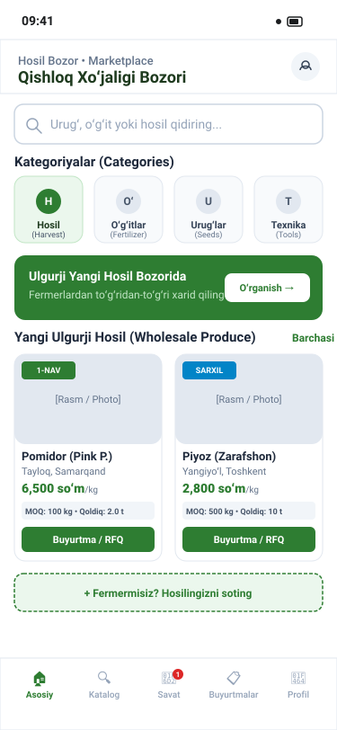
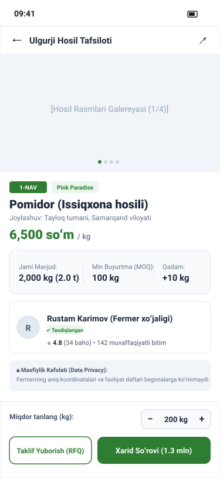
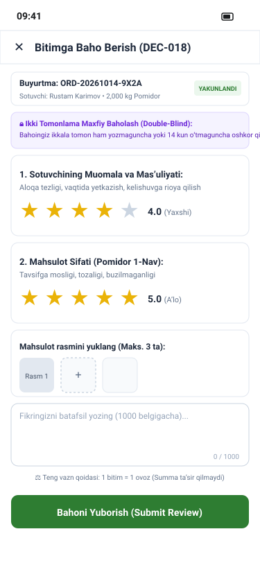

# Hosil Bozor UI/UX Design Specification

**Document Version:** 1.0  
**Date:** 14 October 2026  
**Status:** Approved Specification  
**Application:** Hosil Bozor (B2B/B2C Agricultural Marketplace)  
**Target Platform:** Flutter 3.x (Android & iOS)

---

## 1. Overview and Journey Alignment

Hosil Bozor serves as the marketplace hub for the Hosil ecosystem. It supports two primary product categories:
1. **Wholesale Harvest Listings:** Published by farmers (often directly from Hosil Farm), featuring minimum order quantities (MOQ), step increments, quality grades, and producer reputation scores.
2. **Commercial Inputs & Equipment:** Seeds, fertilizers, plant protection chemicals, and agricultural tools sold by verified commercial vendors.

This document details the complete 17-screen inventory, user interactions, error states, API endpoint bindings, and traceability matrices.

---

## 2. Visual Wireframes

### 2.1 Marketplace Home & Discovery (`bozor_home.svg`)

### 2.2 Harvest Batch Detail & Privacy Boundary (`bozor_harvest_detail.svg`)

### 2.3 Single-Seller Cart & Checkout (`bozor_cart_checkout.svg`)

### 2.4 Decoupled Two-Sided Review Screen (`bozor_two_sided_review.svg`)

---

## 3. Screen Inventory & Specifications

### Screen 1: Onboarding & Phone OTP Authentication (`BOZOR-SCR-01`)
- **Persona / Role:** Guest, Unauthenticated User.
- **Entry Point:** Initial app launch or session expiration (`DEC-003`).
- **Layout & Components:**
  - Hosil Ecosystem brand banner with language switcher (`Oʻzbekcha` / `Русский`).
  - Internationalized phone number field with country code prefix `+998`.
  - "Kodni yuborish" (Send Code) primary button (48dp height).
  - OTP verification modal with 6-digit numeric input, 60s countdown timer, and retry action.
- **API Endpoints:** `POST /api/v1/auth/phone/otp-request`, `POST /api/v1/auth/phone/otp-verify`.
- **Edge Cases:** Rate limit exceeded (HTTP 429) displays backoff countdown; SMS timeout offers voice call fallback if configured.

### Screen 2: Marketplace Home Dashboard (`BOZOR-SCR-02`)
- **Persona / Role:** All Users (Guest, Buyer, Seller).
- **Entry Point:** Bottom navigation tab 1 ("Bozor").
- **Layout & Components:**
  - Sticky search bar with voice search trigger and filter button.
  - Horizontal scrolling category chips: `Hosil (Harvest)`, `Oʻgʻitlar (Fertilizers)`, `Urugʻlar (Seeds)`, `Texnika (Machinery)`.
  - Featured wholesale harvests carousel with badges for verified farmers and region.
  - Seasonal farming recommendations banner.
  - Infinite scroll product feed with grid/list view toggle.
- **API Endpoints:** `GET /api/v1/marketplace/listings/search`, `GET /api/v1/categories`.

### Screen 3: Search & Multi-Facet Filtering (`BOZOR-SCR-03`)
- **Persona / Role:** Buyer.
- **Entry Point:** Tap on search bar or filter icon on `BOZOR-SCR-02`.
- **Layout & Components:**
  - Multi-select facet drawers: Region/District (Tashkent, Fergana, etc.), Crop Variety, Quality Grade (Oliy, 1-nav, 2-nav), Price Range Slider, Organic/Standard certificate toggle.
  - Sort options: Price Low-to-High, Distance/Proximity, Seller Rating, Recency.
  - Reset filters and "N ta natijani koʻrish" (Apply) primary CTA.
- **API Endpoints:** `GET /api/v1/marketplace/listings/search?category=...&region=...`.

### Screen 4: Commercial Input / Retail Product Detail (`BOZOR-SCR-04`)
- **Persona / Role:** Farmer (Buyer persona), Commercial Buyer.
- **Entry Point:** Tap on an input listing (e.g. fertilizer or seeds).
- **Layout & Components:**
  - High-resolution product image gallery with zoom.
  - Supplier card with verification badge (`Rasmiy Taʼminotchi`), tax ID (INN) badge, and contact action.
  - Stock availability and warehouse location.
  - Technical chemical specifications and application guidance download.
  - Fixed quantity selector and "Savatga qoʻshish" (Add to Cart) CTA.
- **API Endpoints:** `GET /api/v1/marketplace/listings/{id}`.

### Screen 5: Wholesale Harvest Listing Detail (`BOZOR-SCR-05`)
- **Persona / Role:** Wholesale Buyer, Exporter, Processor.
- **Entry Point:** Tap on harvest listing from home feed or search.
- **Layout & Components:**
  - Photo gallery showing actual harvest batch photos.
  - **Quality & Spec Card:** Harvest date, crop variety, sorting grade, packaging type (wooden crates, plastic crates, bulk sacks).
  - **Wholesale Order Constraints:** Minimum Order Quantity (MOQ, e.g. 500 kg), Order Step Increment (e.g. 100 kg), Total Available Quantity (e.g. 5 000 kg).
  - **Seller Reputation Badge:** Conduct Rating (⭐ 4.8) + Produce Rating (⭐ 4.9) per `DEC-018`.
  - **Privacy Boundary Notice:** Pinned notice stating: *"Farmer's precise field location and activity logs remain private. Pickup point provided upon order confirmation."*
  - Bottom action bar: "Buyurtma berish" (Order) and "Xabarlashish" (Contact).
- **API Endpoints:** `GET /api/v1/marketplace/listings/{id}`.

### Screen 6: Seller Profile & Public Reputation Summary (`BOZOR-SCR-06`)
- **Persona / Role:** Buyer researching a counterparty.
- **Entry Point:** Tap on seller name or rating badge on listing detail.
- **Layout & Components:**
  - Seller header: Name, Verification Badge, Region, Member Since date.
  - Decoupled reputation scorecard: Conduct Index vs Produce Quality Index, total completed transactions.
  - Active listings tab and completed deals count.
  - Public reviews list with verified purchase checkmarks.
- **API Endpoints:** `GET /api/v1/users/{id}/public-profile`, `GET /api/v1/reputation/users/{id}`.

### Screen 7: Multi-Item Single-Seller Cart (`BOZOR-SCR-07`)
- **Persona / Role:** Buyer.
- **Entry Point:** Header cart icon or bottom navigation badge.
- **Layout & Components:**
  - **Single-Seller Rule Alert Banner:** If a user attempts to add items from Seller B while Cart contains items from Seller A, an alert modal explains: *"Hosil Bozor savatida faqat bitta sotuvchi mahsulotlari boʻlishi mumkin. Yangi mahsulotni qoʻshish uchun mavjud savatni tozalash kerak."*
  - Seller header card with warehouse / pickup region.
  - Line item cards with quantity stepper enforcing MOQ and step rules.
  - Cost summary: Subtotal, Estimated delivery (if applicable), Total UZS.
  - "Rasmiylashtirishga oʻtish" (Proceed to Checkout) primary button.
- **API Endpoints:** `GET /api/v1/cart`, `POST /api/v1/cart/items`, `DELETE /api/v1/cart/items/{id}`.

### Screen 8: Checkout & Delivery Selection (`BOZOR-SCR-08`)
- **Persona / Role:** Buyer.
- **Entry Point:** Proceed from `BOZOR-SCR-07`.
- **Layout & Components:**
  - Delivery Method Radio Selector:
    - `A. Olib ketish (Self-pickup from seller warehouse/farm)`
    - `B. Sotuvchi yetkazib beradi (Seller delivery)`
    - `C. Hosil Logistika orqali yuk mashinasi buyurtma qilish (Link to Hosil Logistika)`
  - Buyer contact confirmation and pickup date/time scheduler.
  - Server-calculated total breakdown (preventing client price tampering).
  - "Toʻlovga oʻtish" (Proceed to Payment) button.
- **API Endpoints:** `POST /api/v1/orders/checkout-summary`, `POST /api/v1/orders`.

### Screen 9: Provider-Neutral Payment Placeholder (`BOZOR-SCR-09`)
- **Persona / Role:** Buyer.
- **Entry Point:** Confirm order on `BOZOR-SCR-08`.
- **Layout & Components:**
  - Notice reflecting `DEC-007`: *"Toʻlov provayderi integratsiyasi sinov rejimida. Toʻlov usulini tanlang:"*
  - Payment options list: Payme, Click, Bank Transfer (Hisob-faktura).
  - 30-minute inventory reservation countdown timer (`MKT-013`).
  - "Toʻlovni tasdiqlash (Test)" simulation CTA.
- **API Endpoints:** `POST /api/v1/payments/initiate`.

### Screen 10: Order Confirmation & Status Timeline (`BOZOR-SCR-10`)
- **Persona / Role:** Buyer.
- **Entry Point:** Successful payment callback or order submission.
- **Layout & Components:**
  - Order reference badge (e.g. `#ORD-2026-9041`).
  - Visual status progress bar: `CREATED` → `CONFIRMED` → `PROCESSING` → `IN_DELIVERY` → `COMPLETED`.
  - Seller contact details (unlocked upon payment/confirmation).
  - "Hosil Logistika bilan bogʻlash" button (pre-fills shipment request).
- **API Endpoints:** `GET /api/v1/orders/{id}`.

### Screen 11: Buyer Order History (`BOZOR-SCR-11`)
- **Persona / Role:** Buyer.
- **Entry Point:** Profile → "Mening buyurtmalarim" (My Orders).
- **Layout & Components:**
  - Filter tabs: Active, Completed, Cancelled.
  - Order cards with thumbnail, quantity, seller name, total price, and action buttons (`Kuzatish`, `Baholash`).
- **API Endpoints:** `GET /api/v1/orders?role=buyer`.

### Screen 12: Seller Order Fulfillment Dashboard (`BOZOR-SCR-12`)
- **Persona / Role:** Farmer / Seller.
- **Entry Point:** Bottom navigation tab (when seller mode active).
- **Layout & Components:**
  - Incoming purchase requests requiring confirmation (`DEC-006`).
  - Accept Request / Decline Request action buttons.
  - Mark as "Tayyor / Ready for Dispatch" button.
  - Link to call carrier or download dispatch invoice.
- **API Endpoints:** `GET /api/v1/orders?role=seller`, `POST /api/v1/orders/{id}/confirm`.

### Screen 13: Seller Harvest Listing Publisher (`BOZOR-SCR-13`)
- **Persona / Role:** Farmer / Seller.
- **Entry Point:** Hosil Bozor "Yangi eʼlon" or redirected from Hosil Farm.
- **Layout & Components:**
  - Pre-fill link to existing Harvest Batch (`harvest_batch_id`).
  - Allocated quantity input (validates `allocated <= available_quantity`).
  - Price per unit OR "Taklif soʻrash (Request for Quote)" toggle.
  - MOQ and step increment numeric fields.
  - Photo uploader (up to 5 photos, max 5MB each).
  - Privacy disclosure review and "Eʼlonni chop etish" CTA.
- **API Endpoints:** `POST /api/v1/marketplace/listings`.

### Screen 14: Commercial Supplier Product Offer Form (`BOZOR-SCR-14`)
- **Persona / Role:** Commercial Supplier.
- **Entry Point:** Seller dashboard → "Yangi taʼminot mahsuloti".
- **Layout & Components:**
  - Category selector (Fertilizer, Seeds, Chemicals, Machinery).
  - Certificate number & document upload (mandatory for chemicals).
  - Wholesale volume discounts table.
- **API Endpoints:** `POST /api/v1/marketplace/listings`.

### Screen 15: Decoupled Two-Sided Review Screen (`BOZOR-SCR-15`)
- **Persona / Role:** Buyer or Seller upon order completion.
- **Entry Point:** Order detail banner or post-completion push notification.
- **Layout & Components:**
  - **Double-Blind 14-Day Notice:** Pinned banner explaining that ratings remain concealed until both parties submit or 14 days elapse (`DEC-018`).
  - **Dimension A - Interpersonal Conduct:** 1 to 5 stars, prompt: *"Sotuvchi vaʼdasiga vaqtida va toʻliq vafo qildimi?"*
  - **Dimension B - Physical Produce Quality:** 1 to 5 stars, prompt: *"Mahsulot sifati (saralanganligi, chirik yoʻqligi) eʼlonga mos keldimi?"*
  - Photo evidence upload slots (up to 3 photos).
  - Written comment text area.
  - "Bahoni yuborish" primary button.
- **API Endpoints:** `POST /api/v1/reputation/reviews`.

### Screen 16: Review Moderation & Dispute Report Screen (`BOZOR-SCR-16`)
- **Persona / Role:** Buyer or Seller reporting an unfair/abusive review.
- **Entry Point:** "Shikoyat qilish" link on received review.
- **Layout & Components:**
  - Reason code selector (`OFFENSIVE_LANGUAGE`, `FALSE_DEFAMATION`, `EXTORTION`).
  - Evidence attachment uploader.
  - Mandatory justification notes (minimum 20 characters).
  - "Shikoyatni joʻnatish" CTA.
- **API Endpoints:** `POST /api/v1/reputation/reviews/{id}/dispute`.

### Screen 17: User Profile, Role Switcher & Settings (`BOZOR-SCR-17`)
- **Persona / Role:** All registered users.
- **Entry Point:** Bottom navigation tab 4 ("Profil").
- **Layout & Components:**
  - User name, phone number (`+998 90 ...`), and active roles.
  - Role switcher toggle (Buyer mode ↔ Seller mode).
  - Language selection, notifications preferences.
  - Help center, terms of service, and "Chiqish" (Logout) button.
- **API Endpoints:** `GET /api/v1/users/me`, `POST /api/v1/auth/logout`.

---

## 4. Screen-to-Requirement Traceability Matrix

| Screen ID | Screen Title | PRD Requirements | Domain Entities | Primary API Endpoint |
| :--- | :--- | :--- | :--- | :--- |
| `BOZOR-SCR-01` | Onboarding & OTP Auth | `ID-001`, `ID-002`, `ACL-001` | `users`, `user_profiles` | `POST /api/v1/auth/phone/otp-verify` |
| `BOZOR-SCR-02` | Home Dashboard | `MKT-001`, `MKT-002` | `categories`, `listings` | `GET /api/v1/marketplace/listings/search` |
| `BOZOR-SCR-03` | Multi-Facet Search | `MKT-002`, `MKT-003` | `listings`, `categories` | `GET /api/v1/marketplace/listings/search` |
| `BOZOR-SCR-04` | Commercial Input Detail | `MKT-004`, `MKT-007` | `listings`, `seller_profiles` | `GET /api/v1/marketplace/listings/{id}` |
| `BOZOR-SCR-05` | Harvest Listing Detail | `MKT-004`, `MKT-005`, `FARM-008` | `listings`, `harvest_batches` | `GET /api/v1/marketplace/listings/{id}` |
| `BOZOR-SCR-06` | Seller Public Profile | `REP-001`, `REP-002`, `REP-004` | `seller_profiles`, `reputation_scores`| `GET /api/v1/users/{id}/public-profile` |
| `BOZOR-SCR-07` | Single-Seller Cart | `MKT-010`, `MKT-011` | `carts`, `cart_items` | `GET /api/v1/cart` |
| `BOZOR-SCR-08` | Checkout & Delivery | `MKT-011`, `MKT-012`, `LOG-001` | `orders`, `order_items` | `POST /api/v1/orders` |
| `BOZOR-SCR-09` | Payment Placeholder | `PAY-001`, `PAY-002`, `DEC-007` | `payments`, `payment_events` | `POST /api/v1/payments/initiate` |
| `BOZOR-SCR-10` | Order Confirmation | `MKT-013`, `MKT-014` | `orders`, `order_status_history` | `GET /api/v1/orders/{id}` |
| `BOZOR-SCR-11` | Buyer Order History | `MKT-015`, `ACL-005` | `orders` | `GET /api/v1/orders?role=buyer` |
| `BOZOR-SCR-12` | Seller Fulfillment | `MKT-016`, `DEC-006` | `orders`, `order_status_history` | `POST /api/v1/orders/{id}/confirm` |
| `BOZOR-SCR-13` | Harvest Publisher | `FARM-008`, `MKT-005` | `harvest_batches`, `listings` | `POST /api/v1/marketplace/listings` |
| `BOZOR-SCR-14` | Supplier Offer Form | `MKT-004`, `MKT-006` | `listings`, `listing_media` | `POST /api/v1/marketplace/listings` |
| `BOZOR-SCR-15` | Two-Sided Review Screen | `REP-001`, `REP-003`, `DEC-018` | `reviews`, `review_evidence` | `POST /api/v1/reputation/reviews` |
| `BOZOR-SCR-16` | Review Dispute Screen | `REP-007`, `ADM-006` | `review_disputes` | `POST /api/v1/reputation/reviews/{id}/dispute` |
| `BOZOR-SCR-17` | Profile & Settings | `ID-005`, `ID-006` | `users`, `user_profiles` | `GET /api/v1/users/me` |
