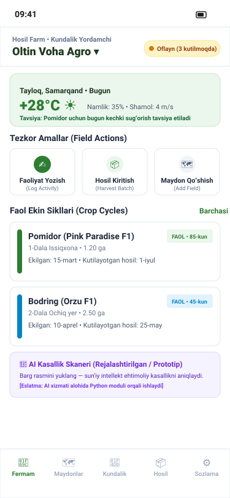
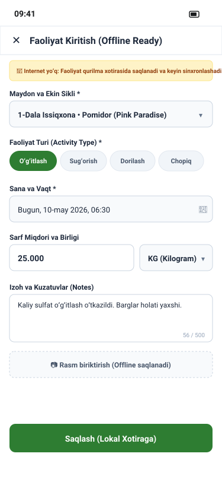
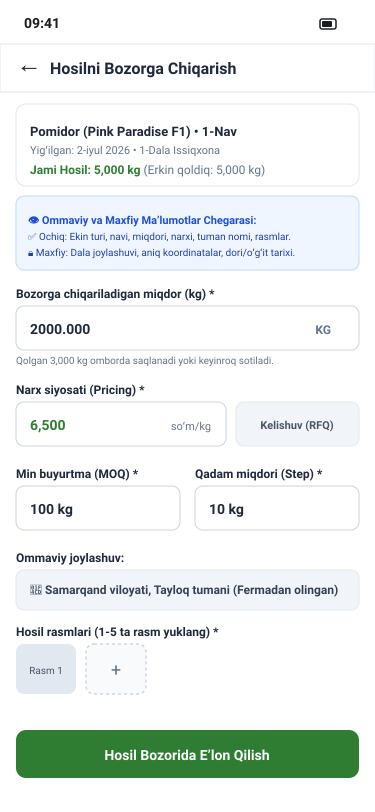

# Hosil Farm UI/UX Design Specification

**Document Version:** 1.0  
**Date:** 14 October 2026  
**Status:** Approved Specification  
**Application:** Hosil Farm (Offline-First Daily Helper & Farm Management)  
**Target Platform:** Flutter 3.x (Android & iOS) with Drift SQLite Local Database

---

## 1. Overview and Architectural Alignment

Hosil Farm is the agricultural operations assistant for farmers in Uzbekistan. Its core UX principles are:
1. **Offline-First Resilience:** All daily field operations (logging irrigation, fertilization, pesticide applications, scouting, and harvest recording) must execute instantaneously against local Drift SQLite storage without waiting for network connectivity (`docs/07_offline_strategy.md`).
2. **Outdoor High-Contrast Ergonomics:** Designed for high sunlight visibility, large touch targets (48x48 dp), and simple one-handed operation.
3. **Seamless Commercial Bridge:** Harvest batches recorded in Hosil Farm can be published directly to Hosil Bozor with transparent public vs. private data disclosure (`FARM-008`).
4. **Staged AI Advisory:** Crop disease scanning features clear disclaimers, confidence scoring, and agronomic treatment guidance (`FARM-011`).

---

## 2. Visual Wireframes

### 2.1 Farm Dashboard & Offline Sync Indicator (`farm_dashboard.svg`)

### 2.2 Daily Farm Activity Form (`farm_activity_form.svg`)

### 2.3 Harvest-to-Bozor Publication Screen (`farm_harvest_publish.svg`)

---

## 3. Screen Inventory & Specifications

### Screen 1: Farm Dashboard (`FARM-SCR-01`)
- **Persona / Role:** Farm Owner, Authorized Farm Worker.
- **Entry Point:** App launch (default home screen).
- **Layout & Components:**
  - Farm selector dropdown (supports multi-farm management per `FARM-001`).
  - **Offline Sync Status Pill:** Amber pill `● Oflayn (3 ta navbatda)` when offline; green `● Sinxronlangan` when up to date. Tapping navigates to Sync Queue (`FARM-SCR-16`).
  - **Quick Action Bar:** Quick buttons for `+ Faoliyat kiritish` (Log Activity), `+ Hosil yigʻish` (Harvest), `🔍 Kasallik skaneri` (AI Scanner).
  - **Active Crop Cycles Widget:** Carousel of active crops (e.g. Pomidor - 65% oʻsish, Bugʻdoy - 30% oʻsish).
  - **Agro-Weather Card:** Current temperature, humidity, 24h precipitation risk, and agro-advisory alert (e.g. *"Bugun kechki payt dorilash uchun qulay ob-havo"*).
- **API Endpoints:** Drift local read; syncs via `GET /api/v1/farms/active-summary`.

### Screen 2: Farm Profile & Boundary Settings (`FARM-SCR-02`)
- **Persona / Role:** Farm Owner.
- **Entry Point:** Dashboard header tap or Settings → "Fermani boshqarish".
- **Layout & Components:**
  - Farm name, cadastral region/district, total declared area (hectares).
  - Soil classification (e.g. Boʻz tuproq, Qumoq) and primary irrigation source (Kanal, Nasos, Tomchilatib).
  - Farm members list with role badges (`Ega`, `Agronom`, `Ishchi`).
  - Save button (queues mutation locally if offline).
- **API Endpoints:** `GET /api/v1/farms/{id}`, `PUT /api/v1/farms/{id}`.

### Screen 3: Field Inventory & Map/List View (`FARM-SCR-03`)
- **Persona / Role:** Farm Owner, Agronomist.
- **Entry Point:** Bottom navigation tab 2 ("Dalalar" / Fields).
- **Layout & Components:**
  - Segmented toggle: List View / Map Boundary View.
  - Field cards displaying: Field Name (e.g. `1-Maydon (Shimoliy)`), Area (e.g. `2.5 ga` or `25 sotka`), Current Crop (`Pomidor - Elita`), Soil moisture indicator.
  - Floating action button: `+ Dala qoʻshish`.
- **API Endpoints:** Drift local query; `GET /api/v1/farms/{id}/fields`.

### Screen 4: Field Detail & Agronomic History (`FARM-SCR-04`)
- **Persona / Role:** Farm Owner, Agronomist.
- **Entry Point:** Tap on a field card in `FARM-SCR-03`.
- **Layout & Components:**
  - Field summary header (area, soil type, irrigation infrastructure).
  - Active crop cycle banner with progress bar.
  - Multi-year crop rotation history (e.g. 2026: Pomidor, 2025: Bugʻdoy, 2024: Bedapoya).
  - Activity log history for this specific field.
- **API Endpoints:** Drift local query; `GET /api/v1/fields/{id}/history`.

### Screen 5: Add / Edit Field Form (`FARM-SCR-05`)
- **Persona / Role:** Farm Owner.
- **Entry Point:** Tap `+ Dala qoʻshish` on `FARM-SCR-03`.
- **Layout & Components:**
  - Field label/name input field.
  - Numeric area input with unit toggle (`Gektar (ha)` / `Sotka`).
  - Boundary GPS polygon recorder (or manual corner point picker).
  - Soil and irrigation notes text area.
  - "Saqlash" CTA (instant local commit with auto-generated UUID).
- **API Endpoints:** `POST /api/v1/farms/{farmId}/fields` (queued via Drift).

### Screen 6: Crop Cycle List & Timeline (`FARM-SCR-06`)
- **Persona / Role:** Farm Owner, Agronomist.
- **Entry Point:** Bottom navigation tab 3 ("Ekinlar" / Crops).
- **Layout & Components:**
  - Active cycles list (current season) and archived past cycles tab.
  - Cycle card showing crop icon, variety, planting date, days in ground, expected harvest date, and current phenological stage.
  - Action button: `+ Yangi ekin sikli`.
- **API Endpoints:** `GET /api/v1/farms/{id}/crop-cycles`.

### Screen 7: Add Crop Cycle Form (`FARM-SCR-07`)
- **Persona / Role:** Farm Owner, Agronomist.
- **Entry Point:** Tap `+ Yangi ekin sikli` on `FARM-SCR-06`.
- **Layout & Components:**
  - Field selector dropdown (filters fields with available area).
  - Crop catalog autocomplete picker (standardized catalog from `04_domain_model.md`).
  - Variety name, planting date picker, expected harvest date picker.
  - Planted area (validates `area <= field.area`).
  - "Ekin siklini boshlash" primary CTA.
- **API Endpoints:** `POST /api/v1/crop-cycles` (queued via Drift).

### Screen 8: Crop Cycle Detail & Health Summary (`FARM-SCR-08`)
- **Persona / Role:** Farm Owner, Agronomist.
- **Entry Point:** Tap on crop cycle card in `FARM-SCR-06`.
- **Layout & Components:**
  - Growth stage progress tracker (e.g. Unib chiqish → Gullash → Hosil tugish → Pishish).
  - Aggregated input usage scorecard: Total water applied, Total nitrogen/phosphorus applied, Treatments count.
  - Linked harvest batches list.
  - Action buttons: `Faoliyat kiritish`, `Hosilni yozish`, `Ekinni yakunlash`.
- **API Endpoints:** `GET /api/v1/crop-cycles/{id}`.

### Screen 9: Daily Farm Activity Log Form (`FARM-SCR-09`)
- **Persona / Role:** Farm Owner, Field Worker.
- **Entry Point:** Dashboard quick action or Crop Cycle detail.
- **Layout & Components:**
  - Offline status banner: *"Oflayn rejim: Qayd qurilmada saqlanadi va aloqa tiklanganda yuboriladi."*
  - Crop cycle & field selector.
  - Activity type chip selector: `Sugʻorish (Irrigation)`, `Oʻgʻitlash (Fertilization)`, `Dorilash (Pesticides)`, `Chopiq/Oʻtash (Weeding)`, `Koʻrik (Scouting)`, `Boshqa (Other)`.
  - Date & time picker (defaults to now).
  - Numeric quantity input with unit dropdown (`kg`, `litr`, `soat`, `m3`).
  - Notes / Operator observation field.
  - "Saqlash" CTA (instant local commit, zero network latency).
- **API Endpoints:** `POST /api/v1/farm-activities` (queued via Drift).

### Screen 10: Activity History & Filter View (`FARM-SCR-10`)
- **Persona / Role:** Farm Owner, Agronomist.
- **Entry Point:** Farm Dashboard → "Barcha faoliyatlar".
- **Layout & Components:**
  - Filter drawer: By field, by crop cycle, by activity type, date range.
  - Chronological activity timeline with sync status icon on each item (`✓ Sinxronlangan` or `⏳ Navbatda`).
  - Tap item to edit or soft-delete (with audit history).
- **API Endpoints:** Drift local query; `GET /api/v1/farms/{id}/activities`.

### Screen 11: Harvest Batch Recording Form (`FARM-SCR-11`)
- **Persona / Role:** Farm Owner.
- **Entry Point:** Dashboard quick action or Crop Cycle detail → "Hosil yigʻish".
- **Layout & Components:**
  - Linked crop cycle selector.
  - Total harvested quantity input with unit toggle (`kg` / `tonna`).
  - Harvest date picker.
  - Quality sorting grade selector: `Oliy (Premium)`, `1-nav (Standard)`, `2-nav (Processing)`.
  - Storage location and condition notes.
  - "Hosilni qabul qilish" CTA.
- **API Endpoints:** `POST /api/v1/harvest-batches` (queued via Drift).

### Screen 12: Harvest Inventory & Storage View (`FARM-SCR-12`)
- **Persona / Role:** Farm Owner.
- **Entry Point:** Bottom navigation tab 4 ("Ombor" / Harvest Storage).
- **Layout & Components:**
  - Total in-storage stock cards grouped by crop.
  - Batch detail card showing: Batch ID, Harvest Date, Total Quantity, Available Quantity, Listed Quantity (on Bozor), Reserved Quantity.
  - Direct action button on card: `Bozorga chiqarish` (Publish to Bozor).
- **API Endpoints:** `GET /api/v1/farms/{id}/harvest-batches`.

### Screen 13: Harvest-to-Bozor Publication Screen (`FARM-SCR-13`)
- **Persona / Role:** Farm Owner.
- **Entry Point:** Tap `Bozorga chiqarish` on a harvest batch in `FARM-SCR-12`.
- **Layout & Components:**
  - **Harvest Batch Context Header:** Crop name, total available stock (e.g. `5 000 kg`).
  - **Public vs. Private Data Disclosure Card:**
    - Explicitly lists public fields: *Mahsulot turi, Sifat navi, Narx/RFQ, Viloyat/Tuman, Sotuvchi reytingi, Rasmlar*.
    - Explicitly lists private fields: *Dala koordinatalari, Oʻgʻitlash/Dorilash jurnali, Ichki fermer eslatmalari sir saqlanadi*.
  - Quantity to list for sale (must be `<= available_quantity`).
  - Pricing model toggle: `Belgilangan narx (UZS/kg)` vs `Taklif soʻrash (RFQ)`.
  - Minimum Order Quantity (MOQ) and Step Increment inputs.
  - Camera/gallery uploader for batch photos.
  - "Eʼlonni Hosil Bozorga chiqarish" primary button.
- **API Endpoints:** `POST /api/v1/marketplace/listings` (bridges farm batch to bozor listing).

### Screen 14: AI Disease Scanner - Camera Capture (`FARM-SCR-14`)
- **Persona / Role:** Farm Owner, Field Worker.
- **Entry Point:** Quick action "🔍 Kasallik skaneri".
- **Layout & Components:**
  - Full-screen camera viewfinder with outdoor framing reticle.
  - On-screen tips: *"Bargni quyosh nurida yaqindan, aniq fokusda suratga oling. Kasallangan qismini markazga qoʻying."*
  - Flash toggle, gallery picker fallback, capture shutter button.
- **API Endpoints:** Local camera hardware; cached image saved to local storage.

### Screen 15: AI Disease Diagnosis Result Screen (`FARM-SCR-15`)
- **Persona / Role:** Farm Owner.
- **Entry Point:** Processed image from `FARM-SCR-14`.
- **Layout & Components:**
  - Uploaded image thumbnail with detected lesion highlights.
  - **Disease Identification Card:** Detected disease name (e.g. *Pomidor Fitoftorozi / Late Blight*).
  - Confidence Score Bar: e.g. `92% ishonchlilik darajasi`.
  - **Staged Advisory Notice:** Pinned disclaimer: *"Ushbu tashxis sunʼiy intellekt tomonidan dastlabki tavsiya sifatida taqdim etildi. Yakuniy ishlov berishdan oldin mahalliy agronom bilan maslahatlashing."*
  - Cultural & biological treatment recommendations (e.g. havo aylanishini yaxshilash, misli preparatlar bilan purkash).
  - Action buttons: "Faoliyatga saqlash" (converts diagnosis to scout activity), "Yangi rasm olish".
- **API Endpoints:** `POST /api/v1/ai/diagnose` (handled via Spring Boot → FastAPI proxy). Diagnosis cached in Drift SQLite for offline review.

### Screen 16: Local Offline Sync Queue & Conflict Resolution Center (`FARM-SCR-16`)
- **Persona / Role:** Farm Owner.
- **Entry Point:** Tap on sync status pill in header.
- **Layout & Components:**
  - Network state indicator (Online / Offline / Poor 2G).
  - List of pending mutations waiting in Drift SQLite queue:
    - Item icon, entity type (`Faoliyat`, `Hosil`, `Dala`), local timestamp, payload summary.
  - "Hozir sinxronlash" (Sync Now) manual trigger.
  - Conflict list section (if concurrent edits occurred on another device):
    - Side-by-side comparison (Local Value vs Server Value).
    - Resolution options: `Mening variantimni qoldirish (Local wins)` / `Server variantini olish (Server wins)`.
- **API Endpoints:** `POST /api/v1/sync/batch-upload`, Drift sync manager.

### Screen 17: Farm Weather & Agro-Advisory Forecast (`FARM-SCR-17`)
- **Persona / Role:** Farm Owner.
- **Entry Point:** Tap on weather widget on `FARM-SCR-01`.
- **Layout & Components:**
  - 7-day hourly temperature, humidity, and wind speed charts.
  - Agro-warning cards: Frost warning (Qorasovuq xavfi), Extreme heat warning (Issiq urishi), Spraying window suitability calculator.
  - Historical rain comparison for current season.
- **API Endpoints:** `GET /api/v1/weather/forecast?farmId={id}` (cached locally for 24h).

---

## 4. Screen-to-Requirement Traceability Matrix

| Screen ID | Screen Title | PRD Requirements | Domain Entities | Primary API Endpoint |
| :--- | :--- | :--- | :--- | :--- |
| `FARM-SCR-01` | Farm Dashboard | `FARM-001`, `FARM-002`, `OFF-001` | `farms`, `crop_cycles` | `GET /api/v1/farms/active-summary` |
| `FARM-SCR-02` | Farm Profile & Boundaries | `FARM-001`, `FARM-002`, `ACL-003` | `farms`, `farm_memberships` | `PUT /api/v1/farms/{id}` |
| `FARM-SCR-03` | Field Inventory | `FARM-003`, `OFF-002` | `fields`, `crop_cycles` | `GET /api/v1/farms/{id}/fields` |
| `FARM-SCR-04` | Field Detail & History | `FARM-003`, `FARM-004` | `fields`, `farm_activities` | `GET /api/v1/fields/{id}/history` |
| `FARM-SCR-05` | Add / Edit Field Form | `FARM-003`, `OFF-002` | `fields` | `POST /api/v1/farms/{farmId}/fields` |
| `FARM-SCR-06` | Crop Cycle List | `FARM-004`, `FARM-005` | `crop_cycles` | `GET /api/v1/farms/{id}/crop-cycles` |
| `FARM-SCR-07` | Add Crop Cycle Form | `FARM-004`, `OFF-002` | `crop_cycles`, `fields` | `POST /api/v1/crop-cycles` |
| `FARM-SCR-08` | Crop Cycle Detail | `FARM-004`, `FARM-006` | `crop_cycles`, `farm_activities` | `GET /api/v1/crop-cycles/{id}` |
| `FARM-SCR-09` | Daily Activity Form | `FARM-005`, `FARM-006`, `OFF-002` | `farm_activities` | `POST /api/v1/farm-activities` |
| `FARM-SCR-10` | Activity History & Filter | `FARM-006`, `OFF-003` | `farm_activities` | `GET /api/v1/farms/{id}/activities` |
| `FARM-SCR-11` | Harvest Recording Form | `FARM-007`, `OFF-002` | `harvest_batches` | `POST /api/v1/harvest-batches` |
| `FARM-SCR-12` | Harvest Inventory | `FARM-007`, `DEC-008` | `harvest_batches` | `GET /api/v1/farms/{id}/harvest-batches` |
| `FARM-SCR-13` | Harvest-to-Bozor Publish | `FARM-008`, `MKT-005` | `harvest_batches`, `listings` | `POST /api/v1/marketplace/listings` |
| `FARM-SCR-14` | AI Camera Capture | `FARM-010`, `MEDIA-003` | `ai_diagnosis_records` | Local Drift / Camera |
| `FARM-SCR-15` | AI Diagnosis Result | `FARM-011`, `FARM-012` | `ai_diagnosis_records` | `POST /api/v1/ai/diagnose` |
| `FARM-SCR-16` | Sync Queue & Conflicts | `OFF-004`, `OFF-005`, `OFF-006` | Drift `sync_queue` | `POST /api/v1/sync/batch-upload` |
| `FARM-SCR-17` | Farm Weather Forecast | `FARM-009`, `DEC-014` | `weather_forecasts` | `GET /api/v1/weather/forecast` |
