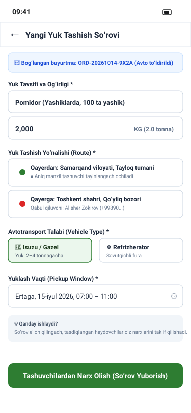
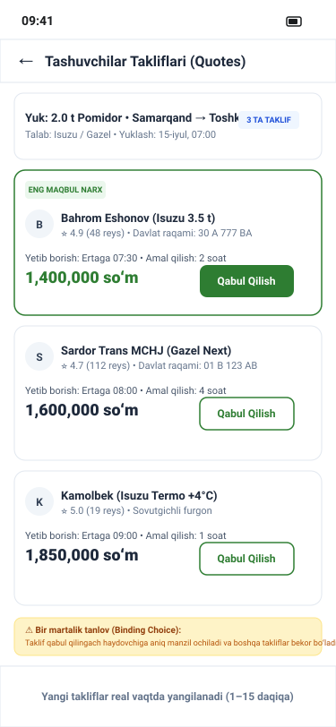

# Hosil Logistika UI/UX Design Specification

**Document Version:** 1.0  
**Date:** 14 October 2026  
**Status:** Approved Specification  
**Application:** Hosil Logistika (Agricultural Freight & Equipment Leasing)  
**Target Platform:** Flutter 3.x (Android & iOS)

---

## 1. Overview and Architectural Alignment

Hosil Logistika bridges agricultural producers and wholesale buyers with certified commercial carriers. It is built as a single Flutter application supporting two operational personas via an integrated role-switcher:
1. **Cargo Requester (Shipper):** Farmers or wholesale buyers requesting transport for bulk harvest or heavy agricultural inputs.
2. **Commercial Carrier (Driver / Fleet Owner):** Independent truck drivers or logistics companies bidding on freight requests, executing deliveries, and submitting cryptographic/photo proofs of delivery.

### Key Architectural & Privacy Policies:
- **Origin/Destination Privacy Preservation (`LOG-002`):** During the open quotation phase, carrier bids are solicited using district-level origin and destination (e.g. *Toshkent viloyati, Yangiyoʻl tumani → Fargʻona shahri*). Exact street addresses, farm coordinates, and sender phone numbers remain strictly masked until the requester formally accepts a binding carrier quote.
- **Strict Linear Status Machine (`LOG-007`):** Deliveries transition through validated stages: `REQUESTED` → `QUOTED` → `ACCEPTED` → `PICKUP_ARRANGED` → `PICKED_UP` → `IN_TRANSIT` → `DELIVERED`.
- **DEC-013 Partner-Neutral Leasing:** The equipment leasing section is presented as an educational eligibility questionnaire with disabled final submission, pending formal bank partnership execution.

---

## 2. Visual Wireframes

### 2.1 Freight Request Creation (`logistika_request.svg`)

### 2.2 Carrier Quotes Comparison (`logistika_carrier_quotes.svg`)

---

## 3. Screen Inventory & Specifications

### Screen 1: Logistika Mode Selector & Home (`LOG-SCR-01`)
- **Persona / Role:** All users (Shippers & Carriers).
- **Entry Point:** App launch / Home tab.
- **Layout & Components:**
  - Header with active persona badge (`Yuk joʻnatuvchi` vs `Tashuvchi / Haydovchi`).
  - Quick-switch toggle button between Shipper and Carrier modes (visible if user has carrier role).
  - Quick action banner: `+ Yuk tashishga buyurtma berish` (Shipper) or `📦 Mavjud yuklar roʻyxati` (Carrier).
  - Active freight tracking summary card.
- **API Endpoints:** `GET /api/v1/users/me`, `GET /api/v1/shipments/active`.

### Screen 2: Requester Active Shipments Dashboard (`LOG-SCR-02`)
- **Persona / Role:** Requester (Shipper).
- **Entry Point:** Bottom navigation tab 1 ("Mening yuklarim").
- **Layout & Components:**
  - Segmented control: `Faol (Active)`, `Kotirovkalar (Quotes)`, `Yakunlangan (Delivered)`.
  - Freight card showing cargo type, gross weight, route summary, active status badge, and quotes count.
  - Tapping navigates to Shipment Detail (`LOG-SCR-07`) or Quotes (`LOG-SCR-06`).
- **API Endpoints:** `GET /api/v1/shipments?role=requester`.

### Screen 3: Create Freight Request - Step 1: Cargo Details (`LOG-SCR-03`)
- **Persona / Role:** Requester.
- **Entry Point:** Tap `+ Yangi buyurtma` on `LOG-SCR-01` or link from Hosil Bozor order.
- **Layout & Components:**
  - Link to existing order/harvest batch toggle (auto-fills cargo weight and description).
  - Cargo category dropdown (`Hosil / Qishloq xoʻjaligi mahsuloti`, `Oʻgʻit / Kimyoviy moddalar`, `Urugʻ / Koʻchat`, `Qishloq xoʻjaligi texnikasi`).
  - Gross cargo weight input with unit selector (`kg` / `tonna`).
  - Packaging type: Qoplar (Sacks), Yogʻoch yashiklar (Wooden crates), Palletlar, Sochma (Bulk).
  - Special handling checkboxes: `Sovutgichli (Refrigerated)`, `Namlikdan himoya (Waterproof)`, `Ehtiyotkorlik bilan (Fragile)`.
  - "Keyingisi: Yoʻnalish va vaqt" CTA.
- **API Endpoints:** Client form state (validates inputs).

### Screen 4: Create Freight Request - Step 2: Route & Timing (`LOG-SCR-04`)
- **Persona / Role:** Requester.
- **Entry Point:** Step 2 of freight creation.
- **Layout & Components:**
  - **Privacy Disclosure Banner:** *"Tashuvchilar taklif berish vaqtida faqat tuman nomini koʻradi. Aniq manzil faqat taklifni qabul qilganingizdan keyin ochiladi."*
  - Pickup region & district selectors (e.g. Tashkent vil., Yangiyoʻl tum.).
  - Pickup detailed address (stored privately).
  - Drop-off region & district selectors (e.g. Fargʻona vil., Qoʻqon sh.).
  - Drop-off detailed address (stored privately).
  - Desired pickup date and delivery deadline date pickers.
  - "Keyingisi: Avtotransport talablari" CTA.
- **API Endpoints:** Client form state.

### Screen 5: Create Freight Request - Step 3: Vehicle Requirements & Submit (`LOG-SCR-05`)
- **Persona / Role:** Requester.
- **Entry Point:** Step 3 of freight creation.
- **Layout & Components:**
  - Required vehicle body type chips: `Tentli (Tarpaulin)`, `Refrijerator (Refrigerated)`, `Bortli (Open Flatbed)`, `Furgon (Box Truck)`, `Samosval (Dump Truck)`.
  - Minimum tonnage capacity requirement (e.g. 5t, 10t, 20t).
  - Loading / unloading responsibility selector (Requester / Carrier / Laborers provided).
  - Full request summary card with total estimated distance.
  - "Buyurtmani eʼlon qilish" (Submit Request) primary CTA.
- **API Endpoints:** `POST /api/v1/shipments/requests`.

### Screen 6: Requester Quotes Comparison Screen (`LOG-SCR-06`)
- **Persona / Role:** Requester.
- **Entry Point:** Tap on a shipment in `QUOTED` status.
- **Layout & Components:**
  - Header with freight ID, route, and quotes count (e.g. `3 ta taklif kelib tushdi`).
  - Carrier Quote Cards displaying:
    - Carrier / Driver name and photo.
    - Carrier verification badge (`✓ Tekshirilgan Tashuvchi`) and reputation rating (⭐ 4.9).
    - Proposed vehicle type and registration plate number (e.g. `Isuzu 5t • 01 A 777 BB`).
    - Proposed pickup ETA (e.g. `Ertaga 08:00`).
    - **Quote Price:** Total amount in UZS with breakdown.
    - Quote expiration timer countdown (e.g. `Qolgan vaqt: 04:32:10`).
    - Primary action button: `Taklifni qabul qilish` (Accept Quote).
- **API Endpoints:** `GET /api/v1/shipments/requests/{id}/quotes`, `POST /api/v1/shipments/quotes/{quoteId}/accept`.

### Screen 7: Shipment Detail & Live Milestone Status Tracker (`LOG-SCR-07`)
- **Persona / Role:** Requester & Assigned Carrier.
- **Entry Point:** Active shipment list or push notification.
- **Layout & Components:**
  - Full linear milestone timeline:
    - `1. Buyurtma berildi (REQUESTED)`
    - `2. Taklif qabul qilindi (ACCEPTED)`
    - `3. Yuk ortish kelishildi (PICKUP_ARRANGED)`
    - `4. Yuk ortildi (PICKED_UP)`
    - `5. Yoʻlda (IN_TRANSIT)`
    - `6. Yetkazildi (DELIVERED)`
  - Active carrier card with direct phone call action.
  - Full origin and destination addresses (unlocked).
  - "Yetkazish isboti (Proof of Delivery)" button (when delivered).
- **API Endpoints:** `GET /api/v1/shipments/{id}`.

### Screen 8: Delivery Proof Viewer (`LOG-SCR-08`)
- **Persona / Role:** Requester & Carrier.
- **Entry Point:** Tap "Yetkazish isboti" on completed shipment.
- **Layout & Components:**
  - High-resolution photo of delivered cargo at destination warehouse/point.
  - Digital recipient signature overlay with signatory full name.
  - Cryptographic timestamp and GPS coordinates verification badge.
  - Download delivery receipt PDF button.
- **API Endpoints:** `GET /api/v1/shipments/{id}/proof`.

### Screen 9: Requester Two-Sided Carrier Review Screen (`LOG-SCR-09`)
- **Persona / Role:** Requester upon successful delivery.
- **Entry Point:** Post-delivery prompt or shipment history.
- **Layout & Components:**
  - Carrier reputation rating form:
    - **Punctuality & Timing (Vaqtga rioya qilish):** 1 to 5 stars.
    - **Cargo Care & Safety (Yukni butun saqlash):** 1 to 5 stars.
    - **Communication & Professionalism (Muomala va halollik):** 1 to 5 stars.
  - Written feedback textarea.
  - "Baholashni yuborish" primary CTA.
- **API Endpoints:** `POST /api/v1/reputation/reviews`.

### Screen 10: Carrier Freight Marketplace / Available Loads (`LOG-SCR-10`)
- **Persona / Role:** Commercial Carrier.
- **Entry Point:** Bottom navigation tab 1 in Carrier mode ("Mavjud yuklar").
- **Layout & Components:**
  - Search and filter bar: Origin district, Destination district, Min weight, Cargo type.
  - Load cards displaying: District-to-District route, Cargo type, Weight, Vehicle required, Desired date, Number of quotes already submitted.
  - Notice on card: *"Aniq manzil taklif qabul qilingandan soʻng taqdim etiladi."*
  - "Taklif berish" (Submit Quote) action button.
- **API Endpoints:** `GET /api/v1/shipments/open-requests`.

### Screen 11: Carrier Submit Quote Modal (`LOG-SCR-11`)
- **Persona / Role:** Commercial Carrier.
- **Entry Point:** Tap "Taklif berish" on `LOG-SCR-10`.
- **Layout & Components:**
  - Freight summary header.
  - Vehicle selector from carrier's registered fleet.
  - Price quote input in UZS (includes platform fee breakdown).
  - Quote validity duration selector (2 hours, 6 hours, 24 hours).
  - Proposed pickup date and arrival time window.
  - Special conditions notes (e.g. *"Yuk ortishda yordam beriladi"*).
  - "Taklifni tasdiqlash va yuborish" primary CTA.
- **API Endpoints:** `POST /api/v1/shipments/requests/{id}/quotes`.

### Screen 12: Carrier My Trips & Active Assignment Screen (`LOG-SCR-12`)
- **Persona / Role:** Commercial Carrier.
- **Entry Point:** Bottom navigation tab 2 ("Mening reyslarim").
- **Layout & Components:**
  - Active assigned shipment card.
  - Full origin address and shipper contact phone number (unlocked).
  - Full destination address and recipient contact phone number.
  - Stage advance button: `[ Yuk ortildi (Picked Up) ]` → `[ Yoʻlda (In Transit) ]` → `[ Yetkazishni yakunlash ]`.
- **API Endpoints:** `GET /api/v1/shipments/assigned`, `PUT /api/v1/shipments/{id}/status`.

### Screen 13: Carrier Proof of Delivery Upload Screen (`LOG-SCR-13`)
- **Persona / Role:** Commercial Carrier.
- **Entry Point:** Tap "Yetkazishni yakunlash" on `LOG-SCR-12`.
- **Layout & Components:**
  - Camera capture frame for cargo photo at destination.
  - Digital touch signature pad for recipient to sign with finger.
  - Recipient full name and phone number input.
  - GPS geotag acquisition confirmation (`Aniq koordinatalar qayd etildi`).
  - "Yetkazilgan deb tasdiqlash" primary destructive CTA.
- **API Endpoints:** `POST /api/v1/shipments/{id}/proof`.

### Screen 14: Equipment & Vehicle Leasing Discovery Screen (`LOG-SCR-14`)
- **Persona / Role:** Farmer or Carrier seeking machinery financing.
- **Entry Point:** Bottom navigation tab 4 ("Lizing / Texnika").
- **Layout & Components:**
  - **DEC-013 Disclaimer Banner:** *"Texnika lizingi xizmati hamkor banklar bilan integratsiya bosqichida. Ariza yuborish tez orada yoʻlga qoʻyiladi."*
  - Catalog of eligible agricultural machinery: Tractors (Belarus, Case, Lovol), Combine Harvesters, Refrigerated Trucks (Isuzu, MAN).
  - Monthly installment calculator (Down payment % slider, Term in months: 12, 24, 36).
  - Eligibility questionnaire (Farm size, annual turnover, region).
  - Disabled submit button with label: *"Tez kunda ishga tushadi (Bank shartnomasi kutilmoqda)"*.
- **API Endpoints:** Read-only reference catalog `GET /api/v1/leasing/catalog`.

### Screen 15: Carrier Profile & Vehicle Management (`LOG-SCR-15`)
- **Persona / Role:** Commercial Carrier.
- **Entry Point:** Profile tab in Carrier mode.
- **Layout & Components:**
  - Carrier verification status badge (`✓ Tasdiqlangan tashuvchi` or `⏳ Hujjatlar tekshiruvda`).
  - Registered vehicle fleet list: Registration plate, vehicle model, capacity (tons), body type, technical inspection certificate expiry date.
  - Driver license and passport/tax ID status.
  - Overall carrier reputation score (⭐ 4.9).
- **API Endpoints:** `GET /api/v1/carriers/me`, `POST /api/v1/carriers/me/vehicles`.

---

## 4. Screen-to-Requirement Traceability Matrix

| Screen ID | Screen Title | PRD Requirements | Domain Entities | Primary API Endpoint |
| :--- | :--- | :--- | :--- | :--- |
| `LOG-SCR-01` | Logistika Mode Selector | `LOG-001`, `ACL-006` | `users`, `user_roles` | `GET /api/v1/users/me` |
| `LOG-SCR-02` | Requester Dashboard | `LOG-001`, `LOG-002` | `shipment_requests`, `shipments` | `GET /api/v1/shipments?role=requester` |
| `LOG-SCR-03` | Cargo Details Form | `LOG-001`, `LOG-003` | `shipment_requests` | Local form validation |
| `LOG-SCR-04` | Route & Timing Form | `LOG-002`, `LOG-004` | `shipment_requests` | Local form validation |
| `LOG-SCR-05` | Vehicle Specs & Submit | `LOG-001`, `LOG-004` | `shipment_requests` | `POST /api/v1/shipments/requests` |
| `LOG-SCR-06` | Quotes Comparison | `LOG-005`, `LOG-006` | `shipment_quotes`, `carrier_profiles` | `GET /api/v1/shipments/requests/{id}/quotes` |
| `LOG-SCR-07` | Live Status Tracker | `LOG-007`, `ACL-006` | `shipments`, `shipment_status_history`| `GET /api/v1/shipments/{id}` |
| `LOG-SCR-08` | Delivery Proof Viewer | `LOG-008`, `MEDIA-003` | `delivery_proofs` | `GET /api/v1/shipments/{id}/proof` |
| `LOG-SCR-09` | Carrier Review Screen | `REP-001`, `LOG-009` | `reviews`, `reputation_scores` | `POST /api/v1/reputation/reviews` |
| `LOG-SCR-10` | Carrier Loads Board | `LOG-002`, `LOG-005` | `shipment_requests` | `GET /api/v1/shipments/open-requests` |
| `LOG-SCR-11` | Carrier Quote Modal | `LOG-005`, `ACL-006` | `shipment_quotes` | `POST /api/v1/shipments/requests/{id}/quotes` |
| `LOG-SCR-12` | Carrier My Trips | `LOG-007`, `LOG-002` | `shipments`, `shipment_status_history`| `PUT /api/v1/shipments/{id}/status` |
| `LOG-SCR-13` | Carrier Proof Upload | `LOG-008`, `MEDIA-003` | `delivery_proofs` | `POST /api/v1/shipments/{id}/proof` |
| `LOG-SCR-14` | Leasing Discovery | `LEAS-001`, `DEC-013` | `leasing_catalog` | `GET /api/v1/leasing/catalog` |
| `LOG-SCR-15` | Carrier Fleet & Profile | `LOG-006`, `ACL-006` | `carrier_profiles`, `vehicles` | `GET /api/v1/carriers/me` |
