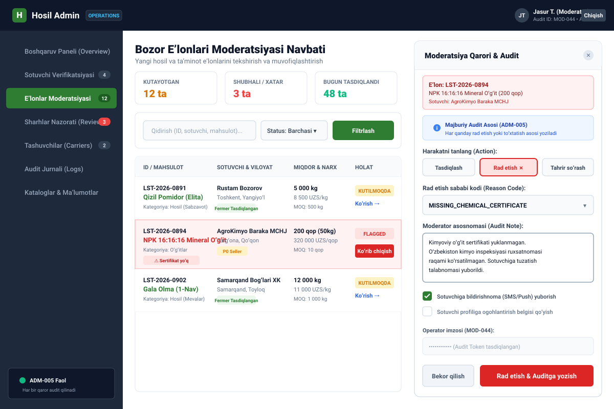

# Hosil Admin Panel UI/UX Design Specification

**Document Version:** 1.0  
**Date:** 14 October 2026  
**Status:** Approved Specification  
**Application:** Hosil Back-Office Operations & Moderation Panel  
**Target Platform:** Web (Spring Boot 3.x + Thymeleaf + HTMX + Tailwind CSS per `ADR-002`)

---

## 1. Overview and Operational Governance

The Hosil Admin Panel is an internal web-based operations tool. It provides platform operators, verification officers, and dispute mediators with the controls necessary to safeguard marketplace trust, regulatory compliance, and system integrity.

### Core Architectural Principles:
1. **Server-Rendered Simplicity (`ADR-002`):** Built with Spring Boot 3.x, Thymeleaf templates, and HTMX for dynamic partial page updates without heavyweight client-side single-page application complexity.
2. **Mandatory Audit Justification (`ADM-005`):** No destructive, approval, rejection, or moderation action can be committed without providing a structured reason code and human-readable audit justification note. Every action is cryptographically tied to the operator's authenticated session.
3. **Session-Based Security (`DEC-016`):** Authentication utilizes server-side HTTP-only secure cookie sessions managed by Spring Security, completely isolated from mobile JWT tokens.
4. **Data Privacy & Need-to-Know Access:** Operators only view sensitive user identity data (such as bank details, personal passport scans, or unmasked farm coordinates) when actively adjudicating a pending verification, dispute, or support ticket.

---

## 2. Visual Wireframe

### Moderation Queue & Mandatory Audit Justification Drawer (`admin_moderation_queue.svg`)

---

## 3. Screen Inventory & Specifications

### Screen 1: Admin Authentication & Session Gateway (`ADM-SCR-01`)
- **Operator Role:** `ADMIN_OPERATOR`, `ADMIN_SUPERVISOR`, `SECURITY_AUDITOR`.
- **Entry Point:** Direct navigation to `/admin/login`.
- **Layout & Components:**
  - High-security login form requiring Operator Email/Username and Password.
  - Multi-Factor Authentication (MFA) TOTP code prompt.
  - Explicit warning banner: *"Antigravity / Hosil xavfsiz tizimi. Barcha harakatlar IP manzil va sessiya boʻyicha qatʼiy audit qilinadi."*
- **Backend Endpoints:** Spring Security `POST /admin/login-process`.

### Screen 2: Operations Overview & KPI Dashboard (`ADM-SCR-02`)
- **Operator Role:** All Admin roles.
- **Entry Point:** Default landing page after login (`/admin/dashboard`).
- **Layout & Components:**
  - **KPI Metrics Cards:**
    - Pending Seller Verifications (count + trend)
    - Active Marketplace Listings & Pending Moderation Queue
    - Reported Reviews Awaiting Resolution
    - Pending Carrier Vettings
    - System Health & Background Sync Queue Status
  - Recent Critical Audit Log ticker (last 5 system interventions).
- **Backend Endpoints:** `GET /admin/dashboard`.

### Screen 3: Seller Verification Queue (`ADM-SCR-03`)
- **Operator Role:** `ADMIN_OPERATOR`, `ADMIN_SUPERVISOR`.
- **Entry Point:** Sidebar → "Sotuvchi Verifikatsiyasi" (`/admin/sellers/verification`).
- **Layout & Components:**
  - Tabular list of applicants filtered by entity type: `Individual Farmer (Jismoniy fermer)` vs `Commercial Supplier (Yuridik MCHJ/XK)`.
  - **Inspection Drawer:**
    - Cadastral farm ownership certificate / Lease contract scan.
    - Commercial Tax ID (INN) and state registry certificate verification.
    - Bank settlement account details.
  - **Action Modal with Audit Justification:**
    - `[ Tasdiqlash (Approve) ]`: Grants verified seller badge.
    - `[ Qayta ishlashga qaytarish (Request Info) ]`: Sends feedback to applicant.
    - `[ Rad etish (Reject) ]`: Requires mandatory rejection reason code (`INVALID_CADASTRAL`, `FAKE_DOCUMENTS`, `TAX_DISCREPANCY`) and operator explanation.
- **Backend Endpoints:** `GET /admin/sellers/verification`, `POST /admin/sellers/verification/{id}/decision` (HTMX partial).

### Screen 4: Marketplace Listing Moderation Queue (`ADM-SCR-04`)
- **Operator Role:** `ADMIN_OPERATOR`, `ADMIN_SUPERVISOR`.
- **Entry Point:** Sidebar → "Eʼlonlar Moderatsiyasi" (`/admin/listings/moderation`).
- **Layout & Components:**
  - Filter queue by: `Pending First Publish`, `Flagged by Auto-Filter (Keywords/Price)`, `User Reported`.
  - Table showing: Listing ID, Crop / Product Name, Seller, Region, Volume & Price, Risk Flags, Current Status.
  - **Inspection & Action Panel (`admin_moderation_queue.svg`):**
    - High-resolution photo inspector.
    - Chemical safety certificate serial verification box (mandatory for fertilizer/pesticides).
    - Price sanity check (highlights listings whose price diverges by >300% from regional market averages).
    - Modal action with mandatory justification: Reason code (`MISSING_CHEMICAL_CERTIFICATE`, `INAPPROPRIATE_PHOTOS`, `PRICE_GOUGING`) and notes.
- **Backend Endpoints:** `GET /admin/listings/moderation`, `POST /admin/listings/moderation/{id}/action` (HTMX partial).

### Screen 5: Two-Sided Review & Reputation Moderation (`ADM-SCR-05`)
- **Operator Role:** `ADMIN_OPERATOR`, `ADMIN_SUPERVISOR`.
- **Entry Point:** Sidebar → "Sharhlar Nazorati" (`/admin/reputation/moderation`).
- **Layout & Components:**
  - Queue of reported reviews and active seller/buyer reputation disputes (`REP-007`).
  - Side-by-side inspection of order transaction history, delivery proof, and reported review text.
  - View double-blind status (reveals hidden reviews to moderators only during active dispute investigation).
  - Actions: `[ Shikoyatni rad etish (Keep Review) ]`, `[ Sharhni yashirish (Hide/Redact Review) ]`, `[ Ogohlantirish berish (Warn User) ]`.
  - Every action writes directly to `reputation_audit_logs`.
- **Backend Endpoints:** `GET /admin/reputation/moderation`, `POST /admin/reputation/moderation/{id}/resolve`.

### Screen 6: Carrier Vetting & Fleet Inspection (`ADM-SCR-06`)
- **Operator Role:** `ADMIN_OPERATOR`, `ADMIN_SUPERVISOR`.
- **Entry Point:** Sidebar → "Tashuvchilar" (`/admin/carriers/vetting`).
- **Layout & Components:**
  - List of drivers and transport companies requesting carrier verification (`LOG-006`).
  - Document viewer: Driver's license scan, Vehicle technical inspection passport, Commercial freight transport license.
  - Approve or Reject with reason code (`EXPIRED_INSPECTION`, `INVALID_LICENSE_CATEGORY`).
- **Backend Endpoints:** `GET /admin/carriers/vetting`, `POST /admin/carriers/vetting/{id}/verify`.

### Screen 7: System Audit Trail Browser (`ADM-SCR-07`)
- **Operator Role:** `ADMIN_SUPERVISOR`, `SECURITY_AUDITOR`.
- **Entry Point:** Sidebar → "Audit Jurnali" (`/admin/audit-logs`).
- **Layout & Components:**
  - Comprehensive, immutable audit trail search table.
  - Search filters: Operator ID, Action Type (`SELLER_VERIFICATION`, `LISTING_SUSPEND`, `REVIEW_REDACT`, `ORDER_REFUND`), Entity ID, Date/Time range.
  - Audit row detail drawer showing full JSON before/after state diff, client IP address, user agent, and operator justification text.
  - Export to signed CSV / PDF report for compliance.
- **Backend Endpoints:** `GET /admin/audit-logs`, `GET /admin/audit-logs/{id}`.

### Screen 8: Reference Data & Catalog Manager (`ADM-SCR-08`)
- **Operator Role:** `ADMIN_SUPERVISOR`.
- **Entry Point:** Sidebar → "Kataloglar & Maʼlumotlar" (`/admin/catalogs`).
- **Layout & Components:**
  - Standardized Crop Varieties Catalog (Uzbek Latin and Russian names, maturity duration, phenological stages).
  - Standardized Units of Measurement Catalog per category (`DEC-009`).
  - Agricultural Input Category Tree.
  - Add / Edit item forms with validation.
- **Backend Endpoints:** `GET /admin/catalogs`, `POST /admin/catalogs/{type}`.

---

## 4. Screen-to-Requirement Traceability Matrix

| Screen ID | Screen Title | PRD Requirements | Domain Entities | Primary Controller Route |
| :--- | :--- | :--- | :--- | :--- |
| `ADM-SCR-01` | Session Login & MFA | `ADM-001`, `DEC-016` | `users`, `admin_sessions` | `POST /admin/login-process` |
| `ADM-SCR-02` | Dashboard & KPIs | `ADM-002`, `ADM-003` | Multiple aggregated entities | `GET /admin/dashboard` |
| `ADM-SCR-03` | Seller Verification | `DEC-004`, `ADM-004` | `seller_profiles`, `audit_logs` | `POST /admin/sellers/verification/{id}/decision` |
| `ADM-SCR-04` | Listing Moderation | `MKT-006`, `ADM-005` | `listings`, `audit_logs` | `POST /admin/listings/moderation/{id}/action` |
| `ADM-SCR-05` | Review Dispute Center | `REP-007`, `ADM-006` | `reviews`, `review_disputes` | `POST /admin/reputation/moderation/{id}/resolve` |
| `ADM-SCR-06` | Carrier Vetting | `DEC-011`, `LOG-006` | `carrier_profiles`, `vehicles` | `POST /admin/carriers/vetting/{id}/verify` |
| `ADM-SCR-07` | Audit Trail Browser | `ADM-005`, `SEC-004` | `audit_logs` | `GET /admin/audit-logs` |
| `ADM-SCR-08` | Catalog Management | `DEC-009`, `ADM-007` | `categories`, `crop_catalog`, `units` | `POST /admin/catalogs/{type}` |
