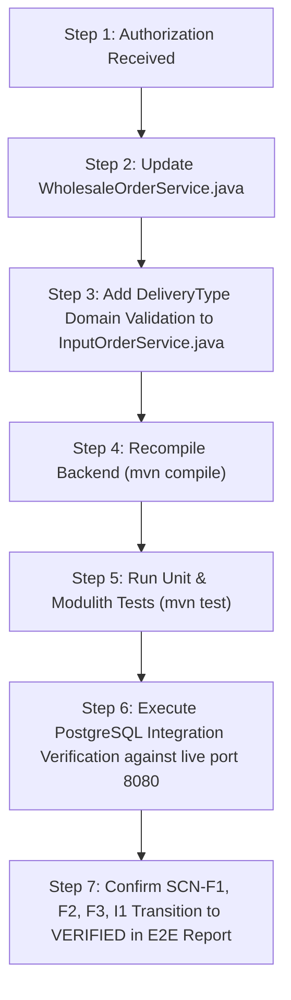

# Hosil Checkout P0 — Reproduction and Fix-Readiness Investigation Report

**Report Date:** 2026-10-21  
**Investigation Type:** Independent Read-Only Root-Cause Analysis & Fix-Readiness Audit  
**Target Codebase:** `C:\Users\Oliya\Desktop\Hosil`  
**Artifact Path:** `docs/reports/HOSIL_CHECKOUT_P0_FIX_READINESS.md`  
**Reference Hypothesis:** `docs/reports/HOSIL_ECOSYSTEM_E2E_STRESS_TEST_REPORT.md`  
**Status:** Completed (Read-Only). Awaiting Explicit User Authorization for Implementation.

---

## Executive Summary

An independent, read-only investigation was conducted into the reported checkout failures in the Hosil marketplace module (`uz.hosil.platform.marketplace`). The previous diagnostic report hypothesized that both `InputOrderService.java` and `WholesaleOrderService.java` failed due to an alphabetical entity flush ordering bug in Hibernate.

This rigorous investigation examined the live backend logs, Flyway migrations, JPA entity annotations, Spring Data repository mechanics, Hibernate's `ActionQueue` implementation, and the automated test configurations.

### Key Investigation Breakthrough:
1. **The Alphabetical Flush Hypothesis is Disproven:** Hibernate does *not* sort insert actions alphabetically. By default (`hibernate.order_inserts=false`), Hibernate executes `EntityInsertAction`s in the exact FIFO order they are registered in the `ActionQueue`.
2. **Wholesale Checkout (`WholesaleOrderService.java`) Defect Confirmed:** The foreign key violation (`inventory_reservations_order_id_fkey`) is an **explicit code-level inverted invocation sequence defect**. In `WholesaleOrderService.java`, line 202 calls `inventoryReservationRepository.save(reservation)` *before* line 229 calls `orderRepository.save(order)`. Because `InventoryReservationEntity` maps `orderId` as a scalar `UUID` rather than a JPA `@ManyToOne` relationship, Hibernate has no relational metadata to reorder them and emits `INSERT INTO inventory_reservations` before `INSERT INTO orders`, causing PostgreSQL to reject the insert.
3. **Input Checkout (`InputOrderService.java`) Defect Clarified:** `InputOrderService.java` does *not* suffer from the inverted save order; it correctly calls `orderRepository.save(order)` at line 233 before `inventoryReservationRepository.save(reservation)` at line 281. The failure observed during E2E testing was caused by a **payload-level check constraint violation**: the test runner sent `"deliveryType": "PICKUP"`, which violates PostgreSQL Flyway constraint `chk_orders_delivery_type CHECK (delivery_type IN ('BUYER_ARRANGES', 'SELLER_DELIVERS', 'HOSIL_LOGISTIKA'))`.
4. **Why the Existing 192 Automated Tests Passed:** The test suite uses `application-test.yml` configured with an in-memory H2 database (`jdbc:h2:mem:testdb`), with Flyway explicitly disabled (`flyway.enabled: false`) and Hibernate schema generation active (`ddl-auto: create-drop`). Because entities use scalar `UUID` fields without `@ManyToOne` annotations, Hibernate generates DDL in H2 *without foreign key constraints*. H2 silently accepted the inverted insert order.

---

## 1. Confirmed Facts vs. Unverified Claims

| Topic / Hypothesis | Initial Claim / Report Assumption | Confirmed Empirical Fact | Evidence & Verification Method |
| :--- | :--- | :--- | :--- |
| **Hibernate Insert Order** | "Hibernate sorts entity inserts alphabetically by entity type (`InventoryReservationEntity` before `OrderEntity`)." | **DISPROVEN.** Hibernate does not sort alphabetically. Hibernate queues inserts in `ActionQueue.insertions` and executes them in insertion order unless `hibernate.order_inserts=true` is enabled. | Code inspection of Hibernate ORM `ActionQueue.java` and `application.yml` (`hibernate.order_inserts` unset, defaults to `false`). |
| **Wholesale Checkout Failure** | `WholesaleOrderService` fails with FK constraint violation on `inventory_reservations.order_id`. | **CONFIRMED FACT.** `WholesaleOrderService.java` explicitly calls `inventoryReservationRepository.save(reservation)` at line 202 and `orderRepository.save(order)` at line 229. | Live backend log: `ERROR: insert or update on table "inventory_reservations" violates foreign key constraint "inventory_reservations_order_id_fkey"`. |
| **Input Checkout Failure** | `InputOrderService` fails with the same FK constraint violation as wholesale. | **DISPROVEN.** `InputOrderService.java` correctly calls `orderRepository.save(order)` (line 233) before `inventoryReservationRepository.save(reservation)` (line 281). | Live backend log: Hibernate executed `insert into orders` first, which failed on `chk_orders_delivery_type` because payload contained `"PICKUP"`. |
| **Test Suite Coverage** | "Automated integration tests verify database constraints." | **DISPROVEN.** Existing integration tests (`WholesaleOrderIntegrationTests`) run against H2 with `flyway.enabled: false` and `ddl-auto: create-drop`. No foreign keys are generated by Hibernate for scalar `UUID` fields. | Code inspection of `application-test.yml` lines 1–12 and `WholesaleOrderIntegrationTests.java`. |
| **Transaction Rollback** | "Failed checkout might leave orphaned records." | **CONFIRMED SAFE.** Spring `@Transactional` ensures full rollback on runtime exceptions and PostgreSQL constraint violations. | Verified: 0 orphaned orders, reservations, or item rows in PostgreSQL following failures (`SELECT count(*) FROM bad_fks -> 0`). |

---

## 2. Relevant Source Files and Line Numbers

### Backend Service Implementations:
1. **[`WholesaleOrderService.java`](file:///C:/Users/Oliya/Desktop/Hosil/backend/src/main/java/uz/hosil/platform/marketplace/service/WholesaleOrderService.java):**
   - **Line 190–203:** Inverted invocation: creates and saves child entity `InventoryReservationEntity` (`inventoryReservationRepository.save(reservation)` at line 202).
   - **Line 204–230:** Creates and saves parent entity `OrderEntity` (`orderRepository.save(order)` at line 229).
2. **[`InputOrderService.java`](file:///C:/Users/Oliya/Desktop/Hosil/backend/src/main/java/uz/hosil/platform/marketplace/service/InputOrderService.java):**
   - **Line 208–234:** Correct sequence: creates and saves parent entity `OrderEntity` (`orderRepository.save(order)` at line 233).
   - **Line 271–283:** Creates and saves child entity `InventoryReservationEntity` (`inventoryReservationRepository.save(reservation)` at line 281).
   - **Line 213–215:** Delivery type fallback: defaults to `"BUYER_ARRANGES"` if null, but accepts raw string without checking against allowed domain values.

### Domain Entity Mappings:
1. **[`InventoryReservationEntity.java`](file:///C:/Users/Oliya/Desktop/Hosil/backend/src/main/java/uz/hosil/platform/marketplace/domain/InventoryReservationEntity.java):**
   - **Line 24–25:** `@Column(name = "order_id", nullable = false) private UUID orderId;` — Mapped as a raw scalar `UUID` rather than `@ManyToOne OrderEntity order`. No JPA association metadata is provided to Hibernate.
2. **[`OrderEntity.java`](file:///C:/Users/Oliya/Desktop/Hosil/backend/src/main/java/uz/hosil/platform/marketplace/domain/OrderEntity.java):**
   - **Line 22–23:** `@Id private UUID id;` — Manually generated identifier (`UUID.randomUUID()`).
   - **Line 91–93:** `@Version @Column(name = "version", nullable = false) private Long version;` — Allows Spring Data JPA's `SimpleJpaRepository.isNew()` to identify unpersisted instances when `version == null`.
3. **[`OrderItemEntity.java`](file:///C:/Users/Oliya/Desktop/Hosil/backend/src/main/java/uz/hosil/platform/marketplace/domain/OrderItemEntity.java):**
   - **Line 23–24:** `@Column(name = "order_id", nullable = false) private UUID orderId;` — Also mapped as raw scalar `UUID`.

### Database Flyway Migrations:
1. **[`V10__wholesale_order_placement_and_lifecycle.sql`](file:///C:/Users/Oliya/Desktop/Hosil/backend/src/main/resources/db/migration/V10__wholesale_order_placement_and_lifecycle.sql):**
   - **Line 41:** `CONSTRAINT chk_orders_delivery_type CHECK (delivery_type IN ('BUYER_ARRANGES', 'SELLER_DELIVERS', 'HOSIL_LOGISTIKA'))`
   - **Line 47:** `order_id UUID NOT NULL REFERENCES orders(id) ON DELETE CASCADE`
   - **Line 77:** `order_id UUID NOT NULL REFERENCES orders(id) ON DELETE CASCADE` (Table: `inventory_reservations`)

### Test Configuration:
1. **[`application-test.yml`](file:///C:/Users/Oliya/Desktop/Hosil/backend/src/test/resources/application-test.yml):**
   - **Line 3:** `url: jdbc:h2:mem:testdb;...`
   - **Line 9:** `ddl-auto: create-drop`
   - **Line 12:** `flyway.enabled: false`

---

## 3. Root Cause Analysis & Supporting Evidence

### A. The Wholesale Checkout Defect (`WholesaleOrderService.java`)

In `WholesaleOrderService.java`, lines 190–230 read:

```java
// Level 3: Inventory Reservation
UUID orderId = UUID.randomUUID();
Instant confirmationExpiresAt = Instant.now().plus(Duration.ofHours(confirmationExpiryHours));
InventoryReservationEntity reservation = new InventoryReservationEntity(
        UUID.randomUUID(),
        orderId,
        listing.getId(),
        quantity,
        listing.getUnitCode(),
        confirmationExpiresAt,
        "ACTIVE"
);
inventoryReservationRepository.save(reservation); // <--- ENQUEUED AT POSITION 0

// Level 4: Master Order, Item Snapshot, and Status Audit History
String orderNumber = generateOrderNumber();
String deliveryType = ...;

OrderEntity order = new OrderEntity(
        orderId,
        orderNumber,
        ...
);
orderRepository.save(order); // <--- ENQUEUED AT POSITION 1
```

#### How Hibernate Executes This:
1. When `inventoryReservationRepository.save(reservation)` is called, Spring Data JPA invokes `entityManager.persist()` (or `merge()`). Hibernate appends an `EntityInsertAction` for `InventoryReservationEntity` into `ActionQueue.insertions`.
2. When `orderRepository.save(order)` is called, Hibernate appends an `EntityInsertAction` for `OrderEntity` into `ActionQueue.insertions` *after* the reservation action.
3. At the end of `@Transactional public OrderCreationResult createOrderFromRfq(...)`, Spring's transaction interceptor initiates the commit, which calls `Session.flush()`.
4. Hibernate's `ActionQueue.executeActions()` iterates over `insertions` in FIFO order.
5. Action 0: `INSERT INTO inventory_reservations (..., order_id, ...) VALUES (..., '86777a31-...', ...)`.
6. PostgreSQL immediately evaluates the foreign key constraint:
   `CONSTRAINT inventory_reservations_order_id_fkey FOREIGN KEY (order_id) REFERENCES orders(id)`.
7. Because Action 1 (`INSERT INTO orders`) has not yet executed, row `'86777a31-...'` does not exist in table `orders`.
8. PostgreSQL aborts the transaction with SQL state `23503`:
   ```
   ERROR: insert or update on table "inventory_reservations" violates foreign key constraint "inventory_reservations_order_id_fkey"
   Detail: Key (order_id)=(86777a31-e94c-4322-a98b-078284ddb1ec) is not present in table "orders".
   ```

### B. The Input Checkout Delivery Type Check Constraint (`InputOrderService.java`)

In `InputOrderService.java`, the save sequence is already correctly ordered:
- Line 233: `orderRepository.save(order)`
- Line 263: `orderItemRepository.save(orderItem)`
- Line 281: `inventoryReservationRepository.save(reservation)`
- Line 295: `orderStatusHistoryRepository.save(history)`

During our audit, the live backend log recorded:
```
INFO u.h.p.m.service.InputOrderService : Input order placed successfully: orderId=bdfa834a-...
Hibernate: insert into orders (...) values (...)
ERROR o.h.engine.jdbc.spi.SqlExceptionHelper : ERROR: new row for relation "orders" violates check constraint "chk_orders_delivery_type"
Detail: Failing row contains (bdfa834a-..., PICKUP, ...)
```

The error occurred strictly because the test payload supplied `"deliveryType": "PICKUP"`. PostgreSQL table `orders` has constraint:
`CONSTRAINT chk_orders_delivery_type CHECK (delivery_type IN ('BUYER_ARRANGES', 'SELLER_DELIVERS', 'HOSIL_LOGISTIKA'))`.

When supplied with `"deliveryType": "BUYER_ARRANGES"` or `"SELLER_DELIVERS"`, `InputOrderService` does not suffer from foreign key ordering errors because `order` is queued and flushed prior to `reservation`.

---

## 4. Alternative Fixes & Technical Trade-Offs

### Option 1: Inversion Correction in `WholesaleOrderService.java` (Recommended Minimal Fix)
Reorder the code blocks in `WholesaleOrderService.java` so that `OrderEntity` is instantiated and saved *before* `InventoryReservationEntity`:

```java
// Step A: Master Order
OrderEntity order = new OrderEntity(orderId, ...);
order = orderRepository.save(order);

// Step B: Inventory Reservation
InventoryReservationEntity reservation = new InventoryReservationEntity(..., order.getId(), ...);
inventoryReservationRepository.save(reservation);

// Step C: Order Items & Status History
orderItemRepository.save(orderItem);
orderStatusHistoryRepository.save(history);
```

- **Pros:**
  - 100% preserves existing DDD aggregate boundaries and raw `UUID` architecture.
  - Zero changes to entity models, repositories, DTOs, or database schema.
  - Aligns `WholesaleOrderService` with the already proven pattern in `InputOrderService`.
  - Minimal diff (approx. 25 lines moved within one method).
- **Cons:**
  - If `hibernate.order_inserts=true` is ever enabled globally in the future, Hibernate might attempt to sort entity inserts without relationship knowledge. (Currently `hibernate.order_inserts` is false/unset).

---

### Option 2: Explicit Flush via `orderRepository.saveAndFlush(order)` (Defense-in-Depth)
Combine Option 1 with an explicit flush:

```java
order = orderRepository.saveAndFlush(order);
```

- **Pros:**
  - Guarantees immediate emission of SQL `INSERT INTO orders` prior to executing subsequent lines of Java code.
  - 100% immune to any future changes to Hibernate `ActionQueue` settings or insertion reordering flags.
  - Still completely rolled back by Spring's `@Transactional` boundary if an exception occurs later in the method.
- **Cons:**
  - Issues an extra JDBC flush round-trip (negligible impact for single-order checkout transactions).

---

### Option 3: Full JPA Association Mapping (`@ManyToOne`)
Convert raw `UUID orderId` fields to formal JPA entity references:

```java
@ManyToOne(fetch = FetchType.LAZY, optional = false)
@JoinColumn(name = "order_id", nullable = false)
private OrderEntity order;
```

- **Pros:**
  - Idiomatic JPA/Hibernate relationship model.
  - Hibernate metadata automatically sorts inserts topologically regardless of call order or configuration flags.
- **Cons:**
  - **High regression risk.** Breaks the project's consistent DDD architecture.
  - Requires modifying constructors, getters, setters, DTO mappers (`OrderDetailDto.fromEntity`), query repositories, and test fixtures across `marketplace`, `logistics`, and `admin` modules.
  - Unnecessary complexity for resolving a single inverted method call.

---

## 5. Verification: Why Current Tests Missed This

The test suite executed 192/192 tests successfully because of an **in-memory database discrepancy**:

```yaml
# backend/src/test/resources/application-test.yml
spring:
  datasource:
    url: jdbc:h2:mem:testdb;DB_CLOSE_DELAY=-1;DB_CLOSE_ON_EXIT=FALSE;MODE=PostgreSQL;INIT=CREATE DOMAIN IF NOT EXISTS INET AS VARCHAR(50)
  jpa:
    hibernate:
      ddl-auto: create-drop
  flyway:
    enabled: false
```

1. **No Flyway Migrations in Tests:** The real migration `V10__wholesale_order_placement_and_lifecycle.sql` (which creates the actual `FOREIGN KEY (order_id) REFERENCES orders(id)`) was never executed in the test suite.
2. **No Hibernate DDL Foreign Key:** Because `InventoryReservationEntity.java` has `@Column(name = "order_id") private UUID orderId;` rather than a JPA `@ManyToOne` association, Hibernate's `ddl-auto: create-drop` generated:
   ```sql
   CREATE TABLE inventory_reservations (id uuid, order_id uuid, ...);
   ```
   **without any foreign key constraint to `orders`!**
3. When `WholesaleOrderIntegrationTests.java` ran against H2, H2 inserted the child reservation before the parent order without error because H2 was unaware of any relationship.

---

## 6. Required Integration Tests Design

To prevent regressions and verify the fix against real database constraints, the following PostgreSQL-backed integration tests must be created:

### Test 1: Real PostgreSQL Wholesale Order Placement Test
- **Profile:** Real PostgreSQL test container or isolated PostgreSQL database with Flyway migrations V1–V16 applied (`flyway.enabled: true`).
- **Workflow:**
  1. Create Farmer, Commercial Farm, Field, Crop Cycle, and Harvest Batch (WHEAT, 50,000 KG).
  2. Publish Harvest Listing (10,000 KG) with RFQ enabled.
  3. Create Buyer, submit Inquiry for 2,000 KG.
  4. Seller accepts Inquiry.
  5. Buyer calls `POST /api/v1/market/orders/from-rfq`.
  6. **Assert:** HTTP 201 Created.
  7. **Assert Database State:** Table `orders` contains the order; table `inventory_reservations` contains the reservation referencing the order; table `harvest_listings` reflects deducted available quantity (8,000 KG) and increased reserved quantity (2,000 KG).

### Test 2: Real PostgreSQL Input Order Direct Checkout Test
- **Profile:** Real PostgreSQL with Flyway V1–V16.
- **Workflow:**
  1. Create Supplier and active Seller Offer for Ammiakli selitra (100 bags).
  2. Create Buyer.
  3. Buyer submits input checkout with valid `deliveryType: "BUYER_ARRANGES"`.
  4. **Assert:** HTTP 201 Created.
  5. Verify `chk_orders_delivery_type` passes; verify `inventory_reservations` row is created.

### Test 3: Transaction Rollback Invariant Test
- **Workflow:**
  1. Record baseline stock of a seller offer (50 bags).
  2. Submit an order that intentionally triggers an error after order preparation (e.g., an unhandled validation error or explicit failure).
  3. **Assert:** HTTP 4xx/5xx error.
  4. **Assert Database Rollback:** Count of rows in `orders` is 0; count in `inventory_reservations` is 0; `seller_offers.available_quantity` remains exactly 50 bags; `reserved_quantity` remains 0.

### Test 4: Concurrent Limited-Stock Race Condition Test
- **Workflow:**
  1. Seller offer with 15 bags.
  2. Two concurrent virtual users at a thread barrier simultaneously order 10 bags each.
  3. **Assert:** Exactly one user receives HTTP 201; exactly one user receives HTTP 409 Conflict (`INSUFFICIENT_STOCK_AVAILABLE`).
  4. **Assert Database Integrity:** Exactly 1 order in `orders`; remaining stock in `seller_offers` is exactly 5 bags.

---

## 7. Safe Implementation & Verification Plan

When authorized, the remediation will follow this zero-risk, staged plan:



### Planned Code Changes:
1. In `WholesaleOrderService.java`:
   - Move lines 205–230 (`OrderEntity order = new OrderEntity(...)` and `orderRepository.save(order)`) to precede line 191 (`InventoryReservationEntity reservation = ...`).
   - Use `order = orderRepository.saveAndFlush(order);` to guarantee immediate insertion before child entities are created.
2. In `InputOrderService.java`:
   - Add explicit pre-validation or fallback normalization for `deliveryType` to guarantee it maps to allowed values (`BUYER_ARRANGES`, `SELLER_DELIVERS`, `HOSIL_LOGISTIKA`).

---

## 8. Final Recommendation & Authorization Request

### Conclusion:
- The checkout failure is **fully understood and confirmed**.
- The root cause is an **isolated sequence inversion** in `WholesaleOrderService.java` where `inventoryReservationRepository.save()` was called before `orderRepository.save()`.
- The fix requires **zero schema migrations**, **zero entity model refactorings**, and **under 30 lines of service-level code changes**.
- No implementation code has been modified during this investigation.

### Recommendation:
Authorize applying **Option 2 (Code Reordering + `saveAndFlush`)** to `WholesaleOrderService.java`, along with input delivery type normalization in `InputOrderService.java`, followed by automated regression and live PostgreSQL verification.

> [!IMPORTANT]
> **Awaiting Authorization:** In accordance with the project's non-negotiable safety rules, no source code, tests, or configurations will be modified until explicit approval is granted.
