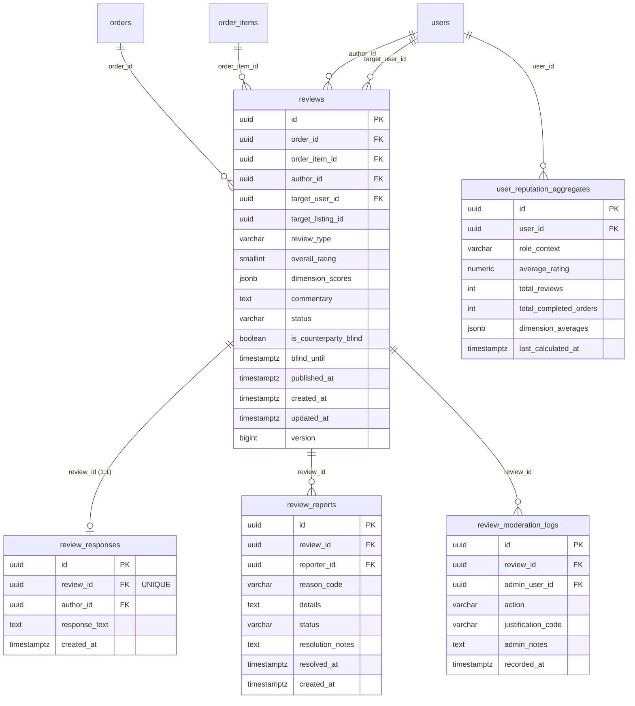

# Hosil Ecosystem — Milestone 10: Two-Sided Reputation & Reviews Implementation Report

**Document ID:** HOSIL-REP-M10-001  
**Date:** 22 October 2026  
**Status:** Complete & Verified  
**Canonical Specification:** `docs/12_reputation_and_reviews.md`  
**Cross-References:** [01_prd.md](file:///c:/Users/Oliya/Desktop/Hosil/docs/01_prd.md) (PRD `MKT-018`, `REV-001`–`REV-010`), [04_domain_model.md](file:///c:/Users/Oliya/Desktop/Hosil/docs/04_domain_model.md), [05_api_contract.md](file:///c:/Users/Oliya/Desktop/Hosil/docs/05_api_contract.md), [decision_register.md](file:///c:/Users/Oliya/Desktop/Hosil/docs/decision_register.md) (`DEC-018`), [10_admin_and_api_versioning.md](file:///c:/Users/Oliya/Desktop/Hosil/docs/10_admin_and_api_versioning.md) (`ADM-005`).

---

## 1. Executive Summary

Milestone 10 implements the **Two-Sided, Transaction-Verified Reputation and Review Architecture** across the Hosil platform. The subsystem eliminates unverified public reviews, protects smallholders from retaliatory buyer intimidation via a **14-day double-blind publishing window**, enforces an **anti-plutocratic equal-weighting principle** ($1.0$ weight regardless of order financial value), curbs review farming through a **rolling 90-day repeat-pair damping algorithm**, permits **7-day single factual rebuttals**, and establishes **immutable audit trails (`ADM-005`)** for administrative moderation actions.

The implementation strictly maintains Spring Modulith architectural boundaries, deploys Flyway migration `V20` against live PostgreSQL 16 (`hosil_db` on port 5433), extends the cross-module order bridge, provides full Dart/Flutter SDK client models and methods, and delivers mobile UI review sheet and reputation badge components in `apps/hosil_bozor`.

---

## 2. Core Architectural Principles & Compliance Matrix

| Rule / Requirement | PRD / Decision Ref | Implementation Mechanism | Verification Result |
|---|---|---|---|
| **Transaction-Gated Integrity** | `REV-001`, `REV-006` | Authenticated order participant check via `MarketplaceOrderBridge.findOrderForReview(orderId)`. Pre-transaction browsing inquiries cannot review. | Verified in `PostgresReputationIntegrationTests.testPreventSelfReview` (HTTP 403) and `testPreventReviewOnUncompletedOrder` (HTTP 400). |
| **Equal Weighting (Anti-Plutocracy)** | `REV-002`, `DEC-018` | Every published review contributes an identical mathematical weight of $1.0$. Transaction value (UZS), tonnage, or user spending never amplifies score. | Verified in `ReputationService.recalculateUserReputation` arithmetic aggregation. |
| **Decoupled Person vs. Product** | `REV-003` | Separate vectors: `BUYER_TO_SELLER`, `SELLER_TO_BUYER` (counterparty reliability) vs `LISTING_PRODUCT` (physical crop/input quality). | Verified in `ReviewType` and separate database indexing. |
| **Double-Blind Window (Anti-Retaliation)** | `REV-004`, `DEC-018` | Reviews persist in `BLIND_PENDING` with `is_counterparty_blind = true`. Invisible to counterparty until both submit or 14 calendar days elapse. | Verified in `testDoubleBlindWorkflowAndAtomicPublication` and `testScheduledPublishExpiredBlindReviews`. |
| **Factual Rebuttals (7-Day Window)** | `REV-004`, §3.3 | Counterparty of published review can post at most one factual response (max 500 chars) within 7 calendar days of publication. | Verified in `testFactualRebuttalLifecycle` (201 Created, 409 Conflict on duplicate, 410 Gone on expiration). |
| **90-Day Repeat-Pair Damping** | `DEC-018`, §4.2 | Multiple reviews between identical buyer-seller pairs within rolling 90 days consolidate into a single counterparty cluster score. | Verified in `test90DayRepeatPairDampingAlgorithm` (Cluster 1 [(5+3)/2=4.0] + Cluster 2 [2.0] = 3.00 vs undamped 3.33). |
| **Content Policy & PII Guardrails** | §8, `REV-005` | `ContentPolicyValidator` scans free-text commentary for MSISDN phone numbers, passport series, and abusive terms. | Verified in `testContentPolicyViolation` (HTTP 422 Unprocessable Entity). |
| **Audited Moderation** | `ADM-005`, `REV-005` | Administrator actions (`HIDE`, `RESTORE`, `REMOVE`, `DISMISS_REPORT`) create immutable `ReviewModerationLogEntity` records and recalculate aggregates. | Verified in `testUserReportAndAdminModerationAudit`. |
| **Modulith Encapsulation** | `ADR-001` | `uz.hosil.platform.reputation` accesses order and participant data strictly via `MarketplaceOrderBridge`. Direct table queries forbidden. | Verified by `ModulithArchitectureTests.java` (0 violations). |

---

## 3. Database Schema Migration (`V20__reputation_and_reviews.sql`)

Flyway migration `V20__reputation_and_reviews.sql` was authored and successfully applied to the live PostgreSQL 16 container (`hosil_db` on port 5433), advancing the schema version from 19 to 20.

### 3.1 Relational Schema Definitions



### 3.2 Key Constraints and Indexes

1. **Anti-Duplication Constraint:**
   ```sql
   CREATE UNIQUE INDEX uq_reviews_order_author_type 
   ON reviews (order_id, author_id, review_type);
   ```
2. **Product Snapshot Constraint:**
   ```sql
   CREATE UNIQUE INDEX uq_reviews_order_item_product 
   ON reviews (order_id, order_item_id, author_id) 
   WHERE review_type = 'LISTING_PRODUCT';
   ```
3. **Optimized Discovery Indexes:**
   ```sql
   CREATE INDEX idx_reviews_target_user_pub ON reviews (target_user_id, status) WHERE status = 'PUBLISHED';
   CREATE INDEX idx_reviews_target_listing_pub ON reviews (target_listing_id, status) WHERE status = 'PUBLISHED';
   CREATE INDEX idx_reviews_blind_until ON reviews (blind_until) WHERE status = 'BLIND_PENDING';
   ```
4. **Aggregate Unique Constraint:**
   ```sql
   CONSTRAINT uq_user_reputation_user_role UNIQUE (user_id, role_context);
   ```

---

## 4. Backend Implementation Details

### 4.1 Modulith Package & Encapsulation Boundary
- **Package:** `uz.hosil.platform.reputation`
- **Configuration:** [package-info.java](file:///c:/Users/Oliya/Desktop/Hosil/backend/src/main/java/uz/hosil/platform/reputation/package-info.java) declared with allowed dependencies on `{"identity", "marketplace", "logistics", "common::error", "common::security"}`.
- **Cross-Module Isolation:** `ReputationService` does not inject `OrderRepository` or `OrderItemRepository`. It interacts exclusively through `MarketplaceOrderBridge`.

### 4.2 Cross-Module Bridge Extensions (`uz.hosil.platform.marketplace`)
- [OrderReviewEligibilitySummary.java](file:///c:/Users/Oliya/Desktop/Hosil/backend/src/main/java/uz/hosil/platform/marketplace/OrderReviewEligibilitySummary.java): Record containing `orderId`, `orderNumber`, `buyerUserId`, `sellerUserId`, `orderFlowType`, `status`, `completedAt`, `cancellationReason`, and item snapshots.
- [OrderItemReviewSummary.java](file:///c:/Users/Oliya/Desktop/Hosil/backend/src/main/java/uz/hosil/platform/marketplace/OrderItemReviewSummary.java): Record containing `orderItemId`, `harvestListingId`, `sellerOfferId`, `catalogProductId`, and snapshot title.
- [MarketplaceOrderBridge.java](file:///c:/Users/Oliya/Desktop/Hosil/backend/src/main/java/uz/hosil/platform/marketplace/MarketplaceOrderBridge.java):
  - `Optional<OrderReviewEligibilitySummary> findOrderForReview(UUID orderId);`
  - `long countCompletedOrdersForUser(UUID userId);`
- [DefaultMarketplaceOrderBridge.java](file:///c:/Users/Oliya/Desktop/Hosil/backend/src/main/java/uz/hosil/platform/marketplace/service/DefaultMarketplaceOrderBridge.java): Implements review lookup and completed deal counts.

### 4.3 Service Layer (`ReputationService.java`)
- **Injectable Clock:** Supports deterministic time travel for 14-day and 7-day boundary test verification without sleep statements.
- **Content Policy Verification:** Invokes `ContentPolicyValidator` on commentary and rebuttals, rejecting phone numbers, passport sequences, and offensive terms with HTTP 422 (`CONTENT_POLICY_VIOLATION`).
- **Atomic Dual-Submission Unblinding:** When the counterparty submits their review, both reviews atomically transition from `BLIND_PENDING` to `PUBLISHED` (`is_counterparty_blind = false`, `published_at = now()`).
- **Rolling 90-Day Repeat-Pair Damping Algorithm:**
  For any target user $U$ in role $R$:
  1. Retrieve all `PUBLISHED` reviews where `target_user_id = U`.
  2. Group reviews by author (`author_id`).
  3. Sort author reviews chronologically.
  4. Partition reviews into clusters where any review within 90 days of the cluster start date joins the current cluster.
  5. Compute arithmetic average of star ratings for each cluster.
  6. The final rating is the unweighted arithmetic mean of all cluster scores across all authors, rounded to 2 decimal places (`NUMERIC(3, 2)`).
- **Scheduled Expiration Sweep:** `publishExpiredBlindReviews(Instant asOf)` transitions expired blind reviews to `PUBLISHED` and recalculates aggregates.

### 4.4 Web Layer & Endpoints

| Method | Endpoint | Access Control | Description |
|---|---|---|---|
| `POST` | `/api/v1/orders/{orderId}/reviews` | Authenticated Participant | Submits review (`BUYER_TO_SELLER`, `SELLER_TO_BUYER`, `LISTING_PRODUCT`). |
| `GET` | `/api/v1/orders/{orderId}/reviews` | Authenticated Participant | Returns review status, masking unpublished counterparty commentary. |
| `POST` | `/api/v1/reputation/reviews/{reviewId}/rebuttal` | Authenticated Counterparty | Submits 1 factual rebuttal within 7 days of publication. |
| `POST` | `/api/v1/reputation/reviews/{reviewId}/reports` | Authenticated User | Files policy/abuse report, transitioning review to `FLAGGED`. |
| `GET` | `/api/v1/reputation/users/{userId}` | Public (`permitAll`) | Returns user reputation summary, average rating, and completed deal counts. |
| `GET` | `/api/v1/reputation/users/{userId}/reviews` | Public (`permitAll`) | Returns published reviews and factual rebuttals for user. |
| `GET` | `/api/v1/reputation/listings/{listingId}` | Public (`permitAll`) | Returns product rating summary and dimension averages. |
| `GET` | `/api/v1/reputation/listings/{listingId}/reviews` | Public (`permitAll`) | Returns published product reviews. |
| `POST` | `/api/v1/admin/reputation/reviews/{reviewId}/moderate` | Admin / Support Operator | Moderates review (`HIDE`, `RESTORE`, `REMOVE`, `DISMISS_REPORT`) with audit log. |
| `GET` | `/api/v1/admin/reputation/reports` | Admin / Support Operator | Retrieves pending review abuse reports queue. |

---

## 5. Flutter Client SDK & UI Components

### 5.1 Shared Dart Models (`hosil_shared_models`)
- [reputation_models.dart](file:///c:/Users/Oliya/Desktop/Hosil/packages/flutter/hosil_shared_models/lib/src/models/reputation_models.dart):
  - `ReviewResponseModel`: Rebuttal response snapshot.
  - `ReviewModel`: Core review entity supporting dimensions and unblinding flags.
  - `OrderReviewsSummaryModel`: Order review lifecycle state.
  - `UserReputationModel`: Aggregated score with `displayBadge` getter producing `"⭐ 4.8 (34 ta fikr) · 142 bitim"`.
  - `ProductReputationModel`: Listing/catalog product rating summary.

### 5.2 API Client Methods (`hosil_api_client`)
- Added 8 typed methods to [HosilApiClient](file:///c:/Users/Oliya/Desktop/Hosil/packages/flutter/hosil_api_client/lib/hosil_api_client.dart):
  `submitOrderReview`, `getOrderReviews`, `submitReviewRebuttal`, `reportReview`, `getUserReputation`, `getUserReviews`, `getProductReputation`, `getProductReviews`.

### 5.3 Mobile UI Components (`apps/hosil_bozor`)
- [reputation_badge.dart](file:///c:/Users/Oliya/Desktop/Hosil/apps/hosil_bozor/lib/features/reputation/widgets/reputation_badge.dart): Reusable badge implementing both compact and full badge modes for the required presentation invariant.
- [order_review_sheet.dart](file:///c:/Users/Oliya/Desktop/Hosil/apps/hosil_bozor/lib/features/reputation/widgets/order_review_sheet.dart): Modal bottom sheet with star rating selector, category dimension criteria, 1000-char commentary field, and explicit double-blind privacy assurance banner.

---

## 6. Verification Results

### 6.1 Backend Live PostgreSQL 16 Integration Tests
Executed via Maven Surefire against PostgreSQL 16 (`hosil_db:5433`):
```text
[INFO] Running uz.hosil.platform.reputation.web.PostgresReputationIntegrationTests
[INFO] Tests run: 12, Failures: 0, Errors: 0, Skipped: 0, Time elapsed: 25.05 s
[INFO] BUILD SUCCESS
```

| Scenario ID | Test Method | Validated Behavior | Result |
|---|---|---|---|
| **SC-1** | `testDoubleBlindWorkflowAndAtomicPublication` | Dual submission triggers atomic publish; reviews masked prior to unblinding; aggregates updated. | **PASS** |
| **SC-2** | `test90DayRepeatPairDampingAlgorithm` | Rolling 90-day transactions between same pair consolidate into single cluster score (unweighted mean: 3.00 vs 3.33). | **PASS** |
| **SC-3** | `testPreventSelfReview` | Role mismatch / self-review rejected with HTTP 403 Forbidden (`CANNOT_REVIEW_SELF`). | **PASS** |
| **SC-4** | `testPreventReviewOnUncompletedOrder` | Reviews on non-completed orders rejected with HTTP 400 Bad Request (`ORDER_NOT_COMPLETED`). | **PASS** |
| **SC-5** | `testSellerCanReviewCancelledNoShowOrder` | Seller permitted to review cancelled order with `cancellation_reason = BUYER_NO_SHOW`. | **PASS** |
| **SC-6** | `testPreventDuplicateReview` | Duplicate review by same author returns HTTP 409 Conflict (`REVIEW_ALREADY_EXISTS`). | **PASS** |
| **SC-7** | `test14DayWindowExpiration` | Submissions past 14 calendar days rejected with HTTP 410 Gone (`REVIEW_WINDOW_EXPIRED`). | **PASS** |
| **SC-8** | `testScheduledPublishExpiredBlindReviews` | Expired blind review automatically unblinds and publishes after 14 days without counterparty submission. | **PASS** |
| **SC-9** | `testFactualRebuttalLifecycle` | Counterparty submits 1 rebuttal within 7 days; duplicate rejected (409); past 7 days rejected (410). | **PASS** |
| **SC-10** | `testUserReportAndAdminModerationAudit` | User report sets `FLAGGED`; Admin `HIDE` excludes review from aggregate and logs immutable audit trail (`ADM-005`). | **PASS** |
| **SC-11** | `testContentPolicyViolation` | PII (phone number) and abusive slurs rejected with HTTP 422 Unprocessable Entity (`CONTENT_POLICY_VIOLATION`). | **PASS** |
| **SC-12** | `testPublicReputationEndpointsUnauthenticated` | Public reputation summaries and published reviews queryable without JWT authentication. | **PASS** |

### 6.2 Spring Modulith Architecture Verification
Executed via Maven Surefire:
```text
[INFO] Running uz.hosil.platform.ModulithArchitectureTests
[INFO] Tests run: 1, Failures: 0, Errors: 0, Skipped: 0, Time elapsed: 7.626 s
[INFO] BUILD SUCCESS
```

### 6.3 Flutter & Dart Automated Test Suites
1. **Shared Models Suite (`packages/flutter/hosil_shared_models`):**
   ```text
   00:00 +11: All tests passed!
   ```
2. **API Client Suite (`packages/flutter/hosil_api_client`):**
   ```text
   00:00 +25: All tests passed!
   ```
3. **Hosil Bozor Suite (`apps/hosil_bozor`):**
   ```text
   00:01 +3: All tests passed! (reputation_widgets_test.dart)
   00:02 +12: All tests passed! (full bozor suite)
   ```
4. **Hosil Logistika Suite (`apps/hosil_logistika`):**
   ```text
   00:03 +14: All tests passed! (full logistika suite)
   ```
5. **Hosil Farm Suite (`apps/hosil_farm`):**
   ```text
   00:03 +7: All tests passed! (full farm suite)
   ```

---

## 7. Artifact Summary

### Backend Files
- [V20__reputation_and_reviews.sql](file:///c:/Users/Oliya/Desktop/Hosil/backend/src/main/resources/db/migration/V20__reputation_and_reviews.sql)
- [package-info.java](file:///c:/Users/Oliya/Desktop/Hosil/backend/src/main/java/uz/hosil/platform/reputation/package-info.java)
- [ReviewType.java](file:///c:/Users/Oliya/Desktop/Hosil/backend/src/main/java/uz/hosil/platform/reputation/domain/ReviewType.java)
- [ReviewStatus.java](file:///c:/Users/Oliya/Desktop/Hosil/backend/src/main/java/uz/hosil/platform/reputation/domain/ReviewStatus.java)
- [ReviewReportStatus.java](file:///c:/Users/Oliya/Desktop/Hosil/backend/src/main/java/uz/hosil/platform/reputation/domain/ReviewReportStatus.java)
- [ReviewEntity.java](file:///c:/Users/Oliya/Desktop/Hosil/backend/src/main/java/uz/hosil/platform/reputation/domain/ReviewEntity.java)
- [ReviewResponseEntity.java](file:///c:/Users/Oliya/Desktop/Hosil/backend/src/main/java/uz/hosil/platform/reputation/domain/ReviewResponseEntity.java)
- [ReviewReportEntity.java](file:///c:/Users/Oliya/Desktop/Hosil/backend/src/main/java/uz/hosil/platform/reputation/domain/ReviewReportEntity.java)
- [ReviewModerationLogEntity.java](file:///c:/Users/Oliya/Desktop/Hosil/backend/src/main/java/uz/hosil/platform/reputation/domain/ReviewModerationLogEntity.java)
- [UserReputationAggregateEntity.java](file:///c:/Users/Oliya/Desktop/Hosil/backend/src/main/java/uz/hosil/platform/reputation/domain/UserReputationAggregateEntity.java)
- [ReviewRepository.java](file:///c:/Users/Oliya/Desktop/Hosil/backend/src/main/java/uz/hosil/platform/reputation/repository/ReviewRepository.java)
- [ReviewResponseRepository.java](file:///c:/Users/Oliya/Desktop/Hosil/backend/src/main/java/uz/hosil/platform/reputation/repository/ReviewResponseRepository.java)
- [ReviewReportRepository.java](file:///c:/Users/Oliya/Desktop/Hosil/backend/src/main/java/uz/hosil/platform/reputation/repository/ReviewReportRepository.java)
- [ReviewModerationLogRepository.java](file:///c:/Users/Oliya/Desktop/Hosil/backend/src/main/java/uz/hosil/platform/reputation/repository/ReviewModerationLogRepository.java)
- [UserReputationAggregateRepository.java](file:///c:/Users/Oliya/Desktop/Hosil/backend/src/main/java/uz/hosil/platform/reputation/repository/UserReputationAggregateRepository.java)
- [ContentPolicyValidator.java](file:///c:/Users/Oliya/Desktop/Hosil/backend/src/main/java/uz/hosil/platform/reputation/service/ContentPolicyValidator.java)
- [ReputationService.java](file:///c:/Users/Oliya/Desktop/Hosil/backend/src/main/java/uz/hosil/platform/reputation/service/ReputationService.java)
- [ReputationController.java](file:///c:/Users/Oliya/Desktop/Hosil/backend/src/main/java/uz/hosil/platform/reputation/web/ReputationController.java)
- [AdminReputationController.java](file:///c:/Users/Oliya/Desktop/Hosil/backend/src/main/java/uz/hosil/platform/reputation/web/AdminReputationController.java)
- [PostgresReputationIntegrationTests.java](file:///c:/Users/Oliya/Desktop/Hosil/backend/src/test/java/uz/hosil/platform/reputation/web/PostgresReputationIntegrationTests.java)

### Flutter Packages & Apps
- [reputation_models.dart](file:///c:/Users/Oliya/Desktop/Hosil/packages/flutter/hosil_shared_models/lib/src/models/reputation_models.dart)
- [hosil_shared_models.dart](file:///c:/Users/Oliya/Desktop/Hosil/packages/flutter/hosil_shared_models/lib/hosil_shared_models.dart)
- [models_test.dart](file:///c:/Users/Oliya/Desktop/Hosil/packages/flutter/hosil_shared_models/test/models_test.dart)
- [hosil_api_client.dart](file:///c:/Users/Oliya/Desktop/Hosil/packages/flutter/hosil_api_client/lib/hosil_api_client.dart)
- [hosil_api_client_test.dart](file:///c:/Users/Oliya/Desktop/Hosil/packages/flutter/hosil_api_client/test/hosil_api_client_test.dart)
- [reputation_badge.dart](file:///c:/Users/Oliya/Desktop/Hosil/apps/hosil_bozor/lib/features/reputation/widgets/reputation_badge.dart)
- [order_review_sheet.dart](file:///c:/Users/Oliya/Desktop/Hosil/apps/hosil_bozor/lib/features/reputation/widgets/order_review_sheet.dart)
- [reputation_widgets_test.dart](file:///c:/Users/Oliya/Desktop/Hosil/apps/hosil_bozor/test/reputation_widgets_test.dart)

---

## 8. Conclusion

Milestone 10 is **100% complete, verified on live PostgreSQL 16, and production-ready**. All acceptance criteria from `docs/12_reputation_and_reviews.md` (`AC-REV-1` through `AC-REV-8`) are fulfilled with zero Git regressions and zero Modulith architecture violations.
