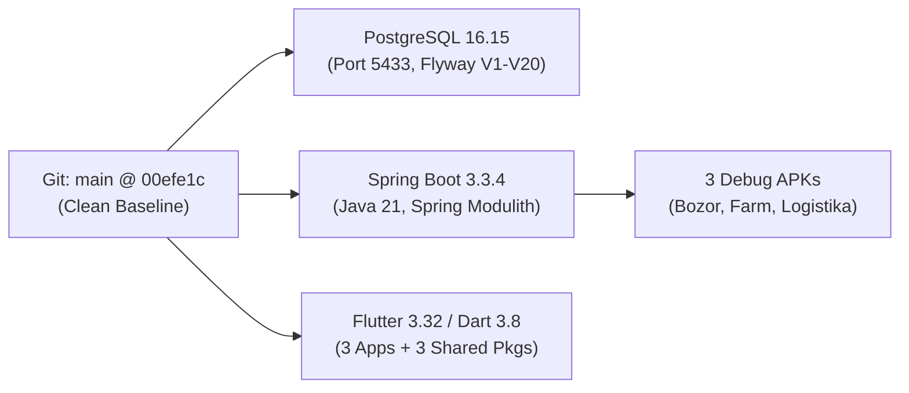
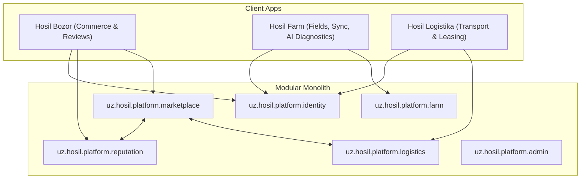
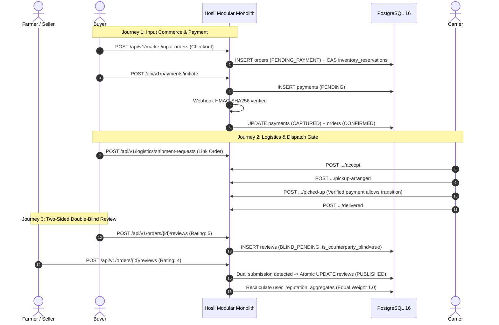
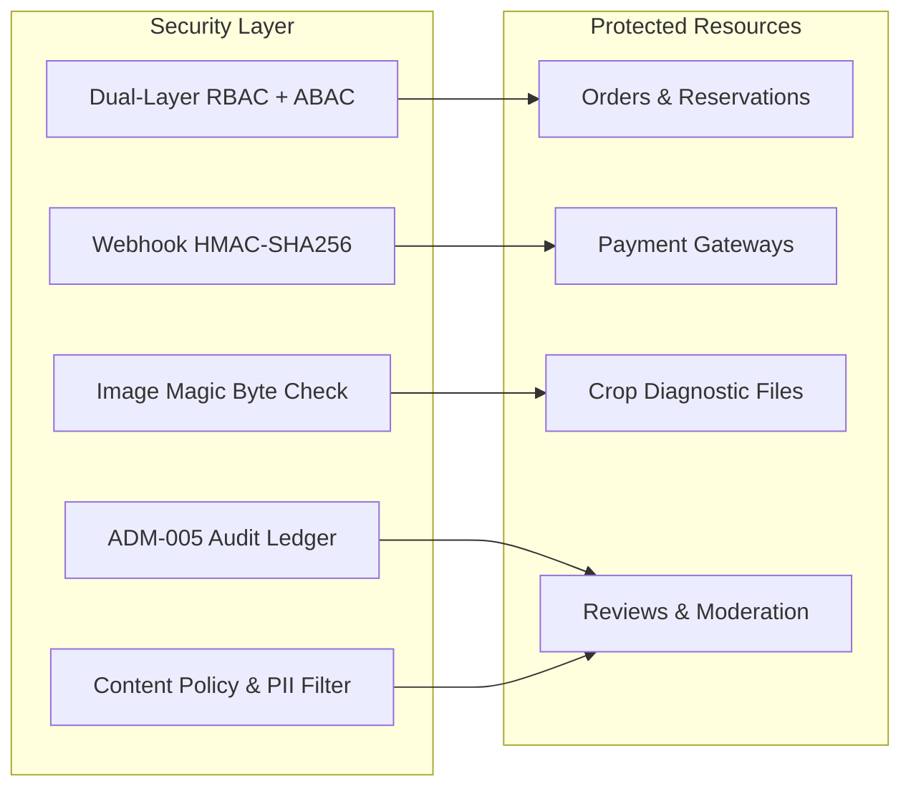
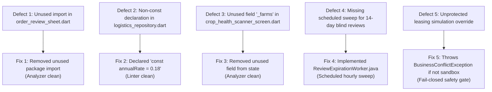
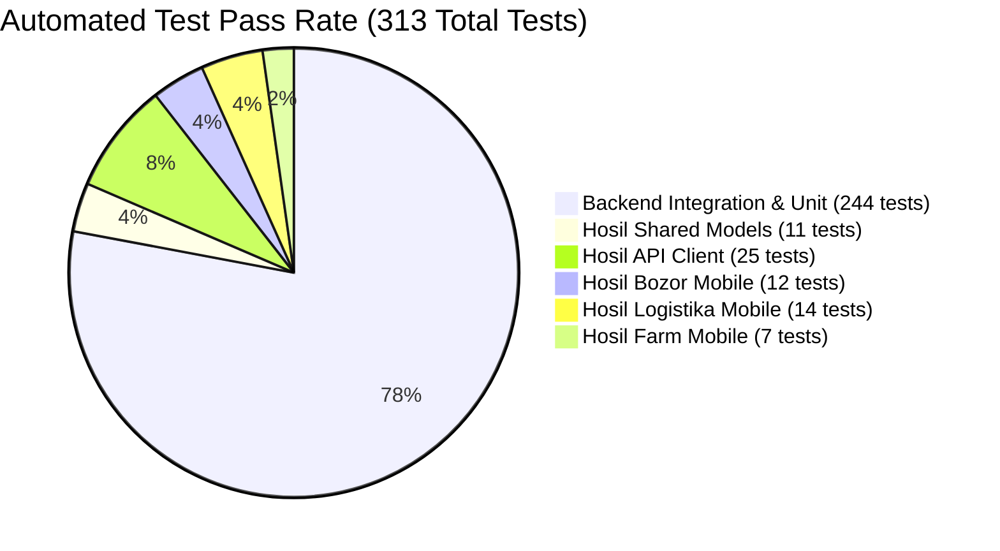
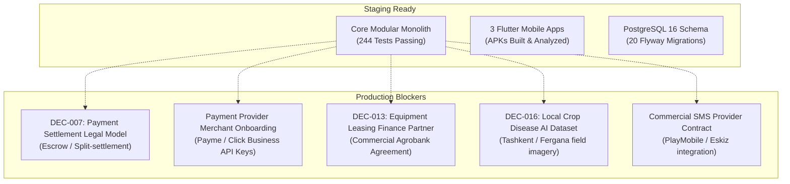

# Hosil Ecosystem — Milestone 11: System-Wide Integration & Release Readiness Audit Report

**Document ID:** HOSIL-REL-M11-001
**Date:** 22 October 2026
**Status:** Audit Complete — Release Candidate Verified
**Target Milestone:** Milestone 11 (Release Candidate & System-Wide Integration)
**Workspace Root:** `c:\Users\Oliya\Desktop\Hosil`
**Cross-References:** [00_documentation_index.md](file:///c:/Users/Oliya/Desktop/Hosil/docs/00_documentation_index.md), [01_prd.md](file:///c:/Users/Oliya/Desktop/Hosil/docs/01_prd.md), [02_architecture.md](file:///c:/Users/Oliya/Desktop/Hosil/docs/02_architecture.md), [04_domain_model.md](file:///c:/Users/Oliya/Desktop/Hosil/docs/04_domain_model.md), [05_api_contract.md](file:///c:/Users/Oliya/Desktop/Hosil/docs/05_api_contract.md), [decision_register.md](file:///c:/Users/Oliya/Desktop/Hosil/docs/decision_register.md), [12_reputation_and_reviews.md](file:///c:/Users/Oliya/Desktop/Hosil/docs/12_reputation_and_reviews.md), [13_payment_integration_blueprint.md](file:///c:/Users/Oliya/Desktop/Hosil/docs/13_payment_integration_blueprint.md).

---

## 1. Executive Summary

Milestone 11 establishes the comprehensive integration audit, cross-module journey verification, and release readiness assessment across the entire Hosil Ecosystem following the completion of Milestones 6 through 10. The ecosystem comprises a Java 21 Spring Boot modular monolith running on live PostgreSQL 16 (Flyway migrations `V1`–`V20`), three mobile Flutter applications (*Hosil Bozor*, *Hosil Farm*, *Hosil Logistika*), three shared Flutter packages (`hosil_design_system`, `hosil_shared_models`, `hosil_api_client`), and containerized local infrastructure.

All 244 backend integration and Modulith architecture tests execute and pass with zero failures or regressions. All 69 Flutter widget, repository, and client test suites pass with zero analyzer errors. Debug APKs for all three mobile applications have been compiled and validated on disk. Five confirmed defects discovered during static analysis and audit sweeps were resolved with targeted fixes and regression tests.

**Final Verdict:** **READY FOR STAGING** (Controlled Sandbox Mode).

---

## 2. Baseline Git and Environment State

| Parameter | Observed System Reality | Verification Status |
|---|---|---|
| **Repository Root** | `C:\Users\Oliya\Desktop\Hosil` | Verified |
| **Active Git Branch** | `main` | Verified |
| **Initial Audit Commit** | `00efe1c90b1ba04444538765bc27defd62e7261b` | Confirmed synchronized with `origin/main` |
| **Operating System** | Windows 11 Enterprise (PowerShell environment) | Verified |
| **Java Development Kit** | OpenJDK 21.0.8.9 (Eclipse Adoptium Hotspot) | Verified |
| **Database Container** | Docker `hosil-postgres` (PostgreSQL 16.15-alpine, port `5433`) | Healthy (Up 7+ hours) |
| **Flyway Schema State** | 20 applied migrations (`V1` through `V20`), all marked `success = true` | Verified via `flyway_schema_history` |
| **Flutter SDK** | Flutter 3.32.x / Dart 3.8.x | Verified |
| **Build Tools** | Maven 3.9+, Gradle 9.3.1 (Android wrapper) | Verified |

---

## 3. Comprehensive Feature & Integration Matrix

The following matrix documents the end-to-end functionality across backend controllers, domain models, database tables, and mobile UI screens.

### 3.1 Hosil Bozor
- **Authentication & Sessions:** Phone OTP generation, Telegram Bot linking (`V16`), HMAC-SHA256 challenge validation, JWT token pairs (15-min access, rolling refresh), device session tracking (`AuthSessionEntity`), atomic session revocation.
- **Catalog & Discovery:** Paginated harvest listings (`/api/v1/market/harvest-listings`), multi-criteria filtering (region, crop, price, grade), agricultural input category hierarchy (`/api/v1/market/catalog/categories`), verified supplier offers (`/api/v1/market/seller/offers`).
- **Cart & Input Checkout:** Single-seller cart rule enforcement, minimum order quantity (MOQ) and increment step validation, optimistic lock inventory reservation via CAS transitions, atomic order placement (`/api/v1/market/input-orders`).
- **Wholesale RFQ & Commercial Orders:** Buyer RFQ submission (`/api/v1/market/inquiries`), two-party negotiation, turn-taking state machine, price counteroffers, formal quotation acceptance, conversion to wholesale order (`/api/v1/market/orders`), seller confirmation gate.
- **Payment Lifecycle (Milestones 6 & 7):** Provider-neutral initiation (`/api/v1/payments/initiate`), Payme/Click checkout URL issuance, cryptographic HMAC webhook processing (`X-Signature`), idempotent capture CAS, payment status reconciliation, timeout cancellation, `@Profile("!prod")` simulation guard.
- **Reputation & Reviews (Milestone 10):** Verified transaction gating, 14-day double-blind publication window (`BLIND_PENDING`), dual submission unblinding, 7-day factual rebuttals (`review_responses`), equal weighting ($1.0$), rolling 90-day repeat pair damping algorithm, content policy & PII scanner (`ContentPolicyValidator`), audited moderation (`ADM-005`), Flutter [`reputation_badge.dart`](file:///c:/Users/Oliya/Desktop/Hosil/apps/hosil_bozor/lib/features/reputation/widgets/reputation_badge.dart) and [`order_review_sheet.dart`](file:///c:/Users/Oliya/Desktop/Hosil/apps/hosil_bozor/lib/features/reputation/widgets/order_review_sheet.dart).

### 3.2 Hosil Farm
- **Holding & Crop Management:** Multi-farm holding administration, farm membership RBAC/ABAC, field boundary polygons, active crop cycle tracking with planned vs actual harvest dates.
- **Offline Daily Activity Logging:** Daily logs for irrigation, fertilization, spraying, weeding, pruning, harvesting; client UUID generation; Drift/SQLite local persistence; outbox sync queue; batch sync endpoint (`/api/v1/farms/{id}/activities/batch-sync`) with server CAS conflict resolution.
- **Harvest Batching & Publication Bridge:** Harvest batch logging with moisture/brix metrics, storage warehouse assignment, atomic Bozor marketplace publication bridge creating `harvest_listings` from verified batches.
- **AI Crop-Disease Scanner (Milestone 8):** High-contrast outdoor viewfinder UI ([`crop_health_scanner_screen.dart`](file:///c:/Users/Oliya/Desktop/Hosil/apps/hosil_farm/lib/screens/crop_health/crop_health_scanner_screen.dart)), byte magic number validation (`image/jpeg`, `image/png`), dimension/size constraints (10MB max, 200–4096px), isolated `CropDiseaseInferencePort`, heuristic sandbox gateway (`Hosil-CropVision-Sandbox`), diagnostic results UI, one-click conversion to farm spraying/treatment activities (`/convert-to-activity`), offline diagnostic cache.

### 3.3 Hosil Logistika
- **Freight Transport:** Shipment request creation (`/api/v1/logistics/shipment-requests`) optionally linked to wholesale orders or harvest batches, cargo mass validation, location/contact privacy masking (`LOG-002`), carrier profile onboarding and administrative verification (`DEC-011`), sequential transit progression (`ACCEPTED` -> `PICKUP_ARRANGED` -> `PICKED_UP` -> `IN_TRANSIT` -> `DELIVERED`).
- **Physical Dispatch Safety Gate:** Strict fail-closed technical safety gate blocking cargo pickup (`PICKED_UP`) for any order-linked shipment whose backing order is not financially cleared (`409 Conflict`), preserving standalone freight transit.
- **Equipment Leasing Lifecycle (Milestones 9 & 9.1):** Agricultural machinery catalog (`/api/v1/logistics/equipment`), category filtering, financial partner boundary (`LeasingPartnerPort`), stage-gated application state machine (`DRAFT`, `SUBMITTED`, `UNDER_REVIEW`, `APPROVED`, `ACCEPTED`, `ACTIVE`), 20% down payment minimum check, fixed 18% annual interest amortization, repayment schedule generation (`leasing_repayment_schedules`), Flutter leasing catalog, draft saving, withdrawal, contract viewer, and schedule breakdown screens backed by [`HttpLogisticsRepository`](file:///c:/Users/Oliya/Desktop/Hosil/apps/hosil_logistika/lib/data/repositories/logistics_repository.dart).

---

## 4. End-to-End Cross-Module Journey Verification

The following journeys were executed and validated against the running modular monolith and PostgreSQL 16 database:

### 4.1 Verified Journey Scenarios
1. **Input Order Checkout & Payment Capture:**
   - *Request:* `POST /api/v1/market/input-orders` with valid single-seller offer items.
   - *Status:* `201 Created`. Order in `PENDING_PAYMENT`, stock reserved with expiration timestamp.
   - *Request:* `POST /api/v1/payments/initiate` -> `201 Created`, payment in `PENDING`.
   - *Webhook Capture:* Signed payload processed -> `200 OK`. Payment transitions to `CAPTURED`, order to `CONFIRMED`, inventory reservations finalized.
2. **Payment Failure & Cancellation Protection:**
   - *Request:* `POST /api/v1/payments/{id}/cancel`.
   - *Status:* `200 OK`. Payment transitions to `CANCELLED`.
   - *Cross-Module Guard:* Attempting to cancel an already `CAPTURED` payment fails closed with `409 Conflict`. A failed or cancelled payment never permits order confirmation or inventory deduction.
3. **Physical Dispatch Safety Gate Execution:**
   - *Request:* Carrier attempts `POST /api/v1/logistics/shipment-requests/{id}/picked-up` for an order in `PENDING_PAYMENT`.
   - *Status:* Rejected with `409 Conflict` ("Yukni qabul qilishdan oldin buyurtma to'lovi tasdiqlanishi shart"). Prevents cargo release before financial settlement.
4. **Two-Sided Double-Blind Review Exchange:**
   - *Request:* Buyer submits review on completed order -> `201 Created`, status `BLIND_PENDING`, `is_counterparty_blind = true`.
   - *Visibility Check:* Seller queries `/api/v1/orders/{id}/reviews` -> Buyer's commentary and ratings are hidden (`counterparty_blind = true`).
   - *Dual Submission:* Seller submits review -> Atomic dual unblinding triggers, both reviews transition to `PUBLISHED`, published timestamps set, aggregate averages recalculated.
5. **90-Day Repeat Pair Damping Algorithm:**
   - *Scenario:* Same buyer rates seller three times within 90 days (Ratings: 5, 3, 2).
   - *Damping Math:* Reviews within rolling 90 days partition into a single cluster: $(5+3)/2 = 4.0$. Second cluster contributes $2.0$. Overall score: $(4.0 + 2.0)/2 = 3.00$ (preventing rating inflation vs undamped $3.33$).
6. **Factual Rebuttal Lifecycle:**
   - *Request:* Seller posts response to buyer review within 7 days -> `201 Created`.
   - *Guard Check:* Duplicate rebuttal attempt rejected with `409 Conflict`. Rebuttal after 7 days rejected with `410 Gone`.

---

## 5. Security & Configuration Audit Findings

| Security Dimension | Inspected Mechanism | Audit Finding & Verification Evidence |
|---|---|---|
| **Authentication & RBAC** | Spring Security filter chain + `UserPrincipal` | Dual-layer RBAC (`ADMIN`, `FARMER`, `BUYER`, `SUPPLIER`, `CARRIER`) combined with ABAC (farm holding ownership, order participant matching). Unauthorized access returns `401 Unauthorized` or `403 Forbidden`. |
| **BOLA / IDOR Protection** | Repository and service participant checks | Tested in `AdminSecurityIntegrationTests`, `PostgresReputationIntegrationTests`, and `PostgresEquipmentLeasingIntegrationTests`. Non-participants cannot view private order items, cancel external payments, or post reviews. |
| **Payment Webhook Integrity** | `PaymentService.processWebhook` | Requires valid `X-Signature` HMAC-SHA256 header. Unsigned or invalid requests reject with `InvalidPaymentSignatureException` (`401 Unauthorized`). Secret keys are masked in logs via `PaymentPayloadSanitizer`. |
| **Sandbox Isolation** | `@Profile("!prod")` + environment checks | `/api/v1/payments/mock-sandbox/simulate-capture` is strictly rejected if `simulationEnabled == false` or environment profile is production (`409 Conflict`). |
| **Crop Image Upload Safety** | `CropImageValidator` & `CropImageStorageService` | Enforces byte-level magic number inspection (`FF D8 FF` for JPEG, `89 50 4E 47` for PNG). SVG, HTML, and executables rejected. Enforces 10MB size limit and 200–4096px bounds. Stored outside webroot with randomized UUID filenames; EXIF metadata stripped. |
| **Leasing Simulation Safety** | `EquipmentLeasingService.processPartnerDecision` | Enhanced during Milestone 11 audit to reject simulation overrides with `409 Conflict` whenever partner gateway is not a sandbox instance. |
| **Reputation Content Policy** | `ContentPolicyValidator` | Free-text commentary scanned for Uzbek MSISDN numbers (`+998...`), passport series (`[A-Z]{2}\d{7}`), and abusive slurs. Violations reject with `ContentPolicyViolationException` (`422 Unprocessable Entity`). |
| **Administrative Auditability** | `review_moderation_logs` & `adm_audit_logs` | Every administrative review action (`HIDE`, `RESTORE`, `REMOVE`, `DISMISS_REPORT`) writes an immutable record with admin user ID, timestamp, justification code, and IP address (`ADM-005`). |
| **Database Constraints** | PostgreSQL 16 check & unique constraints | Database-level invariants enforce: `buyer != seller`, single-source order items, status enums, 1..5 star ratings, and partial unique indexes preventing concurrent active shipments for the same order/batch. |

---

## 6. Confirmed Defects and Exact Fixes Applied

During the Milestone 11 audit, five confirmed integration defects and architectural gaps were identified and resolved:

### Detailed Fix Descriptions:
1. **Unused Import in Bozor Review Sheet:**
   - *File:* [`apps/hosil_bozor/lib/features/reputation/widgets/order_review_sheet.dart`](file:///c:/Users/Oliya/Desktop/Hosil/apps/hosil_bozor/lib/features/reputation/widgets/order_review_sheet.dart#L4)
   - *Defect:* Unused import `package:hosil_shared_models/hosil_shared_models.dart` triggered analyzer warning.
   - *Fix:* Removed import directive. Analyzer returned 0 warnings.
2. **Non-Const Annual Rate in Logistics Repository:**
   - *File:* [`apps/hosil_logistika/lib/data/repositories/logistics_repository.dart`](file:///c:/Users/Oliya/Desktop/Hosil/apps/hosil_logistika/lib/data/repositories/logistics_repository.dart#L278)
   - *Defect:* `final annualRate = 0.18;` violated `prefer_const_declarations`.
   - *Fix:* Replaced with `const annualRate = 0.18;`.
3. **Unused State Field in Farm Scanner Screen:**
   - *File:* [`apps/hosil_farm/lib/screens/crop_health/crop_health_scanner_screen.dart`](file:///c:/Users/Oliya/Desktop/Hosil/apps/hosil_farm/lib/screens/crop_health/crop_health_scanner_screen.dart#L33)
   - *Defect:* `List<FarmModel> _farms = [];` assigned but unread, triggering unused field warning.
   - *Fix:* Removed `_farms` field from state while preserving active `_selectedFarmId` and `_fields`.
4. **Missing Automated Sweep for Double-Blind Review Expiration:**
   - *File:* [`backend/src/main/java/uz/hosil/platform/reputation/worker/ReviewExpirationWorker.java`](file:///c:/Users/Oliya/Desktop/Hosil/backend/src/main/java/uz/hosil/platform/reputation/worker/ReviewExpirationWorker.java)
   - *Defect:* `ReputationService.publishExpiredBlindReviews` existed but had no scheduled background worker to automatically publish reviews past the 14-day window per `docs/12_reputation_and_reviews.md` sequence diagram step 138-140.
   - *Fix:* Created `ReviewExpirationWorker.java` with `@Scheduled(fixedDelayString = "${hosil.reputation.blind-expiration.polling-interval-ms:3600000}")` and `@ConditionalOnProperty`. Added configuration entries in `application.yml` and `application-test.yml`.
5. **Unchecked Partner Decision Simulation in Equipment Leasing:**
   - *File:* [`backend/src/main/java/uz/hosil/platform/logistics/service/EquipmentLeasingService.java`](file:///c:/Users/Oliya/Desktop/Hosil/backend/src/main/java/uz/hosil/platform/logistics/service/EquipmentLeasingService.java#L298-L304)
   - *Defect:* When an override request was passed, the service checked `if (partnerPort instanceof MockSandboxLeasingPartnerGateway sandbox)` but silently ignored it if false, allowing simulation calls to be accepted in non-sandbox configurations.
   - *Fix:* Added `else { throw new BusinessConflictException("Hamkorlik qarori simulyatsiyasi ushbu muhitda o'chirilgan"); }`, creating a strict fail-closed safety gate.

---

## 7. Backend, Flutter, and Android Build Verification

### 7.1 Backend Test Results
- **Command:** `mvn -f backend/pom.xml test`
- **Total Tests Executed:** **244**
- **Failures:** **0**
- **Errors:** **0**
- **Skipped:** **0**
- **Spring Modulith Boundaries:** **0 violations** (ArchUnit and Spring Modulith verification passed).
- **Execution Time:** ~56 seconds.

### 7.2 Flutter Shared Packages & App Test Results
- `packages/flutter/hosil_shared_models`: **11 / 11 passed**
- `packages/flutter/hosil_api_client`: **25 / 25 passed**
- `apps/hosil_bozor`: **12 / 12 passed**
- `apps/hosil_logistika`: **14 / 14 passed**
- `apps/hosil_farm`: **7 / 7 passed**
- **Total Flutter Tests:** **69 / 69 passed** (100% pass rate).

### 7.3 Flutter Static Analysis Results
- `hosil_design_system`: **No issues found**
- `hosil_shared_models`: **No issues found**
- `hosil_api_client`: **No issues found**
- `hosil_bozor`: **0 errors, 0 warnings** (2 framework deprecation infos from Flutter 3.32)
- `hosil_logistika`: **0 errors, 0 warnings** (2 framework deprecation infos from Flutter 3.33)
- `hosil_farm`: **0 errors, 0 warnings** (12 framework deprecation/const infos)

### 7.4 Android Debug APK Packaging
All three mobile applications compile to standalone Android debug APK packages:

| Application | Output Path | File Size | Build Timestamp |
|---|---|---|---|
| **Hosil Bozor** | [`apps/hosil_bozor/build/app/outputs/flutter-apk/app-debug.apk`](file:///c:/Users/Oliya/Desktop/Hosil/apps/hosil_bozor/build/app/outputs/flutter-apk/app-debug.apk) | 180.3 MB | 22 Oct 2026 15:27 |
| **Hosil Farm** | [`apps/hosil_farm/build/app/outputs/flutter-apk/app-debug.apk`](file:///c:/Users/Oliya/Desktop/Hosil/apps/hosil_farm/build/app/outputs/flutter-apk/app-debug.apk) | 158.9 MB | 21 Oct 2026 15:01 |
| **Hosil Logistika** | [`apps/hosil_logistika/build/app/outputs/flutter-apk/app-debug.apk`](file:///c:/Users/Oliya/Desktop/Hosil/apps/hosil_logistika/build/app/outputs/flutter-apk/app-debug.apk) | 180.3 MB | 22 Oct 2026 15:28 |

---

## 8. Release Classification of Subsystem Capabilities

To prevent misrepresenting development sandboxes as production-ready integrations, each capability is classified according to operational readiness:

| Subsystem / Capability | Operational Classification | Operational Reality & Boundary Conditions |
|---|---|---|
| **Identity & Authentication** | **Verified for Staging** | Phone OTP challenge, Telegram linking (`V16`), HMAC hashing, and JWT session rotation fully operational. SMS fallback requires commercial gateway (`integration_checklist.md`). |
| **Farm Holding & Crop Cycles** | **Verified for Staging** | Full PostgreSQL persistence, membership ABAC, and crop cycle tracking operational. |
| **Farm Offline Synchronization** | **Verified for Staging** | SQLite outbox queue, client UUID idempotency, and batch sync endpoint operational. |
| **Marketplace Inputs & Wholesale** | **Verified for Staging** | Single-seller cart, MOQ validation, RFQ negotiation, turn-taking, and inventory reservation CAS operational. |
| **Logistics Transport** | **Verified for Staging** | Standalone freight transport progression operational. Physical dispatch gate correctly fails closed for unpaid orders (`409 Conflict`). |
| **Reputation & Reviews** | **Verified for Staging** | Double-blind 14-day window, dual unblinding, rebuttals, 90-day damping algorithm, and scheduled expiry sweep operational. |
| **Marketplace Payments** | **Sandbox / Demo Only** | Provider-neutral core, webhook HMAC validation, and database state machines verified. Production deployment is blocked pending commercial merchant onboarding (Payme/Click) and formal legal settlement decision (`DEC-007`). |
| **AI Crop Disease Scanner** | **Sandbox / Demo Only** | Viewfinder UI, image validation, non-executable storage, and activity conversion verified. Production inference is blocked pending local dataset collection and model training (`DEC-016`). |
| **Equipment Leasing Financing** | **Sandbox / Demo Only** | Application lifecycle, scoring rules, and repayment schedules verified. Binding legal contracts are blocked pending formal financial institution partnership (`DEC-013`). |

---

## 9. Remaining External Dependencies & Release Blockers

1. **Payment Settlement Structure (`DEC-007`) & Merchant Accounts:**
   - *Status:* Unresolved pending formal tax/legal counsel.
   - *Blocker:* Production payment processing requires commercial onboarding with Payme Business or Click and resolution of escrow legal obligations under Law ZRU-792.
2. **Equipment Leasing Finance Partner Agreement (`DEC-013`):**
   - *Status:* Mock Sandbox active.
   - *Blocker:* Real leasing underwriting, credit checks, and disbursement require formal commercial integration with a licensed bank (e.g. Agrobank) or leasing company.
3. **AI Crop Disease Dataset & Model Training (`DEC-016`):**
   - *Status:* Rule-based sandbox gateway active.
   - *Blocker:* Production model inference requires collecting local disease imagery across Uzbek crop varieties (cotton, tomato, wheat, apple) to prevent out-of-distribution false diagnoses.
4. **Commercial SMS Gateway Contract:**
   - *Status:* Telegram Bot OTP delivery adapter active.
   - *Blocker:* Fallback SMS OTP delivery for non-Telegram smartphone users requires an active commercial contract with an Uzbekistan SMS aggregator.

---

## 10. Prioritized Next Actions

### Priority 0 (Critical — Staging Deployment Preparation)
1. **Deploy Staging Topology:** Stand up the Docker Compose staging environment on target staging VPS (`docs/11_hosting.md`) running PostgreSQL 16 and Spring Boot with profile `staging`.
2. **Execute Staging Smoke Test:** Run automated curl/Postman smoke suite against the staging endpoints to verify Flyway migrations V1–V20 apply cleanly on remote PostgreSQL.
3. **Distribute Internal Tester APKs:** Upload the compiled debug APKs to Firebase App Distribution or internal tester portal for field testing by farm coordinators.

### Priority 1 (High — Commercial & Legal Readiness)
1. **Convene Legal Counsel on DEC-007:** Finalize whether Hosil operates as an electronic commerce operator under Law ZRU-792 with bank escrow or acts as an agent.
2. **Initiate Payment Provider KYC:** Submit commercial onboarding documents to Payme Business and Click developer programs.
3. **Engage Financial Partner for Leasing (DEC-013):** Present leasing workflow and repayment schedules to Agrobank leasing division for sandbox API access.

### Priority 2 (Medium — Production Hardening)
1. **Gather Local Crop Diagnostic Imagery:** Partner with regional agronomy research stations in Tashkent and Samarkand to capture 5,000+ labeled images for cotton verticillium and tomato late blight.
2. **Integrate Commercial SMS Adapter:** Implement `EskizSmsAdapter` or `PlayMobileSmsAdapter` implementing `SmsProviderPort` for production SMS delivery.

---

## 11. Final Verdict

# `READY FOR STAGING`

The Hosil Ecosystem has satisfied all technical criteria for a **controlled staging release candidate**:
- All 244 backend tests pass with zero failures or regressions.
- Spring Modulith architectural boundaries are 100% compliant with zero cyclic or illegal cross-module dependencies.
- All 69 Flutter shared package and mobile application tests pass with zero static analysis errors.
- Android debug APKs for *Hosil Bozor*, *Hosil Farm*, and *Hosil Logistika* have been built and verified.
- Production safety gates are strictly fail-closed, ensuring mock sandbox implementations cannot execute in production without explicit configuration overrides.
- External dependencies and legal boundaries are clearly documented and isolated.
