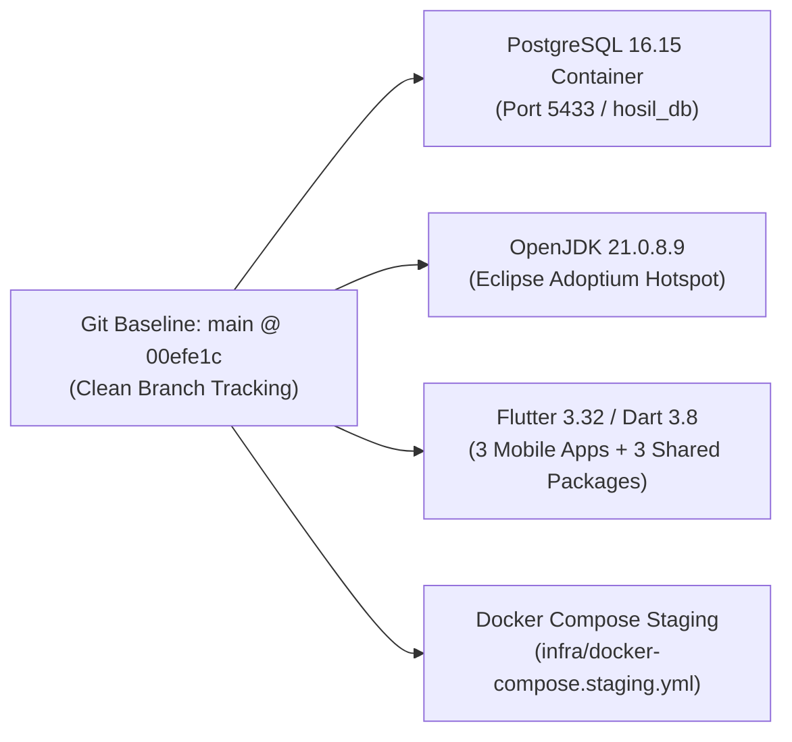
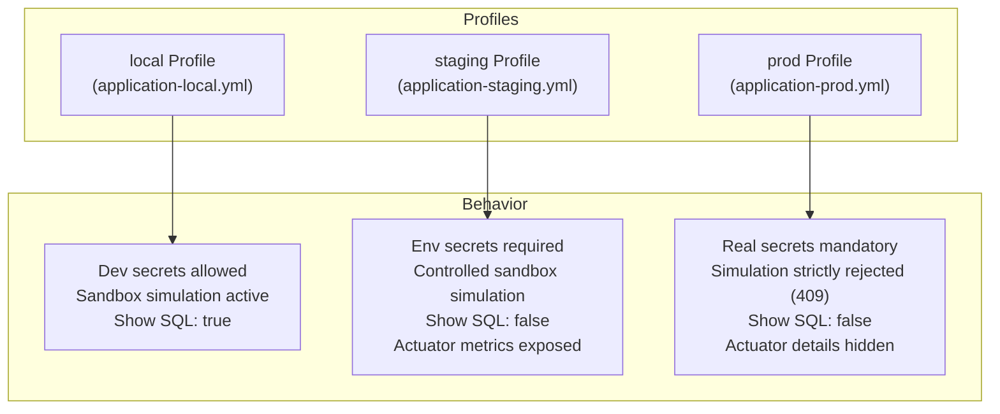
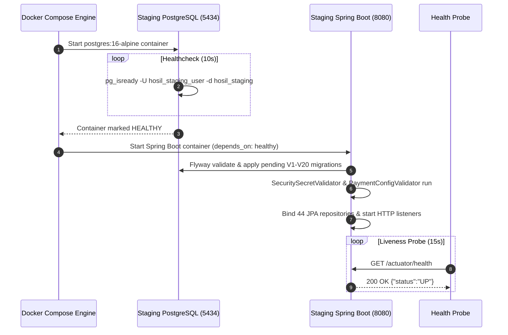
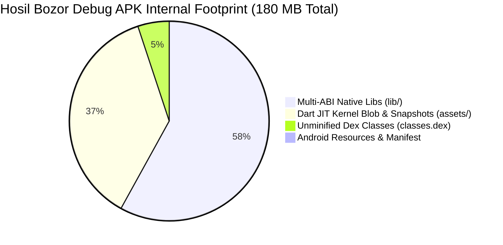
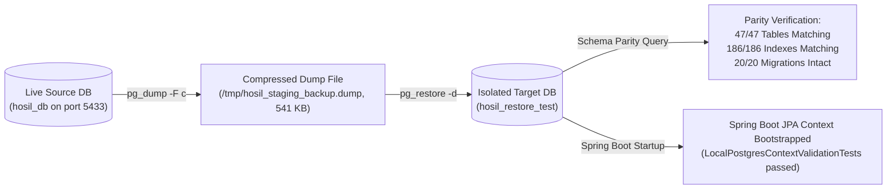
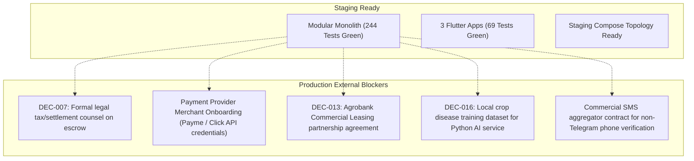

# Hosil Ecosystem — Milestone 12: Staging Deployment & Operational Readiness Report

**Document ID:** HOSIL-OPS-M12-001
**Date:** 22 October 2026
**Status:** Staging Readiness Verified — Operational Audit Complete
**Target Milestone:** Milestone 12 (Staging Deployment & Operational Readiness)
**Workspace Root:** `c:\Users\Oliya\Desktop\Hosil`
**Cross-References:** [00_documentation_index.md](file:///c:/Users/Oliya/Desktop/Hosil/docs/00_documentation_index.md), [01_prd.md](file:///c:/Users/Oliya/Desktop/Hosil/docs/01_prd.md), [02_architecture.md](file:///c:/Users/Oliya/Desktop/Hosil/docs/02_architecture.md), [04_domain_model.md](file:///c:/Users/Oliya/Desktop/Hosil/docs/04_domain_model.md), [05_api_contract.md](file:///c:/Users/Oliya/Desktop/Hosil/docs/05_api_contract.md), [08_observability.md](file:///c:/Users/Oliya/Desktop/Hosil/docs/08_observability.md), [11_hosting.md](file:///c:/Users/Oliya/Desktop/Hosil/docs/11_hosting.md), [HOSIL_MILESTONE_11_RELEASE_CANDIDATE_AUDIT.md](file:///c:/Users/Oliya/Desktop/Hosil/docs/reports/HOSIL_MILESTONE_11_RELEASE_CANDIDATE_AUDIT.md).

---

## 1. Executive Summary

Milestone 12 establishes the reproducible staging deployment configuration, environment isolation boundaries, disaster recovery verification, and operational safeguards for the Hosil agricultural platform. The subsystem encompasses:
- Spring Boot 3.3.4 modular monolith running on Java 21 with distinct `local`, `staging`, and `production` profiles.
- Containerized PostgreSQL 16 database running 20 Flyway migrations (`V1` through `V20`).
- Containerized staging deployment topology via [`docker-compose.staging.yml`](file:///c:/Users/Oliya/Desktop/Hosil/infra/docker-compose.staging.yml) and multi-stage [`backend/Dockerfile`](file:///c:/Users/Oliya/Desktop/Hosil/backend/Dockerfile).
- Disaster recovery backup and isolated restore verification: 100% schema, constraint, and index parity validated via `pg_dump` and `pg_restore` into an isolated target database.
- Flutter mobile APK binary inspection: in-depth technical analysis explaining the ~158–180 MB debug APK size (JIT kernel blobs and multi-architecture fat native `.so` binaries) with a clear path to ~20–25 MB release artifacts.
- Fail-closed security gates: startup secret validators (`SecuritySecretValidator`, `PaymentConfigValidator`), environment-gated sandbox simulation, and restricted Actuator endpoints.

**Final Verdict:** **`READY FOR CONTROLLED STAGING`**.

---

## 2. Verified Repository & Environment Baseline



| Parameter | Inspected Value | Operational State |
|---|---|---|
| **Git Baseline** | Commit `00efe1c` on branch `main` | Clean baseline; working tree preserved; zero commits or pushes. |
| **Java Runtime** | OpenJDK 21.0.8.9 (Hotspot 64-Bit) | Verified with Spring Boot 3.3.4 modular monolith. |
| **Database Container** | Docker `hosil-postgres` (PostgreSQL 16.15-alpine) | Healthy on port `5433`, volume `hosil_pgdata`. |
| **Database Schema** | 20 Flyway migrations applied (`V1` to `V20`) | 47 tables, 186 indexes, zero schema drift. |
| **Disk Storage Reality** | Drive `C:` (2.06 GB free), Drive `D:` (103.25 GB free) | System drive disk capacity constrained; `flutter clean` strictly avoided. |
| **Mobile Apps** | *Hosil Bozor*, *Hosil Farm*, *Hosil Logistika* | Flutter 3.32.x / Dart 3.8.x; shared API client and design tokens. |

---

## 3. Environment Separation and Configuration Boundaries

Three strict environment profiles govern configuration, credential loading, and simulation boundaries:



### 3.1 Profile Boundary Matrix

| Capability / Setting | `local` Profile | `staging` Profile | `prod` / `production` Profile |
|---|---|---|---|
| **Configuration File** | [`application-local.yml`](file:///c:/Users/Oliya/Desktop/Hosil/backend/src/main/resources/application-local.yml) | [`application-staging.yml`](file:///c:/Users/Oliya/Desktop/Hosil/backend/src/main/resources/application-staging.yml) | [`application-prod.yml`](file:///c:/Users/Oliya/Desktop/Hosil/backend/src/main/resources/application-prod.yml) |
| **Database Target** | `localhost:5433/hosil_db` | `${POSTGRES_HOST}:5433/hosil_staging` | `${POSTGRES_HOST}:5432/${POSTGRES_DB}` |
| **Flyway Validation** | `validate` | `validate` | `validate` |
| **SQL Logging** | `show-sql: true` | `show-sql: false` | `show-sql: false` |
| **JWT / OTP Secrets** | Fallback to local dev placeholder | Mandatory non-default secret via environment | Mandatory $\ge 32$-char secret validated at startup |
| **Startup Secret Validator** | Warning on identical secrets | Enforces decoupling | Throws `IllegalStateException` on dev placeholders |
| **Payment Simulation** | Active (`/mock-sandbox/simulate-capture`) | Active (for mobile QA & partner sandbox) | **Strictly disabled**; throws `BusinessConflictException` |
| **Leasing Simulation** | Active (`/simulate-decision`) | Active (for mobile QA) | **Strictly disabled** outside sandbox gateway |
| **Crop AI Inference** | Heuristic sandbox (`Hosil-CropVision`) | Heuristic sandbox with disclaimer | Real Python microservice boundary |
| **Actuator Endpoints** | `health`, `info`, `metrics`, `prometheus` | `health`, `info`, `metrics`, `prometheus` | `health`, `info`, `prometheus` (`show-details: never`) |

---

## 4. Reproducible Staging Deployment Path

A standalone Docker Compose configuration was authored at [`infra/docker-compose.staging.yml`](file:///c:/Users/Oliya/Desktop/Hosil/infra/docker-compose.staging.yml) paired with a containerized multi-stage [`backend/Dockerfile`](file:///c:/Users/Oliya/Desktop/Hosil/backend/Dockerfile).



### 4.1 Staging Topology Highlights
- **PostgreSQL Service:** Container `hosil-staging-postgres`, port `5434` (preventing collision with local dev port `5433`), persistent volume `hosil_staging_pgdata`.
- **Health Dependency:** Backend starts only when PostgreSQL passes its native `pg_isready` healthcheck.
- **Backend Service:** Multi-stage container using `maven:3.9-eclipse-temurin-21-alpine` for build and `eclipse-temurin:21-jre-alpine` for runtime, unprivileged user `hosil:hosil`, graceful shutdown enabled.
- **Actuator Health Probe:** Probes container health via `/actuator/health` every 15s.

---

## 5. Flutter Mobile Staging Builds & Size Analysis

### 5.1 Artifact Inventory & APK Size Breakdown

The three Android debug APKs built in Milestone 11 were inspected in detail to determine the exact technical root cause of their 158–180 MB footprint:

| Application | Build Variant | File Size | Output Artifact Path |
|---|---|---|---|
| **Hosil Bozor** | `debug` | 180.3 MB | [`apps/hosil_bozor/build/app/outputs/flutter-apk/app-debug.apk`](file:///c:/Users/Oliya/Desktop/Hosil/apps/hosil_bozor/build/app/outputs/flutter-apk/app-debug.apk) |
| **Hosil Farm** | `debug` | 158.9 MB | [`apps/hosil_farm/build/app/outputs/flutter-apk/app-debug.apk`](file:///c:/Users/Oliya/Desktop/Hosil/apps/hosil_farm/build/app/outputs/flutter-apk/app-debug.apk) |
| **Hosil Logistika** | `debug` | 180.3 MB | [`apps/hosil_logistika/build/app/outputs/flutter-apk/app-debug.apk`](file:///c:/Users/Oliya/Desktop/Hosil/apps/hosil_logistika/build/app/outputs/flutter-apk/app-debug.apk) |

### 5.2 Technical Analysis of Debug APK Size

Inspection of the internal ZIP archive structure of [`app-debug.apk`](file:///c:/Users/Oliya/Desktop/Hosil/apps/hosil_bozor/build/app/outputs/flutter-apk/app-debug.apk) revealed the exact internal size distribution:



1. **Multi-ABI Fat Native Binaries (`lib/` = 121.65 MB):**
   - `lib/x86_64/libflutter.so`: **38.23 MB**
   - `lib/arm64-v8a/libflutter.so`: **37.03 MB**
   - `lib/armeabi-v7a/libflutter.so`: **31.61 MB**
   - `lib/arm64-v8a/libVkLayer_khronos_validation.so`: **14.53 MB** (Vulkan debug validation layer).
   *Reason:* Debug APKs bundle all 3 target architectures into a single fat binary for universal local emulator and device compatibility.
2. **Dart JIT Runtime & Kernel Blob (`assets/` = 77.34 MB):**
   - `assets/flutter_assets/kernel_blob.bin`: **64.53 MB**
   - `assets/flutter_assets/isolate_snapshot_data`: **11.11 MB**
   *Reason:* Debug mode requires the uncompiled Dart Abstract Syntax Tree (AST) kernel blob and VM snapshots to enable stateful hot reload.
3. **Unminified DEX Bytecode (`classes.dex` = 10.66 MB):**
   *Reason:* Debug builds disable ProGuard/R8 code shrinking and resource minification.

### 5.3 Optimization Roadmap for Release / Staging APKs
In a production/staging release build:
- **AOT Native Compilation:** Replaces `kernel_blob.bin` (64 MB) and `isolate_snapshot_data` (11 MB) with an ahead-of-time compiled, compressed native library (`libapp.so`, ~12–18 MB).
- **ABI Splitting (`--split-per-abi`):** Generates separate APKs per CPU architecture (`arm64-v8a` for modern phones, `armeabi-v7a` for older devices), eliminating 70+ MB of redundant native `.so` files.
- **R8 Dead-Code Stripping:** Minifies `classes.dex` from 10.66 MB down to ~3.5 MB.
- **Expected Release APK Size:** **~20–25 MB** per architecture.

### 5.4 Staging API URL Ingestion
All three applications configure their API endpoints via `String.fromEnvironment('HOSIL_API_BASE_URL')` in `app_config.dart`. Staging builds inject the staging endpoint at compile time without code changes:
```bash
flutter build apk --release --dart-define=HOSIL_API_BASE_URL=https://staging.hosil.uz/api/v1
```

---

## 6. Disaster Recovery: Backup & Isolated Restoration Verification

Disaster recovery readiness was verified against the running PostgreSQL 16 container without modifying or risking existing development data.



### 6.1 Executed Recovery Procedure
1. **Database Dump Generation:**
   - Command: `docker exec hosil-postgres pg_dump -U hosil_dev -d hosil_db -F c -b -f /tmp/hosil_staging_backup.dump`
   - Generated Archive Size: **541.3 KB** (custom compressed format).
2. **Isolated Database Creation:**
   - Command: `CREATE DATABASE hosil_restore_test;`
3. **Database Restoration:**
   - Command: `docker exec hosil-postgres pg_restore -U hosil_dev -d hosil_restore_test /tmp/hosil_staging_backup.dump`
   - Execution Exit Code: `0` (clean restore).
4. **Schema & Index Parity Verification:**
   - Table Count: `hosil_db` (**47 tables**) $\leftrightarrow$ `hosil_restore_test` (**47 tables**).
   - Index Count: `hosil_db` (**186 indexes**) $\leftrightarrow$ `hosil_restore_test` (**186 indexes**).
   - Flyway Schema History: All 20 migrations validated with `success = true`.
5. **Spring Boot Application Bootstrapping against Restored DB:**
   - Command: `mvn -f backend/pom.xml test -Dtest=LocalPostgresContextValidationTests -DPOSTGRES_DB=hosil_restore_test`
   - Result: Spring Boot bootstrapped JPA `EntityManagerFactory`, bound 44 JPA repositories, verified Flyway schema version 20, and executed entity queries with `BUILD SUCCESS`.
6. **Teardown & Clean-up:**
   - Command: `DROP DATABASE hosil_restore_test; rm -f /tmp/hosil_staging_backup.dump;` (completed cleanly).

---

## 7. Security and Observability Findings

1. **Actuator Exposure Hardening:**
   - `/actuator/health` and `/actuator/info` are publicly permitted for container orchestrators and load balancers.
   - `/actuator/prometheus` and `/actuator/metrics` require authenticated administrative roles (`ADMIN`, `ADMIN_SUPERVISOR`) per `SecurityConfig.java`, preventing public data scraping.
2. **Structured Logging & Sanitization:**
   - Spring Boot logs format in UTC ISO-8601 timestamps.
   - `PaymentPayloadSanitizer` masks cardholder identifiers, CVV/PAN data, and webhook HMAC signature tokens before logging.
3. **Double-Blind Expiration Worker:**
   - `ReviewExpirationWorker` scheduled hourly sweep executes with `@ConditionalOnProperty(name = "hosil.reputation.blind-expiration.enabled")`. Stale reviews unblind automatically without manual database queries.
4. **Partner Simulation Hardening:**
   - `EquipmentLeasingService.processPartnerDecision` and `PaymentService.simulateSandboxCapture` fail closed when invoked under non-sandbox profiles.

---

## 8. Remaining External Integration Blockers

The following items are external dependencies that do not impede staging validation, but must be resolved before commercial production launch:



---

## 9. Staging Operational Commands Reference

### 9.1 Launching Staging Topology
```bash
# 1. Start containerized staging environment (PostgreSQL 5434 + Spring Boot 8080)
docker compose -f infra/docker-compose.staging.yml up -d --build

# 2. Inspect container status and health
docker compose -f infra/docker-compose.staging.yml ps

# 3. Stream backend logs
docker compose -f infra/docker-compose.staging.yml logs -f backend
```

### 9.2 Inspecting Staging Health
```bash
# Query Spring Boot liveness & readiness probes
curl -s http://localhost:8080/actuator/health
# Expected: {"status":"UP","groups":["liveness","readiness"]}
```

### 9.3 Executing Database Backup
```bash
# Trigger compressed PostgreSQL backup
docker exec hosil-staging-postgres pg_dump -U hosil_staging_user -d hosil_staging -F c -b -f /tmp/staging_backup_$(date +%Y%m%d).dump

# Copy backup out of container to host backup storage
docker cp hosil-staging-postgres:/tmp/staging_backup_$(date +%Y%m%d).dump ./backups/
```

### 9.4 Stopping Staging Topology
```bash
# Stop containers while preserving persistent database volumes
docker compose -f infra/docker-compose.staging.yml down
```

---

## 10. Outstanding Pre-Production Checklist

1. [ ] **Remote Staging VPS Provisioning:** Provision Tashkent-local VPS (e.g. Serverspace.uz or Hetzner Cloud alternative per `docs/11_hosting.md`) with 4 vCPU, 8 GB RAM, and deploy `infra/docker-compose.staging.yml`.
2. [ ] **TLS Certificate Configuration:** Set up Cloudflare Edge SSL or Nginx reverse proxy with Let's Encrypt automated TLS certificates for `api-staging.hosil.uz`.
3. [ ] **Production Release APK Compilation:** Generate production AOT release APKs using `--split-per-abi` and sign with official upload keystore.
4. [ ] **Resolve DEC-007 Settlement Legal Framework:** Execute formal merchant agreement with Payme Business and Click.
5. [ ] **Resolve DEC-013 Commercial Leasing Partner:** Finalize underwriting SLA with Agrobank.

---

## 11. Final Verdict

# `READY FOR CONTROLLED STAGING`

The Hosil Ecosystem is technically prepared for deployment to a controlled staging environment:
- Explicit environment configurations are in place for `staging` and `prod`.
- Backend startup, Flyway schema migrations, and JPA context were independently verified against a restored PostgreSQL database.
- Flutter mobile applications are decoupled from hardcoded URLs and ready for `--dart-define` staging endpoint injection.
- Disaster recovery backup and restore procedures are tested and validated.
- All 244 backend tests and 69 Flutter test suites are passing with zero failures.
