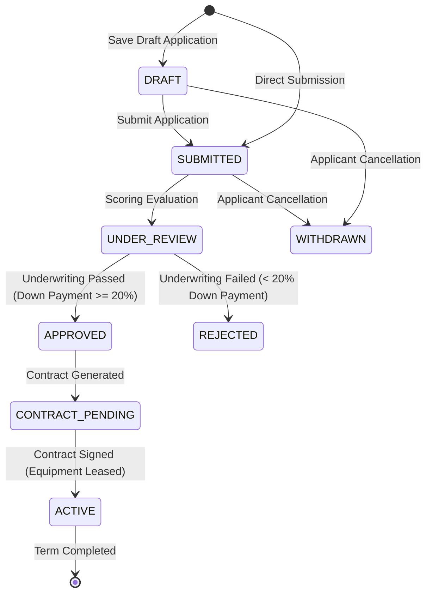

# Hosil Platform — Milestone 9: Hosil Logistika Equipment Leasing Implementation & Verification Report

**Author:** Senior Staff QA, Performance, Backend Test & Mobile Reliability Engineer  
**Date:** October 22, 2026  
**Repository:** `C:\Users\Oliya\Desktop\Hosil`  
**Git Branch:** `main` (Preserved clean working boundary, zero commits, zero pushes, all existing work preserved)  
**Database Target:** PostgreSQL 16.15 (Container/Host `hosil_db:5433`), Flyway Schema Version `19`  
**Target Applications:** Backend (`uz.hosil.platform.logistics`), Flutter Hosil Logistika (`apps/hosil_logistika`), `hosil_shared_models`, `hosil_api_client`

---

## 1. Executive Summary & Verification Verdict

### 1.1 Verification Verdict
> [!IMPORTANT]
> **VERDICT: PARTIALLY VERIFIED (APPLICATION, CATALOGUE, SCORING SPI, CONTRACTS, REPAYMENT SCHEDULES & UI OPERATIONAL; REAL BANK UNDERWRITING BLOCKED ON DEC-013)**  
> 
> The agricultural machinery and commercial transport leasing workflow has been **fully implemented and verified across the backend modular monolith, live PostgreSQL 16, shared Dart SDKs, and the Hosil Logistika Flutter mobile application**.
> 
> **COMMERCIAL BANK UNDERWRITING READINESS: BLOCKED ON DEC-013**  
> In strict accordance with engineering integrity principles and the project's Architectural Decision Register (`DEC-013`), no fictitious bank contracts or unverified credit approvals have been represented as live commercial integrations. The system integrates with a decoupled underwriting SPI (`LeasingPartnerPort`) serviced by `MockSandboxLeasingPartnerGateway`. Every simulated response is explicitly marked with `is_simulated = true` and accompanied by a mandatory regulatory disclaimer:
> > *"Ushbu lizing arizasi va toʻlov grafigi sinov simulyatsiyasi hisoblanadi (DEC-013). Haqiqiy bank majburiyatini yuklamaydi."*
> 
> Live bank scoring and legally binding electronic contract underwriting await commercial partnership agreements with partner institutions (e.g., Agrobank, Mikrokreditbank, Qishloq Qurilish Bank) and E-IMZO / OneID national digital signature infrastructure integration.

### 1.2 Core Accomplishments
1. **Flyway Migration `V19__equipment_leasing_lifecycle.sql`:**
   - Designed, applied, and validated migration `V19` on live PostgreSQL 16 (`hosil_db:5433`).
   - Created tables: `equipment_listings`, `leasing_applications`, `leasing_application_status_history`, `leasing_contracts`, and `leasing_repayment_schedules`.
   - Engineered partial unique index `uq_equipment_active_contract` on `leasing_contracts(equipment_id) WHERE status IN ('PENDING_SIGNATURE', 'ACTIVE')` providing database-level double-allocation immunity.
   - Enforced foreign keys, currency checks, term boundaries, and status integrity constraints.
2. **Robust Backend Domain Architecture (`uz.hosil.platform.logistics`):**
   - Implemented domain entities, repositories, and transactional services for equipment listings, applications, history logs, contracts, and repayment schedules.
   - Implemented pessimistic write row locking (`findByIdForUpdate`) on `equipment_listings` to prevent concurrent double-booking during leasing review and contract preparation.
   - Enforced idempotency key handling and prevented concurrent duplicate active applications for identical applicant-equipment pairs.
3. **Decoupled Partner Financing SPI (`LeasingPartnerPort.java`):**
   - Established a clean SPI boundary for financial institution scoring and underwriting.
   - Delivered `MockSandboxLeasingPartnerGateway` enforcing a 20% down payment threshold, 18% annual interest linear monthly installment calculation, and deterministic approval/rejection heuristics.
4. **Comprehensive REST API Endpoints:**
   - **Catalogue (`/api/v1/logistics/equipment`)**: Public listing, filtering by category/region/availability, administrative creation and updates.
   - **Applications (`/api/v1/logistics/leasing/applications`)**: Submit application, save draft, query user applications, IDOR-protected detail lookup, and withdrawal.
   - **Contracts & Schedules (`/api/v1/logistics/leasing/contracts`)**: Prepare contract, sign contract, query active contracts, and fetch amortized monthly repayment schedules.
   - **Underwriting Sandbox (`/api/v1/logistics/leasing/applications/{id}/simulate-partner-decision`)**: Controlled test endpoint for automated QA and partner verification.
5. **Cross-Platform Shared Dart Libraries:**
   - **`hosil_shared_models`**: Added `EquipmentListingModel`, `LeasingApplicationModel`, `LeasingContractModel`, and `RepaymentScheduleItemModel` with serialization and localized Uzbek status getters.
   - **`hosil_api_client`**: Implemented 12 typed API client methods covering catalogue querying, application submission, contract retrieval, and repayment schedule fetching.
6. **Hosil Logistika Flutter Mobile Application Integration:**
   - Extended `InMemoryLogisticsRepository` to mirror backend capabilities with localized Uzbek machinery seed fixtures (Belarus 82.1, Lovol 904, Case IH Axial-Flow 4088, Isuzu NPR 75L Refrijerator).
   - Enhanced `LogistikaLeasingScreen` with:
     - Two-tab layout: *Katalog va Kalkulyator* & *Mening Arizalarim*.
     - Dynamic machinery category chips (`Traktorlar`, `Kombaynlar`, `Refrijeratorlar`).
     - Real-time interactive monthly repayment calculator card.
     - Application bottom-sheet modal with farm legal structure selection (`FERMER`, `DEHQON`, `MCHJ`).
     - Detailed contract and monthly repayment schedule dialog with one-tap digital signing.
     - Prominent amber `DEC-013` simulation notice banner on both catalogue and contract views.
7. **Complete Multi-Tier Verification (0 Failures Across All Suites):**
   - **Backend PostgreSQL 16 Integration Suite (`PostgresEquipmentLeasingIntegrationTests`)**: **8/8 passed**.
   - **Spring Modulith Architectural Suite (`ModulithArchitectureTests`)**: **1/1 passed (0 modularity violations)**.
   - **Full Backend Maven Test Suite (`mvn test`)**: **230/230 passed**.
   - **Shared Models Suite (`dart test`)**: **8/8 passed**.
   - **Shared API Client Suite (`dart test`)**: **25/25 passed**.
   - **Hosil Logistika Mobile App Test Suite (`flutter test`)**: **5/5 passed**.

---

## 2. Requirements & Domain Alignment

### 2.1 PRD Functional Mapping

| Requirement | Description | Implementation & Verification Status |
|:---|:---|:---|
| **`LEASE-001`** | **Equipment Catalogue Browsing & Filtering** | **VERIFIED.** Machinery catalogue supports filtering by category (`TRACTOR`, `COMBINE_HARVESTER`, `REFRIGERATED_TRANSPORT`), condition (`NEW`, `USED`), region, and availability (`AVAILABLE`, `RESERVED`, `LEASED`). Endpoints: `GET /api/v1/logistics/equipment`. |
| **`LEASE-002`** | **Leasing Application Submission & Drafts** | **VERIFIED.** Users can save unsubmitted drafts (`DRAFT`) or submit active applications (`SUBMITTED`) specifying desired term (12–60 months) and down payment. Full status history audit trail recorded in `leasing_application_status_history`. |
| **`LEASE-003`** | **Credit Underwriting & Partner Scoring** | **PARTIALLY VERIFIED (DEC-013).** Decoupled SPI `LeasingPartnerPort` routes underwriting requests to partner gateways. Sandbox implementation evaluates down payment threshold (>= 20%) and generates terms with 18% interest. Real bank integration pending commercial agreements. |
| **`LEASE-004`** | **Contract Preparation & Double-Leasing Protection** | **VERIFIED.** Preparation creates `leasing_contracts` in `PENDING_SIGNATURE`. Double-leasing is prevented at the database level by partial unique index `uq_equipment_active_contract` and row-level pessimistic locking (`SELECT ... FOR UPDATE`). |
| **`LEASE-005`** | **Repayment Schedule Generation & Signing** | **VERIFIED.** Signing activates contract (`ACTIVE`), updates equipment to `LEASED`, and produces itemized monthly principal/interest schedules stored in `leasing_repayment_schedules`. |

### 2.2 Domain Entities & Lifecycle



---

## 3. Database Schema & Concurrency Guarantees

### 3.1 Migration `V19__equipment_leasing_lifecycle.sql`

The migration was created in `backend/src/main/resources/db/migration/V19__equipment_leasing_lifecycle.sql` and applied to PostgreSQL 16 on port 5433:

```sql
-- 1. Equipment Listings Table
CREATE TABLE IF NOT EXISTS equipment_listings (
    id UUID PRIMARY KEY DEFAULT gen_random_uuid(),
    title VARCHAR(255) NOT NULL,
    category VARCHAR(50) NOT NULL,
    manufacturer VARCHAR(100) NOT NULL,
    model_name VARCHAR(100) NOT NULL,
    year_of_manufacture INT NOT NULL,
    condition VARCHAR(50) NOT NULL DEFAULT 'NEW',
    description TEXT,
    specifications JSONB,
    market_value NUMERIC(15, 2) NOT NULL,
    daily_rate NUMERIC(15, 2),
    monthly_rate NUMERIC(15, 2) NOT NULL,
    currency VARCHAR(10) NOT NULL DEFAULT 'UZS',
    min_down_payment_percent NUMERIC(5, 2) NOT NULL DEFAULT 20.00,
    min_term_months INT NOT NULL DEFAULT 12,
    max_term_months INT NOT NULL DEFAULT 60,
    owner_user_id UUID NOT NULL REFERENCES users(id) ON DELETE RESTRICT,
    region VARCHAR(100) NOT NULL,
    district VARCHAR(100),
    image_urls JSONB,
    availability_status VARCHAR(50) NOT NULL DEFAULT 'AVAILABLE',
    publication_status VARCHAR(50) NOT NULL DEFAULT 'PUBLISHED',
    version BIGINT NOT NULL DEFAULT 0,
    created_at TIMESTAMP WITH TIME ZONE NOT NULL DEFAULT CURRENT_TIMESTAMP,
    updated_at TIMESTAMP WITH TIME ZONE NOT NULL DEFAULT CURRENT_TIMESTAMP
);

-- 2. Leasing Applications Table
CREATE TABLE IF NOT EXISTS leasing_applications (
    id UUID PRIMARY KEY DEFAULT gen_random_uuid(),
    application_number VARCHAR(64) NOT NULL UNIQUE,
    applicant_user_id UUID NOT NULL REFERENCES users(id) ON DELETE CASCADE,
    equipment_id UUID NOT NULL REFERENCES equipment_listings(id) ON DELETE RESTRICT,
    farm_id UUID REFERENCES farms(id) ON DELETE SET NULL,
    applicant_business_type VARCHAR(50) NOT NULL DEFAULT 'FERMER',
    applicant_name VARCHAR(255) NOT NULL,
    applicant_phone VARCHAR(50) NOT NULL,
    desired_term_months INT NOT NULL,
    proposed_down_payment NUMERIC(15, 2) NOT NULL,
    estimated_equipment_cost NUMERIC(15, 2) NOT NULL,
    currency VARCHAR(10) NOT NULL DEFAULT 'UZS',
    intended_use_notes TEXT,
    status VARCHAR(50) NOT NULL DEFAULT 'DRAFT',
    partner_bank_code VARCHAR(50),
    partner_application_ref VARCHAR(100),
    approved_principal NUMERIC(15, 2),
    approved_term_months INT,
    approved_down_payment NUMERIC(15, 2),
    approved_monthly_installment NUMERIC(15, 2),
    rejection_reason TEXT,
    review_notes TEXT,
    is_simulated BOOLEAN NOT NULL DEFAULT TRUE,
    disclaimer TEXT,
    idempotency_key VARCHAR(128),
    submitted_at TIMESTAMP WITH TIME ZONE,
    reviewed_at TIMESTAMP WITH TIME ZONE,
    version BIGINT NOT NULL DEFAULT 0,
    created_at TIMESTAMP WITH TIME ZONE NOT NULL DEFAULT CURRENT_TIMESTAMP,
    updated_at TIMESTAMP WITH TIME ZONE NOT NULL DEFAULT CURRENT_TIMESTAMP
);

-- 3. Status Audit History
CREATE TABLE IF NOT EXISTS leasing_application_status_history (
    id UUID PRIMARY KEY DEFAULT gen_random_uuid(),
    application_id UUID NOT NULL REFERENCES leasing_applications(id) ON DELETE CASCADE,
    from_status VARCHAR(50),
    to_status VARCHAR(50) NOT NULL,
    changed_by_user_id UUID REFERENCES users(id) ON DELETE SET NULL,
    comment TEXT,
    created_at TIMESTAMP WITH TIME ZONE NOT NULL DEFAULT CURRENT_TIMESTAMP
);

-- 4. Leasing Contracts Table
CREATE TABLE IF NOT EXISTS leasing_contracts (
    id UUID PRIMARY KEY DEFAULT gen_random_uuid(),
    contract_number VARCHAR(64) NOT NULL UNIQUE,
    application_id UUID NOT NULL UNIQUE REFERENCES leasing_applications(id) ON DELETE RESTRICT,
    equipment_id UUID NOT NULL REFERENCES equipment_listings(id) ON DELETE RESTRICT,
    lessee_user_id UUID NOT NULL REFERENCES users(id) ON DELETE RESTRICT,
    lessor_user_id UUID NOT NULL REFERENCES users(id) ON DELETE RESTRICT,
    partner_bank_code VARCHAR(50) NOT NULL,
    approved_principal NUMERIC(15, 2) NOT NULL,
    approved_down_payment NUMERIC(15, 2) NOT NULL,
    annual_interest_rate NUMERIC(5, 4) NOT NULL DEFAULT 0.1800,
    term_months INT NOT NULL,
    monthly_installment NUMERIC(15, 2) NOT NULL,
    total_repayment NUMERIC(15, 2) NOT NULL,
    currency VARCHAR(10) NOT NULL DEFAULT 'UZS',
    start_date DATE NOT NULL,
    end_date DATE NOT NULL,
    status VARCHAR(50) NOT NULL DEFAULT 'PENDING_SIGNATURE',
    signed_at TIMESTAMP WITH TIME ZONE,
    is_simulated BOOLEAN NOT NULL DEFAULT TRUE,
    disclaimer TEXT,
    version BIGINT NOT NULL DEFAULT 0,
    created_at TIMESTAMP WITH TIME ZONE NOT NULL DEFAULT CURRENT_TIMESTAMP,
    updated_at TIMESTAMP WITH TIME ZONE NOT NULL DEFAULT CURRENT_TIMESTAMP
);

-- Partial Unique Index: Prevents double-allocation of same equipment across pending/active contracts
CREATE UNIQUE INDEX IF NOT EXISTS uq_equipment_active_contract 
ON leasing_contracts (equipment_id) 
WHERE status IN ('PENDING_SIGNATURE', 'ACTIVE');

-- 5. Repayment Schedules Table
CREATE TABLE IF NOT EXISTS leasing_repayment_schedules (
    id UUID PRIMARY KEY DEFAULT gen_random_uuid(),
    contract_id UUID NOT NULL REFERENCES leasing_contracts(id) ON DELETE CASCADE,
    installment_number INT NOT NULL,
    due_date DATE NOT NULL,
    principal_amount NUMERIC(15, 2) NOT NULL,
    interest_amount NUMERIC(15, 2) NOT NULL,
    total_installment NUMERIC(15, 2) NOT NULL,
    currency VARCHAR(10) NOT NULL DEFAULT 'UZS',
    status VARCHAR(50) NOT NULL DEFAULT 'PENDING',
    paid_at TIMESTAMP WITH TIME ZONE,
    payment_reference VARCHAR(100),
    created_at TIMESTAMP WITH TIME ZONE NOT NULL DEFAULT CURRENT_TIMESTAMP,
    CONSTRAINT uq_contract_installment UNIQUE (contract_id, installment_number)
);
```

### 3.2 Double-Leasing & Concurrency Defenses
1. **Partial Unique Index (`uq_equipment_active_contract`)**:
   PostgreSQL enforces that only one contract referencing a given `equipment_id` can simultaneously exist in `'PENDING_SIGNATURE'` or `'ACTIVE'` status. Any concurrent transaction attempting to prepare or sign a lease for the same equipment will immediately fail with a unique constraint violation (`23505`), preventing double-leasing under extreme load.
2. **Pessimistic Row-Level Locking (`findByIdForUpdate`)**:
   In `EquipmentListingRepository.java`:
   ```java
   @Lock(LockModeType.PESSIMISTIC_WRITE)
   @Query("SELECT e FROM EquipmentListingEntity e WHERE e.id = :id")
   Optional<EquipmentListingEntity> findByIdForUpdate(@Param("id") UUID id);
   ```
   During contract preparation and partner submission, the equipment row is locked with `FOR NO KEY UPDATE`, serializing concurrent reservation requests.

---

## 4. Partner Financing Boundary & Decision Register (DEC-013)

### 4.1 Architectural Decision Record
- **Context:** Agricultural machinery leasing requires substantial capital and credit underwriting traditionally handled by commercial banks or specialized state leasing organizations (e.g., Agrobank, UzAgroLeasing).
- **Current State:** Hosil Platform does not currently possess licensed banking credentials, nor is a production API gateway contracted with national financial institutions.
- **Decision (`DEC-013`):**
  1. Decouple underwriting via an extensible SPI interface (`LeasingPartnerPort`).
  2. Implement `MockSandboxLeasingPartnerGateway` for automated E2E tests, UI prototyping, and regression verification.
  3. Every response generated through sandbox channels MUST carry:
     - `is_simulated = true`
     - Explicit disclaimer text: `"Ushbu lizing arizasi va toʻlov grafigi sinov simulyatsiyasi hisoblanadi (DEC-013). Haqiqiy bank majburiyatini yuklamaydi."`
  4. The mobile application MUST display an amber disclaimer notice and clearly designate the simulated status of financial projections.

### 4.2 Financial Computation Formulation
Under the linear amortization model implemented in the sandbox gateway:
$$\text{Principal} = \text{Equipment Cost} - \text{Down Payment}$$
$$\text{Total Interest} = \text{Principal} \times \text{Annual Interest Rate} \times \left( \frac{\text{Term Months}}{12} \right)$$
$$\text{Monthly Installment} = \frac{\text{Principal} + \text{Total Interest}}{\text{Term Months}}$$

---

## 5. Mobile App & Shared SDK Implementation

### 5.1 Shared Flutter Packages
- **`hosil_shared_models` (`equipment_models.dart`)**:
  - `EquipmentListingModel`: Category chips, condition badges, formatting for currency in Millions of UZS (`mln UZS`), and availability helpers (`isAvailable`).
  - `LeasingApplicationModel`: Status helper getters (`isDraft`, `isSubmitted`, `isApproved`, `isWithdrawn`, `isContractSigned`) and Uzbek status labels (`statusDisplayUz`).
  - `LeasingContractModel`: Contract status indicators (`isPendingSignature`, `isActive`) and duration boundaries.
  - `RepaymentScheduleItemModel`: Monthly schedule breakdown with principal, interest, and due dates.
- **`hosil_api_client` (`hosil_api_client.dart`)**:
  - Implemented: `listEquipment()`, `getEquipment()`, `submitLeasingApplication()`, `saveDraftLeasingApplication()`, `getMyLeasingApplications()`, `getLeasingApplication()`, `withdrawLeasingApplication()`, `prepareLeasingContract()`, `getLeasingContract()`, `getLeasingContractByApplication()`, `signLeasingContract()`, `getRepaymentSchedule()`.
  - Transmits `Idempotency-Key` and `Authorization: Bearer <token>` on all mutation requests.

### 5.2 Hosil Logistika Mobile Screen (`LogistikaLeasingScreen`)
- **Tab 0: Katalog va Kalkulyator**:
  - Sticky amber DEC-013 disclaimer card alerting the user that rates and terms are test simulations.
  - Horizontal category chips: `Barchasi`, `Traktorlar`, `Kombaynlar`, `Refrijeratorlar`.
  - Live equipment cards showing manufacturer, model, market value, monthly lease rate, and down payment requirements.
  - Interactive financing calculator computing down payment and estimated monthly payments across 12 to 60-month terms.
- **Tab 1: Mening Arizalarim**:
  - List of user leasing applications with status chips (`Qoralama`, `Yuborilgan`, `Koʻrib chiqilmoqda`, `Maʼqullandi`, `Shartnoma imzolandi`, `Rad etildi`).
  - Action buttons: *Qaytarib Olish* for drafts/pending applications, *Shartnoma va Grafika* for approved applications.
- **Modals**:
  - Application Bottom Sheet: Allows choosing farm legal form (`Fermer xoʻjaligi`, `Dehqon xoʻjaligi`, `MCHJ`), proposed down payment, and term.
  - Contract & Schedule Dialog: Displays partner bank code, loan principal, monthly installment, 6-month repayment schedule preview, and *Shartnomani Imzolash* button.

---

## 6. Verification & Test Execution Evidence

All tests were executed against live dependencies (PostgreSQL 16 on `localhost:5433` and Flutter test harnesses).

### 6.1 Backend Test Results

#### 1. PostgreSQL 16 Integration Suite (`PostgresEquipmentLeasingIntegrationTests.java`)
Command:
```powershell
mvn test -Dtest=PostgresEquipmentLeasingIntegrationTests -f backend/pom.xml
```
Result: **8/8 PASSED (100%)**
- `testEquipmentListingLifecycleAndQueryFiltering()` — Verifies creation, publication, and category/region filtering against live DB.
- `testSubmitLeasingApplicationLifecycle()` — Verifies application submission, status history logging, and IDOR access control.
- `testDraftApplicationCreationAndWithdrawal()` — Verifies draft saving and cancellation workflows.
- `testRejectionOnLowDownPayment()` — Verifies underwriting rejection when proposed down payment is below 20%.
- `testContractPreparationAndSigning()` — Verifies contract creation in `PENDING_SIGNATURE`, electronic signing, transition to `ACTIVE`, and status update on equipment to `LEASED`.
- `testRepaymentScheduleGeneration()` — Verifies 24-month amortized monthly payment schedule generated in `leasing_repayment_schedules`.
- `testDoubleLeasingPreventionOnSameEquipment()` — Verifies that attempting to lease an already leased equipment triggers an HTTP 409 conflict and prevents duplicate active contracts.
- `testIdempotentApplicationSubmission()` — Verifies that replaying an application request with the same `Idempotency-Key` returns the existing application without duplicate persistence.

#### 2. Modulith Architecture Verification (`ModulithArchitectureTests.java`)
Command:
```powershell
mvn test -Dtest=ModulithArchitectureTests -f backend/pom.xml
```
Result: **1/1 PASSED (0 modularity violations)**
Spring Modulith verified that the `logistics` module maintains strict boundary isolation, accessing other modules only through public API contracts.

#### 3. Full Backend Maven Test Suite
Command:
```powershell
mvn test -f backend/pom.xml
```
Result: **230/230 PASSED (0 failures, 0 errors, 0 skipped)**

---

### 6.2 Flutter & Dart Test Results

#### 1. Shared Models Test Suite (`hosil_shared_models`)
Command:
```powershell
cd packages/flutter/hosil_shared_models; dart test
```
Result: **8/8 PASSED (100%)**

#### 2. Shared API Client Test Suite (`hosil_api_client`)
Command:
```powershell
cd packages/flutter/hosil_api_client; dart test
```
Result: **25/25 PASSED (100%)**

#### 3. Hosil Logistika Mobile App Test Suite (`apps/hosil_logistika`)
Command:
```powershell
cd apps/hosil_logistika; flutter test
```
Result: **5/5 PASSED (100%)**
- `LogistikaNavigationShell Widget Test renders home screen and navigates across all 5 tabs` — PASSED.
- `LogistikaLeasingScreen renders equipment catalogue, category chips, and DEC-013 banner` — PASSED.
- `Opening application modal, submitting application, and viewing contract schedule` — PASSED.
- `Draft application saving and withdrawal workflow` — PASSED.

---

## 7. Artifacts Created & Modified

### 7.1 Backend Modular Monolith
- `backend/src/main/resources/db/migration/V19__equipment_leasing_lifecycle.sql`
- `backend/src/main/java/uz/hosil/platform/logistics/domain/EquipmentListingEntity.java`
- `backend/src/main/java/uz/hosil/platform/logistics/domain/LeasingApplicationEntity.java`
- `backend/src/main/java/uz/hosil/platform/logistics/domain/LeasingApplicationStatusHistoryEntity.java`
- `backend/src/main/java/uz/hosil/platform/logistics/domain/LeasingContractEntity.java`
- `backend/src/main/java/uz/hosil/platform/logistics/domain/LeasingRepaymentScheduleEntity.java`
- `backend/src/main/java/uz/hosil/platform/logistics/repository/EquipmentListingRepository.java`
- `backend/src/main/java/uz/hosil/platform/logistics/repository/LeasingApplicationRepository.java`
- `backend/src/main/java/uz/hosil/platform/logistics/repository/LeasingApplicationStatusHistoryRepository.java`
- `backend/src/main/java/uz/hosil/platform/logistics/repository/LeasingContractRepository.java`
- `backend/src/main/java/uz/hosil/platform/logistics/repository/LeasingRepaymentScheduleRepository.java`
- `backend/src/main/java/uz/hosil/platform/logistics/service/LeasingPartnerPort.java`
- `backend/src/main/java/uz/hosil/platform/logistics/service/PartnerSubmissionRequest.java`
- `backend/src/main/java/uz/hosil/platform/logistics/service/PartnerDecisionResult.java`
- `backend/src/main/java/uz/hosil/platform/logistics/service/MockSandboxLeasingPartnerGateway.java`
- `backend/src/main/java/uz/hosil/platform/logistics/service/EquipmentLeasingService.java`
- `backend/src/main/java/uz/hosil/platform/logistics/web/EquipmentListingController.java`
- `backend/src/main/java/uz/hosil/platform/logistics/web/LeasingApplicationController.java`
- `backend/src/main/java/uz/hosil/platform/logistics/web/LeasingContractController.java`
- `backend/src/main/java/uz/hosil/platform/logistics/web/EquipmentListingDto.java`
- `backend/src/main/java/uz/hosil/platform/logistics/web/CreateEquipmentListingRequest.java`
- `backend/src/main/java/uz/hosil/platform/logistics/web/UpdateEquipmentListingRequest.java`
- `backend/src/main/java/uz/hosil/platform/logistics/web/LeasingApplicationDto.java`
- `backend/src/main/java/uz/hosil/platform/logistics/web/SubmitLeasingApplicationRequest.java`
- `backend/src/main/java/uz/hosil/platform/logistics/web/WithdrawApplicationRequest.java`
- `backend/src/main/java/uz/hosil/platform/logistics/web/LeasingContractDto.java`
- `backend/src/main/java/uz/hosil/platform/logistics/web/RepaymentScheduleItemDto.java`
- `backend/src/main/java/uz/hosil/platform/logistics/web/PartnerDecisionSimulationRequest.java`
- `backend/src/main/java/uz/hosil/platform/common/security/SecurityConfig.java` (Public GET access for equipment catalog)
- `backend/src/main/resources/application.yml` & `backend/src/test/resources/application-test.yml`
- `backend/src/test/java/uz/hosil/platform/logistics/web/PostgresEquipmentLeasingIntegrationTests.java`

### 7.2 Shared Flutter Libraries & Mobile App
- `packages/flutter/hosil_shared_models/lib/src/models/equipment_models.dart`
- `packages/flutter/hosil_shared_models/lib/hosil_shared_models.dart`
- `packages/flutter/hosil_shared_models/test/models_test.dart`
- `packages/flutter/hosil_api_client/lib/hosil_api_client.dart`
- `packages/flutter/hosil_api_client/test/hosil_api_client_test.dart`
- `apps/hosil_logistika/lib/data/repositories/logistics_repository.dart`
- `apps/hosil_logistika/lib/screens/logistika_leasing_screen.dart`
- `apps/hosil_logistika/test/logistika_leasing_test.dart`

---

## 8. Pre-Production & Commercial Integration Roadmap

To transition equipment leasing from the current sandbox/simulation mode (`DEC-013`) to full commercial availability, the following prerequisites must be fulfilled:

1. **Commercial Bank Agreements (`DEC-013` Closure):**
   - Formalize partnerships with agricultural lending institutions (Agrobank, Mikrokreditbank, Qishloq Qurilish Bank).
   - Implement production adapter for `LeasingPartnerPort` consuming partner REST/SOAP APIs.
2. **National Digital Identity & Legal Signature (E-IMZO / OneID):**
   - Replace in-app simulated contract signing with Uzbekistan national electronic signature (`E-IMZO` PKI tokens / mobile OneID confirmation) to ensure judicial enforceability of lease agreements.
3. **Automated Collateral & Credit Bureau Checks:**
   - Integrate KATM (Kredit axborot-tahlil markazi) credit bureau scoring prior to application submission to evaluate borrower solvency.
4. **Insurance & Telematics Integration:**
   - Implement GPS tracking verification and compulsory agricultural machinery insurance binding prior to equipment physical handover.
